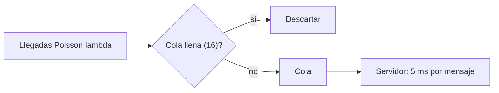

# B88-C43 — Pruebas de carga y estrés del software de vuelo

<!-- nav:top -->
[🏠 Programa](../../../../README.md) · [📚 Bloque B88](../../../tronco-comun/B88-avionica-y-software-critico-espacial.md) · [← Anterior: B88-C42 — Simuladores y mocks de sensores para pruebas](../B88-C42-simuladores-y-mocks-de-sensores-para-pruebas/CLASE.md) · [Siguiente: B88-C44 — Mantenimiento predictivo y pronóstico de salud de sistemas →](../B88-C44-mantenimiento-predictivo-y-pronostico-de-salud-de-sistemas/CLASE.md)
<!-- /nav -->

## 1. Ubicación, nivel y alcance

Clase 43 del bloque B88. Nivel N3. Las pruebas de **carga y estrés** miden cómo se comporta el software cuando la tasa de mensajes crece hasta saturarlo. Aquí simulas una cola de un servidor con servicio determinista de 5 ms y llegadas de Poisson, comparas la espera media con la teoría **M/D/1** y estudias el descarte con una cola limitada a 16 mensajes. Todo **sintético** (semilla 43). Todos los datos son **sintéticos** salvo los que se rotulan como consultados.

## 2. Por qué esta clase existe

Un sistema que funciona al 50 % de carga puede volverse inutilizable al 95 %. La decisión central: **¿a qué tasa de llegada se degrada la latencia y qué política de descarte conviene al saturarse?**

## 3. Lo que podrás hacer al terminar

1. Calcular la utilización `ρ = λ·S`.
2. Calcular la espera media M/D/1.
3. Simular y comparar con la teoría.
4. Medir percentiles de espera.
5. Medir descartes con cola limitada.
6. Separar lo sintético de lo consultado.

La evidencia es la **curva de carga frente a latencia** del ejercicio 12 (sección 20).

## 4. Con qué llegas y cómo comprobarlo

1. ¿Qué es la tasa de llegada `λ`?
2. ¿Qué es el tiempo de servicio `S`?
3. ¿Qué es la utilización?
4. ¿Qué es un proceso de Poisson?
5. ¿Qué es el descarte?

<details>
<summary>Ver respuestas</summary>

1. Mensajes por segundo. 2. El tiempo para procesar un mensaje. 3. `ρ = λS`, fracción de tiempo ocupado. 4. Llegadas independientes con tasa constante. 5. Rechazar un mensaje por falta de espacio.
</details>

Con cuatro o cinco aciertos, sigue; si no, repasa los prerrequisitos.

## 5. Un caso de contexto y casos de referencia

Servidor **sintético** con `S = 5 ms` (capacidad 200 mensajes/s). Espera media: `ρ = 0,5` → `2,50 ms` (simulado `2,49`); `ρ = 0,8` → `10,00` (`10,04`); `ρ = 0,9` → `22,5` (`22,63`). Con cola de 16: `ρ = 0,95` descarta `1,36 %`; `ρ = 1,1`, `9,41 %`; `ρ = 1,5`, `33,19 %`.

## 6. Vocabulario

La **utilización** `ρ = λS`. En **M/D/1**, `W_q = ρS/(2(1 − ρ))`. El **p99** de la espera deja el 1 % por encima. El **descarte** ocurre al estar la cola llena. La **saturación** es `ρ ≥ 1`.

## 7. Modelo mental



*Descripción textual:* las llegadas entran a la cola si hay espacio y el servidor las atiende de a una; si está llena se descartan.

Analogía: es un cajero que tarda 5 ms por cliente: con pocos clientes casi no hay fila; cerca de la capacidad, la fila crece sin parar. Límite: los clientes reales no llegan con tasa constante.

## 8. La explicación, paso a paso

### 8.1 Teoría

`W_q = ρS/(2(1 − ρ))`: para `ρ = 0,5`, `0,5×5/(2×0,5) = 2,5 ms`; `ρ = 0,8` → `10 ms`; `ρ = 0,9` → `22,5 ms`; `ρ = 0,95` → `47,5 ms`.

### 8.2 Simulación

200 000 mensajes: `1,066` (teor. `1,071`) a `ρ = 0,3`; `2,493` (`2,5`); `10,042` (`10,0`); `22,630` (`22,5`); `44,645` (`47,5`, con ruido a alta carga). El p99 crece más rápido que la media: `53,3 ms` a `ρ = 0,8` y `117 ms` a `0,9`.

### 8.3 Cola limitada

Con 16: `ρ = 0,8`: `0,03 %` descartados; `0,95`: `1,36 %`; `1,1`: `9,41 %`; `1,5`: `33,19 %`. La espera se acota en unos `75 ms` (16 × 5 ms).

### 8.4 Lectura

La espera crece sin cota cerca de `ρ = 1`; limitar la cola acota la latencia a cambio de descartar.

## 9. Magnitudes, símbolos y unidades

| Símbolo | Qué es | Unidad | Valor / nota |
|---|---|---|---|
| `S` | tiempo de servicio | ms | 5 |
| `λ` | tasa de llegada | 1/s | 60 a 300 |
| `ρ` | utilización | — | 0,3 a 1,5 |
| `W_q` | espera media | ms | 1,07 a 47,5 |
| `p99` | percentil 99 de la espera | ms | 9,4 a 199 |

## 10. Convenciones y referencias

Llegadas de Poisson, servicio determinista, una cola FIFO; cola limitada a 16 sistema incluido; 200 000 mensajes; semilla `43`. Tolerancia: simulado dentro de 10 % de la teoría para `ρ < 0,9`. Todo **sintético**.

## 11. De dónde sale lo que afirmamos

| ID | Fuente | Localizador | Respalda | Estado |
|---|---|---|---|---|
| S1 | NASA, «Software Engineering and Assurance Handbook» NASA-HDBK-2203 — https://swehb.nasa.gov/ (consultada 2026-11-10) | página de inicio | guía informativa (no de requisitos) para cumplir NPR 7150.2D y NASA-STD-8739.8B para quien adquiere, desarrolla, asegura o mantiene software de la NASA | Consultada (solo la página de inicio) |
| — | Libros de texto de sistemas de tiempo real, tolerancia a fallos y comunicaciones digitales | — | — | No consultada |
| — | Relaciones y algoritmos estándar usados por el laboratorio (fórmula de Pollaczek–Khinchine para M/D/1 y simulación de colas) | — | los verifica el laboratorio con una segunda vía o con pruebas | No consultada en una fuente concreta |

Límites: la fórmula M/D/1 es un resultado estándar de teoría de colas que no se consultó en una fuente concreta. El modelo es de un solo servidor y una sola clase de mensaje: no hay prioridades ni ráfagas. Lo simulado no se presenta como dato de vuelo ni como medición.

## 12. Cómo ver los resultados

| ρ | Wq teórica (ms) | Wq simulada (ms) | p99 simulado (ms) |
|---|---|---|---|
| 0,30 | 1,071 | 1,066 | 9,4 |
| 0,50 | 2,500 | 2,493 | 16,7 |
| 0,80 | 10,000 | 10,042 | 53,3 |
| 0,90 | 22,500 | 22,630 | 117,0 |

Descripción larga: la espera media y el p99 crecen con fuerza al acercarse a la capacidad.

## 13. Ejemplo trabajado

**Paso 1 · Utilización.** `λ = 160/s`, `S = 5 ms`: `ρ = 0,8`.

**Paso 2 · Espera.** `0,8×5/(2×0,2) = 10 ms`.

**Paso 3 · Simulación.** `10,04 ms`.

**Paso 4 · Cola limitada.** Descarte del `0,03 %`.

## 14. Distintas formas de describir el problema

**Por teoría de colas:** esta clase. **Por simulación:** esta clase. **Por banco de carga real:** exige el software. El laboratorio compara las dos primeras.

## 15. Práctica guiada

**Ejercicio 1 · con los pasos indicados.** Calcula `ρ` con `λ = 100/s` y `S = 5 ms`.

<details><summary>Solución comentada</summary>

0,5.
</details>

**Ejercicio 2 · con una pista.** Calcula `W_q` para `ρ = 0,9`.

<details><summary>Solución comentada</summary>

`0,9×5/(2×0,1) = 22,5 ms`.
</details>

**Ejercicio 3 · casi autónomo.** ¿Cuál es la capacidad máxima?

<details><summary>Solución comentada</summary>

`1/S = 200` mensajes/s.
</details>

## 16. Práctica autónoma, transferencia e integrador

**Ejercicio 4 · autónomo.** ¿Qué pasa con `ρ = 1,5`?

<details><summary>Solución comentada</summary>

Se descarta el 33,19 % y la cola está siempre llena.
</details>

**Ejercicio 5 · autónomo.** ¿Qué acota la espera con una cola de 16?

<details><summary>Solución comentada</summary>

`16 × 5 ms = 80 ms` como máximo (observado p99 ≈ 75 ms).
</details>

**Ejercicio 6 · autónomo.** ¿Por qué el p99 es mucho mayor que la media?

<details><summary>Solución comentada</summary>

Las ráfagas de llegadas forman colas largas.
</details>

**Ejercicio 7 · autónomo.** ¿Qué política de descarte protegería los mensajes críticos?

<details><summary>Solución comentada</summary>

Descartar primero los de menor prioridad.
</details>

**Ejercicio 8 · autónomo.** ¿Qué harías con `ρ = 0,95` en vuelo?

<details><summary>Solución comentada</summary>

Reducir la carga o ampliar la capacidad.
</details>

**Ejercicio 9 · transferencia.** **Transferencia.** Un colega dice que a 80 % de carga todo va bien. ¿Es válido?

<details><summary>Solución comentada</summary>

No: el p99 es 53 ms frente a una media de 10 ms.
</details>

**Ejercicio 10 · transferencia.** **Transferencia.** ¿Qué cambia si hay ráfagas en vez de Poisson?

<details><summary>Solución comentada</summary>

La espera real es mayor que la de M/D/1.
</details>

**Ejercicio 11 · transferencia.** **Transferencia.** ¿Cómo detectarías la saturación en vuelo?

<details><summary>Solución comentada</summary>

Monitoreando la longitud de cola y los descartes.
</details>

**Ejercicio 12 · integrador.** **Integrador.** Elabora tu *curva de carga frente a latencia*: teoría, simulación, p99, descarte y lista de qué es sintético.

<details><summary>Solución comentada</summary>

Secciones 8.1–8.4 y la salida del laboratorio.
</details>

## 17. Laboratorio: cola con carga creciente

El script [carga_estres.py](carga_estres.py) simula una cola M/D/1 con cinco cargas, compara con la teoría y estudia el descarte con cola de 16, y **comprueba** que el error relativo es menor que 10 % para `ρ < 0,9`.

**Datos:** llegadas y servicio **sintéticos**; semilla 43. **Predice antes de ejecutar:** ¿cuánto vale la espera media con `ρ = 0,8`? (10 ms). **Ejecución del 2026-11-10 (Python 3.12.9):**

```text
Python 3.12.9
Datos SINTETICOS: llegadas Poisson y servicio determinista de 5 ms
rho    lambda   Wq teor    Wq sim    p99 sim   (sin limite de cola)
0.30     60.0     1.071     1.066     9.414
0.50    100.0     2.500     2.493    16.745
0.80    160.0    10.000    10.042    53.256
0.90    180.0    22.500    22.630   117.002
0.95    190.0    47.500    44.645   199.456
Con cola limitada a 16 mensajes:
rho=0.80 lambda=  160.0/s  espera media =   9.935 ms  p99 =  51.725 ms  descartados =  0.03 %
rho=0.95 lambda=  190.0/s  espera media =  26.723 ms  p99 =  73.258 ms  descartados =  1.36 %
rho=1.10 lambda=  220.0/s  espera media =  52.782 ms  p99 =  74.754 ms  descartados =  9.41 %
rho=1.50 lambda=  300.0/s  espera media =  69.235 ms  p99 =  74.943 ms  descartados = 33.19 %
Capacidad maxima = 1/S = 200 mensajes/s
Pruebas superadas.
```

```bash
python programa/clases/B88/B88-C43-pruebas-de-carga-y-estres-del-software-de-vuelo/carga_estres.py
```

**Límites:** un servidor, una clase, sin ráfagas ni prioridades.

## 18. Errores frecuentes y cómo corregirlos

**Mirar solo la media.** Mide el p99 (8.2)

**Probar solo bajo la capacidad.** Prueba también `ρ ≥ 1`

**Presentar el modelo como software real.** Revisa la sección 10

## 19. Cómo sabrás que vas bien

Tras 8.2: ¿qué espera esperabas a `ρ = 0,9`? Si dudas, repasa el ejemplo 13. Tras el laboratorio: ¿qué comprueba? (ver sección 17).

## 20. Qué entregas y cómo se evalúa

El producto es tu **curva de carga frente a latencia** (ejercicio 12).

| Criterio | Inicial | En desarrollo | Logrado | Destacado |
|---|---|---|---|---|
| Conceptos | Los confunde | Parciales | Explica el método y su dominio | Explica los límites y las alternativas |
| Cálculo | Sin unidades | Con errores | Resultados con unidades y comprobados | Resuelve casos nuevos |
| Numérico | Sin comprobar | Un caso | Verifica con una segunda vía en varios casos | Interpreta las diferencias y los fallos |
| Fuentes | Sin fuente | Sin fecha | Fuentes con fecha y estado | Declara lo sintético y lo no consultado |
| Límites | No los nombra | Uno | Tres | Discute qué falta del modelo |

**Condiciones críticas (no se compensan con promedio):** rotular los datos como sintéticos; comprobar cada resultado con una segunda vía; citar solo lo consultado.

## 21. Ética, seguridad y límites

Clase educativa: los modelos son simplificados y los datos son sintéticos; ningún resultado describe una misión real, certifica conformidad con una norma ni sustituye la revisión de especialistas.  Accesibilidad: tablas equivalentes a las gráficas, fórmulas en texto, ejercicios sin conexión.

## 22. Para cerrar y seguir

La espera pasa de 2,5 ms a 22,5 ms entre `ρ = 0,5` y `0,9`, y con cola limitada la saturación se traduce en descartes. Queda una pregunta: ¿cómo se anticipa la degradación de un componente?

**Glosario español–inglés.** prueba de carga · *load test*; prueba de estrés · *stress test*; utilización · *utilization*; cola · *queue*; descarte · *drop*.

**Continuidad.** [B88-C44](../B88-C44-mantenimiento-predictivo-y-pronostico-de-salud-de-sistemas/CLASE.md) cierra el bloque con el mantenimiento predictivo y el pronóstico de salud.

**Referencias:** ver sección 11.

<!-- nav:bottom -->
---

[← Anterior: B88-C42 — Simuladores y mocks de sensores para pruebas](../B88-C42-simuladores-y-mocks-de-sensores-para-pruebas/CLASE.md) · [📚 Bloque B88](../../../tronco-comun/B88-avionica-y-software-critico-espacial.md) · [Siguiente: B88-C44 — Mantenimiento predictivo y pronóstico de salud de sistemas →](../B88-C44-mantenimiento-predictivo-y-pronostico-de-salud-de-sistemas/CLASE.md)
<!-- /nav -->
