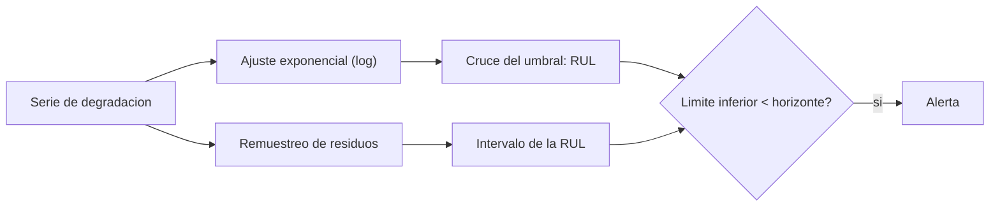

# B88-C44 — Mantenimiento predictivo y pronóstico de salud de sistemas

<!-- nav:top -->
[🏠 Programa](../../../../README.md) · [📚 Bloque B88](../../../tronco-comun/B88-avionica-y-software-critico-espacial.md) · [← Anterior: B88-C43 — Pruebas de carga y estrés del software de vuelo](../B88-C43-pruebas-de-carga-y-estres-del-software-de-vuelo/CLASE.md) · [Siguiente: B89-C01 — Electromagnetismo aplicado a enlaces →](../../../tronco-comun/B89-comunicaciones-y-navegacion-satelital.md#b89-c01)
<!-- /nav -->

## 1. Ubicación, nivel y alcance

Clase 44 del bloque B88. Nivel N3. El **pronóstico de salud** estima cuánto falta para que un componente cruce un umbral de degradación (**vida útil restante**, RUL). Aquí ajustas una degradación exponencial a una serie **sintética** de fricción de una rueda de reacción, estimas la RUL y su intervalo por **remuestreo de residuos** y ves cómo cambia la estimación con menos datos. No es telemetría real. Todos los datos son **sintéticos** salvo los que se rotulan como consultados.

## 2. Por qué esta clase existe

Detectar una falla (C12) llega tarde para planificar; anticiparla da tiempo para actuar. La decisión central: **¿cuándo cruzará el umbral y con qué incertidumbre, para decidir si alertar?**

## 3. Lo que podrás hacer al terminar

1. Ajustar un modelo exponencial por mínimos cuadrados en logaritmos.
2. Calcular el instante de cruce del umbral y la RUL.
3. Estimar un intervalo por remuestreo.
4. Ver el efecto de la cantidad de datos.
5. Definir una política de alerta con el límite inferior.
6. Separar lo sintético de lo consultado.

La evidencia es la **estimación de vida útil con intervalo** del ejercicio 12 (sección 20).

## 4. Con qué llegas y cómo comprobarlo

1. ¿Qué es una degradación exponencial?
2. ¿Qué son mínimos cuadrados?
3. ¿Qué es el logaritmo de un exponencial?
4. ¿Qué es el remuestreo (*bootstrap*)?
5. ¿Qué es un umbral de falla?

<details>
<summary>Ver respuestas</summary>

1. Un crecimiento `f(t) = a·e^(bt)`. 2. Ajustar una recta minimizando la suma de residuos al cuadrado. 3. Una recta: `ln f = ln a + b·t`. 4. Recalcular con residuos tomados al azar. 5. El valor en que el componente se considera fallado.
</details>

Con cuatro o cinco aciertos, sigue; si no, repasa los prerrequisitos.

## 5. Un caso de contexto y casos de referencia

Serie **sintética**: fricción `f = 2·e^(0,0006·t)` mN·m con ruido relativo 3 %, 75 puntos en 150 días, umbral `60 mN·m`. El ajuste da `a = 1,9958`, `b = 0,000601 /h`; la RUL estimada es `88,1` días (real `88,2`); el intervalo de remuestreo 95 % es `[86,5; 89,6]` días. Con solo 15 puntos (28 días) la estimación es `201,7` días.

## 6. Vocabulario

La **RUL** `= t_cruce − t_actual`. El **ajuste** `ln f = ln a + b·t`. El **cruce** `t = ln(umbral/a)/b`. El **remuestreo** reutiliza los residuos para reajustar. La **política de alerta** compara el límite inferior del intervalo con un horizonte.

## 7. Modelo mental



*Descripción textual:* la serie se ajusta con un modelo exponencial; el cruce del umbral da la RUL; el remuestreo da su intervalo y la política decide si alertar.

Analogía: es estimar cuándo se acabará la gasolina viendo cómo baja la aguja: con pocos kilómetros la estimación es torpe; con más datos mejora. Límite: si cambias de ruta (el modelo cambia), la estimación falla.

## 8. La explicación, paso a paso

### 8.1 Ajuste

En logaritmos, la serie es una recta. Con 75 puntos: `a = 1,9958` (real 2,0) y `b = 0,000601 /h` (real 0,0006).

### 8.2 RUL

`t_cruce = ln(60/1,9958)/0,000601 = 5666 h`. El último dato está en `3552 h` (148 días): RUL = `2114 h = 88,1` días; la verdadera es `88,2`.

### 8.3 Intervalo

Remuestreo con 2000 réplicas: `[86,5; 89,6]` días (ancho `3,1`). Este intervalo solo refleja el ruido de medida; no incluye error de modelo.

### 8.4 Pocos datos

Con los primeros 15 puntos (28 días): `201,7` días; con 30 (58 días): `183,7`; con los 75: `88,1`. Con poco recorrido, la estimación es muy optimista. La política «alertar si el límite inferior es menor de 100 días» activa la alerta (`86,5`).

## 9. Magnitudes, símbolos y unidades

| Símbolo | Qué es | Unidad | Valor / nota |
|---|---|---|---|
| `a, b` | parámetros del modelo | mN·m, 1/h | 1,9958; 0,000601 |
| `umbral` | valor de falla | mN·m | 60 |
| `RUL` | vida útil restante | d | 88,1 |
| `IC` | intervalo de remuestreo 95 % | d | [86,5; 89,6] |

## 10. Convenciones y referencias

Modelo `f = a·e^(bt)` con ruido multiplicativo gaussiano de 3 %; tiempo en horas (24 h/día); remuestreo de 2000 réplicas con semilla `44`. Tolerancia: la RUL real cae dentro del intervalo. Todo **sintético**.

## 11. De dónde sale lo que afirmamos

| ID | Fuente | Localizador | Respalda | Estado |
|---|---|---|---|---|
| S1 | NASA, «Software Engineering and Assurance Handbook» NASA-HDBK-2203 — https://swehb.nasa.gov/ (consultada 2026-11-10) | página de inicio | guía informativa (no de requisitos) para cumplir NPR 7150.2D y NASA-STD-8739.8B para quien adquiere, desarrolla, asegura o mantiene software de la NASA | Consultada (solo la página de inicio) |
| — | Libros de texto de sistemas de tiempo real, tolerancia a fallos y comunicaciones digitales | — | — | No consultada |
| — | Relaciones y algoritmos estándar usados por el laboratorio (mínimos cuadrados en logaritmos y remuestreo de residuos) | — | los verifica el laboratorio con una segunda vía o con pruebas | No consultada en una fuente concreta |

Límites: no se consultó literatura de pronóstico ni datos de ninguna rueda. Los datos se generan con el mismo modelo con que se ajustan (por eso el acierto es alto): en la realidad hay error de modelo y cambios de régimen. Lo simulado no se presenta como dato de vuelo ni como medición.

## 12. Cómo ver los resultados

| Datos usados | RUL estimada (d) |
|---|---|
| 15 puntos (28 d) | 201,7 |
| 30 puntos (58 d) | 183,7 |
| 75 puntos (148 d) | 88,1 |
| Real | 88,2 |

Descripción larga: la estimación converge a la real cuando se observa una parte mayor de la curva.

## 13. Ejemplo trabajado

**Paso 1 · Cruce.** `ln(60/1,9958)/0,000601 = 5666 h`.

**Paso 2 · Ahora.** `3552 h`.

**Paso 3 · RUL.** `2114 h = 88,1` días.

**Paso 4 · Política.** Límite inferior `86,5 < 100`: alerta.

## 14. Distintas formas de describir el problema

**Por modelo paramétrico:** esta clase. **Por filtros (Kalman, partículas):** (no consultado). **Por aprendizaje automático:** exige datos históricos. El laboratorio solo usa la primera.

## 15. Práctica guiada

**Ejercicio 1 · con los pasos indicados.** Calcula `t_cruce` con `a = 2`, `b = 0,0006` y umbral 60.

<details><summary>Solución comentada</summary>

`ln 30/0,0006 = 5669 h`.
</details>

**Ejercicio 2 · con una pista.** Convierte 2114 h a días.

<details><summary>Solución comentada</summary>

`88,1 d`.
</details>

**Ejercicio 3 · casi autónomo.** ¿Cuál es el ancho del intervalo?

<details><summary>Solución comentada</summary>

`89,6 − 86,5 = 3,1` días.
</details>

## 16. Práctica autónoma, transferencia e integrador

**Ejercicio 4 · autónomo.** ¿Qué pasa con la RUL si el umbral baja a 40?

<details><summary>Solución comentada</summary>

Cruza antes: `ln 20/0,0006 = 4993 h`; RUL = 1441 h = 60 d.
</details>

**Ejercicio 5 · autónomo.** ¿Por qué se ajusta en logaritmos?

<details><summary>Solución comentada</summary>

La exponencial se vuelve una recta y se aplican mínimos cuadrados.
</details>

**Ejercicio 6 · autónomo.** ¿Por qué 15 puntos dan una RUL optimista?

<details><summary>Solución comentada</summary>

La curva aún es casi plana: el crecimiento exponencial no se nota.
</details>

**Ejercicio 7 · autónomo.** ¿Qué política de alerta se aplicó?

<details><summary>Solución comentada</summary>

Alertar si el límite inferior de la RUL es menor de 100 días.
</details>

**Ejercicio 8 · autónomo.** ¿Qué incertidumbre no cubre el intervalo?

<details><summary>Solución comentada</summary>

El error de modelo (si la degradación no es exponencial).
</details>

**Ejercicio 9 · transferencia.** **Transferencia.** Un colega dice que el intervalo de 3 días garantiza la fecha de falla. ¿Es válido?

<details><summary>Solución comentada</summary>

No: es de datos sintéticos y del modelo asumido.
</details>

**Ejercicio 10 · transferencia.** **Transferencia.** ¿Qué cambia si hay un salto en el régimen?

<details><summary>Solución comentada</summary>

El ajuste previo deja de valer; se reajusta con los datos nuevos.
</details>

**Ejercicio 11 · transferencia.** **Transferencia.** ¿Cómo usarías esto con la tabla FDIR (C12)?

<details><summary>Solución comentada</summary>

El pronóstico alerta antes y el FDIR actúa si el umbral se cruza.
</details>

**Ejercicio 12 · integrador.** **Integrador.** Elabora tu *estimación de vida útil con intervalo*: ajuste, RUL, intervalo, efecto de los datos, política y lista de qué es sintético.

<details><summary>Solución comentada</summary>

Secciones 8.1–8.4 y la salida del laboratorio.
</details>

## 17. Laboratorio: pronóstico de salud con intervalo de remuestreo

El script [pronostico_salud.py](pronostico_salud.py) ajusta una degradación exponencial, calcula la RUL, estima su intervalo por remuestreo y la compara con 15, 30 y 75 datos, y **comprueba** que la RUL real cae en el intervalo.

**Datos:** serie **sintética**; semilla 44. **Predice antes de ejecutar:** ¿qué RUL dará el ajuste con todos los datos? (unos 88 días). **Ejecución del 2026-11-10 (Python 3.12.9):**

```text
Python 3.12.9
Datos SINTETICOS: par de friccion de una rueda de reaccion inventado (mN m), NO telemetria real
Observaciones: 75 en 150 dias ; ultimo valor = 17.210 mN m
Ajuste: a = 1.9958 (real 2.0) ; b = 0.000601 /h (real 0.0006)
Cruce del umbral 60.0 en t = 5666 h ; vida util restante = 2114 h = 88.1 dias (real 88.2 dias)
Intervalo de remuestreo 95 % de la vida restante: [86.5, 89.6] dias ; ancho = 3.1
El valor real (88.2 dias) cae dentro: True
Con los primeros  15 puntos (   28 dias): vida util estimada =   201.7 dias
Con los primeros  30 puntos (   58 dias): vida util estimada =   183.7 dias
Con los primeros  75 puntos (  148 dias): vida util estimada =    88.1 dias
Politica: alertar si el limite inferior < 100 dias -> ALERTAR (limite inferior = 86.5)
Pruebas superadas.
```

```bash
python programa/clases/B88/B88-C44-mantenimiento-predictivo-y-pronostico-de-salud-de-sistemas/pronostico_salud.py
```

**Límites:** datos generados con el mismo modelo; sin error de modelo ni cambios de régimen.

## 18. Errores frecuentes y cómo corregirlos

**Ajustar con muy pocos datos.** Mira la convergencia (8.4)

**Ignorar el error de modelo.** El intervalo no lo cubre

**Presentar los datos como telemetría.** Revisa la sección 10

## 19. Cómo sabrás que vas bien

Tras 8.4: ¿qué RUL esperabas con 15 puntos? Si dudas, repasa el ejemplo 13. Tras el laboratorio: ¿qué comprueba? (ver sección 17).

## 20. Qué entregas y cómo se evalúa

El producto es tu **estimación de vida útil con intervalo** (ejercicio 12).

| Criterio | Inicial | En desarrollo | Logrado | Destacado |
|---|---|---|---|---|
| Conceptos | Los confunde | Parciales | Explica el método y su dominio | Explica los límites y las alternativas |
| Cálculo | Sin unidades | Con errores | Resultados con unidades y comprobados | Resuelve casos nuevos |
| Numérico | Sin comprobar | Un caso | Verifica con una segunda vía en varios casos | Interpreta las diferencias y los fallos |
| Fuentes | Sin fuente | Sin fecha | Fuentes con fecha y estado | Declara lo sintético y lo no consultado |
| Límites | No los nombra | Uno | Tres | Discute qué falta del modelo |

**Condiciones críticas (no se compensan con promedio):** rotular los datos como sintéticos; comprobar cada resultado con una segunda vía; citar solo lo consultado.

## 21. Ética, seguridad y límites

Clase educativa: los modelos son simplificados y los datos son sintéticos; ningún resultado describe una misión real, certifica conformidad con una norma ni sustituye la revisión de especialistas.  Accesibilidad: tablas equivalentes a las gráficas, fórmulas en texto, ejercicios sin conexión.

## 22. Para cerrar y seguir

El ajuste recupera la degradación sintética, estima 88,1 días de vida restante con un intervalo de ±1,5 días y muestra que con pocos datos la estimación engaña. Con esto se completa el bloque B88.

**Glosario español–inglés.** pronóstico de salud · *prognostics and health management*; vida útil restante · *remaining useful life*; degradación · *degradation*; remuestreo · *bootstrap*; umbral · *threshold*.

**Continuidad.** cierra el bloque; el siguiente continúa en el área A07 con B89.

**Referencias:** ver sección 11.

<!-- nav:bottom -->
---

[← Anterior: B88-C43 — Pruebas de carga y estrés del software de vuelo](../B88-C43-pruebas-de-carga-y-estres-del-software-de-vuelo/CLASE.md) · [📚 Bloque B88](../../../tronco-comun/B88-avionica-y-software-critico-espacial.md) · [Siguiente: B89-C01 — Electromagnetismo aplicado a enlaces →](../../../tronco-comun/B89-comunicaciones-y-navegacion-satelital.md#b89-c01)
<!-- /nav -->
