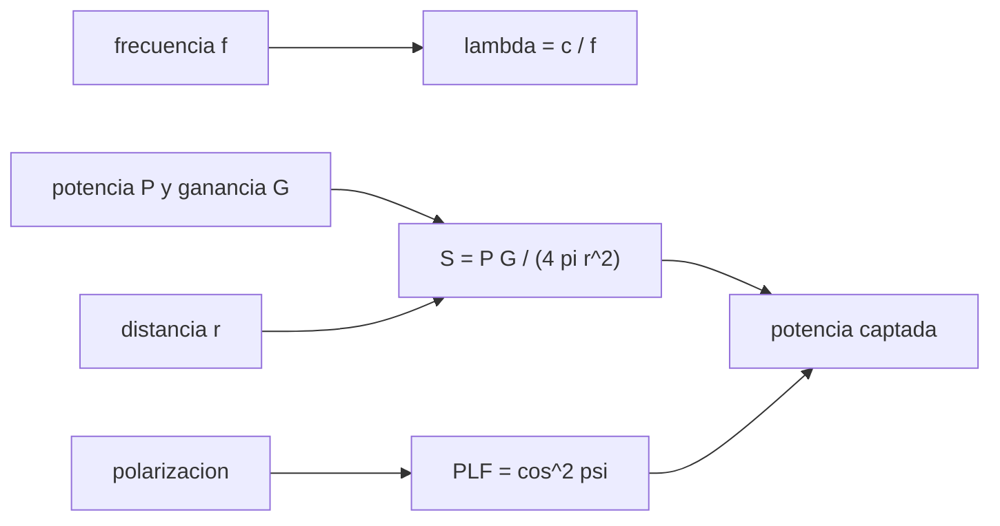

# B89-C01 — Electromagnetismo aplicado a enlaces

<!-- nav:top -->
[🏠 Programa](../../../../README.md) · [📚 Bloque B89](../../../tronco-comun/B89-comunicaciones-y-navegacion-satelital.md) · [← Anterior: B88-C44 — Mantenimiento predictivo y pronóstico de salud de sistemas](../../../tronco-comun/B88-avionica-y-software-critico-espacial.md#b88-c44) · [Siguiente: B89-C02 — Frecuencia y espectro espacial →](../B89-C02-frecuencia-y-espectro-espacial/CLASE.md)
<!-- /nav -->

## 1. Ubicación, nivel y alcance

Clase 1 del bloque B89, nivel N3. Un enlace espacial es, físicamente, una onda electromagnética que se propaga por el vacío entre dos antenas. Aquí fijas lo mínimo de electromagnetismo que el resto del bloque necesita: la relación `λ = c/f`, la densidad de flujo de potencia y su caída con el cuadrado de la distancia, y la polarización. La clase es autocontenida y solo supone óptica y electromagnetismo de primer ciclo. Todos los parámetros del enlace son sintéticos.

## 2. Por qué esta clase existe

Todo presupuesto de enlace, toda antena y toda banda parten de la misma onda. Confundir longitud de onda con frecuencia, o potencia con densidad de flujo, rompe los cálculos de las clases siguientes. La decisión central: **¿qué parte de la potencia transmitida llega por unidad de área al receptor y cuánto de ella puede aprovechar una antena según la polarización?**

## 3. Lo que podrás hacer al terminar

1. Calcular la longitud de onda de una portadora a partir de su frecuencia con `λ = c/f`.
2. Calcular la densidad de flujo de potencia `S = P·G/(4π r²)` y expresarla en W/m² y dBW/m².
3. Comprobar la ley del inverso del cuadrado de la distancia.
4. Calcular la pérdida por polarización entre dos antenas lineales desalineadas.
5. Distinguir los casos circular–circular, circular–lineal y lineal–lineal.
6. Rotular lo consultado (`c`) frente a lo sintético (potencia, ganancia, distancia).

La evidencia es la **ficha de flujo y polarización de un enlace sintético** del ejercicio 12 (sección 20).

## 4. Con qué llegas y cómo comprobarlo

1. ¿Qué es una onda electromagnética y qué relaciona su frecuencia con su longitud de onda?
2. ¿Qué es una densidad de flujo de potencia?
3. ¿Qué es un decibel?
4. ¿Qué es la polarización?
5. ¿Qué es un dato sintético?

<details>
<summary>Ver respuestas</summary>

1. Una perturbación de campos eléctrico y magnético; en el vacío `λ f = c`. 2. Potencia por unidad de área, en W/m². 3. Una razón expresada como `10 log10` de la razón de potencias. 4. La orientación del campo eléctrico de la onda. 5. Un dato inventado para el ejemplo, no medido.
</details>

Con cuatro o cinco aciertos, sigue; si no, repasa los prerrequisitos.

## 5. Un caso de contexto y casos de referencia

Un transmisor sintético de 20 W con una antena de 30 dBi produce a 1000 km una densidad de flujo de `1.592e-09 W/m²` (-87,98 dBW/m²). A 2000 km baja a la cuarta parte. Es el **ejemplo conductor**: ninguna cifra describe una misión real.

## 6. Vocabulario

La **longitud de onda** `λ = c/f` es la distancia entre crestas. La **densidad de flujo de potencia** `S` es la potencia por unidad de área. La **ganancia** `G` de una antena compara su densidad de flujo en la dirección de máximo con la de una antena isótropa. La **polarización** es la orientación del campo eléctrico. El **factor de pérdida por polarización** (PLF) de dos antenas lineales con desalineación `ψ` es `cos²ψ`. El **campo lejano** es la región donde la onda es localmente plana y `S` decae como `1/r²`.

## 7. Modelo mental: una linterna que reparte su luz sobre una esfera



*Descripción textual:* la frecuencia da la longitud de onda; la potencia, la ganancia y la distancia dan la densidad de flujo; la polarización fija qué fracción capta la antena receptora.

Analogía: una linterna reparte la misma luz sobre una esfera cada vez mayor; al duplicar el radio, el área se cuadruplica. Límite: vale en el vacío y en campo lejano; cerca de la antena o con medio absorbente el modelo cambia.

## 8. La explicación, paso a paso

### 8.1 Longitud de onda

Con `c = 299 792 458 m/s` (exacta): UHF 401 MHz → `λ = 74,8 cm`; S 2,2 GHz → `13,63 cm`; X 8,4 GHz → `3,57 cm`; Ka 32 GHz → `0,937 cm`. A mayor frecuencia, antenas físicamente más pequeñas para la misma ganancia.

### 8.2 Densidad de flujo

`S = P G/(4π r²)` con `P = 20 W`, `G = 1000` (30 dBi) y `r = 10⁶ m` da `1.5915e-09 W/m²`, es decir `-87,98 dBW/m²`. La razón `S(r)/S(2r)` vale `4,0000`.

### 8.3 Polarización

Con dos lineales desalineadas, `PLF = cos²ψ`: 30° → 0,7500 (-1,25 dB); 45° → 0,5000 (-3,01 dB); 60° → 0,2500 (-6,02 dB). Una antena circular que recibe de una lineal (o al revés) pierde `-3,01 dB` sin importar el ángulo.

### 8.4 Qué cambia y qué no

La longitud de onda depende solo de `f`; `S` depende de `r` pero no de `f` en el vacío (la frecuencia entra después, vía la apertura efectiva de la antena receptora). Por eso a igual potencia y ganancia la densidad de flujo es la misma en UHF y en Ka.

## 9. Magnitudes, símbolos y unidades

| Símbolo | Qué es | Unidad | Valor / nota |
|---|---|---|---|
| `c` | velocidad de la luz | m/s | 299 792 458 (exacta) |
| `f` | frecuencia | Hz | 401e6 a 32e9 |
| `λ` | longitud de onda | m | 0,1363 (S) |
| `P` | potencia transmitida | W | 20 (sintético) |
| `G` | ganancia de la antena | adimensional / dBi | 1000 / 30 dBi (sintético) |
| `S` | densidad de flujo | W/m² | 1.592e-09 |
| `ψ` | desalineación de polarización | grados | 0 a 85 |

## 10. Convenciones y referencias

Vacío, campo lejano, onda plana, ondas monocromáticas. Distancias en metros; frecuencias en hercios; decibelios con `10 log10` para potencias. Potencia, ganancia y distancia son sintéticas; `c` es la constante exacta del SI (CODATA 2022). Sin atmósfera, sin ionosfera, sin rotación de Faraday.

## 11. De dónde sale lo que afirmamos

| ID | Fuente | Localizador | Respalda | Estado |
|---|---|---|---|---|
| S1 | NIST, CODATA 2022: velocidad de la luz en el vacio — https://physics.nist.gov/cgi-bin/cuu/Value?c (consultada 2026-11-10) | valor de la pagina | c = 299 792 458 m/s (exacta) | Consultada |
| — | Relaciones estándar (`λ = c/f`, ley del inverso del cuadrado, `PLF = cos²ψ`) | — | las verifica el laboratorio con una segunda vía | No consultada en una fuente concreta |

Límites: la potencia, la ganancia, la distancia y los ángulos son sintéticos; no se consultó ningún texto de antenas; la ley de Friis se trata en [B89-C04](../B89-C04-propagacion-y-perdidas-de-espacio-libre/CLASE.md).

## 12. Cómo ver la onda y su flujo

| Magnitud | Valor |
|---|---|
| `λ` en S (2,2 GHz) | 13,63 cm |
| `S` a 1000 km | 1.592e-09 W/m² |
| `S` a 1000 km, en dB | -87,98 dBW/m² |
| `S(r)/S(2r)` | 4,0000 |
| PLF a 45° | -3,01 dB |

Descripción larga: la longitud de onda decrece con la frecuencia, la densidad de flujo cae 6,02 dB cada vez que se duplica la distancia y la polarización lineal desalineada 45° cuesta 3,01 dB.

## 13. Ejemplo trabajado: el flujo a 2000 km

**Paso 1 · Potencia por ganancia.** `P G = 20 × 1000 = 2,0 × 10⁴ W`

**Paso 2 · Área de la esfera.** `4π r² = 4π (2 × 10⁶)² = 5,0265 × 10¹³ m²`

**Paso 3 · Cociente.** `S = 2,0 × 10⁴/5,0265 × 10¹³ = 3.9789e-10 W/m²`

**Paso 4 · Comparación.** Es la cuarta parte de `1.5915e-09 W/m²`: la razón es `4,0000`.

## 14. Distintas formas de describir un enlace electromagnético

**Por frecuencia:** `f`. **Por longitud de onda:** `λ`. **Por flujo:** `S`, en W/m² o dBW/m². **Por polarización:** lineal, circular a derecha o a izquierda, con su factor de pérdida.

## 15. Práctica guiada

**Ejercicio 1 · con los pasos indicados.** Calcula `λ` en banda X (8,4 GHz). *Pasos:* divide `c` por `f`.

<details><summary>Solución comentada</summary>

`299 792 458/8,4e9 = 0,03569 m = 3,57 cm`.
</details>

**Ejercicio 2 · con una pista.** Predice `S` a 4000 km con la razón de distancias. *Pista:* cuadrado inverso.

<details><summary>Solución comentada</summary>

Hay un factor 4² = 16: `1.5915e-09/16 = 9.9472e-11 W/m²`.
</details>

**Ejercicio 3 · casi autónomo.** ¿Por qué `S` no depende de `f` en el vacío?

<details><summary>Solución comentada</summary>

Porque en `S = P G/(4π r²)` no aparece `f`; mira qué variables entran. La frecuencia aparecerá en la apertura de la antena receptora.
</details>

## 16. Práctica autónoma, transferencia e integrador

**Ejercicio 4 · autónomo.** `S` en dBW/m² si la potencia sube a 40 W con la misma ganancia y distancia.

<details><summary>Solución comentada</summary>

Se suman `10 log10 2 = 3,01 dB`: `-84,97 dBW/m²`.
</details>

**Ejercicio 5 · autónomo.** PLF para `ψ = 60°`, en dB.

<details><summary>Solución comentada</summary>

`cos² 60° = 0,25` → `-6,02 dB`.
</details>

**Ejercicio 6 · autónomo.** ¿A qué `ψ` el PLF es 0,5?

<details><summary>Solución comentada</summary>

`cos²ψ = 0,5` → `ψ = 45°`, o −3,01 dB.
</details>

**Ejercicio 7 · autónomo.** Longitud de onda de la banda Ka a 32 GHz, en mm.

<details><summary>Solución comentada</summary>

`9,369 mm`.
</details>

**Ejercicio 8 · autónomo.** Si se triplica la distancia, ¿cuántos dB baja `S`?

<details><summary>Solución comentada</summary>

`20 log10 3 = 9,54 dB`.
</details>

**Ejercicio 9 · transferencia.** **Transferencia.** Un colega afirma que Ka recibe más flujo que UHF «porque su frecuencia es mayor». ¿Es correcto?

<details><summary>Solución comentada</summary>

No: el flujo en el vacío no depende de `f`; lo que cambia es la apertura de la antena para una ganancia dada y las pérdidas atmosféricas.
</details>

**Ejercicio 10 · transferencia.** **Transferencia.** Una antena lineal de la sonda y una circular en tierra: ¿cuánta potencia se pierde por polarización?

<details><summary>Solución comentada</summary>

Siempre `-3,01 dB` (la mitad), sea cual sea el ángulo de giro.
</details>

**Ejercicio 11 · transferencia.** **Transferencia.** Un satélite gira y su antena lineal rota 85° respecto de la de tierra. ¿Qué ocurre con el enlace?

<details><summary>Solución comentada</summary>

PLF `0,00760` (`-21,19 dB`): el enlace casi se pierde; por eso se prefiere polarización circular.
</details>

**Ejercicio 12 · integrador.** **Integrador.** Elabora tu *ficha de flujo y polarización de un enlace sintético*: tabla de `λ` en cuatro bandas, `S` a dos distancias, PLF y lista de qué es consultado y sintético.

<details><summary>Solución comentada</summary>

Secciones 8.1–8.3 y la salida del laboratorio.
</details>

## 17. Laboratorio: longitud de onda, flujo y polarización

El script [ondas.py](ondas.py) calcula `λ` en cuatro bandas, la densidad de flujo a dos distancias y la pérdida por polarización (**comprueba** `λ f = c` a 1e-12, la integración sobre la esfera y la razón 4 al duplicar la distancia).

**Datos:** `c` de NIST CODATA 2022 (consultada); potencia, ganancia, distancia y ángulos **sintéticos**. **Predice antes de ejecutar:** ¿qué razón `S(r)/S(2r)` obtendrás? (4,0000.) **Ejecución del 2026-11-10 (Python 3.12 (biblioteca estandar)):**

```text
3.12.9 (biblioteca estandar)
Longitud de onda lambda = c/f (c = 299 792 458 m/s):
  UHF 401 MHz  lambda =    74.761 cm
  S 2.2 GHz    lambda =    13.627 cm
  X 8.4 GHz    lambda =     3.569 cm
  Ka 32 GHz    lambda =     0.937 cm
SINTETICO: P = 20 W, G = 30 dBi, r = 1000 km
  S = 1.5915e-09 W/m2 = -87.98 dBW/m2
  S(r)/S(2r) = 4.0000
Perdida por polarizacion lineal-lineal desalineada:
  psi =  0 grados  PLF = 1.0000  (   0.00 dB)
  psi = 30 grados  PLF = 0.7500  (  -1.25 dB)
  psi = 45 grados  PLF = 0.5000  (  -3.01 dB)
  psi = 60 grados  PLF = 0.2500  (  -6.02 dB)
  psi = 85 grados  PLF = 0.0076  ( -21.19 dB)
Circular -> lineal: -3.01 dB
Pruebas superadas.
```

```bash
python programa/clases/B89/B89-C01-electromagnetismo-aplicado-a-enlaces/ondas.py
```

**Límites:** vacío, campo lejano y ondas planas; no hay atmósfera ni rotación de Faraday; el laboratorio no valida la teoría electromagnética, solo la coherencia de las fórmulas.

## 18. Errores frecuentes y cómo corregirlos

**Confundir la frecuencia con la longitud de onda.** Se corrige con 8.1.

**Creer que `S` depende de la frecuencia en el vacío.** Se corrige con 8.4.

**Sumar potencias en dB como si fueran lineales.** Se corrige con 13: en dB se suman razones, no potencias absolutas.

**Presentar el enlace sintético como real.** Se corrige con la sección 10.

## 19. Cómo sabrás que vas bien

Tras la sección 8: ¿qué razón esperabas para `S` al duplicar la distancia y cuál obtuviste? Si dudas, repasa el ejemplo 13. Tras el laboratorio: ¿qué comprueba? (ver la sección 17).

## 20. Qué entregas y cómo se evalúa

El producto es tu **ficha de flujo y polarización de un enlace sintético** (ejercicio 12).

| Criterio | Inicial | En desarrollo | Logrado | Destacado |
|---|---|---|---|---|
| Conceptos | Los confunde | Parciales | Calcula `λ`, `S` y el PLF | Explica los límites |
| Cálculo | Sin unidades | Con errores | Tablas completas con unidades | Calcula casos nuevos |
| Numérico | Sin comprobar | Un caso | Contraste con una segunda vía | Interpreta las diferencias |
| Fuentes | Sin fuente | Sin fecha | Fuentes con fecha y estado | Declara lo sintético y lo no consultado |
| Límites | No los nombra | Uno | Tres | Discute qué falta del modelo |

**Condiciones críticas (no se compensan con promedio):** rotular potencia, ganancia y distancia como sintéticas; citar `c` con su fuente y fecha; no presentar un cálculo como una medición; citar solo lo consultado.

## 21. Ética, seguridad y límites

Clase educativa: los modelos son simplificados y sus datos son sintéticos o ilustrativos; ningún resultado describe un enlace, un satélite ni una misión reales, ni sustituye a la documentación oficial de una misión, a un presupuesto de enlace verificado ni a la coordinación regulatoria.  Accesibilidad: tablas equivalentes a las gráficas, fórmulas en texto, ejercicios sin conexión.

## 22. Para cerrar y seguir

Un transmisor de 20 W con 30 dBi deja `1.59e-09 W/m²` a 1000 km y la mitad de la potencia se perdería con polarizaciones cruzadas circular–lineal. Queda una pregunta: ¿en qué frecuencias se permite transmitir?

**Glosario español–inglés.** longitud de onda · *wavelength*; densidad de flujo de potencia · *power flux density*; polarización · *polarization*; campo lejano · *far field*; ganancia · *gain*.

**Continuidad.** [B89-C02](../B89-C02-frecuencia-y-espectro-espacial/CLASE.md) estudia el espectro radioeléctrico y su uso espacial.

**Referencias:** ver sección 11.

<!-- nav:bottom -->
---

[← Anterior: B88-C44 — Mantenimiento predictivo y pronóstico de salud de sistemas](../../../tronco-comun/B88-avionica-y-software-critico-espacial.md#b88-c44) · [📚 Bloque B89](../../../tronco-comun/B89-comunicaciones-y-navegacion-satelital.md) · [Siguiente: B89-C02 — Frecuencia y espectro espacial →](../B89-C02-frecuencia-y-espectro-espacial/CLASE.md)
<!-- /nav -->
