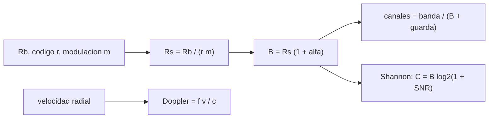

# B89-C02 — Frecuencia y espectro espacial

<!-- nav:top -->
[🏠 Programa](../../../../README.md) · [📚 Bloque B89](../../../tronco-comun/B89-comunicaciones-y-navegacion-satelital.md) · [← Anterior: B89-C01 — Electromagnetismo aplicado a enlaces](../B89-C01-electromagnetismo-aplicado-a-enlaces/CLASE.md) · [Siguiente: B89-C03 — Bandas VHF UHF S X Ka →](../B89-C03-bandas-vhf-uhf-s-x-ka/CLASE.md)
<!-- /nav -->

## 1. Ubicación, nivel y alcance

Clase 2 del bloque B89, nivel N3. El espectro es un recurso finito: cada enlace ocupa un ancho de banda que depende de la tasa de símbolos y del filtro, y esa ocupación debe caber en una banda compartida. Aquí calculas el ancho ocupado, un plan de canales, el desplazamiento Doppler que se suma y el límite de Shannon. Usas [B89-C01](../B89-C01-electromagnetismo-aplicado-a-enlaces/CLASE.md) para `λ` y `c`. La banda de 50 MHz es sintética y no corresponde a una asignación real.

## 2. Por qué esta clase existe

Sin una idea cuantitativa del ancho de banda no se puede decidir cuántos enlaces caben en una banda ni cuánta tasa de datos es posible. La regulación (C19) trabaja con exactamente estas magnitudes. La decisión central: **¿cuántos enlaces caben en una banda dada y qué tasa máxima admite el ancho ocupado por cada uno?**

## 3. Lo que podrás hacer al terminar

1. Calcular la tasa de símbolos a partir de la tasa de bits, el código y la modulación.
2. Calcular el ancho de banda ocupado con un filtro de coseno alzado.
3. Armar un plan de canales con bandas de guarda y contar canales.
4. Calcular el desplazamiento Doppler máximo de una órbita baja en tres bandas.
5. Aplicar el límite de Shannon y el mínimo de `Eb/N0` para una eficiencia espectral.
6. Rotular lo consultado (`c`) frente a lo ilustrativo (banda, tasas, guardas).

La evidencia es la **plan de canales sintético en una banda** del ejercicio 12 (sección 20).

## 4. Con qué llegas y cómo comprobarlo

1. ¿Qué es una frecuencia y en qué unidad se mide?
2. ¿Qué es un símbolo en comunicaciones digitales?
3. ¿Qué es un efecto Doppler?
4. ¿Qué es un dato sintético?
5. ¿Qué es una segunda vía de verificación?

<details>
<summary>Ver respuestas</summary>

1. Ciclos por segundo, en hercios. 2. La unidad que transporta uno o varios bits en cada intervalo de señalización. 3. El cambio de frecuencia por movimiento relativo entre emisor y receptor. 4. Un dato inventado para el ejemplo. 5. Calcular lo mismo con otro método y comparar.
</details>

Con cuatro o cinco aciertos, sigue; si no, repasa los prerrequisitos.

## 5. Un caso de contexto y casos de referencia

Un enlace sintético de 2 Mbit/s con código de tasa 1/2 y QPSK ocupa `2,700 MHz`; en una banda de 50 MHz caben `16` canales separados `3,00 MHz`. Es el **ejemplo conductor**. Todo es **ilustrativo**: no hay ninguna asignación real detrás.

## 6. Vocabulario

La **tasa de símbolos** `Rs = Rb/(r·m)` es el número de símbolos por segundo, con `r` la tasa del código y `m` los bits por símbolo. El **roll-off** `α` es el exceso de banda del filtro de coseno alzado; el **ancho ocupado** es `Rs(1+α)`. La **eficiencia espectral** `η = Rb/B` se mide en bit/s/Hz. La **banda de guarda** separa canales vecinos. El **límite de Shannon** `C = B log₂(1+SNR)` es la tasa máxima sin errores.

## 7. Modelo mental: una carretera con carriles



*Descripción textual:* la tasa de bits, el código y la modulación dan la tasa de símbolos; con el roll-off, el ancho ocupado; este decide cuántos canales caben y la capacidad de Shannon; el Doppler se suma por separado.

Analogía: cada enlace es un vehículo que necesita un carril de cierto ancho y un margen con el vecino; ensancharlo permite ir más rápido, pero caben menos. Límite: el espectro real tiene máscaras de emisión y coordinación (C19), no solo guardas rectangulares.

## 8. La explicación, paso a paso

### 8.1 Ancho ocupado

`Rs = 2×10⁶/(0,5×2) = 2,000 Msímb/s`. Con `α = 0,35`: `B = 2,700 MHz`. La eficiencia es `η = 0,741 bit/s/Hz`.

### 8.2 Plan de canales

Con guarda de 0,3 MHz la separación es `3,000 MHz` y en 50 MHz caben `16` canales; se usan `48,00 MHz`.

### 8.3 Doppler

A `v = 7,5 km/s`: `Δf = f v/c`: UHF `10,032 kHz`; S `55,038 kHz`; X `210,145 kHz`. En X el Doppler equivale a `0,070` separaciones de canal: hay que seguirlo o predecirlo.

### 8.4 Shannon

Con SNR de 10 dB y `B = 2,700 MHz`, `C = 9,340 Mbit/s`. Para una eficiencia `η`, el mínimo de `Eb/N0` es `(2^η − 1)/η`: `-0,429 dB`; cuando `η → 0` tiende a `ln 2 = −1,592 dB`.

## 9. Magnitudes, símbolos y unidades

| Símbolo | Qué es | Unidad | Valor / nota |
|---|---|---|---|
| `Rb` | tasa de bits | bit/s | 2×10⁶ (sintético) |
| `Rs` | tasa de símbolos | símb/s | 2,000×10⁶ |
| `α` | roll-off | — | 0,35 (ilustrativo) |
| `B` | ancho ocupado | Hz | 2,700×10⁶ |
| `η` | eficiencia espectral | bit/s/Hz | 0,741 |
| `Δf` | desplazamiento Doppler | Hz | 210,1×10³ (X) |
| `C` | capacidad de Shannon | bit/s | 9,34×10⁶ |

## 10. Convenciones y referencias

Banda base equivalente, filtro de coseno alzado ideal, ruido blanco gaussiano aditivo. Frecuencias en Hz; el Doppler usa la velocidad radial máxima (no la órbita completa). Tasas, guardas, `α` y la banda de 50 MHz son sintéticos; `c` es la constante exacta del SI.

## 11. De dónde sale lo que afirmamos

| ID | Fuente | Localizador | Respalda | Estado |
|---|---|---|---|---|
| S1 | NIST, CODATA 2022: velocidad de la luz en el vacio — https://physics.nist.gov/cgi-bin/cuu/Value?c (consultada 2026-11-10) | valor de la pagina | c = 299 792 458 m/s (exacta) | Consultada |
| S2 | UIT, Reglamento de Radiocomunicaciones (Radio Regulations) — https://www.itu.int/pub/R-REG-RR (consultada 2026-11-10) | pagina de la publicacion | la edicion mas reciente listada es la de 2024 e incorpora las revisiones hasta la CMR-23; contiene apendices, resoluciones y recomendaciones | Consultada |
| — | Relaciones estándar (ancho de banda del coseno alzado, Shannon, Doppler) | — | las verifica el laboratorio con una segunda vía | No consultada en una fuente concreta |

Límites: la banda de 50 MHz no es una asignación de la UIT; de la página del Reglamento solo se consultó que existe y su edición 2024, no sus cuadros de atribución de frecuencias.

## 12. Cómo ver la ocupación del espectro

| Magnitud | Valor |
|---|---|
| `B` ocupado | 2,700 MHz |
| canales en 50 MHz | 16 |
| Doppler en X a 7,5 km/s | 210,15 kHz |
| Capacidad de Shannon (10 dB) | 9,340 Mbit/s |
| `Eb/N0` mínimo a este `η` | -0,429 dB |

Descripción larga: el ancho ocupado fija cuántos canales caben, el Doppler crece con la frecuencia y Shannon acota la tasa para una SNR dada.

## 13. Ejemplo trabajado: el ancho para 10 Mbit/s

**Paso 1 · Tasa de símbolos.** Con `Rb = 10 Mbit/s`, tasa 1/2 y QPSK: `Rs = 10/(0,5×2) = 10 Msímb/s`.

**Paso 2 · Ancho ocupado.** `B = 10 × 1,35 = 13,5 MHz`.

**Paso 3 · Canales.** Con guarda 0,3 MHz: `50/13,8 = 3,62` → 3 canales.

**Paso 4 · Lectura.** Cinco veces más tasa cuesta cinco veces más espectro: de 16 a 3 canales.

## 14. Distintas formas de describir la ocupación de un enlace

**Por tasa de bits:** `Rb`. **Por símbolos:** `Rs`. **Por espectro:** `B`. **Por eficiencia:** `η`. **Por capacidad:** Shannon.

## 15. Práctica guiada

**Ejercicio 1 · con los pasos indicados.** Calcula `Rs` para `Rb = 4 Mbit/s`, tasa 3/4 y 8PSK. *Pasos:* `m = 3`.

<details><summary>Solución comentada</summary>

`Rs = 4/(0,75×3) = 1,778 Msímb/s`.
</details>

**Ejercicio 2 · con una pista.** Predice `B` con `α = 0,2` para ese `Rs`. *Pista:* `B = Rs(1+α)`.

<details><summary>Solución comentada</summary>

`1,778 × 1,2 = 2,133 MHz`.
</details>

**Ejercicio 3 · casi autónomo.** ¿Por qué el Doppler en UHF es menor que en X?

<details><summary>Solución comentada</summary>

Porque `Δf = f v/c` es proporcional a `f`: mira la razón de frecuencias 8400/401 = 20,9.
</details>

## 16. Práctica autónoma, transferencia e integrador

**Ejercicio 4 · autónomo.** Doppler de S (2,2 GHz) a 7,5 km/s.

<details><summary>Solución comentada</summary>

`55,038 kHz`.
</details>

**Ejercicio 5 · autónomo.** ¿Cuántos canales de 2,0 MHz de separación caben en 50 MHz?

<details><summary>Solución comentada</summary>

`50/2 = 25`.
</details>

**Ejercicio 6 · autónomo.** Eficiencia de un enlace de 5 Mbit/s en 4 MHz.

<details><summary>Solución comentada</summary>

`η = 1,25 bit/s/Hz`.
</details>

**Ejercicio 7 · autónomo.** `Eb/N0` mínimo de Shannon para `η = 1`.

<details><summary>Solución comentada</summary>

`(2¹ − 1)/1 = 1` → 0 dB.
</details>

**Ejercicio 8 · autónomo.** Si `α` baja de 0,35 a 0,2, ¿cuántos canales ganas con `Rs = 2 Msímb/s` y guarda 0,3 MHz?

<details><summary>Solución comentada</summary>

`B = 2,4` → separación 2,7 → `50/2,7 = 18` canales; ganas 2 sobre los 16 del ejemplo.
</details>

**Ejercicio 9 · transferencia.** **Transferencia.** Un diseñador propone 20 enlaces de 2 Mbit/s en la banda de 50 MHz. ¿Es viable con esta modulación?

<details><summary>Solución comentada</summary>

No: caben `16`; haría falta más eficiencia (otra modulación) o más banda.
</details>

**Ejercicio 10 · transferencia.** **Transferencia.** Un receptor X no sigue el Doppler: ¿qué pasa con un canal de 3,0 MHz?

<details><summary>Solución comentada</summary>

El Doppler de `210 kHz` es una fracción de la separación (`0,070`): no cruza de canal, pero un lazo de portadora estrecho puede perder el enganche.
</details>

**Ejercicio 11 · transferencia.** **Transferencia.** ¿Por qué no se puede superar `ln 2` (−1,59 dB) de `Eb/N0`?

<details><summary>Solución comentada</summary>

Es el límite de Shannon cuando el ancho de banda crece sin límite: ninguna tasa fiable existe por debajo.
</details>

**Ejercicio 12 · integrador.** **Integrador.** Elabora tu *plan de canales sintético en una banda*: tabla de `Rs`, `B`, separación, canales, Doppler y Shannon, y la lista de qué es consultado y sintético.

<details><summary>Solución comentada</summary>

Secciones 8.1–8.4 y la salida del laboratorio.
</details>

## 17. Laboratorio: plan de canales, Doppler y Shannon

El script [espectro.py](espectro.py) calcula la tasa de símbolos, el ancho ocupado, el plan de canales, el Doppler en tres bandas y el límite de Shannon (**comprueba** que Shannon se invierte a la SNR de entrada, que los canales caben en la banda y que el límite absoluto vale −1,592 dB).

**Datos:** `c` de NIST CODATA 2022 (consultada); banda, tasas, `α` y guardas **sintéticos**. **Predice antes de ejecutar:** ¿cuántos canales saldrán? (16.) **Ejecución del 2026-11-10 (Python 3.12.9):**

```text
3.12.9 (biblioteca estandar)
ILUSTRATIVO: Rb = 2 Mbit/s, codigo 1/2, QPSK, roll-off 0.35, guarda 0.3 MHz, banda 50 MHz
  Rs = 2.000 Msimb/s ; ancho ocupado = 2.700 MHz ; separacion = 3.000 MHz
  canales = 16 ; espectro usado = 48.00 MHz ; eficiencia = 0.741 bit/s/Hz
  Doppler maximo a 7.5 km/s en UHF 401 MHz  =   10.032 kHz
  Doppler maximo a 7.5 km/s en S 2.2 GHz    =   55.038 kHz
  Doppler maximo a 7.5 km/s en X 8.4 GHz    =  210.145 kHz
  Doppler X = 0.070 separaciones de canal
Shannon con SNR = 10 dB: C = 9.340 Mbit/s
Eb/N0 minimo (Shannon) a esta eficiencia = -0.429 dB ; limite absoluto = -1.592 dB
Pruebas superadas.
```

```bash
python programa/clases/B89/B89-C02-frecuencia-y-espectro-espacial/espectro.py
```

**Límites:** filtro ideal, ruido blanco y velocidad radial máxima; no hay máscara de emisión ni coordinación; no valida ninguna asignación real.

## 18. Errores frecuentes y cómo corregirlos

**Confundir tasa de bits con tasa de símbolos.** Se corrige con 8.1.

**Olvidar el roll-off al calcular el ancho.** Se corrige con 8.1.

**Ignorar el Doppler al planear canales.** Se corrige con 8.3.

**Presentar la banda sintética como una asignación real.** Se corrige con la sección 10.

## 19. Cómo sabrás que vas bien

Tras la sección 8: ¿cuántos canales esperabas y cuántos obtuviste? Si dudas, repasa el ejemplo 13. Tras el laboratorio: ¿qué comprueba? (ver la sección 17).

## 20. Qué entregas y cómo se evalúa

El producto es tu **plan de canales sintético en una banda** (ejercicio 12).

| Criterio | Inicial | En desarrollo | Logrado | Destacado |
|---|---|---|---|---|
| Conceptos | Los confunde | Parciales | Calcula `Rs`, `B` y canales | Explica los límites |
| Cálculo | Sin unidades | Con errores | Tablas completas con unidades | Calcula casos nuevos |
| Numérico | Sin comprobar | Un caso | Contraste con una segunda vía | Interpreta las diferencias |
| Fuentes | Sin fuente | Sin fecha | Fuentes con fecha y estado | Declara lo sintético y lo no consultado |
| Límites | No los nombra | Uno | Tres | Discute qué falta del modelo |

**Condiciones críticas (no se compensan con promedio):** rotular la banda y las tasas como sintéticas; no presentar el plan como asignación real; no presentar un cálculo como una medición; citar solo lo consultado.

## 21. Ética, seguridad y límites

Clase educativa: los modelos son simplificados y sus datos son sintéticos o ilustrativos; ningún resultado describe un enlace, un satélite ni una misión reales, ni sustituye a la documentación oficial de una misión, a un presupuesto de enlace verificado ni a la coordinación regulatoria.  Accesibilidad: tablas equivalentes a las gráficas, fórmulas en texto, ejercicios sin conexión.

## 22. Para cerrar y seguir

Un enlace de 2 Mbit/s ocupa `2,700 MHz` y caben `16` en 50 MHz, con un Doppler de `210 kHz` en banda X. Queda una pregunta: ¿qué bandas usa realmente la ingeniería espacial?

**Glosario español–inglés.** ancho de banda · *bandwidth*; tasa de símbolos · *symbol rate*; eficiencia espectral · *spectral efficiency*; banda de guarda · *guard band*; límite de Shannon · *Shannon limit*.

**Continuidad.** [B89-C03](../B89-C03-bandas-vhf-uhf-s-x-ka/CLASE.md) compara las bandas VHF, UHF, S, X y Ka.

**Referencias:** ver sección 11.

<!-- nav:bottom -->
---

[← Anterior: B89-C01 — Electromagnetismo aplicado a enlaces](../B89-C01-electromagnetismo-aplicado-a-enlaces/CLASE.md) · [📚 Bloque B89](../../../tronco-comun/B89-comunicaciones-y-navegacion-satelital.md) · [Siguiente: B89-C03 — Bandas VHF UHF S X Ka →](../B89-C03-bandas-vhf-uhf-s-x-ka/CLASE.md)
<!-- /nav -->
