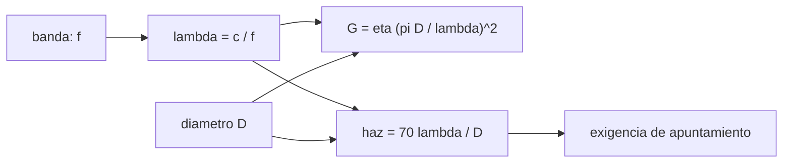

# B89-C03 — Bandas VHF UHF S X Ka

<!-- nav:top -->
[🏠 Programa](../../../../README.md) · [📚 Bloque B89](../../../tronco-comun/B89-comunicaciones-y-navegacion-satelital.md) · [← Anterior: B89-C02 — Frecuencia y espectro espacial](../B89-C02-frecuencia-y-espectro-espacial/CLASE.md) · [Siguiente: B89-C04 — Propagación y pérdidas de espacio libre →](../B89-C04-propagacion-y-perdidas-de-espacio-libre/CLASE.md)
<!-- /nav -->

## 1. Ubicación, nivel y alcance

Clase 3 del bloque B89, nivel N3. Las bandas de frecuencia no son solo etiquetas: cada una cambia el tamaño de la antena que da una ganancia, el ancho del haz y, más adelante, la sensibilidad a la lluvia y a la ionosfera. Aquí comparas VHF, UHF, S, X y Ka con una misma ganancia objetivo y una misma antena. Usas [B89-C01](../B89-C01-electromagnetismo-aplicado-a-enlaces/CLASE.md) y [B89-C02](../B89-C02-frecuencia-y-espectro-espacial/CLASE.md). Las frecuencias centrales son ilustrativas: no se consultaron los límites formales de cada banda.

## 2. Por qué esta clase existe

Elegir la banda es la primera decisión de diseño de un enlace y determina el tamaño de la antena y la tasa alcanzable. La decisión central: **¿qué banda usar para una ganancia de antena dada y qué se paga en apuntamiento por usarla?**

## 3. Lo que podrás hacer al terminar

1. Calcular la longitud de onda de cinco bandas ilustrativas.
2. Calcular el diámetro de parábola necesario para una ganancia de 30 dBi en cada banda.
3. Calcular la ganancia y el ancho de haz de una antena de 1 m por banda.
4. Comprobar que la ganancia crece 20 log₁₀ de la razón de frecuencias.
5. Relacionar un haz más estrecho con una exigencia de apuntamiento mayor.
6. Rotular lo ilustrativo (frecuencias centrales, eficiencia) y lo no consultado (límites de banda).

La evidencia es la **tabla comparativa de bandas** del ejercicio 12 (sección 20).

## 4. Con qué llegas y cómo comprobarlo

1. ¿Qué es la ganancia de una antena?
2. ¿Qué es el ancho de haz?
3. ¿Qué relación hay entre `λ` y `f`?
4. ¿Qué es un decibelio?
5. ¿Qué es un dato ilustrativo?

<details>
<summary>Ver respuestas</summary>

1. La razón entre su densidad de flujo máxima y la de una antena isótropa, en dBi. 2. El ángulo entre los puntos de media potencia del lóbulo principal. 3. `λ = c/f`. 4. Diez veces el logaritmo decimal de una razón de potencias. 5. Un valor típico elegido para el ejemplo, no consultado.
</details>

Con cuatro o cinco aciertos, sigue; si no, repasa los prerrequisitos.

## 5. Un caso de contexto y casos de referencia

Para una ganancia de 30 dBi hace falta una parábola de `9,72 m` en UHF, de `0,464 m` en X y de `0,122 m` en Ka. Es el **ejemplo conductor**; todo es **ilustrativo**.

## 6. Vocabulario

La **ganancia de apertura** `G = η(πD/λ)²` crece con el cuadrado del diámetro y de la frecuencia. La **eficiencia de apertura** `η` agrupa las pérdidas de iluminación y desbordamiento. El **ancho de haz** a media potencia es aproximadamente `70 λ/D` grados. Las bandas **VHF** (~145 MHz), **UHF** (~401 MHz), **S** (~2,2 GHz), **X** (~8,4 GHz) y **Ka** (~32 GHz) se tratan aquí con frecuencias centrales ilustrativas.

## 7. Modelo mental: una linterna con reflector más o menos grande



*Descripción textual:* la frecuencia da la longitud de onda; con el diámetro y la eficiencia se obtiene la ganancia y el ancho de haz, y de este la exigencia de apuntamiento.

Analogía: a mayor frecuencia, la «linterna» enfoca más con el mismo reflector, pero hay que apuntarla con más cuidado. Límite: la fórmula `70 λ/D` y la eficiencia son aproximaciones; una antena real tiene lóbulos laterales y pérdidas de superficie (C06).

## 8. La explicación, paso a paso

### 8.1 Longitud de onda por banda

VHF `206,8 cm`; UHF `74,8 cm`; S `13,63 cm`; X `3,57 cm`; Ka `0,937 cm`.

### 8.2 Diámetro para 30 dBi

`D = (λ/π)√(G/η)` con `η = 0,60`: VHF `26,87 m`; UHF `9,72 m`; S `1,771 m`; X `0,464 m`; Ka `0,122 m`.

### 8.3 Una antena de 1 m

La ganancia es `1,4` dBi en VHF, `10,3` en UHF, `25,0` en S, `36,7` en X y `48,3` en Ka; el haz pasa de `144,7°` a `0,66°`.

### 8.4 La regla de 20 log

De UHF a X, `20 log₁₀(8400/401) = 26,423 dB`; el laboratorio obtiene `26,423 dB`: la misma cifra, porque la ganancia depende de `f²`. Por eso, para la misma ganancia, el diámetro se reduce `20,95` veces.

## 9. Magnitudes, símbolos y unidades

| Símbolo | Qué es | Unidad | Valor / nota |
|---|---|---|---|
| `f` | frecuencia central | Hz | 145e6 a 32e9 (ilustrativo) |
| `λ` | longitud de onda | m | 0,0357 (X) |
| `η` | eficiencia de apertura | — | 0,60 (sintético) |
| `D` | diámetro de la parábola | m | 0,464 (X, 30 dBi) |
| `G` | ganancia | dBi | 36,7 (X, 1 m) |
| `θ₃dB` | ancho de haz | grados | 2,50 (X, 1 m) |

## 10. Convenciones y referencias

Antena de apertura circular uniforme con eficiencia constante; vacío; frecuencias centrales ilustrativas, no los límites formales de cada banda. Diámetros en metros, ganancias en dBi, ángulos en grados.

## 11. De dónde sale lo que afirmamos

| ID | Fuente | Localizador | Respalda | Estado |
|---|---|---|---|---|
| S1 | NIST, CODATA 2022: velocidad de la luz en el vacio — https://physics.nist.gov/cgi-bin/cuu/Value?c (consultada 2026-11-10) | valor de la pagina | c = 299 792 458 m/s (exacta) | Consultada |
| — | Límites de las bandas VHF, UHF, S, X y Ka (IEEE 521) y asignaciones de la UIT | — | las frecuencias centrales son ilustrativas; los límites no se consultaron | No consultada en una fuente concreta |
| — | Relaciones estándar (`G = η(πD/λ)²`, `θ ≈ 70 λ/D`) | — | las verifica el laboratorio con una segunda vía | No consultada en una fuente concreta |

Límites: no se consultó ningún estándar de designación de bandas; las frecuencias son valores típicos; la eficiencia de 0,60 es sintética.

## 12. Cómo ver las bandas frente a frente

| Magnitud | Valor |
|---|---|
| `D` para 30 dBi en UHF | 9,72 m |
| `D` para 30 dBi en X | 0,464 m |
| `G` de 1 m en Ka | 48,3 dBi |
| haz de 1 m en Ka | 0,66° |
| `20 log₁₀(f_X/f_UHF)` | 26,423 dB |

Descripción larga: el diámetro necesario baja con la frecuencia, la ganancia sube 20 dB por década de frecuencia y el haz se estrecha.

## 13. Ejemplo trabajado: la parábola de 30 dBi en X

**Paso 1 · Longitud de onda.** `λ = 0,03569 m`.

**Paso 2 · Ganancia lineal.** `G = 10³ = 1000`.

**Paso 3 · Diámetro.** `D = (λ/π)√(1000/0,6) = 0,4638 m`.

**Paso 4 · Ancho de haz.** `70 λ/D = 5,39°`.

## 14. Distintas formas de describir una banda

**Por frecuencia:** `f`. **Por longitud de onda:** `λ`. **Por tamaño de antena:** `D` para una ganancia. **Por haz:** `θ₃dB`.

## 15. Práctica guiada

**Ejercicio 1 · con los pasos indicados.** Calcula `λ` en S (2,2 GHz) en cm. *Pasos:* `c/f`.

<details><summary>Solución comentada</summary>

`13,63 cm`.
</details>

**Ejercicio 2 · con una pista.** Predice la ganancia de 1 m en Ka a partir de la de X. *Pista:* `20 log₁₀(32/8,4)`.

<details><summary>Solución comentada</summary>

`20 log₁₀(3,81) = 11,62 dB`: `48,3 dBi`, la del laboratorio (`48,3`).
</details>

**Ejercicio 3 · casi autónomo.** ¿Por qué una antena de 1 m en VHF tiene un haz tan ancho?

<details><summary>Solución comentada</summary>

Porque `θ ≈ 70 λ/D` y `λ` es grande: mira la longitud de onda de VHF (2,07 m) frente a `D`.
</details>

## 16. Práctica autónoma, transferencia e integrador

**Ejercicio 4 · autónomo.** Diámetro para 40 dBi en X.

<details><summary>Solución comentada</summary>

Hay 10 dB más: `D` se multiplica por `√10`: `1,47 m`.
</details>

**Ejercicio 5 · autónomo.** Ganancia de 3 m en X.

<details><summary>Solución comentada</summary>

`46,2 dBi`.
</details>

**Ejercicio 6 · autónomo.** Haz de 3 m en X.

<details><summary>Solución comentada</summary>

`0,83°`.
</details>

**Ejercicio 7 · autónomo.** Si `η` baja de 0,60 a 0,45, ¿cuántos dB pierdes?

<details><summary>Solución comentada</summary>

`10 log₁₀(0,45/0,60) = −1,25 dB`.
</details>

**Ejercicio 8 · autónomo.** ¿Qué razón de diámetros hay entre VHF y UHF para igual ganancia?

<details><summary>Solución comentada</summary>

`401/145 = 2,77`.
</details>

**Ejercicio 9 · transferencia.** **Transferencia.** Un cubesat de 30 cm quiere 30 dBi en UHF. ¿Es viable?

<details><summary>Solución comentada</summary>

No: harían falta `9,72 m`; su apertura de 0,3 m da `-0,2 dBi`.
</details>

**Ejercicio 10 · transferencia.** **Transferencia.** En Ka el haz de 1 m es menor que un grado. ¿Qué implica para el apuntamiento de un satélite pequeño?

<details><summary>Solución comentada</summary>

Que exige estabilización y apuntamiento mucho más finos que en UHF; el error de puntería se convierte en una pérdida importante (C06).
</details>

**Ejercicio 11 · transferencia.** **Transferencia.** Una misión elige X en vez de UHF «porque X atraviesa mejor la atmósfera». ¿Es esa la razón correcta?

<details><summary>Solución comentada</summary>

No necesariamente: la razón principal suele ser la ganancia por tamaño y la banda asignada; las pérdidas atmosféricas crecen con la frecuencia (C04) y no se han consultado aquí.
</details>

**Ejercicio 12 · integrador.** **Integrador.** Elabora tu *tabla comparativa de bandas*: `λ`, `D` para 30 dBi, `G` y haz de 1 m por banda, con qué es ilustrativo y no consultado.

<details><summary>Solución comentada</summary>

Secciones 8.1–8.4 y la salida del laboratorio.
</details>

## 17. Laboratorio: comparación de bandas

El script [bandas.py](bandas.py) calcula `λ`, el diámetro para 30 dBi, la ganancia y el haz de una antena de 1 m en cinco bandas (**comprueba** que diámetro y ganancia son inversos y que la diferencia de ganancia entre X y UHF es `20 log₁₀` de la razón de frecuencias).

**Datos:** `c` de NIST CODATA 2022 (consultada); frecuencias centrales y eficiencia **ilustrativas**. **Predice antes de ejecutar:** ¿cuánto mayor es la ganancia de X sobre UHF con 1 m? (26,42 dB.) **Ejecución del 2026-11-10 (Python 3.12.9):**

```text
3.12.9 (biblioteca estandar)
ILUSTRATIVO: frecuencias centrales; eficiencia de apertura 0.60 (sintetica)
banda         lambda[cm]  D para 30 dBi [m]  G(1 m) [dBi]  haz(1 m) [deg]
VHF 145 MHz      206.753             26.867          1.42          144.73
UHF 401 MHz       74.761              9.715         10.25           52.33
S 2.2 GHz         13.627              1.771         25.04            9.54
X 8.4 GHz          3.569              0.464         36.67            2.50
Ka 32 GHz          0.937              0.122         48.29            0.66
D(UHF)/D(X) para igual ganancia = 20.948 ; f_X/f_UHF = 20.948
Ganancia extra de X sobre UHF con 1 m = 26.423 dB ; 20 log10(f_X/f_UHF) = 26.423 dB
Pruebas superadas.
```

```bash
python programa/clases/B89/B89-C03-bandas-vhf-uhf-s-x-ka/bandas.py
```

**Límites:** apertura uniforme, sin pérdidas atmosféricas ni de superficie; las bandas no tienen límites formales en el laboratorio; la aproximación `70 λ/D` pierde sentido cuando `D` es del orden de `λ` (VHF y UHF con 1 m dan haces de decenas de grados que no deben tomarse al pie de la letra).

## 18. Errores frecuentes y cómo corregirlos

**Creer que mayor frecuencia siempre da mejor enlace.** Se corrige con 8.4 y con C04: la ganancia sube, pero también las pérdidas.

**Olvidar el apuntamiento al elegir Ka.** Se corrige con 8.3.

**Usar la frecuencia en MHz con `c` en m/s sin convertir.** Se corrige con 8.1: trabaja siempre en Hz.

**Presentar las frecuencias centrales como límites de banda.** Se corrige con la sección 10.

## 19. Cómo sabrás que vas bien

Tras la sección 8: ¿qué diámetro esperabas en X y cuál obtuviste? Si dudas, repasa el ejemplo 13. Tras el laboratorio: ¿qué comprueba? (ver la sección 17).

## 20. Qué entregas y cómo se evalúa

El producto es tu **tabla comparativa de bandas** (ejercicio 12).

| Criterio | Inicial | En desarrollo | Logrado | Destacado |
|---|---|---|---|---|
| Conceptos | Los confunde | Parciales | Calcula `λ`, `D`, `G` y haz | Explica los límites |
| Cálculo | Sin unidades | Con errores | Tablas completas con unidades | Calcula casos nuevos |
| Numérico | Sin comprobar | Un caso | Contraste con una segunda vía | Interpreta las diferencias |
| Fuentes | Sin fuente | Sin fecha | Fuentes con fecha y estado | Declara lo sintético y lo no consultado |
| Límites | No los nombra | Uno | Tres | Discute qué falta del modelo |

**Condiciones críticas (no se compensan con promedio):** rotular las frecuencias y la eficiencia como ilustrativas; no presentar los centros como límites de banda; no presentar un cálculo como una medición; citar solo lo consultado.

## 21. Ética, seguridad y límites

Clase educativa: los modelos son simplificados y sus datos son sintéticos o ilustrativos; ningún resultado describe un enlace, un satélite ni una misión reales, ni sustituye a la documentación oficial de una misión, a un presupuesto de enlace verificado ni a la coordinación regulatoria.  Accesibilidad: tablas equivalentes a las gráficas, fórmulas en texto, ejercicios sin conexión.

## 22. Para cerrar y seguir

Para 30 dBi, X necesita `0,46 m` y UHF `9,72 m`; el precio de la banda alta es un haz más estrecho. Queda una pregunta: ¿cuánto se pierde en el camino?

**Glosario español–inglés.** ganancia de apertura · *aperture gain*; ancho de haz · *beamwidth*; eficiencia de apertura · *aperture efficiency*; banda X · *X band*; banda Ka · *Ka band*.

**Continuidad.** [B89-C04](../B89-C04-propagacion-y-perdidas-de-espacio-libre/CLASE.md) calcula la pérdida de espacio libre y el retardo de propagación.

**Referencias:** ver sección 11.

<!-- nav:bottom -->
---

[← Anterior: B89-C02 — Frecuencia y espectro espacial](../B89-C02-frecuencia-y-espectro-espacial/CLASE.md) · [📚 Bloque B89](../../../tronco-comun/B89-comunicaciones-y-navegacion-satelital.md) · [Siguiente: B89-C04 — Propagación y pérdidas de espacio libre →](../B89-C04-propagacion-y-perdidas-de-espacio-libre/CLASE.md)
<!-- /nav -->
