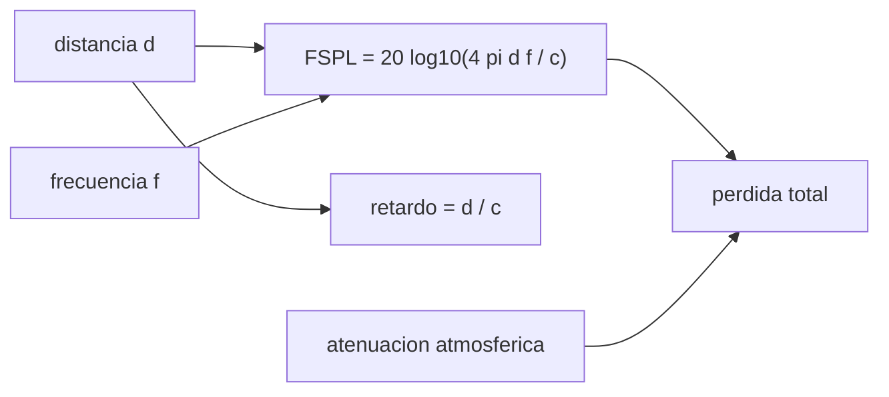

# B89-C04 — Propagación y pérdidas de espacio libre

<!-- nav:top -->
[🏠 Programa](../../../../README.md) · [📚 Bloque B89](../../../tronco-comun/B89-comunicaciones-y-navegacion-satelital.md) · [← Anterior: B89-C03 — Bandas VHF UHF S X Ka](../B89-C03-bandas-vhf-uhf-s-x-ka/CLASE.md) · [Siguiente: B89-C05 — Presupuesto de enlace →](../B89-C05-presupuesto-de-enlace/CLASE.md)
<!-- /nav -->

## 1. Ubicación, nivel y alcance

Clase 4 del bloque B89, nivel N3. En el vacío la señal no se absorbe: se reparte sobre una esfera cada vez mayor, y eso es la pérdida de espacio libre. Aquí calculas la pérdida y el retardo de luz para distancias desde la órbita baja hasta Neptuno y cuatro bandas, y añades una atenuación atmosférica sintética. Usas [B89-C01](../B89-C01-electromagnetismo-aplicado-a-enlaces/CLASE.md) para la densidad de flujo y [B89-C03](../B89-C03-bandas-vhf-uhf-s-x-ka/CLASE.md) para las bandas. Las distancias son redondeadas e ilustrativas.

## 2. Por qué esta clase existe

La pérdida de espacio libre domina cualquier presupuesto de enlace de espacio profundo y fija la potencia, la ganancia y el tiempo de ida y vuelta que tendrá una misión. La decisión central: **¿cuántos decibelios se pierden entre transmisor y receptor y cuánto tarda la señal en llegar?**

## 3. Lo que podrás hacer al terminar

1. Calcular la pérdida de espacio libre `FSPL = 20 log₁₀(4π d f/c)` en dB.
2. Calcular el retardo de luz y el tiempo de ida y vuelta.
3. Comprobar `+6,02 dB` por duplicar la distancia y `+20 dB` por década de frecuencia.
4. Comparar bandas y distancias en una tabla.
5. Añadir una atenuación atmosférica sintética y distinguirla de la de espacio libre.
6. Rotular lo consultado (`c`) frente a lo ilustrativo (distancias y atmósfera).

La evidencia es la **tabla de pérdidas y retardos por distancia** del ejercicio 12 (sección 20).

## 4. Con qué llegas y cómo comprobarlo

1. ¿Qué es un decibelio?
2. ¿Qué es la ley del inverso del cuadrado?
3. ¿Cuánto tarda la luz en recorrer 300 000 km?
4. ¿Qué es una unidad astronómica?
5. ¿Qué es un dato sintético?

<details>
<summary>Ver respuestas</summary>

1. `10 log₁₀` de una razón de potencias. 2. La caída de la densidad de flujo con `1/r²`. 3. Aproximadamente 1 s. 4. Una distancia de unos 1,5×10¹¹ m, la media Tierra–Sol. 5. Un dato inventado para el ejemplo.
</details>

Con cuatro o cinco aciertos, sigue; si no, repasa los prerrequisitos.

## 5. Un caso de contexto y casos de referencia

A la Luna (384 400 km) la pérdida en banda X es de `222,63 dB` y la luz tarda `1,282 s`; a Neptuno (30 UA) la pérdida es de `303,97 dB` y el viaje de ida dura `4,16 h`. Es el **ejemplo conductor**; todo es **ilustrativo**.

## 6. Vocabulario

La **pérdida de espacio libre** `FSPL = (4π d/λ)²` expresada en dB es el cociente entre la potencia transmitida y la recibida con antenas isótropas. El **retardo de luz** es `d/c`. La **UA** es la unidad astronómica. La **atenuación atmosférica** es la pérdida por gases y lluvia, que crece con la frecuencia. El **tiempo de ida y vuelta** (RTT) es el doble del retardo.

## 7. Modelo mental: una linterna en un cuarto cada vez más grande



*Descripción textual:* la distancia y la frecuencia dan la pérdida de espacio libre; la distancia sola da el retardo; sumando la atmósfera se obtiene la pérdida total.

Analogía: la misma luz se reparte sobre una esfera de radio creciente. Límite: la pérdida de espacio libre es de «geometría», no de absorción; la atmósfera añade pérdidas reales que dependen del clima y del ángulo de elevación.

## 8. La explicación, paso a paso

### 8.1 La fórmula

`FSPL = 20 log₁₀(4π d f/c)`; es `20 log₁₀ d + 20 log₁₀ f − 147,55` con `d` en m y `f` en Hz. Cada duplicación de `d` suma 6,02 dB y cada década de `f` suma 20 dB.

### 8.2 Tabla de pérdidas

En X (8,4 GHz): LEO 500 km `164,91 dB`; GEO `202,01 dB`; Luna `222,63 dB`; Marte 0,5 UA `268,41 dB`; Marte 2,5 UA `282,39 dB`; Neptuno `303,97 dB`.

### 8.3 Retardos

Luna `1,282 s`; Marte 0,5 UA `4,16 min`; Marte 2,5 UA `20,79 min`; Neptuno `4,16 h` de ida y `8,32 h` de ida y vuelta.

### 8.4 Banda y atmósfera

Pasar de X a Ka a 2,5 UA cuesta `11,617 dB` más de espacio libre (`20 log₁₀(32/8,4)`). Con una atenuación atmosférica sintética de 1,5 dB en Ka, el total a la Luna es `235,75 dB`. La pérdida total de un enlace real sale de sumar ambas.

## 9. Magnitudes, símbolos y unidades

| Símbolo | Qué es | Unidad | Valor / nota |
|---|---|---|---|
| `d` | distancia | m | 5×10⁵ a 4,5×10¹² |
| `f` | frecuencia | Hz | 401e6 a 32e9 |
| `FSPL` | pérdida de espacio libre | dB | 222,63 (Luna, X) |
| `t` | retardo de luz | s | 1,282 (Luna) |
| `L_atm` | atenuación atmosférica | dB | 0,05 a 1,5 (sintética) |

## 10. Convenciones y referencias

Antenas isótropas, vacío, distancia entre antenas (sin movimiento). Distancias redondeadas e ilustrativas (no consultadas); la UA es `1,495978707×10¹¹ m` (valor redondeado, no consultado). Las atenuaciones son sintéticas para cielo despejado; no se consultó ninguna recomendación UIT-R de propagación.

## 11. De dónde sale lo que afirmamos

| ID | Fuente | Localizador | Respalda | Estado |
|---|---|---|---|---|
| S1 | NIST, CODATA 2022: velocidad de la luz en el vacio — https://physics.nist.gov/cgi-bin/cuu/Value?c (consultada 2026-11-10) | valor de la pagina | c = 299 792 458 m/s (exacta) | Consultada |
| S2 | NASA, Space Communications and Navigation (SCaN) — https://www.nasa.gov/directorates/somd/space-communications-navigation-program/ (consultada 2026-11-10) | pagina completa | Near Space Network (hasta ~1 millon de millas), Deep Space Network con antenas de 34 y 70 m en Goldstone, Madrid y Canberra; las comunicaciones laser transmiten 10 a 100 veces mas datos que los sistemas de RF actuales segun la pagina | Consultada |
| — | Distancias a la Luna, GEO, Marte y Neptuno y valor de la UA | — | ilustrativos y redondeados | No consultada en una fuente concreta |
| — | Relaciones estándar (`FSPL`, ley de Friis) | — | las verifica el laboratorio con una segunda vía | No consultada en una fuente concreta |

Límites: la página de SCaN respalda solo que existen las redes DSN y Near Space Network y sus rangos aproximados; no se consultaron modelos de atenuación atmosférica ni de lluvia.

## 12. Cómo ver las pérdidas por distancia y banda

| Magnitud | Valor |
|---|---|
| FSPL Luna, X | 222,63 dB |
| FSPL Neptuno, X | 303,97 dB |
| duplicar la distancia | +6,021 dB |
| década de frecuencia | +20,000 dB |
| RTT a 30 UA | 8,32 h |

Descripción larga: la pérdida crece 6 dB por cada duplicación de distancia y 20 dB por década de frecuencia, mientras el retardo crece linealmente con la distancia.

## 13. Ejemplo trabajado: la pérdida a la Luna en X

**Paso 1 · Longitud de onda.** `λ = c/f = 0,035690 m`.

**Paso 2 · Razón.** `4π d/λ = 4π × 3,844×10⁸/0,03569 = 1,3535×10¹¹`.

**Paso 3 · Decibelios.** `20 log₁₀ = 222,63 dB`.

**Paso 4 · Retardo.** `d/c = 1,2822 s`.

## 14. Distintas formas de describir la pérdida de un enlace

**Por razón de potencias:** `(4π d/λ)²`. **En decibelios:** `FSPL`. **Por tiempo:** retardo de luz. **Total:** espacio libre más atmósfera.

## 15. Práctica guiada

**Ejercicio 1 · con los pasos indicados.** Calcula la pérdida a GEO en banda S. *Pasos:* aplica la fórmula con `d = 35 786 km`, `f = 2,2 GHz`.

<details><summary>Solución comentada</summary>

`190,37 dB`.
</details>

**Ejercicio 2 · con una pista.** Predice la pérdida a 2 000 000 km a partir de 1 000 000 km. *Pista:* +6,02 dB.

<details><summary>Solución comentada</summary>

Se suma `20 log₁₀ 2 = 6,02 dB`.
</details>

**Ejercicio 3 · casi autónomo.** ¿Por qué Ka pierde más que X a la misma distancia si el espacio vacío no absorbe?

<details><summary>Solución comentada</summary>

Porque `FSPL` incluye `λ²` en el área de captura de una antena isótropa: a menor `λ`, menor área; mira el término `20 log₁₀ f`.
</details>

## 16. Práctica autónoma, transferencia e integrador

**Ejercicio 4 · autónomo.** Retardo a Marte a 2,5 UA, en minutos.

<details><summary>Solución comentada</summary>

`20,79 min`.
</details>

**Ejercicio 5 · autónomo.** Retardo de ida y vuelta a la Luna, en s.

<details><summary>Solución comentada</summary>

`2,564 s`.
</details>

**Ejercicio 6 · autónomo.** Diferencia de FSPL entre LEO y GEO en banda X.

<details><summary>Solución comentada</summary>

`37,09 dB`.
</details>

**Ejercicio 7 · autónomo.** Pérdida total a la Luna en X con 0,3 dB de atmósfera.

<details><summary>Solución comentada</summary>

`222,93 dB`.
</details>

**Ejercicio 8 · autónomo.** Si la distancia se multiplica por 10, ¿cuántos dB sube la pérdida?

<details><summary>Solución comentada</summary>

`20 dB`.
</details>

**Ejercicio 9 · transferencia.** **Transferencia.** Una misión a Neptuno pide una conversación interactiva. ¿Es posible?

<details><summary>Solución comentada</summary>

No: el RTT de `8,3 h` lo impide; el control es por secuencias cargadas con antelación.
</details>

**Ejercicio 10 · transferencia.** **Transferencia.** Un presupuesto usa FSPL de LEO para una pasada de 500 a 2 000 km. ¿Qué error comete?

<details><summary>Solución comentada</summary>

A 2 000 km la pérdida es `20 log₁₀ 4 = 12,04 dB` mayor que a 500 km; usar un solo valor subestima el peor caso.
</details>

**Ejercicio 11 · transferencia.** **Transferencia.** Un colega suma la atenuación atmosférica sintética al FSPL y la presenta como «pérdida medida». ¿Qué corriges?

<details><summary>Solución comentada</summary>

Que es un valor sintético sumado a un cálculo; no hay medición.
</details>

**Ejercicio 12 · integrador.** **Integrador.** Elabora tu *tabla de pérdidas y retardos por distancia*: seis distancias, cuatro bandas, retardos y la atmósfera sintética, con la lista de qué es consultado e ilustrativo.

<details><summary>Solución comentada</summary>

Secciones 8.1–8.4 y la salida del laboratorio.
</details>

## 17. Laboratorio: pérdidas y retardos

El script [espacio_libre.py](espacio_libre.py) calcula `FSPL` y el retardo de luz para seis distancias y cuatro bandas y las comprueba con la forma de Friis (**comprueba** igualdad a 1e-9 dB, +6,02 dB por duplicar la distancia y +20 dB por década de frecuencia).

**Datos:** `c` de NIST CODATA 2022 (consultada); distancias redondeadas **ilustrativas**; atmósfera **sintética**. **Predice antes de ejecutar:** ¿cuánto sube la pérdida al duplicar la distancia? (6,0206 dB.) **Ejecución del 2026-11-10 (Python 3.12.9):**

```text
3.12.9 (biblioteca estandar)
ILUSTRATIVO: distancias redondeadas; atenuacion atmosferica SINTETICA (cielo despejado)
distancia           retardo[s]  UHF 401 MHz    S 2.2 GHz    X 8.4 GHz    Ka 32 GHz   (FSPL en dB)
LEO 500 km              0.0017       138.49       153.28       164.91       176.53
GEO ~35 786 km          0.1194       175.58       190.37       202.01       213.63
Luna ~384 400 km        1.2822       196.21       210.99       222.63       234.25
Marte 0.5 UA          249.5024       241.99       256.77       268.41       280.03
Marte 2.5 UA         1247.5120       255.97       270.75       282.39       294.01
Neptuno ~30 UA      14970.1435       277.55       292.34       303.97       315.59
Al duplicar la distancia: +6.021 dB ; por decada de frecuencia: +20.000 dB
Ka - X a 2.5 UA = 11.617 dB ; ida y vuelta a 30 UA = 8.317 h
Luna, Ka: FSPL + atmosfera = 235.75 dB
Pruebas superadas.
```

```bash
python programa/clases/B89/B89-C04-propagacion-y-perdidas-de-espacio-libre/espacio_libre.py
```

**Límites:** vacío, antenas isótropas y distancia fija; la atenuación de lluvia, la elevación y el movimiento no se modelan.

## 18. Errores frecuentes y cómo corregirlos

**Medir la pérdida de espacio libre como absorción.** Se corrige con 8.1 y la analogía.

**Usar km en la fórmula sin convertir a m.** Se corrige con 8.1: la constante 147,55 supone metros y hercios.

**Olvidar el retardo al planear operaciones.** Se corrige con 8.3.

**Presentar distancias ilustrativas como efemérides.** Se corrige con la sección 10.

## 19. Cómo sabrás que vas bien

Tras la sección 8: ¿qué pérdida esperabas a la Luna y cuál obtuviste? Si dudas, repasa el ejemplo 13. Tras el laboratorio: ¿qué comprueba? (ver la sección 17).

## 20. Qué entregas y cómo se evalúa

El producto es tu **tabla de pérdidas y retardos por distancia** (ejercicio 12).

| Criterio | Inicial | En desarrollo | Logrado | Destacado |
|---|---|---|---|---|
| Conceptos | Los confunde | Parciales | Calcula `FSPL` y retardos | Explica los límites |
| Cálculo | Sin unidades | Con errores | Tablas completas con unidades | Calcula casos nuevos |
| Numérico | Sin comprobar | Un caso | Contraste con una segunda vía | Interpreta las diferencias |
| Fuentes | Sin fuente | Sin fecha | Fuentes con fecha y estado | Declara lo sintético y lo no consultado |
| Límites | No los nombra | Uno | Tres | Discute qué falta del modelo |

**Condiciones críticas (no se compensan con promedio):** rotular las distancias y la atmósfera como ilustrativas o sintéticas; separar espacio libre de atmósfera; no presentar un cálculo como una medición; citar solo lo consultado.

## 21. Ética, seguridad y límites

Clase educativa: los modelos son simplificados y sus datos son sintéticos o ilustrativos; ningún resultado describe un enlace, un satélite ni una misión reales, ni sustituye a la documentación oficial de una misión, a un presupuesto de enlace verificado ni a la coordinación regulatoria.  Accesibilidad: tablas equivalentes a las gráficas, fórmulas en texto, ejercicios sin conexión.

## 22. Para cerrar y seguir

A la Luna se pierden `222,63 dB` en X y a Neptuno `303,97 dB`, con `8,3 h` de ida y vuelta. Queda una pregunta: ¿cómo se suma todo en un balance único?

**Glosario español–inglés.** pérdida de espacio libre · *free-space path loss*; retardo de luz · *light time*; unidad astronómica · *astronomical unit*; tiempo de ida y vuelta · *round-trip time*; atenuación · *attenuation*.

**Continuidad.** [B89-C05](../B89-C05-presupuesto-de-enlace/CLASE.md) reúne pérdidas, ganancias y ruido en un presupuesto de enlace.

**Referencias:** ver sección 11.

<!-- nav:bottom -->
---

[← Anterior: B89-C03 — Bandas VHF UHF S X Ka](../B89-C03-bandas-vhf-uhf-s-x-ka/CLASE.md) · [📚 Bloque B89](../../../tronco-comun/B89-comunicaciones-y-navegacion-satelital.md) · [Siguiente: B89-C05 — Presupuesto de enlace →](../B89-C05-presupuesto-de-enlace/CLASE.md)
<!-- /nav -->
