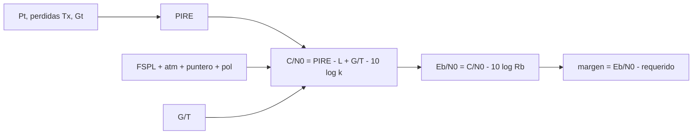

# B89-C05 — Presupuesto de enlace

<!-- nav:top -->
[🏠 Programa](../../../../README.md) · [📚 Bloque B89](../../../tronco-comun/B89-comunicaciones-y-navegacion-satelital.md) · [← Anterior: B89-C04 — Propagación y pérdidas de espacio libre](../B89-C04-propagacion-y-perdidas-de-espacio-libre/CLASE.md) · [Siguiente: B89-C06 — Ganancias y pérdidas de antena →](../B89-C06-ganancias-y-perdidas-de-antena/CLASE.md)
<!-- /nav -->

## 1. Ubicación, nivel y alcance

Clase 5 del bloque B89, nivel N3. El presupuesto de enlace suma en decibelios todo lo que gana y pierde la señal entre el transmisor y el decisor del receptor y termina en un margen. Aquí construyes el de una bajada sintética en banda X a 1 UA. Usas [B89-C04](../B89-C04-propagacion-y-perdidas-de-espacio-libre/CLASE.md) para la pérdida de espacio libre; las ganancias y el ruido se detallan en C06 y C07, y las relaciones `C/N0`–`Eb/N0` en C23. Todos los parámetros son sintéticos.

## 2. Por qué esta clase existe

El presupuesto de enlace es el documento donde se decide si una misión puede transmitir; un error de 3 dB equivale a duplicar la potencia o el tamaño de la antena. La decisión central: **¿cuánto margen queda y qué tasa de datos máxima admite este enlace?**

## 3. Lo que podrás hacer al terminar

1. Calcular la PIRE de un transmisor.
2. Sumar pérdidas de espacio libre, atmosféricas, de apuntamiento y de polarización.
3. Calcular `G/T` y la densidad de potencia de portadora a ruido `C/N0`.
4. Calcular `Eb/N0` y su margen frente al valor requerido.
5. Despejar la tasa de datos máxima para un margen objetivo.
6. Rotular lo consultado (`c`, `k`) frente a lo sintético (equipo).

La evidencia es la **presupuesto de enlace con margen** del ejercicio 12 (sección 20).

## 4. Con qué llegas y cómo comprobarlo

1. ¿Qué es la PIRE?
2. ¿Qué es `G/T`?
3. ¿Qué es `C/N0`?
4. ¿Qué es un margen de enlace?
5. ¿Qué es un dato sintético?

<details>
<summary>Ver respuestas</summary>

1. La potencia isótropa radiada equivalente: potencia más ganancia de la antena menos pérdidas. 2. El cociente entre ganancia de recepción y temperatura de ruido del sistema, en dB/K. 3. La razón entre la potencia de portadora y la densidad espectral de ruido, en dB-Hz. 4. La diferencia entre el `Eb/N0` disponible y el requerido. 5. Un dato inventado para el ejemplo.
</details>

Con cuatro o cinco aciertos, sigue; si no, repasa los prerrequisitos.

## 5. Un caso de contexto y casos de referencia

Un transmisor sintético de 20 W con antena de 40 dBi a 1 UA en banda X, recibido por una antena de 68 dBi con `T = 25 K`, da `C/N0 = 59,20 dB-Hz` y, a 100 kbit/s, un `Eb/N0 = 9,20 dB` con un margen de `-1,39 dB` sin codificación y `4,61 dB` con una ganancia de código sintética de 6 dB. Es el **ejemplo conductor**; ningún valor describe una misión real.

## 6. Vocabulario

La **PIRE** es `P_t − L_t + G_t` (dBW). La **pérdida de espacio libre** `FSPL` viene de C04. **`G/T`** es `G_r − 10 log₁₀ T_sis` (dB/K). **`C/N0 = PIRE − L_total + G/T − 10 log₁₀ k`** (dB-Hz). **`Eb/N0 = C/N0 − 10 log₁₀ R_b`**. El **margen** es `Eb/N0` disponible menos requerido (incluye pérdida de implementación). La **ganancia de codificación** reduce el `Eb/N0` requerido.

## 7. Modelo mental: una cuenta bancaria en decibelios



*Descripción textual:* la PIRE, las pérdidas y `G/T` dan `C/N0`; restando la tasa de bits se obtiene `Eb/N0`; comparado con el valor requerido, el margen.

Analogía: una cuenta donde cada ganancia es un ingreso y cada pérdida un gasto, y el saldo es el margen. Límite: los términos son valores medios; el margen cubre incertidumbres que aquí no se modelan (clima, apuntamiento dinámico, tolerancias).

## 8. La explicación, paso a paso

### 8.1 PIRE y pérdidas

`PIRE = 10 log₁₀ 20 − 1 + 40 = 52,01 dBW`. `FSPL = 274,43 dB` a 1 UA y 8,4 GHz. Otras pérdidas: `1,00 dB` (atmósfera 0,3, apuntamiento 0,5, polarización 0,2; sintéticos).

### 8.2 G/T y C/N0

`G/T = 68 − 10 log₁₀ 25 = 54,02 dB/K`. `10 log₁₀ k = -228,60 dBW/K/Hz`. `C/N0 = 52,01 − 274,43 − 1,00 + 54,02 + 228,60 = 59,20 dB-Hz`.

### 8.3 Eb/N0 y margen

A 100 kbit/s, `10 log₁₀ R_b = 50 dB`: `Eb/N0 = 9,20 dB`. BPSK con BER 10⁻⁵ pide `9,588 dB`; con 1 dB de pérdida de implementación, `10,59 dB`. Margen: `-1,39 dB`. Con una ganancia de código sintética de 6 dB, el requerido baja a `4,59 dB` y el margen sube a `4,61 dB`.

### 8.4 Tasa máxima

Despejando `R_b` para un margen de 3 dB: `36,4 kbit/s` sin codificación y `144,9 kbit/s` con la ganancia de código. Al duplicar la distancia, el margen cae `6,021 dB`.

## 9. Magnitudes, símbolos y unidades

| Símbolo | Qué es | Unidad | Valor / nota |
|---|---|---|---|
| `PIRE` | potencia isótropa radiada equivalente | dBW | 52,01 |
| `FSPL` | pérdida de espacio libre | dB | 274,43 |
| `G/T` | figura de mérito del receptor | dB/K | 54,02 |
| `k` | constante de Boltzmann | J/K | 1,380649×10⁻²³ (exacta) |
| `C/N0` | portadora a densidad de ruido | dB-Hz | 59,20 |
| `R_b` | tasa de bits | bit/s | 10⁵ (sintético) |
| `Eb/N0` | energía por bit a densidad de ruido | dB | 9,20 |
| margen | `Eb/N0` disponible menos requerido | dB | -1,39 |

## 10. Convenciones y referencias

Enlace de bajada, BPSK coherente con ruido blanco gaussiano, antena isótropa de referencia. Decibelios: potencias `10 log₁₀`. La PIRE, las ganancias, las pérdidas, `T_sis` y la tasa son sintéticos; `c` y `k` son constantes exactas del SI (CODATA 2022). Distancia de 1 UA redondeada e ilustrativa.

## 11. De dónde sale lo que afirmamos

| ID | Fuente | Localizador | Respalda | Estado |
|---|---|---|---|---|
| S1 | NIST, CODATA 2022: velocidad de la luz en el vacio — https://physics.nist.gov/cgi-bin/cuu/Value?c (consultada 2026-11-10) | valor de la pagina | c = 299 792 458 m/s (exacta) | Consultada |
| S2 | NIST, CODATA 2022: constante de Boltzmann — https://physics.nist.gov/cgi-bin/cuu/Value?k (consultada 2026-11-10) | valor de la pagina | k = 1,380 649 × 10⁻²³ J/K (exacta) | Consultada |
| S3 | NASA/JPL, DSN Telecommunications Link Design Handbook (810-005) — https://deepspace.jpl.nasa.gov/dsndocs/810-005/ (consultada 2026-11-10) | pagina de indice | existencia y estructura por modulos (material introductorio, interfaces del enlace espacial, procesamiento de datos de estacion, propiedades de estacion terrestre, informacion complementaria); no se leyeron los modulos | Consultada |
| — | Relaciones estándar (balance en dB, BER de BPSK) | — | las verifica el laboratorio con una segunda vía | No consultada en una fuente concreta |

Límites: del manual DSN 810-005 solo se consultó la página de índice, no los módulos de enlace; ningún valor de equipo procede de una misión; no se incluyen pérdidas por lluvia, escintilación ni ruido de cielo.

## 12. Cómo ver el balance del enlace

| Magnitud | Valor |
|---|---|
| PIRE | 52,01 dBW |
| `C/N0` | 59,20 dB-Hz |
| `Eb/N0` a 100 kbit/s | 9,20 dB |
| margen sin código | -1,39 dB |
| tasa máxima (margen 3 dB) | 36,4 kbit/s |

Descripción larga: el margen resulta de sumar ganancias y restar pérdidas en dB; con código, el mismo enlace admite una tasa mayor.

## 13. Ejemplo trabajado: el margen con código

**Paso 1 · `Eb/N0` disponible.** `9,20 dB` (igual que sin código).

**Paso 2 · `Eb/N0` requerido.** `9,588 + 1,0 − 6,0 = 4,59 dB`.

**Paso 3 · Margen.** `9,20 − 4,59 = 4,61 dB`.

**Paso 4 · Lectura.** La ganancia de código sintética de 6 dB se traduce uno a uno en margen.

## 14. Distintas formas de describir un enlace

**En decibelios:** suma de términos. **En lineal:** producto y cociente de razones (equivalente). **Por `C/N0`:** independiente de la tasa. **Por `Eb/N0`:** depende de la tasa. **Por margen:** respecto del requerido.

## 15. Práctica guiada

**Ejercicio 1 · con los pasos indicados.** Calcula la PIRE con 50 W, 1,5 dB de pérdida y 45 dBi. *Pasos:* `10 log₁₀ 50 − 1,5 + 45`.

<details><summary>Solución comentada</summary>

`16,99 − 1,5 + 45 = 60,49 dBW`.
</details>

**Ejercicio 2 · con una pista.** Predice `G/T` si `T_sis` baja a 20 K con `G_r = 68 dBi`. *Pista:* `10 log₁₀ 20 = 13,01`.

<details><summary>Solución comentada</summary>

`68 − 13,01 = 54,99 dB/K`.
</details>

**Ejercicio 3 · casi autónomo.** ¿Por qué `C/N0` no depende de la tasa de bits?

<details><summary>Solución comentada</summary>

Porque en `C/N0` no entra `R_b`: es una propiedad del enlace físico; `R_b` solo aparece al pasar a `Eb/N0`.
</details>

## 16. Práctica autónoma, transferencia e integrador

**Ejercicio 4 · autónomo.** Margen si la tasa sube a 1 Mbit/s (sin código).

<details><summary>Solución comentada</summary>

`-11,39 dB`: negativo; el enlace no cierra.
</details>

**Ejercicio 5 · autónomo.** Tasa máxima con margen de 6 dB y sin código.

<details><summary>Solución comentada</summary>

`18,2 kbit/s`.
</details>

**Ejercicio 6 · autónomo.** Cambio de margen al subir la potencia de 20 a 40 W.

<details><summary>Solución comentada</summary>

`+3,01 dB`.
</details>

**Ejercicio 7 · autónomo.** Cambio de margen si el apuntamiento empeora de 0,5 a 1,5 dB.

<details><summary>Solución comentada</summary>

`−1,0 dB`.
</details>

**Ejercicio 8 · autónomo.** Distancia a la que el margen sin código es 0 (otras variables iguales).

<details><summary>Solución comentada</summary>

El margen actual es `-1,39 dB` (negativo: no cierra); el margen cae `20 log₁₀` de la razón de distancias, de modo que se anula a `d = 1 UA × 10^(-1,39/20) = 0,85 UA`.
</details>

**Ejercicio 9 · transferencia.** **Transferencia.** Un equipo quiere pasar de X a Ka con la misma antena de 68 dBi. ¿Qué ocurre con la ganancia y el FSPL?

<details><summary>Solución comentada</summary>

La ganancia de una parábola de igual diámetro sube `20 log₁₀(f₂/f₁)` y el FSPL sube lo mismo; se compensan en la geometría, y queda la atmósfera y el apuntamiento más exigentes.
</details>

**Ejercicio 10 · transferencia.** **Transferencia.** Un presupuesto promete «margen 0 dB» para una misión. ¿Es prudente?

<details><summary>Solución comentada</summary>

No: no deja holgura para incertidumbres; se acostumbra exigir un margen positivo explícito, y aquí 3 dB es solo un objetivo sintético.
</details>

**Ejercicio 11 · transferencia.** **Transferencia.** Un compañero presenta este presupuesto sintético como el de una sonda. ¿Qué corriges?

<details><summary>Solución comentada</summary>

Que todos los valores de equipo son inventados; solo `c` y `k` son consultadas.
</details>

**Ejercicio 12 · integrador.** **Integrador.** Elabora tu *presupuesto de enlace con margen*: tabla de PIRE, pérdidas, `G/T`, `C/N0`, `Eb/N0`, requerido y margen, con y sin código, y la lista de qué es consultado y sintético.

<details><summary>Solución comentada</summary>

Secciones 8.1–8.4 y la salida del laboratorio.
</details>

## 17. Laboratorio: presupuesto de enlace de bajada en X

El script [presupuesto.py](presupuesto.py) calcula PIRE, pérdidas, `G/T`, `C/N0`, `Eb/N0`, el requerido por BPSK (por bisección sobre `erfc`) y el margen, con y sin código (**comprueba** el balance en lineal y en dB, `Eb/N0 ≈ 9,59 dB` para 10⁻⁵ y −6,02 dB al duplicar la distancia).

**Datos:** `c` y `k` de NIST CODATA 2022 (consultadas); equipo, atmósfera y tasa **sintéticos**. **Predice antes de ejecutar:** ¿cuánto cae el margen al duplicar la distancia? (6,02 dB.) **Ejecución del 2026-11-10 (Python 3.12.9):**

```text
3.12.9 (biblioteca estandar)
SINTETICO: 20 W, Gt 40 dBi, Gr 68 dBi, Tsis 25 K, 100 kbit/s, d = 1 UA, banda X 8.4 GHz
--- sin_cod ---
  PIRE = 52.01 dBW ; FSPL = 274.43 dB ; otras perdidas = 1.00 dB
  G/T = 54.02 dB/K ; 10log k = -228.60 dBW/K/Hz ; C/N0 = 59.20 dB-Hz
  Eb/N0 = 9.20 dB ; requerido = 10.59 dB ; margen = -1.39 dB
  tasa maxima con 3 dB de margen = 36.4 kbit/s
--- con_cod ---
  PIRE = 52.01 dBW ; FSPL = 274.43 dB ; otras perdidas = 1.00 dB
  G/T = 54.02 dB/K ; 10log k = -228.60 dBW/K/Hz ; C/N0 = 59.20 dB-Hz
  Eb/N0 = 9.20 dB ; requerido = 4.59 dB ; margen = 4.61 dB
  tasa maxima con 3 dB de margen = 144.9 kbit/s
Eb/N0 de BPSK para BER 1e-5 = 9.588 dB
Margen al duplicar la distancia: -6.021 dB
Pruebas superadas.
```

```bash
python programa/clases/B89/B89-C05-presupuesto-de-enlace/presupuesto.py
```

**Límites:** BPSK ideal sin código real; la ganancia de codificación de 6 dB es sintética; sin lluvia ni ruido de cielo.

## 18. Errores frecuentes y cómo corregirlos

**Confundir `C/N0` con `Eb/N0`.** Se corrige con 8.2 y 8.3.

**Sumar potencias en W y pérdidas en dB.** Se corrige con 8.1: todo en dB.

**Olvidar la pérdida de implementación.** Se corrige con 8.3.

**Presentar el presupuesto sintético como el de una misión.** Se corrige con la sección 10.

## 19. Cómo sabrás que vas bien

Tras la sección 8: ¿qué margen esperabas y cuál obtuviste? Si dudas, repasa el ejemplo 13. Tras el laboratorio: ¿qué comprueba? (ver la sección 17).

## 20. Qué entregas y cómo se evalúa

El producto es tu **presupuesto de enlace con margen** (ejercicio 12).

| Criterio | Inicial | En desarrollo | Logrado | Destacado |
|---|---|---|---|---|
| Conceptos | Los confunde | Parciales | Construye el balance y el margen | Explica los límites |
| Cálculo | Sin unidades | Con errores | Tablas completas con unidades | Calcula casos nuevos |
| Numérico | Sin comprobar | Un caso | Contraste con una segunda vía | Interpreta las diferencias |
| Fuentes | Sin fuente | Sin fecha | Fuentes con fecha y estado | Declara lo sintético y lo no consultado |
| Límites | No los nombra | Uno | Tres | Discute qué falta del modelo |

**Condiciones críticas (no se compensan con promedio):** rotular el equipo como sintético; usar `c` y `k` con su fuente y fecha; mostrar el margen con y sin código; no presentar un cálculo como una medición; citar solo lo consultado.

## 21. Ética, seguridad y límites

Clase educativa: los modelos son simplificados y sus datos son sintéticos o ilustrativos; ningún resultado describe un enlace, un satélite ni una misión reales, ni sustituye a la documentación oficial de una misión, a un presupuesto de enlace verificado ni a la coordinación regulatoria.  Accesibilidad: tablas equivalentes a las gráficas, fórmulas en texto, ejercicios sin conexión.

## 22. Para cerrar y seguir

El enlace sintético tiene `C/N0 = 59,20 dB-Hz` y un margen de `-1,39 dB` a 100 kbit/s. Queda una pregunta: ¿de dónde sale la ganancia de la antena y qué la reduce?

**Glosario español–inglés.** presupuesto de enlace · *link budget*; PIRE · *EIRP*; margen de enlace · *link margin*; figura de mérito · *figure of merit (G/T)*; ganancia de codificación · *coding gain*.

**Continuidad.** [B89-C06](../B89-C06-ganancias-y-perdidas-de-antena/CLASE.md) detalla las ganancias y pérdidas de antena.

**Referencias:** ver sección 11.

<!-- nav:bottom -->
---

[← Anterior: B89-C04 — Propagación y pérdidas de espacio libre](../B89-C04-propagacion-y-perdidas-de-espacio-libre/CLASE.md) · [📚 Bloque B89](../../../tronco-comun/B89-comunicaciones-y-navegacion-satelital.md) · [Siguiente: B89-C06 — Ganancias y pérdidas de antena →](../B89-C06-ganancias-y-perdidas-de-antena/CLASE.md)
<!-- /nav -->
