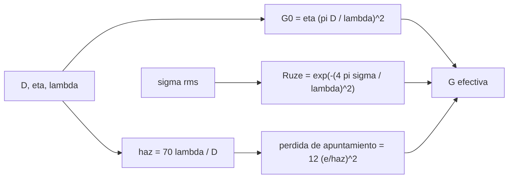

# B89-C06 — Ganancias y pérdidas de antena

<!-- nav:top -->
[🏠 Programa](../../../../README.md) · [📚 Bloque B89](../../../tronco-comun/B89-comunicaciones-y-navegacion-satelital.md) · [← Anterior: B89-C05 — Presupuesto de enlace](../B89-C05-presupuesto-de-enlace/CLASE.md) · [Siguiente: B89-C07 — Figura de ruido de receptor →](../B89-C07-figura-de-ruido-de-receptor/CLASE.md)
<!-- /nav -->

## 1. Ubicación, nivel y alcance

Clase 6 del bloque B89, nivel N3. La ganancia de una antena no es solo `(πD/λ)²`: se reduce por la eficiencia de iluminación, por el error de superficie y por el apuntamiento. Aquí calculas esas pérdidas para una parábola sintética de 2 m en X y Ka. Usas [B89-C03](../B89-C03-bandas-vhf-uhf-s-x-ka/CLASE.md) para la ganancia de apertura y [B89-C05](../B89-C05-presupuesto-de-enlace/CLASE.md) para el lugar de estos términos en el presupuesto. Los parámetros de la antena son sintéticos.

## 2. Por qué esta clase existe

Una antena mal apuntada o con la superficie deformada pierde decibelios que ningún amplificador recupera, y esas pérdidas crecen con la frecuencia. La decisión central: **¿qué ganancia efectiva da una antena y a qué frecuencia deja de compensar subir la frecuencia?**

## 3. Lo que podrás hacer al terminar

1. Calcular la ganancia de apertura `η(πD/λ)²` en dBi.
2. Calcular el ancho de haz con `70 λ/D`.
3. Calcular la pérdida por apuntamiento con el modelo `12(θ_e/θ₃dB)²`.
4. Calcular la pérdida por error de superficie de Ruze `exp[−(4πσ/λ)²]`.
5. Hallar la frecuencia de ganancia máxima `f* = c/(4πσ)` y comprobarla numéricamente.
6. Rotular lo consultado (`c`) frente a lo sintético (antena).

La evidencia es la **ficha de una antena de parábola** del ejercicio 12 (sección 20).

## 4. Con qué llegas y cómo comprobarlo

1. ¿Qué es la ganancia de una antena?
2. ¿Qué es el ancho de haz?
3. ¿Qué es un error de superficie rms?
4. ¿Qué es un error de apuntamiento?
5. ¿Qué es un dato sintético?

<details>
<summary>Ver respuestas</summary>

1. La razón de su densidad de flujo máxima a la de una isótropa, en dBi. 2. El ángulo entre los puntos de media potencia. 3. La desviación cuadrática media de la superficie respecto de la parábola ideal. 4. El ángulo entre el eje de la antena y la dirección del otro extremo. 5. Un dato inventado para el ejemplo.
</details>

Con cuatro o cinco aciertos, sigue; si no, repasa los prerrequisitos.

## 5. Un caso de contexto y casos de referencia

Una parábola sintética de 2 m con `η = 0,65` y `σ = 0,3 mm` da `43,04 dBi` en X (pierde `0,048 dB` por superficie) y `54,66 dBi` en Ka (pierde `0,70 dB`). Es el **ejemplo conductor**; ningún valor es de una antena real.

## 6. Vocabulario

La **ganancia** es `G = η e^{−(4πσ/λ)²} (πD/λ)²`. **Ruze** es el factor `e^{−(4πσ/λ)²}` de pérdida por error de superficie rms `σ`. El **ancho de haz** es `θ₃dB ≈ 70 λ/D`. La **pérdida por apuntamiento** es `12 (θ_e/θ₃dB)²` dB. La **frecuencia óptima** `f* = c/(4πσ)` maximiza la ganancia de una parábola con `σ` fija.

## 7. Modelo mental: un espejo que enfoca luz si es liso y está bien apuntado



*Descripción textual:* la ganancia ideal se corrige con Ruze y con la pérdida por apuntamiento, que depende del ancho de haz.

Analogía: un espejo curvo enfoca bien la luz si es liso y está orientado; con rugosidades o mal apuntado, enfoca menos. Límite: Ruze y el modelo gaussiano de apuntamiento son aproximaciones; los lóbulos laterales y el bloqueo del alimentador no se modelan.

## 8. La explicación, paso a paso

### 8.1 Ganancia ideal

Con `D = 2 m`, `η = 0,65`: `43,04 dBi` en X (8,4 GHz) y `54,66 dBi` en Ka (32 GHz). Duplicar `D` suma `6,021 dB`.

### 8.2 Error de superficie (Ruze)

Con `σ = 0,3 mm`: en X pierde `0,048 dB` (casi nada); en Ka, `0,70 dB`. La ganancia efectiva en Ka es `53,96 dBi`.

### 8.3 Apuntamiento

Haz de `1,249°` en X y `0,328°` en Ka. Un error de 0,5° cuesta `1,923 dB` en X y `27,9 dB` en Ka; de 0,1°, `0,077 dB` y `1,116 dB`.

### 8.4 Frecuencia óptima

La ganancia de una parábola con `σ` fija tiene un máximo en `f* = c/(4πσ) = 79,52 GHz`; la búsqueda numérica da `79,52 GHz`. Por encima de `f*` subir la frecuencia ya no compensa; en el máximo la ganancia es `58,22 dBi`.

## 9. Magnitudes, símbolos y unidades

| Símbolo | Qué es | Unidad | Valor / nota |
|---|---|---|---|
| `D` | diámetro | m | 2,0 (sintético) |
| `η` | eficiencia de apertura | — | 0,65 (sintético) |
| `σ` | error de superficie rms | m | 3×10⁻⁴ (sintético) |
| `G` | ganancia | dBi | 42,99 (X) |
| `θ₃dB` | ancho de haz | grados | 1,249 (X) |
| `θ_e` | error de apuntamiento | grados | 0,1 a 1,0 |
| `f*` | frecuencia de ganancia máxima | Hz | 79,52×10⁹ |

## 10. Convenciones y referencias

Parábola de apertura circular, iluminación con eficiencia constante, error de superficie gaussiano, lóbulo principal gaussiano. Dimensiones, ángulos en grados, ganancias en dBi. Todos los parámetros de la antena son sintéticos; `c` es la constante exacta del SI.

## 11. De dónde sale lo que afirmamos

| ID | Fuente | Localizador | Respalda | Estado |
|---|---|---|---|---|
| S1 | NIST, CODATA 2022: velocidad de la luz en el vacio — https://physics.nist.gov/cgi-bin/cuu/Value?c (consultada 2026-11-10) | valor de la pagina | c = 299 792 458 m/s (exacta) | Consultada |
| — | Relaciones estándar (ganancia de apertura, fórmula de Ruze, pérdida de apuntamiento `12(θ/θ₃dB)²`) | — | las verifica el laboratorio con una segunda vía (búsqueda numérica del máximo) | No consultada en una fuente concreta |

Límites: no se consultó el artículo original de Ruze ni un libro de antenas; las fórmulas son estándar y se verifican en el laboratorio solo en su coherencia matemática.

## 12. Cómo ver las pérdidas de la antena

| Magnitud | Valor |
|---|---|
| `G` en X con Ruze | 42,99 dBi |
| pérdida de Ruze en Ka | 0,70 dB |
| pérdida a 0,5° en X | 1,923 dB |
| pérdida a 0,5° en Ka | 27,9 dB |
| `f*` | 79,52 GHz |

Descripción larga: la ganancia sube con la frecuencia hasta `f*`, el error de superficie la penaliza y el apuntamiento pesa mucho más en el haz estrecho de Ka.

## 13. Ejemplo trabajado: la ganancia en Ka

**Paso 1 · Ganancia ideal.** `λ = 9,369 mm`; `G = 0,65 (π×2/λ)²` → `54,66 dBi`.

**Paso 2 · Ruze.** `exp[−(4π×0,3 mm/λ)²] = exp[−0,162]`: `-0,70 dB`.

**Paso 3 · Ganancia efectiva.** `54,66 − 0,70 = 53,96 dBi`.

**Paso 4 · Apuntamiento 0,1°.** `12(0,1/0,328)² = 1,116 dB`.

## 14. Distintas formas de describir las pérdidas de una antena

**Por ganancia:** `G` en dBi. **Por geometría:** `D` y `λ`. **Por calidad:** `σ` y Ruze. **Por orientación:** `θ_e`. **Por frecuencia óptima:** `f*`.

## 15. Práctica guiada

**Ejercicio 1 · con los pasos indicados.** Calcula `θ₃dB` de 2 m en X. *Pasos:* `70 λ/D`.

<details><summary>Solución comentada</summary>

`1,249°`.
</details>

**Ejercicio 2 · con una pista.** Predice la pérdida a 0,2° en X. *Pista:* proporcional a `θ_e²`.

<details><summary>Solución comentada</summary>

`0,308 dB` (cuatro veces la de 0,1°).
</details>

**Ejercicio 3 · casi autónomo.** ¿Por qué la pérdida de Ruze es despreciable en X y no en Ka con el mismo `σ`?

<details><summary>Solución comentada</summary>

Porque el exponente va con `(σ/λ)²`: Ka tiene `λ` menor; compara `σ/λ` en cada banda.
</details>

## 16. Práctica autónoma, transferencia e integrador

**Ejercicio 4 · autónomo.** Ganancia de la misma antena con `η = 0,5`, en X, sin Ruze.

<details><summary>Solución comentada</summary>

`41,90 dBi`.
</details>

**Ejercicio 5 · autónomo.** `σ` que duplica la pérdida de Ruze en dB.

<details><summary>Solución comentada</summary>

Como el exponente es `(σ/λ)²`, `σ` debe multiplicarse por `√2`: 0,42 mm.
</details>

**Ejercicio 6 · autónomo.** Pérdida a 1,0° en X.

<details><summary>Solución comentada</summary>

`7,69 dB`.
</details>

**Ejercicio 7 · autónomo.** Pérdida de Ruze si `σ = 0`.

<details><summary>Solución comentada</summary>

`0 dB`: la ganancia es la ideal.
</details>

**Ejercicio 8 · autónomo.** `f*` para `σ = 0,1 mm`.

<details><summary>Solución comentada</summary>

`c/(4π×10⁻⁴) = 238,6 GHz`.
</details>

**Ejercicio 9 · transferencia.** **Transferencia.** Un diseñador de un satélite pequeño con apuntamiento de 1° quiere una antena Ka de 2 m. ¿Qué pasa?

<details><summary>Solución comentada</summary>

Pierde `112 dB` por apuntamiento, inutilizable; necesita mecanismo de apuntamiento fino o una antena de haz más ancho.
</details>

**Ejercicio 10 · transferencia.** **Transferencia.** Una antena de 0,3 mm de error se usa a 90 GHz. ¿Qué ocurre con la ganancia?

<details><summary>Solución comentada</summary>

Está por encima de `f*` = `80 GHz`: la pérdida de Ruze supera a la ganancia de apertura que se esperaba al subir `f`.
</details>

**Ejercicio 11 · transferencia.** **Transferencia.** Un presupuesto usa 0 dB de apuntamiento «porque el sistema es de seguimiento». ¿Qué falta?

<details><summary>Solución comentada</summary>

El error residual de seguimiento no es cero; hay que asignarle un valor (aquí sintético) y su pérdida.
</details>

**Ejercicio 12 · integrador.** **Integrador.** Elabora tu *ficha de una antena de parábola*: `G` ideal y efectiva en X y Ka, haz, pérdidas por apuntamiento y `f*`, con qué es consultado y sintético.

<details><summary>Solución comentada</summary>

Secciones 8.1–8.4 y la salida del laboratorio.
</details>

## 17. Laboratorio: ficha de una parábola de 2 m

El script [antena.py](antena.py) calcula la ganancia ideal y efectiva en X y Ka, el haz, las pérdidas por apuntamiento y la frecuencia óptima de Ruze (**comprueba** que la búsqueda numérica del máximo coincide con `c/(4πσ)` a 1e-3 y que duplicar `D` suma 6,02 dB).

**Datos:** `c` de NIST CODATA 2022 (consultada); diámetro, eficiencia y error de superficie **sintéticos**. **Predice antes de ejecutar:** ¿a qué frecuencia está el máximo de ganancia? (~79,5 GHz.) **Ejecución del 2026-11-10 (Python 3.12.9):**

```text
3.12.9 (biblioteca estandar)
SINTETICO: parabola D = 2 m, eficiencia 0.65, error de superficie rms 0.3 mm
  G(X 8.4 GHz) = 43.04 dBi ; con Ruze = 42.99 dBi (perdida -0.048 dB)
  G(Ka 32 GHz) = 54.66 dBi ; con Ruze = 53.96 dBi (perdida -0.703 dB)
  Haz X = 1.249 deg ; haz Ka = 0.328 deg
  error de apuntamiento 0.1 deg: perdida X =  0.077 dB ; Ka =   1.116 dB
  error de apuntamiento 0.5 deg: perdida X =  1.923 dB ; Ka =  27.903 dB
  error de apuntamiento 1.0 deg: perdida X =  7.691 dB ; Ka = 111.610 dB
  frecuencia de ganancia maxima (Ruze) = 79.52 GHz ; busqueda numerica = 79.52 GHz
  G en el maximo = 58.22 dBi ; duplicar D suma 6.021 dB
Pruebas superadas.
```

```bash
python programa/clases/B89/B89-C06-ganancias-y-perdidas-de-antena/antena.py
```

**Límites:** el modelo gaussiano de apuntamiento solo vale para errores de unas décimas del ancho de haz (los valores de decenas de dB del laboratorio indican «fuera de rango», no una pérdida medible); sin lóbulos laterales ni bloqueo; Ruze aproximado; no representa una antena real.

## 18. Errores frecuentes y cómo corregirlos

**Usar la ganancia ideal sin el error de superficie en Ka.** Se corrige con 8.2.

**Despreciar el apuntamiento en haces estrechos.** Se corrige con 8.3.

**Creer que subir la frecuencia siempre sube la ganancia.** Se corrige con 8.4.

**Presentar la antena sintética como un equipo real.** Se corrige con la sección 10.

## 19. Cómo sabrás que vas bien

Tras la sección 8: ¿qué pérdida esperabas por apuntamiento en Ka a 0,5° y cuál obtuviste? Si dudas, repasa el ejemplo 13. Tras el laboratorio: ¿qué comprueba? (ver la sección 17).

## 20. Qué entregas y cómo se evalúa

El producto es tu **ficha de una antena de parábola** (ejercicio 12).

| Criterio | Inicial | En desarrollo | Logrado | Destacado |
|---|---|---|---|---|
| Conceptos | Los confunde | Parciales | Calcula `G`, haz, Ruze y apuntamiento | Explica los límites |
| Cálculo | Sin unidades | Con errores | Tablas completas con unidades | Calcula casos nuevos |
| Numérico | Sin comprobar | Un caso | Contraste con una segunda vía | Interpreta las diferencias |
| Fuentes | Sin fuente | Sin fecha | Fuentes con fecha y estado | Declara lo sintético y lo no consultado |
| Límites | No los nombra | Uno | Tres | Discute qué falta del modelo |

**Condiciones críticas (no se compensan con promedio):** rotular la antena como sintética; separar ganancia ideal de efectiva; no presentar un cálculo como una medición; citar solo lo consultado.

## 21. Ética, seguridad y límites

Clase educativa: los modelos son simplificados y sus datos son sintéticos o ilustrativos; ningún resultado describe un enlace, un satélite ni una misión reales, ni sustituye a la documentación oficial de una misión, a un presupuesto de enlace verificado ni a la coordinación regulatoria.  Accesibilidad: tablas equivalentes a las gráficas, fórmulas en texto, ejercicios sin conexión.

## 22. Para cerrar y seguir

La parábola de 2 m da `42,99 dBi` en X y `53,96 dBi` en Ka, pero un error de 0,5° cuesta `28 dB` en Ka. Queda una pregunta: ¿cuánto ruido añade el propio receptor?

**Glosario español–inglés.** ganancia de antena · *antenna gain*; error de superficie · *surface error*; pérdida por apuntamiento · *pointing loss*; ancho de haz · *beamwidth*; eficiencia de apertura · *aperture efficiency*.

**Continuidad.** [B89-C07](../B89-C07-figura-de-ruido-de-receptor/CLASE.md) calcula el ruido del receptor y la figura de mérito `G/T`.

**Referencias:** ver sección 11.

<!-- nav:bottom -->
---

[← Anterior: B89-C05 — Presupuesto de enlace](../B89-C05-presupuesto-de-enlace/CLASE.md) · [📚 Bloque B89](../../../tronco-comun/B89-comunicaciones-y-navegacion-satelital.md) · [Siguiente: B89-C07 — Figura de ruido de receptor →](../B89-C07-figura-de-ruido-de-receptor/CLASE.md)
<!-- /nav -->
