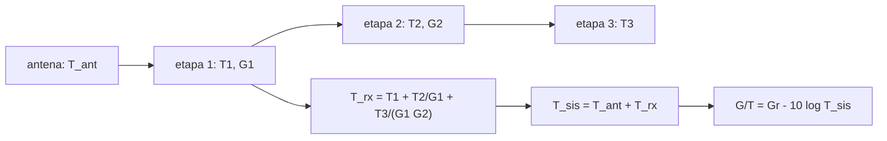

# B89-C07 — Figura de ruido de receptor

<!-- nav:top -->
[🏠 Programa](../../../../README.md) · [📚 Bloque B89](../../../tronco-comun/B89-comunicaciones-y-navegacion-satelital.md) · [← Anterior: B89-C06 — Ganancias y pérdidas de antena](../B89-C06-ganancias-y-perdidas-de-antena/CLASE.md) · [Siguiente: B89-C08 — Modulación digital →](../B89-C08-modulacion-digital/CLASE.md)
<!-- /nav -->

## 1. Ubicación, nivel y alcance

Clase 7 del bloque B89, nivel N3. El receptor añade ruido propio; la figura de ruido y la temperatura de ruido son dos formas de describirlo. Aquí calculas la temperatura de una cadena receptora con la fórmula de Friis, comparas el orden de las etapas y obtienes `G/T`. Usas [B89-C05](../B89-C05-presupuesto-de-enlace/CLASE.md) para dónde entra `G/T` y [B89-C06](../B89-C06-ganancias-y-perdidas-de-antena/CLASE.md) para `G`. Las etapas y la temperatura de antena son sintéticas.

## 2. Por qué esta clase existe

La primera etapa de una cadena receptora decide casi todo el ruido: un amplificador de bajo ruido bien colocado vale muchos decibelios de `G/T`. La decisión central: **¿qué orden y qué componentes dan la menor temperatura de sistema y el mayor `G/T`?**

## 3. Lo que podrás hacer al terminar

1. Convertir figura de ruido en temperatura de ruido y viceversa.
2. Calcular la temperatura de una cadena en cascada con Friis.
3. Comparar el efecto del orden de las etapas.
4. Calcular la temperatura de sistema y `G/T`.
5. Calcular la densidad de ruido `N₀ = k T_sis`.
6. Rotular lo consultado (`k`) frente a lo sintético (cadena, `T_antena`).

La evidencia es la **ficha de ruido y G/T de una cadena receptora** del ejercicio 12 (sección 20).

## 4. Con qué llegas y cómo comprobarlo

1. ¿Qué es el ruido térmico?
2. ¿Qué es una figura de ruido?
3. ¿Qué es una pérdida pasiva en dB?
4. ¿Qué es `G/T`?
5. ¿Qué es un dato sintético?

<details>
<summary>Ver respuestas</summary>

1. El ruido de potencia `k T B` generado por el movimiento térmico de portadores. 2. La razón entre el ruido de salida real y el de un dispositivo ideal a 290 K, normalmente en dB. 3. Una ganancia negativa que además agrega ruido térmico. 4. Ganancia de antena menos 10 log de la temperatura de sistema. 5. Un dato inventado para el ejemplo.
</details>

Con cuatro o cinco aciertos, sigue; si no, repasa los prerrequisitos.

## 5. Un caso de contexto y casos de referencia

Con un LNA de 0,6 dB, 30 dB de ganancia, un cable de 1 dB y un receptor de 8 dB, poner el LNA primero da `T_rx = 44,98 K` (`NF = 0,626 dB`); poner el cable primero da `131,12 K`; sin LNA, `2013,6 K`. Con `T_antena = 25 K` y `G_r = 68 dBi`, `G/T` vale `49,55`, `46,07` y `34,91 dB/K`. Es el **ejemplo conductor**; todo es sintético.

## 6. Vocabulario

La **temperatura de ruido** de un dispositivo es `T = T₀(F − 1)` con `T₀ = 290 K`. La **figura de ruido** `NF = 10 log₁₀ F`. La **fórmula de Friis para el ruido** da `T = T₁ + T₂/G₁ + T₃/(G₁G₂) + …`. La **temperatura de sistema** es `T_sis = T_ant + T_rx`. **`G/T`** es `G_r − 10 log₁₀ T_sis`. La **densidad de ruido** es `N₀ = k T_sis`.

## 7. Modelo mental: una cadena de montaje donde el primer eslabón importa más



*Descripción textual:* las etapas se suman con el ruido de las posteriores dividido por la ganancia acumulada; sumada la temperatura de antena se obtiene `T_sis` y de ahí `G/T`.

Analogía: un error en el primer eslabón de una cadena de montaje se arrastra a todo lo que sigue; uno al final casi no pesa. Límite: se supone linealidad, adaptación de impedancias y ruido blanco; no se modela la compresión ni el ruido de fase.

## 8. La explicación, paso a paso

### 8.1 Figura y temperatura

`T = 290 (10^(NF/10) − 1)`. El LNA de 0,6 dB tiene `42,96 K`; el receptor de 8 dB, `1539,8 K`; el cable de 1 dB, `75,1 K`.

### 8.2 Cascada

Con el LNA primero: `T_rx = 44,98 K`; con el cable primero, `131,12 K`; sin LNA, `2013,6 K`. La figura de ruido equivalente es `0,626`, `1,620` y `9,00 dB`. La fórmula de Friis en factores de ruido da lo mismo (diferencia menor que 10⁻⁹ dB).

### 8.3 Temperatura de sistema y G/T

`T_sis = 25 + T_rx`: `69,98`, `156,12` y `2038,6 K`. `G/T = 68 − 10 log₁₀ T_sis`: `49,55`, `46,07` y `34,91 dB/K`. El LNA primero mejora `G/T` en `14,64 dB` frente a no tenerlo.

### 8.4 Densidad de ruido

`N₀ = k T_sis`: `-210,15 dBW/Hz` con el LNA primero. Es el término que entra en `C/N0` (C05).

## 9. Magnitudes, símbolos y unidades

| Símbolo | Qué es | Unidad | Valor / nota |
|---|---|---|---|
| `NF` | figura de ruido | dB | 0,626 (cadena) |
| `T₀` | temperatura de referencia | K | 290 (convencional) |
| `T_rx` | temperatura de ruido del receptor | K | 44,98 |
| `T_ant` | temperatura de antena | K | 25 (sintético) |
| `T_sis` | temperatura de sistema | K | 69,98 |
| `G/T` | figura de mérito | dB/K | 49,55 |
| `N₀` | densidad de ruido | dBW/Hz | -210,15 |

## 10. Convenciones y referencias

Ruido blanco gaussiano, cadena lineal adaptada, pérdidas pasivas a 290 K. Temperaturas en kelvin, ganancias y figuras de ruido en dB. Las etapas y `T_antena` son sintéticas; `k` es la constante exacta del SI (CODATA 2022); `T₀ = 290 K` es la referencia convencional de la figura de ruido (no consultada).

## 11. De dónde sale lo que afirmamos

| ID | Fuente | Localizador | Respalda | Estado |
|---|---|---|---|---|
| S1 | NIST, CODATA 2022: constante de Boltzmann — https://physics.nist.gov/cgi-bin/cuu/Value?k (consultada 2026-11-10) | valor de la pagina | k = 1,380 649 × 10⁻²³ J/K (exacta) | Consultada |
| — | Convención `T₀ = 290 K` y relaciones estándar (Friis, `T = T₀(F−1)`) | — | la convención es estándar y la fórmula se verifica en el laboratorio con una segunda vía | No consultada en una fuente concreta |

Límites: no se consultó ninguna hoja de datos ni estándar de medida de ruido; las etapas son sintéticas.

## 12. Cómo ver el ruido de la cadena

| Magnitud | Valor |
|---|---|
| `T_rx` con LNA primero | 44,98 K |
| `T_rx` con cable primero | 131,12 K |
| `G/T` con LNA primero | 49,55 dB/K |
| `G/T` sin LNA | 34,91 dB/K |
| mejora por el LNA | 14,64 dB |

Descripción larga: poner el amplificador de bajo ruido antes de la pérdida del cable reduce la temperatura a una fracción y sube `G/T` varios decibelios.

## 13. Ejemplo trabajado: la temperatura con el LNA primero

**Paso 1 · LNA.** `T₁ = 290(10^0,06 − 1) = 42,96 K`.

**Paso 2 · Cable.** `T₂ = 290(10^0,1 − 1) = 75,1 K`, dividido por `G₁ = 1000`: `0,075 K`.

**Paso 3 · Receptor.** `T₃ = 1539,8 K` dividido por `G₁G₂ = 794,3`: `1,938 K`.

**Paso 4 · Suma.** `T_rx = 44,98 K`.

## 14. Distintas formas de describir el ruido de un receptor

**Por figura de ruido:** `NF` en dB. **Por temperatura:** `T` en K. **Por cascada:** Friis. **Por sistema:** `T_sis` y `G/T`. **Por densidad:** `N₀`.

## 15. Práctica guiada

**Ejercicio 1 · con los pasos indicados.** Convierte `NF = 3 dB` en temperatura. *Pasos:* `290(10^0,3 − 1)`.

<details><summary>Solución comentada</summary>

`288,6 K`.
</details>

**Ejercicio 2 · con una pista.** Predice qué pasa con `T_rx` si el cable de 1 dB pasa delante del LNA. *Pista:* el cable divide el efecto del LNA.

<details><summary>Solución comentada</summary>

Sube de `44,98` a `131,12 K`.
</details>

**Ejercicio 3 · casi autónomo.** ¿Por qué las etapas posteriores al LNA casi no importan?

<details><summary>Solución comentada</summary>

Porque su ruido se divide por la ganancia acumulada (`G₁ = 1000`).
</details>

## 16. Práctica autónoma, transferencia e integrador

**Ejercicio 4 · autónomo.** `G/T` si `G_r = 60 dBi` y `T_sis = 100 K`.

<details><summary>Solución comentada</summary>

`60 − 20 = 40 dB/K`.
</details>

**Ejercicio 5 · autónomo.** Temperatura de un cable pasivo de 3 dB a 290 K.

<details><summary>Solución comentada</summary>

`290(10^0,3 − 1) = 288,6 K`.
</details>

**Ejercicio 6 · autónomo.** `N₀` en dBW/Hz para `T_sis = 70,0 K`.

<details><summary>Solución comentada</summary>

`-210,15 dBW/Hz`.
</details>

**Ejercicio 7 · autónomo.** Mejora de `G/T` al pasar de `T_sis = 100 K` a `50 K`.

<details><summary>Solución comentada</summary>

`10 log₁₀ 2 = 3,01 dB`.
</details>

**Ejercicio 8 · autónomo.** `NF` de la cadena sin LNA.

<details><summary>Solución comentada</summary>

`9,00 dB`.
</details>

**Ejercicio 9 · transferencia.** **Transferencia.** Un diseñador pone el LNA tras 20 m de cable de 3 dB por «comodidad». ¿Qué pierde?

<details><summary>Solución comentada</summary>

Casi 3 dB de `G/T` o más: el cable pasivo ya impone `288,6 K` antes del LNA.
</details>

**Ejercicio 10 · transferencia.** **Transferencia.** Una estación fría (criogénica) baja el LNA a 10 K. ¿Cuánto mejora `G/T` frente a `T_sis` de 50 K?

<details><summary>Solución comentada</summary>

A `T_sis = 35 K`: `10 log₁₀(50/35) = 1,55 dB` (los valores son sintéticos).
</details>

**Ejercicio 11 · transferencia.** **Transferencia.** Una hoja de datos dice «NF 0,6 dB» sin temperatura ambiente. ¿Qué falta?

<details><summary>Solución comentada</summary>

La temperatura de referencia y la frecuencia; la figura depende de ellas, y aquí se usa `T₀ = 290 K` por convención.
</details>

**Ejercicio 12 · integrador.** **Integrador.** Elabora tu *ficha de ruido y G/T de una cadena receptora*: tabla de `T_rx`, `NF`, `T_sis`, `G/T` y `N₀` para tres órdenes, con qué es consultado y sintético.

<details><summary>Solución comentada</summary>

Secciones 8.1–8.4 y la salida del laboratorio.
</details>

## 17. Laboratorio: cascada de ruido y G/T

El script [ruido.py](ruido.py) calcula la temperatura de ruido de tres cadenas con Friis y la contrasta con la fórmula en factores de ruido (**comprueba** diferencia < 1e-9 dB); obtiene `T_sis`, `G/T` y `N₀`.

**Datos:** `k` de NIST CODATA 2022 (consultada); etapas y `T_antena` **sintéticas**; `T₀ = 290 K` convencional. **Predice antes de ejecutar:** ¿qué cadena tiene la menor `T_rx`? (LNA primero.) **Ejecución del 2026-11-10 (Python 3.12.9):**

```text
3.12.9 (biblioteca estandar)
SINTETICO: LNA 30 dB / 0.6 dB, cable 1 dB, receptor 40 dB / 8 dB ; T_antena = 25 K ; Gr = 68 dBi ; T0 = 290 K
orden           T_rx [K]   NF [dB]  NF Friis  T_sis [K]  G/T [dB/K]  N0 [dBW/Hz]
LNA primero        44.98     0.626     0.626      69.98       49.55      -210.15
cable primero     131.12     1.620     1.620     156.12       46.07      -206.66
sin LNA          2013.55     9.000     9.000    2038.55       34.91      -195.51
T del LNA solo (NF 0.6 dB) = 42.96 K ; mejora de G/T con LNA primero frente a sin LNA = 14.64 dB
Pruebas superadas.
```

```bash
python programa/clases/B89/B89-C07-figura-de-ruido-de-receptor/ruido.py
```

**Límites:** linealidad, ruido blanco y adaptación perfecta; sin compresión, intermodulación ni ruido de fase.

## 18. Errores frecuentes y cómo corregirlos

**Poner la pérdida del cable después del LNA en el cálculo cuando está antes.** Se corrige con 8.2.

**Sumar figuras de ruido en dB en vez de temperaturas.** Se corrige con 8.2.

**Olvidar la temperatura de la antena.** Se corrige con 8.3.

**Presentar la cadena sintética como un receptor real.** Se corrige con la sección 10.

## 19. Cómo sabrás que vas bien

Tras la sección 8: ¿qué orden esperabas como mejor y cuál lo fue? Si dudas, repasa el ejemplo 13. Tras el laboratorio: ¿qué comprueba? (ver la sección 17).

## 20. Qué entregas y cómo se evalúa

El producto es tu **ficha de ruido y G/T de una cadena receptora** (ejercicio 12).

| Criterio | Inicial | En desarrollo | Logrado | Destacado |
|---|---|---|---|---|
| Conceptos | Los confunde | Parciales | Calcula `T`, `NF` y `G/T` | Explica los límites |
| Cálculo | Sin unidades | Con errores | Tablas completas con unidades | Calcula casos nuevos |
| Numérico | Sin comprobar | Un caso | Contraste con una segunda vía | Interpreta las diferencias |
| Fuentes | Sin fuente | Sin fecha | Fuentes con fecha y estado | Declara lo sintético y lo no consultado |
| Límites | No los nombra | Uno | Tres | Discute qué falta del modelo |

**Condiciones críticas (no se compensan con promedio):** rotular la cadena como sintética; declarar `T₀`; usar `k` con su fuente y fecha; no presentar un cálculo como una medición; citar solo lo consultado.

## 21. Ética, seguridad y límites

Clase educativa: los modelos son simplificados y sus datos son sintéticos o ilustrativos; ningún resultado describe un enlace, un satélite ni una misión reales, ni sustituye a la documentación oficial de una misión, a un presupuesto de enlace verificado ni a la coordinación regulatoria.  Accesibilidad: tablas equivalentes a las gráficas, fórmulas en texto, ejercicios sin conexión.

## 22. Para cerrar y seguir

El mismo LNA da `49,55 dB/K` primero y `46,07 dB/K` tras el cable. Queda una pregunta: ¿cómo se codifica la información sobre la portadora?

**Glosario español–inglés.** figura de ruido · *noise figure*; temperatura de ruido · *noise temperature*; amplificador de bajo ruido · *low-noise amplifier (LNA)*; temperatura de sistema · *system noise temperature*; figura de mérito · *figure of merit (G/T)*.

**Continuidad.** [B89-C08](../B89-C08-modulacion-digital/CLASE.md) estudia la modulación digital.

**Referencias:** ver sección 11.

<!-- nav:bottom -->
---

[← Anterior: B89-C06 — Ganancias y pérdidas de antena](../B89-C06-ganancias-y-perdidas-de-antena/CLASE.md) · [📚 Bloque B89](../../../tronco-comun/B89-comunicaciones-y-navegacion-satelital.md) · [Siguiente: B89-C08 — Modulación digital →](../B89-C08-modulacion-digital/CLASE.md)
<!-- /nav -->
