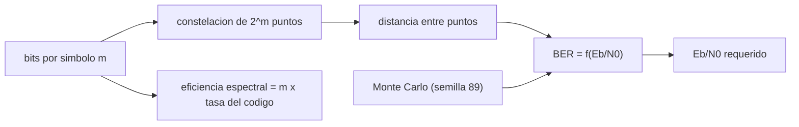

# B89-C08 — Modulación digital

<!-- nav:top -->
[🏠 Programa](../../../../README.md) · [📚 Bloque B89](../../../tronco-comun/B89-comunicaciones-y-navegacion-satelital.md) · [← Anterior: B89-C07 — Figura de ruido de receptor](../B89-C07-figura-de-ruido-de-receptor/CLASE.md) · [Siguiente: B89-C09 — Codificación correctora de errores →](../../../tronco-comun/B89-comunicaciones-y-navegacion-satelital.md#b89-c09)
<!-- /nav -->

## 1. Ubicación, nivel y alcance

Clase 8 del bloque B89, nivel N3. Modular es elegir cuántos bits lleva cada símbolo y cómo se separan sus puntos en el plano de señal; más bits por símbolo ahorran espectro pero exigen más `Eb/N0`. Aquí comparas BPSK, QPSK, 8PSK y 16QAM por su tasa de error de bit teórica y la contrastas con una simulación de Monte Carlo con semilla fija. Usas [B89-C02](../B89-C02-frecuencia-y-espectro-espacial/CLASE.md) para la eficiencia espectral y [B89-C05](../B89-C05-presupuesto-de-enlace/CLASE.md) para el `Eb/N0`. El canal es sintético (ruido blanco gaussiano).

## 2. Por qué esta clase existe

La elección de la modulación fija el `Eb/N0` requerido en el presupuesto de enlace y el ancho de banda ocupado; es la base de la codificación y la sincronización siguientes. La decisión central: **¿qué modulación da la tasa que necesito con el `Eb/N0` que mi enlace puede ofrecer?**

## 3. Lo que podrás hacer al terminar

1. Calcular la BER teórica de BPSK, QPSK, 8PSK y 16QAM con la función `erfc`.
2. Hallar el `Eb/N0` requerido para una BER objetivo por bisección.
3. Relacionar bits por símbolo con eficiencia espectral y con `Eb/N0` requerido.
4. Simular BPSK, QPSK y 16QAM con semilla fija.
5. Comparar simulación y teoría con una tolerancia estadística.
6. Rotular lo sintético (canal, simulación) y las aproximaciones no consultadas.

La evidencia es la **tabla de BER teórica y simulada** del ejercicio 12 (sección 20).

## 4. Con qué llegas y cómo comprobarlo

1. ¿Qué es un símbolo y cuántos bits lleva en 16QAM?
2. ¿Qué es el `Eb/N0`?
3. ¿Qué es la BER?
4. ¿Qué es el ruido blanco gaussiano aditivo (AWGN)?
5. ¿Qué es una semilla fija?

<details>
<summary>Ver respuestas</summary>

1. La unidad de señalización; 4 bits. 2. La energía por bit dividida por la densidad espectral de ruido. 3. La fracción de bits recibidos con error. 4. Un ruido con densidad espectral plana y amplitudes gaussianas, sumado a la señal. 5. Un valor inicial del generador aleatorio que hace reproducible la simulación.
</details>

Con cuatro o cinco aciertos, sigue; si no, repasa los prerrequisitos.

## 5. Un caso de contexto y casos de referencia

A `Eb/N0 = 8 dB`, BPSK tiene BER `1,91e-04` y 16QAM `9,25e-03`; para llegar a 10⁻⁵ BPSK y QPSK piden `9,59 dB`, 8PSK `12,97 dB` y 16QAM `13,43 dB`. Una simulación sintética a 4 dB con 200 000 bits da `1,20e-02` para BPSK frente a la teoría `1,25e-02`. Es el **ejemplo conductor**.

## 6. Vocabulario

**BPSK** usa 2 fases (1 bit/símbolo); **QPSK**, 4 (2 bits); **8PSK**, 8 (3 bits); **16QAM**, 16 amplitudes y fases (4 bits). La **BER** de BPSK en AWGN es `Q(√(2Eb/N0)) = ½ erfc(√(Eb/N0))`. La **codificación de Gray** hace que símbolos vecinos difieran en un bit. El **`Eb/N0` requerido** es el que da una BER objetivo. La **simulación de Monte Carlo** estima la BER contando errores.

## 7. Modelo mental: constelaciones más o menos apretadas



*Descripción textual:* más bits por símbolo dan una constelación más densa y una menor distancia entre puntos, lo que eleva el `Eb/N0` requerido; la simulación contrasta la BER teórica.

Analogía: más personas en la misma sala obligan a hablar más alto para entenderse. Límite: el modelo es AWGN con sincronismo perfecto; el canal real tiene fase, no linealidades y desvanecimiento.

## 8. La explicación, paso a paso

### 8.1 BER teórica

BPSK y QPSK: `Q(√(2γ))`, con `γ = Eb/N0`. 8PSK: `erfc(√(3γ) sin(π/8))/3`. 16QAM: `(3/8) erfc(√(0,4γ))` (aproximaciones con Gray, relaciones estándar no consultadas). A 8 dB: BPSK `1,91e-04`; 8PSK `6,18e-03`; 16QAM `9,25e-03`.

### 8.2 Eb/N0 requerido

Para BER 10⁻⁵ (bisección): BPSK/QPSK `9,588 dB`; 8PSK `12,97 dB`; 16QAM `13,43 dB`. QPSK duplica la eficiencia espectral sin costo en `Eb/N0`; 8PSK y 16QAM la suben a cambio de `3,4` y `3,8 dB`.

### 8.3 Monte Carlo

Con `random.Random(89)`: BPSK a 4 dB `1,20e-02` (teoría `1,25e-02`), QPSK `1,26e-02`, y 16QAM a 8 dB `9,15e-03` (teoría aproximada `9,25e-03`). Las desviaciones, medidas en errores estándar binomiales, son `1,85`, `0,40` y `0,63`, todas menores que 4.

### 8.4 Lectura

Elegir una modulación es elegir entre espectro y energía: en enlaces limitados en potencia (espacio profundo) se usa BPSK/QPSK; en enlaces limitados en ancho de banda se usan constelaciones densas.

## 9. Magnitudes, símbolos y unidades

| Símbolo | Qué es | Unidad | Valor / nota |
|---|---|---|---|
| `m` | bits por símbolo | — | 1, 2, 3, 4 |
| `γ` | `Eb/N0` | lineal / dB | 4, 8, 10 dB |
| BER | tasa de error de bit | — | 1,91e-04 |
| `Q(x)` | función Q | — | ½ erfc(x/√2) |
| `n` | bits simulados | — | 200 000 / 400 000 |
| `z` | desviación en errores estándar | — | 1,85 |

## 10. Convenciones y referencias

Canal AWGN, detección coherente con sincronismo y fase perfectos, codificación de Gray, filtrado ideal. `Eb/N0` en dB para presentación. Las BER de 8PSK y 16QAM son aproximaciones estándar; la simulación usa `random.Random(89)` y datos sintéticos.

## 11. De dónde sale lo que afirmamos

| ID | Fuente | Localizador | Respalda | Estado |
|---|---|---|---|---|
| — | Relaciones estándar (BER de BPSK/QPSK, aproximaciones de 8PSK y 16QAM, Gray) | — | las verifica el laboratorio con una simulación de Monte Carlo independiente | No consultada en una fuente concreta |
| — | CCSDS 401.0-B (modulaciones de radiofrecuencia y modulación) | — | no consultado | No consultada en una fuente concreta |

Límites: esta clase no usa constantes físicas; no se consultó ningún estándar de modulación (p. ej. CCSDS 401.0-B) ni libro de texto; todo se verifica con la simulación.

## 12. Cómo ver la BER de cuatro modulaciones

| Magnitud | Valor |
|---|---|
| BER BPSK a 8 dB | 1,91e-04 |
| BER 16QAM a 8 dB | 9,25e-03 |
| `Eb/N0` requerido BPSK | 9,59 dB |
| `Eb/N0` requerido 16QAM | 13,43 dB |
| desviación Monte Carlo BPSK | 1,85 σ |

Descripción larga: la BER baja muy rápido con el `Eb/N0`; las constelaciones densas necesitan varios decibelios más para la misma BER.

## 13. Ejemplo trabajado: BER de BPSK a 4 dB

**Paso 1 · `Eb/N0` lineal.** `10^0,4 = 2,512`.

**Paso 2 · Argumento.** `√(2γ) = √5,024 = 2,2415`.

**Paso 3 · BER.** `Q(2,2415) = 1,25e-02`.

**Paso 4 · Simulación.** `1,20e-02` con 200 000 bits, a `1,85` errores estándar.

## 14. Distintas formas de describir el rendimiento de una modulación

**Por BER vs `Eb/N0`:** curva. **Por `Eb/N0` requerido:** valor a una BER. **Por eficiencia:** bits/símbolo. **Por simulación:** conteo de errores.

## 15. Práctica guiada

**Ejercicio 1 · con los pasos indicados.** Calcula la BER de BPSK a 6 dB. *Pasos:* `γ = 10^0,6`, `Q(√(2γ))`.

<details><summary>Solución comentada</summary>

`2,39e-03`.
</details>

**Ejercicio 2 · con una pista.** Predice si QPSK necesita más `Eb/N0` que BPSK. *Pista:* cada eje es un BPSK independiente.

<details><summary>Solución comentada</summary>

No: ambos piden lo mismo (con Gray) y QPSK usa la mitad del espectro.
</details>

**Ejercicio 3 · casi autónomo.** ¿Por qué 16QAM necesita más `Eb/N0` que 8PSK?

<details><summary>Solución comentada</summary>

Porque sus puntos están más próximos entre sí a igual energía media; compara las BER a 10 dB.
</details>

## 16. Práctica autónoma, transferencia e integrador

**Ejercicio 4 · autónomo.** Eficiencia espectral de 16QAM con código de tasa 3/4.

<details><summary>Solución comentada</summary>

`4 × 0,75 = 3 bit/símbolo`.
</details>

**Ejercicio 5 · autónomo.** ¿Cuántos errores esperas en 10⁶ bits de BPSK a 8 dB?

<details><summary>Solución comentada</summary>

`190,91` (teoría).
</details>

**Ejercicio 6 · autónomo.** Error estándar de una BER de 10⁻³ con 10⁶ bits.

<details><summary>Solución comentada</summary>

`√(10⁻³/10⁶) = 3,2×10⁻⁵`, es decir 3,2 % relativo.
</details>

**Ejercicio 7 · autónomo.** Diferencia de `Eb/N0` requerido 8PSK − BPSK, en dB.

<details><summary>Solución comentada</summary>

`3,38 dB`.
</details>

**Ejercicio 8 · autónomo.** Número mínimo de bits para medir BER 10⁻⁵ con 10 % de error relativo.

<details><summary>Solución comentada</summary>

~10³ errores → `10³/10⁻⁵ = 10⁸` bits.
</details>

**Ejercicio 9 · transferencia.** **Transferencia.** Un enlace de espacio profundo con `Eb/N0` justo elige 16QAM «para ir más rápido». ¿Qué falla?

<details><summary>Solución comentada</summary>

Pasa de requerir ~9,6 a más de 13 dB; sin esa energía, la BER explota.
</details>

**Ejercicio 10 · transferencia.** **Transferencia.** Un simulador dice que su BPSK a 4 dB tiene BER 10⁻⁴. ¿Es plausible?

<details><summary>Solución comentada</summary>

No: la teoría da `1,25e-02`; una diferencia de 100 veces apunta a un error de escala (p. ej. confundir `Eb/N0` con `Es/N0`).
</details>

**Ejercicio 11 · transferencia.** **Transferencia.** Un colega usa la fórmula de 16QAM a 8 dB y la presenta como medida. ¿Qué corriges?

<details><summary>Solución comentada</summary>

Es una aproximación teórica y una simulación sintética, no una medición.
</details>

**Ejercicio 12 · integrador.** **Integrador.** Elabora tu *tabla de BER teórica y simulada*: cuatro modulaciones, tres `Eb/N0`, requerido a 10⁻⁵ y el contraste de Monte Carlo, con qué es sintético y no consultado.

<details><summary>Solución comentada</summary>

Secciones 8.1–8.4 y la salida del laboratorio.
</details>

## 17. Laboratorio: BER teórica y simulación

El script [modulacion.py](modulacion.py) calcula la BER de cuatro modulaciones, su `Eb/N0` requerido y simula BPSK, QPSK y 16QAM con `random.Random(89)` (**comprueba** que la desviación entre simulación y teoría sea menor que 4 errores estándar binomiales).

**Datos:** canal AWGN **sintético**; aproximaciones de 8PSK y 16QAM **estándar, no consultadas**; semilla 89. **Predice antes de ejecutar:** ¿qué desviación esperas entre simulación y teoría? (Menos de 4 σ, típicamente 1–2.) **Ejecución del 2026-11-10 (Python 3.12.9):**

```text
3.12.9 (biblioteca estandar), random.Random(89)
AWGN sintetico. BER teorica:
modulacion bits/simb     Eb/N0=4     Eb/N0=8    Eb/N0=10  req. 1e-5 [dB]
BPSK               1   1.250e-02   1.909e-04   3.872e-06            9.59
QPSK               2   1.250e-02   1.909e-04   3.872e-06            9.59
8PSK               3   4.579e-02   6.181e-03   1.011e-03           12.97
16QAM              4   5.862e-02   9.247e-03   1.754e-03           13.43
Monte Carlo a Eb/N0 = 4 dB (200000 bits): BPSK = 1.2040e-02 (teoria 1.2501e-02, z = 1.85)
                                           QPSK = 1.2600e-02 (teoria 1.2501e-02, z = 0.40)
Monte Carlo a Eb/N0 = 8 dB (400000 bits): 16QAM = 9.1525e-03 (teoria aprox. 9.2472e-03, z = 0.63)
Pruebas superadas.
```

```bash
python programa/clases/B89/B89-C08-modulacion-digital/modulacion.py
```

**Límites:** sincronismo perfecto, sin desvanecimiento ni no linealidades; las BER de 8PSK y 16QAM son aproximadas; el resultado es una simulación, no una medición.

## 18. Errores frecuentes y cómo corregirlos

**Confundir `Eb/N0` con `Es/N0`.** Se corrige con 8.1.

**Creer que más bits por símbolo es siempre mejor.** Se corrige con 8.2.

**Tomar una simulación pequeña como exacta.** Se corrige con 8.3: calcula el error estándar.

**Presentar la simulación sintética como una medición.** Se corrige con la sección 10.

## 19. Cómo sabrás que vas bien

Tras la sección 8: ¿qué `Eb/N0` esperabas para BER 10⁻⁵ en BPSK y cuál obtuviste? Si dudas, repasa el ejemplo 13. Tras el laboratorio: ¿qué comprueba? (ver la sección 17).

## 20. Qué entregas y cómo se evalúa

El producto es tu **tabla de BER teórica y simulada** (ejercicio 12).

| Criterio | Inicial | En desarrollo | Logrado | Destacado |
|---|---|---|---|---|
| Conceptos | Los confunde | Parciales | Calcula BER y `Eb/N0` requerido | Explica los límites |
| Cálculo | Sin unidades | Con errores | Tablas completas con unidades | Calcula casos nuevos |
| Numérico | Sin comprobar | Un caso | Contraste con una segunda vía | Interpreta las diferencias |
| Fuentes | Sin fuente | Sin fecha | Fuentes con fecha y estado | Declara lo sintético y lo no consultado |
| Límites | No los nombra | Uno | Tres | Discute qué falta del modelo |

**Condiciones críticas (no se compensan con promedio):** rotular el canal y la simulación como sintéticos; contrastar teoría y simulación con su error estadístico; no presentar un cálculo como una medición; citar solo lo consultado.

## 21. Ética, seguridad y límites

Clase educativa: los modelos son simplificados y sus datos son sintéticos o ilustrativos; ningún resultado describe un enlace, un satélite ni una misión reales, ni sustituye a la documentación oficial de una misión, a un presupuesto de enlace verificado ni a la coordinación regulatoria.  Accesibilidad: tablas equivalentes a las gráficas, fórmulas en texto, ejercicios sin conexión.

## 22. Para cerrar y seguir

BPSK pide `9,59 dB` de `Eb/N0` para 10⁻⁵ y 16QAM `13,43 dB`. Queda una pregunta: ¿cómo se baja ese requisito sin cambiar la modulación?

**Glosario español–inglés.** modulación · *modulation*; tasa de error de bit · *bit error rate (BER)*; codificación de Gray · *Gray coding*; constelación · *constellation*; método de Monte Carlo · *Monte Carlo method*.

**Continuidad.** [B89-C09](../B89-C09-codificacion-correctora-de-errores/CLASE.md) estudia la codificación correctora de errores.

**Referencias:** ver sección 11.

<!-- nav:bottom -->
---

[← Anterior: B89-C07 — Figura de ruido de receptor](../B89-C07-figura-de-ruido-de-receptor/CLASE.md) · [📚 Bloque B89](../../../tronco-comun/B89-comunicaciones-y-navegacion-satelital.md) · [Siguiente: B89-C09 — Codificación correctora de errores →](../../../tronco-comun/B89-comunicaciones-y-navegacion-satelital.md#b89-c09)
<!-- /nav -->
