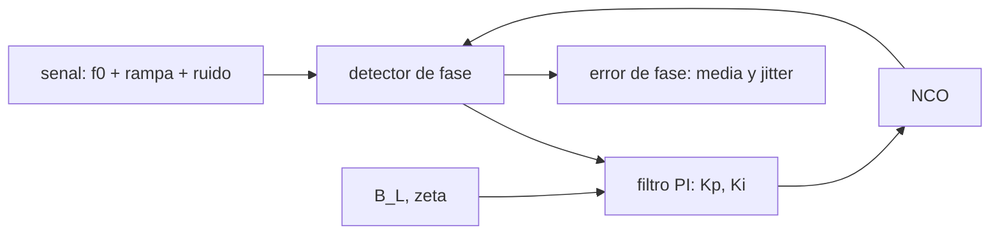

# B89-C10 — Sincronización de portadora

<!-- nav:top -->
[🏠 Programa](../../../../README.md) · [📚 Bloque B89](../../../tronco-comun/B89-comunicaciones-y-navegacion-satelital.md) · [← Anterior: B89-C09 — Codificación correctora de errores](../B89-C09-codificacion-correctora-de-errores/CLASE.md) · [Siguiente: B89-C11 — Telemetría CCSDS →](../B89-C11-telemetria-ccsds/CLASE.md)
<!-- /nav -->

## 1. Ubicación, nivel y alcance

Clase 10 del bloque B89, nivel N3. Para demodular coherentemente el receptor debe reproducir la fase y la frecuencia de la portadora, aunque el Doppler las desplace y el ruido las perturbe. Aquí simulas un lazo de enganche de fase digital de segundo orden que sigue una rampa de Doppler y mides su error y su jitter. Usas [B89-C02](../B89-C02-frecuencia-y-espectro-espacial/CLASE.md) para el Doppler y [B89-C07](../B89-C07-figura-de-ruido-de-receptor/CLASE.md) para `N₀`. Señal y ruido son sintéticos.

## 2. Por qué esta clase existe

Un lazo demasiado ancho deja pasar ruido; uno demasiado estrecho pierde el Doppler. Ajustarlo es el equilibrio central de la sincronización y condiciona la recepción de señales débiles (C24). La decisión central: **¿qué ancho de banda de lazo da el mejor compromiso entre jitter de ruido y error dinámico por Doppler?**

## 3. Lo que podrás hacer al terminar

1. Describir el lazo de segundo orden y sus parámetros `ζ`, `ω_n` y `B_L`.
2. Calcular las ganancias proporcional e integral de un lazo digital.
3. Calcular el error de fase estacionario ante una rampa de frecuencia.
4. Calcular la SNR del lazo `C/N₀/B_L` y el jitter teórico `1/√SNR_L`.
5. Contrastar simulación y teoría con una tolerancia declarada.
6. Rotular lo sintético (señal, ruido, semilla) y lo no consultado (fórmulas estándar).

La evidencia es la **ficha del lazo de seguimiento** del ejercicio 12 (sección 20).

## 4. Con qué llegas y cómo comprobarlo

1. ¿Qué es una portadora?
2. ¿Qué hace un detector de fase?
3. ¿Qué es un oscilador controlado numéricamente (NCO)?
4. ¿Qué es el ancho de banda de lazo?
5. ¿Qué es una semilla fija?

<details>
<summary>Ver respuestas</summary>

1. La onda sinusoidal que transporta la modulación. 2. Mide la diferencia de fase entre la señal y la referencia local. 3. Un generador de fase digital cuya frecuencia se ajusta. 4. El ancho equivalente de ruido del lazo, en Hz. 5. Un valor que hace reproducible el generador aleatorio.
</details>

Con cuatro o cinco aciertos, sigue; si no, repasa los prerrequisitos.

## 5. Un caso de contexto y casos de referencia

Un lazo de `B_L = 5 Hz` y `ζ = 0,707` sigue una portadora sintética con 50 Hz de Doppler y una rampa de 5 Hz/s. A `C/N₀ = 30 dB-Hz` el error medio es `0,374 rad` (teoría `0,353`) y la dispersión `0,073 rad` (teoría `0,071`); a 36 dB-Hz, `0,036 rad`. Es el **ejemplo conductor**.

## 6. Vocabulario

El **lazo de enganche de fase (PLL)** compara la fase de entrada con la de un NCO y corrige. Un lazo de **segundo orden** con filtro proporcional-integral sigue frecuencias constantes sin error y rampas con error constante. El **ancho de banda de lazo** `B_L` fija ruido y seguimiento. La **frecuencia natural** `ω_n = 8ζB_L/(4ζ²+1)`. La **SNR del lazo** es `C/N₀/B_L`. El **jitter de fase** teórico es `σ_φ ≈ 1/√SNR_L`.

## 7. Modelo mental: un conductor que sigue a otro con un volante



*Descripción textual:* el detector de fase compara la señal con el NCO; el filtro proporcional-integral corrige el NCO; el ancho de lazo fija el error medio por la rampa y el jitter por ruido.

Analogía: un conductor que sigue a otro mirando su distancia; si reacciona lento (lazo estrecho) se queda atrás en las curvas (Doppler); si reacciona nervioso (lazo ancho) transmite el ruido al volante. Límite: a baja SNR el detector se satura y el lazo pierde el enganche, algo que el modelo lineal no captura.

## 8. La explicación, paso a paso

### 8.1 Parámetros del lazo

Con `B_L = 5 Hz` y `ζ = 0,7071`: `ω_n = 9,428 rad/s`. En tiempo discreto a `f_s = 100 Hz`: `K_p = 0,124739`, `K_i = 8.316e-03`.

### 8.2 Error por la rampa

Un lazo de segundo orden ante una rampa de frecuencia `ḟ = 5 Hz/s` tiene un error de fase constante `θ_e = 2πḟ/ω_n² = 0,3534 rad`. La simulación mide `0,3742 rad` (diferencia 5,9 %).

### 8.3 Jitter por ruido

A `C/N₀ = 30 dB-Hz`, `SNR_L = 23,0 dB` y `σ_φ = 1/√SNR_L = 0,0707 rad`; la simulación da `0,0727 rad` (diferencia 2,9 %). A 36 dB-Hz la SNR del lazo sube a `29,0 dB` y el jitter baja a `0,0357 rad`.

### 8.4 El compromiso

Estrechar `B_L` reduce el jitter pero aumenta el error por Doppler (`∝ 1/ω_n²`); ensancharlo hace lo contrario. En C24 se usa esta relación para recibir portadoras débiles con lazos muy estrechos y Doppler predicho.

## 9. Magnitudes, símbolos y unidades

| Símbolo | Qué es | Unidad | Valor / nota |
|---|---|---|---|
| `B_L` | ancho de banda de lazo | Hz | 5 (sintético) |
| `ζ` | factor de amortiguamiento | — | 0,7071 |
| `ω_n` | frecuencia natural | rad/s | 9,428 |
| `ḟ` | rampa de frecuencia (Doppler) | Hz/s | 5 (sintético) |
| `C/N₀` | portadora a densidad de ruido | dB-Hz | 30 y 36 (sintéticos) |
| `σ_φ` | jitter de fase | rad | 0,0727 |
| `θ_e` | error por la rampa | rad | 0,3534 |

## 10. Convenciones y referencias

Banda base compleja, potencia de portadora normalizada a 1, ruido blanco gaussiano complejo. Detector de fase `arg(x·e^{−jφ̂})`, filtro proporcional-integral, NCO. El lazo parte con la frecuencia inicial ya adquirida (la adquisición con un Doppler de 50 Hz excede el rango de enganche de un lazo de 5 Hz y se trata en C24). Frecuencia de muestreo 100 Hz (SNR por muestra de 10 dB o más, para que el detector `atan2` trabaje en su zona lineal); 200 s; se descartan los primeros 20 s (transitorio). Todo es sintético con `random.Random(89)`; las fórmulas de `K_p`, `K_i`, `ω_n` y jitter son relaciones estándar no consultadas.

## 11. De dónde sale lo que afirmamos

| ID | Fuente | Localizador | Respalda | Estado |
|---|---|---|---|---|
| — | Relaciones estándar (ganancias del PLL digital, `ω_n`, error por rampa, jitter `1/√SNR_L`) | — | las verifica el laboratorio contra una simulación independiente del lazo | No consultada en una fuente concreta |
| — | CCSDS 401.0-B y manuales de transpondedor | — | no consultados | No consultada en una fuente concreta |

Límites: esta clase no usa constantes físicas ni estándares; los resultados son de simulación sintética.

## 12. Cómo ver el seguimiento del lazo

| Magnitud | Valor |
|---|---|
| `ω_n` | 9,428 rad/s |
| error por rampa (teoría) | 0,3534 rad |
| error por rampa (simulado) | 0,3742 rad |
| `σ_φ` a 30 dB-Hz (sim.) | 0,0727 rad |
| `σ_φ` a 36 dB-Hz (sim.) | 0,0357 rad |

Descripción larga: el error medio lo fija la rampa y el ancho de lazo; la dispersión la fija la SNR del lazo; subir 6 dB el `C/N₀` reduce el jitter a la mitad.

## 13. Ejemplo trabajado: el jitter a 30 dB-Hz

**Paso 1 · `C/N₀` lineal.** `10³ = 1000 Hz`.

**Paso 2 · SNR del lazo.** `1000/5 = 200` (`23,0 dB`).

**Paso 3 · Jitter teórico.** `σ_φ = 1/√200 = 0,0707 rad` (4,05°).

**Paso 4 · Simulación.** `0,0727 rad`: coherente con la teoría.

## 14. Distintas formas de describir el seguimiento de una portadora

**Por parámetros:** `B_L`, `ζ`. **Por error dinámico:** `θ_e`. **Por ruido:** `σ_φ`. **Por SNR:** `C/N₀/B_L`.

## 15. Práctica guiada

**Ejercicio 1 · con los pasos indicados.** Calcula `ω_n` para `B_L = 10 Hz`, `ζ = 0,707`. *Pasos:* `8ζB_L/(4ζ²+1)`.

<details><summary>Solución comentada</summary>

`8×0,707×10/3 = 18,85 rad/s`.
</details>

**Ejercicio 2 · con una pista.** Predice qué pasa con `θ_e` si `B_L` se duplica. *Pista:* `θ_e ∝ 1/ω_n²`.

<details><summary>Solución comentada</summary>

Baja a una cuarta parte.
</details>

**Ejercicio 3 · casi autónomo.** ¿Por qué la rampa produce un error constante y no creciente?

<details><summary>Solución comentada</summary>

Porque el lazo de segundo orden integra el error: sigue la frecuencia con error cero y la rampa con un error de fase constante.
</details>

## 16. Práctica autónoma, transferencia e integrador

**Ejercicio 4 · autónomo.** `SNR_L` a `C/N₀ = 25 dB-Hz` con `B_L = 2 Hz`.

<details><summary>Solución comentada</summary>

`10^2,5/2 = 158,1` (22,0 dB).
</details>

**Ejercicio 5 · autónomo.** Jitter con esa SNR.

<details><summary>Solución comentada</summary>

`1/√158,1 = 0,0795 rad`.
</details>

**Ejercicio 6 · autónomo.** `B_L` máximo para `σ_φ ≤ 0,1 rad` con `C/N₀ = 30 dB-Hz`.

<details><summary>Solución comentada</summary>

`SNR_L ≥ 100` → `B_L ≤ 10 Hz`.
</details>

**Ejercicio 7 · autónomo.** Error por una rampa de 20 Hz/s con `ω_n = 9,43 rad/s`.

<details><summary>Solución comentada</summary>

`2π×20/88,9 = 1,41 rad`: demasiado cerca de perder el enganche.
</details>

**Ejercicio 8 · autónomo.** Si `C/N₀` sube de 30 a 36 dB-Hz, ¿cuánto cambia el jitter?

<details><summary>Solución comentada</summary>

Se multiplica por `0,49` en la simulación (teoría `1/√4 = 0,5`).
</details>

**Ejercicio 9 · transferencia.** **Transferencia.** Una sonda con Doppler variable de 30 Hz/s quiere `B_L = 1 Hz`. ¿Es viable?

<details><summary>Solución comentada</summary>

No: `ω_n` ≈ 1,9 rad/s y el error sería enorme; hay que predecir y compensar el Doppler o ensanchar el lazo.
</details>

**Ejercicio 10 · transferencia.** **Transferencia.** ¿Cómo ayuda un oscilador ultraestable en el receptor?

<details><summary>Solución comentada</summary>

Reduce el ruido de fase propio, permitiendo un lazo estrecho sin que el oscilador local lo desenganche.
</details>

**Ejercicio 11 · transferencia.** **Transferencia.** Un compañero afirma que el jitter simulado «prueba» la fórmula para cualquier SNR. ¿Qué corriges?

<details><summary>Solución comentada</summary>

Que solo vale a SNR de lazo alta; a baja SNR el detector se satura y la aproximación lineal falla.
</details>

**Ejercicio 12 · integrador.** **Integrador.** Elabora tu *ficha del lazo de seguimiento*: parámetros, error por rampa, jitter teórico y simulado a dos `C/N₀`, con qué es sintético y no consultado.

<details><summary>Solución comentada</summary>

Secciones 8.1–8.4 y la salida del laboratorio.
</details>

## 17. Laboratorio: PLL de segundo orden

El script [lazo_fase.py](lazo_fase.py) simula un PLL digital con una rampa de Doppler a dos `C/N₀` y compara el error medio y el jitter con la teoría (**comprueba** que las diferencias a 30 dB-Hz sean menores que 25 % y que el jitter baje al subir el `C/N₀`).

**Datos:** señal, ruido y semilla 89 **sintéticos**; sin constantes consultadas. **Predice antes de ejecutar:** ¿cuánto jitter esperas a 30 dB-Hz con `B_L = 5 Hz`? (~0,07 rad.) **Ejecución del 2026-11-10 (Python 3.12.9):**

```text
3.12.9 (biblioteca estandar), random.Random(89)
SINTETICO: fs = 100 Hz, B_L = 5.0 Hz, zeta = 0.7071, f0 = 50 Hz, rampa 5 Hz/s, 200 s
  wn = 9.428 rad/s ; Kp = 0.124739 ; Ki = 8.316e-03
  error de fase teorico por la rampa = 0.3534 rad
  C/N0 = 30 dB-Hz: SNR_lazo = 23.0 dB ; error medio = 0.3742 rad ; sigma medida = 0.0727 rad ; sigma teorica = 0.0707 rad
  C/N0 = 36 dB-Hz: SNR_lazo = 29.0 dB ; error medio = 0.3760 rad ; sigma medida = 0.0357 rad ; sigma teorica = 0.0354 rad
  discrepancias a 30 dB-Hz: sigma 2.9 % ; rampa 5.9 %
Pruebas superadas.
```

```bash
python programa/clases/B89/B89-C10-sincronizacion-de-portadora/lazo_fase.py
```

**Límites:** detector atan2 con SNR alta, con SNR por muestra de 10 dB o más (a 0 dB por muestra el detector `atan2` pierde ganancia y la simulación se aparta de la teoría); sin adquisición inicial, sin saltos de ciclo ni ruido de fase del oscilador; una sola realización por caso; no valida un receptor real.

## 18. Errores frecuentes y cómo corregirlos

**Confundir ancho de banda de lazo con ancho de banda de señal.** Se corrige con el vocabulario.

**Ignorar el error dinámico por Doppler.** Se corrige con 8.2.

**Usar la fórmula de jitter a baja SNR.** Se corrige con 8.3 y el ejercicio 11.

**Presentar la simulación como un ensayo.** Se corrige con la sección 10.

## 19. Cómo sabrás que vas bien

Tras la sección 8: ¿qué jitter esperabas a 30 dB-Hz y cuál obtuviste? Si dudas, repasa el ejemplo 13. Tras el laboratorio: ¿qué comprueba? (ver la sección 17).

## 20. Qué entregas y cómo se evalúa

El producto es tu **ficha del lazo de seguimiento** (ejercicio 12).

| Criterio | Inicial | En desarrollo | Logrado | Destacado |
|---|---|---|---|---|
| Conceptos | Los confunde | Parciales | Calcula `ω_n`, error y jitter | Explica los límites |
| Cálculo | Sin unidades | Con errores | Tablas completas con unidades | Calcula casos nuevos |
| Numérico | Sin comprobar | Un caso | Contraste con una segunda vía | Interpreta las diferencias |
| Fuentes | Sin fuente | Sin fecha | Fuentes con fecha y estado | Declara lo sintético y lo no consultado |
| Límites | No los nombra | Uno | Tres | Discute qué falta del modelo |

**Condiciones críticas (no se compensan con promedio):** rotular la señal como sintética; declarar la tolerancia de la simulación; no presentar fórmulas no consultadas como citadas; no presentar un cálculo como una medición; citar solo lo consultado.

## 21. Ética, seguridad y límites

Clase educativa: los modelos son simplificados y sus datos son sintéticos o ilustrativos; ningún resultado describe un enlace, un satélite ni una misión reales, ni sustituye a la documentación oficial de una misión, a un presupuesto de enlace verificado ni a la coordinación regulatoria.  Accesibilidad: tablas equivalentes a las gráficas, fórmulas en texto, ejercicios sin conexión.

## 22. Para cerrar y seguir

Un lazo de 5 Hz sigue una rampa de 5 Hz/s con `0,37 rad` de error y `0,07 rad` de jitter a 30 dB-Hz. Queda una pregunta: ¿cómo se organizan los bits en tramas que el receptor reconoce?

**Glosario español–inglés.** lazo de enganche de fase · *phase-locked loop (PLL)*; ancho de banda de lazo · *loop bandwidth*; jitter · *jitter*; frecuencia natural · *natural frequency*; amortiguamiento · *damping factor*.

**Continuidad.** [B89-C11](../B89-C11-telemetria-ccsds/CLASE.md) estudia la telemetría de la CCSDS.

**Referencias:** ver sección 11.

<!-- nav:bottom -->
---

[← Anterior: B89-C09 — Codificación correctora de errores](../B89-C09-codificacion-correctora-de-errores/CLASE.md) · [📚 Bloque B89](../../../tronco-comun/B89-comunicaciones-y-navegacion-satelital.md) · [Siguiente: B89-C11 — Telemetría CCSDS →](../B89-C11-telemetria-ccsds/CLASE.md)
<!-- /nav -->
