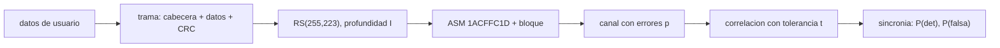

# B89-C11 — Telemetría CCSDS

<!-- nav:top -->
[🏠 Programa](../../../../README.md) · [📚 Bloque B89](../../../tronco-comun/B89-comunicaciones-y-navegacion-satelital.md) · [← Anterior: B89-C10 — Sincronización de portadora](../B89-C10-sincronizacion-de-portadora/CLASE.md) · [Siguiente: B89-C12 — Telecomandos CCSDS →](../B89-C12-telecomandos-ccsds/CLASE.md)
<!-- /nav -->

## 1. Ubicación, nivel y alcance

Clase 11 del bloque B89, nivel N3. Una telemetría no es un chorro de bits: se agrupa en tramas de longitud fija, protegidas con Reed–Solomon, precedidas de un marcador de sincronía que el receptor debe encontrar entre el ruido. Aquí calculas el tamaño y el rendimiento de una trama con los valores de la CCSDS 131.0-B-5 y simulas la búsqueda del marcador. Usas [B89-C09](../B89-C09-codificacion-correctora-de-errores/CLASE.md) para Reed–Solomon. La cabecera de 6 octetos y el CRC de 2 octetos son ilustrativos (no se consultó el formato de trama de telemetría).

## 2. Por qué esta clase existe

El receptor solo puede decodificar si encuentra el comienzo de cada bloque; la elección del marcador, su tolerancia y la profundidad de entrelazado deciden la latencia, el rendimiento y la pérdida de tramas. La decisión central: **¿qué entrelazado usar y cuántos errores tolerar al buscar el marcador para no perder tramas ni falsear sincronía?**

## 3. Lo que podrás hacer al terminar

1. Escribir el ASM 1ACFFC1D en binario y explicar su papel.
2. Calcular los octetos de información, de bloque y de canal para `I = 1…8`.
3. Calcular la eficiencia de datos de una trama con cabecera y control de errores.
4. Calcular la probabilidad de detección del marcador con tolerancia a `t` errores.
5. Calcular la probabilidad de falsa sincronía por posición y las falsas esperadas.
6. Rotular lo consultado (ASM, tamaños) frente a lo ilustrativo (cabecera, CRC) y lo sintético (ruido).

La evidencia es la **ficha de una trama de telemetría** del ejercicio 12 (sección 20).

## 4. Con qué llegas y cómo comprobarlo

1. ¿Qué es una trama de telemetría?
2. ¿Qué es un marcador de sincronía?
3. ¿Qué es el entrelazado?
4. ¿Qué es una correlación con tolerancia?
5. ¿Qué es un dato sintético?

<details>
<summary>Ver respuestas</summary>

1. Un bloque de datos de longitud fija que se transmite con una cabecera. 2. Un patrón de bits conocido que marca el inicio de un bloque. 3. Repartir símbolos de varias palabras de código para dispersar ráfagas de errores. 4. Aceptar el patrón si difiere en a lo sumo `t` bits. 5. Un dato inventado para el ejemplo.
</details>

Con cuatro o cinco aciertos, sigue; si no, repasa los prerrequisitos.

## 5. Un caso de contexto y casos de referencia

Con `I = 5`, un bloque RS lleva `8920` bits de información (`1115` octetos); con el ASM de 4 octetos ocupa `1279` octetos de canal, de los que `1107` son datos de usuario (`0,8655`). En una simulación sintética con `p = 0,02` y tolerancia de 3 bits se detectan `20` de `20` marcadores y `1` falsos. Es el **ejemplo conductor**.

## 6. Vocabulario

El **ASM (attached sync marker)** `1ACFFC1D` (32 bits) precede a cada bloque codificado con RS, concatenado o LDPC de tasa 7/8. El **bloque de información** de RS tiene `223 × I` octetos (`I` = profundidad de entrelazado). El **bloque de canal** tiene `255 × I` octetos. La **eficiencia de datos** es datos de usuario dividido por octetos de canal. La **sincronía de trama** busca el ASM por correlación con tolerancia `t`.

## 7. Modelo mental: un tren con una señal de inicio en cada vagón



*Descripción textual:* los datos forman una trama que se codifica con RS, se precede del ASM y se envía; el receptor correla el ASM con tolerancia `t` para recuperar la sincronía.

Analogía: la señal de inicio de cada vagón permite al guardia saber dónde cortar el tren aunque haya borrones. Límite: una tolerancia mayor detecta más marcadores pero genera más falsos positivos; el equilibrio es el diseño.

## 8. La explicación, paso a paso

### 8.1 El marcador

`ASM = 1ACFFC1D` = `00011010110011111111110000011101` (32 bits), tomado de la CCSDS 131.0-B-5 (consultada). Para LDPC de tasas 1/2, 2/3 y 4/5 la norma usa un CSM de 64 bits (`034776C7272895B0`).

### 8.2 Tamaños

En la tabla 6-1 de la norma, los bloques de información son 1784, 3568, 7136 y 8920 bits (`223 × 8 × I` con `I = 1, 2, 4, 5`). El laboratorio lista `I = 1, 2, 3, 4, 5, 8`: `I = 5` da `n = 1275` octetos de bloque y `1279` con el ASM.

### 8.3 Eficiencia

Con cabecera de 6 y CRC de 2 octetos (ilustrativos), la carga de usuario es `223 I − 8` octetos: `I = 1` da `215` octetos y `0,8301` de eficiencia; `I = 5`, `1107` y `0,8655`; `I = 8`, `1776` y `0,8689`. La tasa del código RS (`223/255 = 0,8745`) es el techo.

### 8.4 Detección y falsa sincronía

Con errores de bit `p = 0,02`, una tolerancia `t = 3` detecta un marcador con probabilidad `0,99632`; un patrón aleatorio coincide a distancia ≤ 3 con probabilidad `1.28e-06` por posición, de modo que en `204640` bits se esperan `0,261` falsos; el laboratorio observa `1`.

## 9. Magnitudes, símbolos y unidades

| Símbolo | Qué es | Unidad | Valor / nota |
|---|---|---|---|
| `ASM` | marcador de sincronía | 32 bits | 1ACFFC1D |
| `I` | profundidad de entrelazado | — | 1, 2, 3, 4, 5, 8 |
| `k` | bloque de información | bits | 8920 (I = 5) |
| `n` | bloque de canal con ASM | octetos | 1279 (I = 5) |
| `t` | tolerancia de correlación | bits | 3 (sintético) |
| `p` | error de bit del canal | — | 0,02 (sintético) |
| eficiencia | datos/canal | — | 0,8655 |

## 10. Convenciones y referencias

Telemetría con RS(255,223) y ASM de 32 bits. El ASM y los tamaños de bloque salen de la CCSDS 131.0-B-5 (septiembre de 2023, leída con PyMuPDF). La cabecera de 6 octetos y el CRC de 2 octetos son ilustrativos; no se consultó el formato de trama de telemetría (CCSDS 132.0-B). Datos y errores sintéticos con `random.Random(89)`.

## 11. De dónde sale lo que afirmamos

| ID | Fuente | Localizador | Respalda | Estado |
|---|---|---|---|---|
| S1 | CCSDS 131.0-B-5, TM Synchronization and Channel Coding, Blue Book, septiembre de 2023 — https://ccsds.org/Pubs/131x0b5.pdf (PDF leido con PyMuPDF, consultada 2026-11-10) | tablas 6-1, 6-2 y 8-1; secciones 4.3.5 y 8.2 | profundidades de entrelazado I = 1, 2, 3, 4, 5, 8; bloques de informacion de 1784, 3568, 7136 y 8920 bits (223 octetos × I); longitudes de palabra del codigo turbo; marcador ASM 1ACFFC1D (32 bits) y CSM de 64 bits 034776C7272895B0 para LDPC 1/2, 2/3 y 4/5 | Consultada |
| — | Formato de la trama de telemetría (CCSDS 132.0-B) y tamaños de cabecera y de control de errores | — | no consultado; 6 + 2 octetos ilustrativos | No consultada en una fuente concreta |

Límites: no se consultó el estándar del protocolo de enlace de datos de telemetría ni la codificación turbo o LDPC en detalle; la detección usa errores de bit independientes, no ráfagas.

## 12. Cómo ver la trama y su sincronía

| Magnitud | Valor |
|---|---|
| `ASM` | 1ACFFC1D |
| octetos de canal, `I = 5` | 1279 |
| eficiencia, `I = 5` | 0,8655 |
| `P(detección)`, `t = 3`, `p = 0,02` | 0,99632 |
| falsas esperadas / observadas | 0,261 / 1 |

Descripción larga: más entrelazado mejora la eficiencia (menor peso de la cabecera) a costa de latencia; más tolerancia detecta más marcadores pero admite más falsos.

## 13. Ejemplo trabajado: la eficiencia con I = 1

**Paso 1 · Bloque de información.** `223 octetos = 1784 bits`.

**Paso 2 · Canal.** `255 + 4 = 259 octetos`.

**Paso 3 · Carga.** `223 − 6 − 2 = 215 octetos`.

**Paso 4 · Eficiencia.** `215/259 = 0,8301`.

## 14. Distintas formas de describir una trama de telemetría

**Por estructura:** cabecera, datos, control de errores. **Por codificación:** RS con profundidad `I`. **Por tamaño:** `k`, `n`. **Por sincronía:** ASM y tolerancia.

## 15. Práctica guiada

**Ejercicio 1 · con los pasos indicados.** Escribe el ASM en binario. *Pasos:* convierte `1ACFFC1D` a 32 bits.

<details><summary>Solución comentada</summary>

`00011010110011111111110000011101`.
</details>

**Ejercicio 2 · con una pista.** Predice los octetos de canal con `I = 2`. *Pista:* `255 × I + 4`.

<details><summary>Solución comentada</summary>

`514`.
</details>

**Ejercicio 3 · casi autónomo.** ¿Por qué la eficiencia sube con `I`?

<details><summary>Solución comentada</summary>

Porque la cabecera, el CRC y el ASM son fijos y se reparten entre más datos; mira el cociente.
</details>

## 16. Práctica autónoma, transferencia e integrador

**Ejercicio 4 · autónomo.** Carga de usuario con `I = 4`.

<details><summary>Solución comentada</summary>

`884` octetos.
</details>

**Ejercicio 5 · autónomo.** Tasa de datos útil con una tasa de símbolos de 1 Msímb/s a 8 bits por octeto, `I = 5`.

<details><summary>Solución comentada</summary>

`10⁶ × 0,8655 = 865,5 kbit/s` (supone 1 símbolo = 1 bit sin código convolucional).
</details>

**Ejercicio 6 · autónomo.** Probabilidad de que no se detecte el ASM con `t = 3` y `p = 0,02`.

<details><summary>Solución comentada</summary>

`1 − 0,99632 = 0,00368`.
</details>

**Ejercicio 7 · autónomo.** Número de posiciones de búsqueda en un flujo de 10⁶ bits.

<details><summary>Solución comentada</summary>

`≈ 10⁶`.
</details>

**Ejercicio 8 · autónomo.** Falsas esperadas en 10⁶ bits con `t = 3`.

<details><summary>Solución comentada</summary>

`1.28e-06 × 10⁶ = 1,278`.
</details>

**Ejercicio 9 · transferencia.** **Transferencia.** Un diseñador sube la tolerancia a `t = 8`. ¿Qué ocurre con las falsas sincronías?

<details><summary>Solución comentada</summary>

La probabilidad de coincidencia aleatoria crece fuertemente (la suma `Σ C(32,k)/2³²` hasta 8 da ≈ 3,5×10⁻³ por posición), y en 10⁶ bits habría unas 3500 falsas.
</details>

**Ejercicio 10 · transferencia.** **Transferencia.** Un enlace con ráfagas largas de errores usa `I = 1`. ¿Qué cambiarías?

<details><summary>Solución comentada</summary>

Subir `I` para dispersar las ráfagas entre palabras, aceptando más latencia y 4 octetos más de ASM por bloque.
</details>

**Ejercicio 11 · transferencia.** **Transferencia.** Un compañero cita el tamaño de cabecera de 6 octetos como el «del estándar». ¿Qué corriges?

<details><summary>Solución comentada</summary>

Es un valor ilustrativo; el formato de trama de telemetría no se consultó.
</details>

**Ejercicio 12 · integrador.** **Integrador.** Elabora tu *ficha de una trama de telemetría*: tabla de tamaños y eficiencia para `I = 1…8`, ASM, probabilidades de detección y falsa sincronía, con qué es consultado, ilustrativo y sintético.

<details><summary>Solución comentada</summary>

Secciones 8.1–8.4 y la salida del laboratorio.
</details>

## 17. Laboratorio: trama de telemetría y sincronía

El script [trama_tm.py](trama_tm.py) calcula la estructura de una trama para `I = 1…8` y simula la búsqueda del ASM con tolerancia 3 en 20 tramas con errores de bit del 2 % (**comprueba** el valor 1ACFFC1D, los `k` de 1784 y 8920 bits y que se detecten casi todos los marcadores).

**Datos:** ASM y tamaños de CCSDS 131.0-B-5 (consultada); cabecera de 6 y CRC de 2 octetos **ilustrativos**; datos y errores **sintéticos**, semilla 89. **Predice antes de ejecutar:** ¿cuántos octetos de canal tiene una trama con `I = 5`? (1279.) **Ejecución del 2026-11-10 (Python 3.12.9):**

```text
3.12.9 (biblioteca estandar), random.Random(89)
ASM = 1ACFFC1D = 00011010110011111111110000011101 (CCSDS 131.0-B-5, consultada)
Estructura con RS(255,223) segun profundidad I (cabecera 6 + CRC 2 octetos ILUSTRATIVOS):
  I  k [oct]  n [oct]  canal [oct]  datos [oct]  eficiencia  k [bits]
  1      223      255          259          215      0.8301      1784
  2      446      510          514          438      0.8521      3568
  3      669      765          769          661      0.8596      5352
  4      892     1020         1024          884      0.8633      7136
  5     1115     1275         1279         1107      0.8655      8920
  8     1784     2040         2044         1776      0.8689     14272
Sincronizacion de trama: 20 tramas, p = 0.02, tolerancia t = 3 bits, 204640 bits
  P(deteccion) teorica = 0.99632 ; detectadas = 20/20
  P(falsa por posicion) = 1.278e-06 ; falsas esperadas = 0.261 ; falsas observadas = 1
Pruebas superadas.
```

```bash
python programa/clases/B89/B89-C11-telemetria-ccsds/trama_tm.py
```

**Límites:** errores de bit independientes, sin RS real ni ráfagas; no valida un decodificador de la norma.

## 18. Errores frecuentes y cómo corregirlos

**Confundir octetos de información con octetos de canal.** Se corrige con 8.2.

**Olvidar el ASM en la longitud de canal.** Se corrige con 8.2.

**Aumentar la tolerancia sin calcular las falsas.** Se corrige con 8.4.

**Presentar los valores ilustrativos como los del estándar de trama.** Se corrige con la sección 10.

## 19. Cómo sabrás que vas bien

Tras la sección 8: ¿qué eficiencia esperabas con `I = 5` y cuál obtuviste? Si dudas, repasa el ejemplo 13. Tras el laboratorio: ¿qué comprueba? (ver la sección 17).

## 20. Qué entregas y cómo se evalúa

El producto es tu **ficha de una trama de telemetría** (ejercicio 12).

| Criterio | Inicial | En desarrollo | Logrado | Destacado |
|---|---|---|---|---|
| Conceptos | Los confunde | Parciales | Calcula tamaños, eficiencia y sincronía | Explica los límites |
| Cálculo | Sin unidades | Con errores | Tablas completas con unidades | Calcula casos nuevos |
| Numérico | Sin comprobar | Un caso | Contraste con una segunda vía | Interpreta las diferencias |
| Fuentes | Sin fuente | Sin fecha | Fuentes con fecha y estado | Declara lo sintético y lo no consultado |
| Límites | No los nombra | Uno | Tres | Discute qué falta del modelo |

**Condiciones críticas (no se compensan con promedio):** rotular cabecera y CRC como ilustrativos; usar solo ASM y tamaños consultados; separar sintético de consultado; no presentar un cálculo como una medición; citar solo lo consultado.

## 21. Ética, seguridad y límites

Clase educativa: los modelos son simplificados y sus datos son sintéticos o ilustrativos; ningún resultado describe un enlace, un satélite ni una misión reales, ni sustituye a la documentación oficial de una misión, a un presupuesto de enlace verificado ni a la coordinación regulatoria.  Accesibilidad: tablas equivalentes a las gráficas, fórmulas en texto, ejercicios sin conexión.

## 22. Para cerrar y seguir

Con `I = 5` el canal lleva `1279` octetos por bloque y `0,866` de eficiencia; el ASM `1ACFFC1D` se encuentra casi siempre con tolerancia de 3 bits. Queda una pregunta: ¿cómo se protege el camino contrario, el de los comandos?

**Glosario español–inglés.** telemetría · *telemetry*; marcador de sincronía · *attached sync marker (ASM)*; trama de transferencia · *transfer frame*; entrelazado · *interleaving*; sincronización de trama · *frame synchronization*.

**Continuidad.** [B89-C12](../B89-C12-telecomandos-ccsds/CLASE.md) estudia los telecomandos.

**Referencias:** ver sección 11.

<!-- nav:bottom -->
---

[← Anterior: B89-C10 — Sincronización de portadora](../B89-C10-sincronizacion-de-portadora/CLASE.md) · [📚 Bloque B89](../../../tronco-comun/B89-comunicaciones-y-navegacion-satelital.md) · [Siguiente: B89-C12 — Telecomandos CCSDS →](../B89-C12-telecomandos-ccsds/CLASE.md)
<!-- /nav -->
