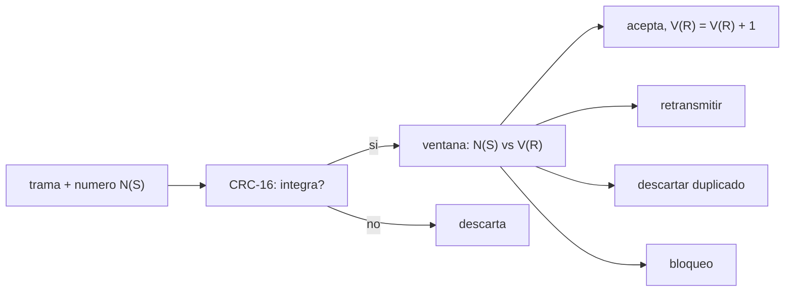

# B89-C12 — Telecomandos CCSDS

<!-- nav:top -->
[🏠 Programa](../../../../README.md) · [📚 Bloque B89](../../../tronco-comun/B89-comunicaciones-y-navegacion-satelital.md) · [← Anterior: B89-C11 — Telemetría CCSDS](../B89-C11-telemetria-ccsds/CLASE.md) · [Siguiente: B89-C13 — Protocolos para espacio profundo →](../B89-C13-protocolos-para-espacio-profundo/CLASE.md)
<!-- /nav -->

## 1. Ubicación, nivel y alcance

Clase 12 del bloque B89, nivel N3. Un telecomando es una orden a una nave: debe llegar completa, en orden, una sola vez y sin que un error la convierta en otra orden. Aquí implementas un CRC-16, una ventana de aceptación de números de secuencia y la eficiencia de una retransmisión go-back-N, como ilustración del tipo de mecanismos que usan los protocolos de telecomando. Usas [B89-C09](../B89-C09-codificacion-correctora-de-errores/CLASE.md) para la detección y la corrección de errores y [B89-C11](../B89-C11-telemetria-ccsds/CLASE.md) para las tramas. **Los estándares de telecomando de la CCSDS no se consultaron:** los parámetros son ilustrativos y los datos, sintéticos.

## 2. Por qué esta clase existe

Un comando mal recibido o ejecutado dos veces puede dañar una misión; los mecanismos de detección y secuenciación son lo que separa un enlace seguro de uno peligroso. La decisión central: **¿cómo se garantiza que un comando se acepte completo, en orden y una sola vez?**

## 3. Lo que podrás hacer al terminar

1. Calcular un CRC-16 y comprobarlo con el valor de verificación publicado.
2. Verificar que el CRC detecta todos los errores de 1 y 2 bits de una trama dada y las ráfagas ≤ 16 bits.
3. Estimar la fracción de corrupciones no detectadas ≈ 2⁻¹⁶.
4. Clasificar números de secuencia con una ventana de aceptación módulo 256.
5. Calcular la eficiencia de una retransmisión go-back-N y compararla con una simulación.
6. Rotular lo ilustrativo y no consultado (parámetros de la norma) frente a lo sintético (datos).

La evidencia es la **ficha de la aceptación de un comando** del ejercicio 12 (sección 20).

## 4. Con qué llegas y cómo comprobarlo

1. ¿Qué es un CRC?
2. ¿Qué es un número de secuencia?
3. ¿Qué es la aritmética módulo 256?
4. ¿Qué es una retransmisión automática (ARQ)?
5. ¿Qué es un dato sintético?

<details>
<summary>Ver respuestas</summary>

1. Una suma de verificación polinómica que detecta errores. 2. Un contador en cada trama para ordenar y detectar pérdidas o duplicados. 3. Una aritmética que da la vuelta al llegar a 256. 4. Reenviar lo que no fue reconocido. 5. Un dato inventado para el ejemplo.
</details>

Con cuatro o cinco aciertos, sigue; si no, repasa los prerrequisitos.

## 5. Un caso de contexto y casos de referencia

El CRC-16 de «123456789» es `0x29B1`; detecta `512/512` errores de 1 bit y las ráfagas ≤ 16 bits de la muestra. Una ventana de 10+10 sobre 256 números acepta 1, pide retransmisión de 9, descarta 10 y bloquea 236. Con pérdida del 10 % y ventana de 8, un go-back-N tiene eficiencia `0,529`. Es el **ejemplo conductor**; todo es una ilustración.

## 6. Vocabulario

El **CRC-16** usa el polinomio `x¹⁶ + x¹² + x⁵ + 1` (0x1021). La **ventana de aceptación** compara el número recibido con el esperado `V(R)`: igual, acepta; en la ventana positiva, pide retransmisión; en la negativa, descarta por duplicado; fuera, se bloquea. El **go-back-N** retransmite desde la trama perdida. La **eficiencia** es tramas útiles por ranura.

## 7. Modelo mental: un portero con la lista de invitados numerada



*Descripción textual:* la trama pasa primero la verificación del CRC y después la ventana de números de secuencia, que decide aceptar, pedir retransmisión, descartar o bloquear.

Analogía: un portero con una lista numerada: deja pasar al esperado, pide que vuelvan a intentar a los que llegan antes de tiempo, ignora a los repetidos y cierra la puerta si algo no cuadra. Límite: la norma real tiene más estados y mecanismos que esta ilustración.

## 8. La explicación, paso a paso

### 8.1 CRC-16

El polinomio 0x1021 con valor inicial 0xFFFF da, para «123456789», `0x29B1`, igual al valor de verificación publicado de CRC-16/CCITT-FALSE (dato estándar no consultado en esta clase). En una trama de 64 octetos se detectan todos los errores de 1 bit (`512/512`), todos los de 2 bits de la muestra (`1752/1752`) y todas las ráfagas ≤ 16 bits de la muestra (`117/117`).

### 8.2 Corrupción fuerte

Si la trama se corrompe por completo, el CRC la acepta con probabilidad `2⁻¹⁶ = 1.53e-05`; el laboratorio observa `7` en `300000` (`2.33e-05`). Un CRC detecta, no corrige, y deja un riesgo residual.

### 8.3 Ventana de secuencia

Con `V(R) = 10` y ventanas positiva y negativa de 10 sobre 256 números: 1 se acepta, `9` piden retransmisión, `10` se descartan y `236` bloquean. La suma es 256.

### 8.4 Retransmisión go-back-N

La eficiencia teórica `(1−p)/(1−p+Np)` con `p = 0,01` y `N = 8` es `0,9252` (simulada `0,9260`); con `p = 0,1`, `N = 8`: `0,5294` (`0,5285`); con `N = 32`: `0,2195`. Con retardos largos (espacio profundo) go-back-N es muy ineficiente.

## 9. Magnitudes, símbolos y unidades

| Símbolo | Qué es | Unidad | Valor / nota |
|---|---|---|---|
| CRC | verificación polinómica | 16 bits | 0x29B1 (cadena de prueba) |
| `N(S)`, `V(R)` | número de secuencia y esperado | módulo 256 | 0 a 255 |
| ventana positiva/negativa | tamaño | tramas | 10 / 10 (ilustrativo) |
| `p` | pérdida de trama | — | 0,01 y 0,1 (sintético) |
| `N` | ventana (tramas en vuelo) | tramas | 8 y 32 |
| eficiencia | tramas útiles / ranuras | — | 0,529 |

## 10. Convenciones y referencias

CRC-16 con polinomio 0x1021 e inicialización 0xFFFF; ventana de aceptación ilustrativa; ARQ go-back-N de ranuras discretas. Los parámetros exactos de los estándares de telecomando (CRC, ventanas, procedimientos) **no se consultaron**. Datos sintéticos con `random.Random(89)`.

## 11. De dónde sale lo que afirmamos

| ID | Fuente | Localizador | Respalda | Estado |
|---|---|---|---|---|
| S1 | CCSDS 230.2-G-1, Next Generation Uplink, Green Book, julio de 2014 — https://ccsds.org/Pubs/230x2g1.pdf (PDF leido con PyMuPDF, consultada 2026-11-10) | introduccion y bibliografia | el enlace de subida se trata como un enlace de proposito general; los codigos BCH de los telecomandos clasicos se mejoran con codigos mas potentes (LDPC) que exigen simbolos blandos y SNR de simbolo menor | Consultada |
| — | Estándares de telecomando (CCSDS 231.0-B, 232.0-B) y parámetros del CRC y la ventana | — | no consultados; la descarga de sus PDF falló | No consultada en una fuente concreta |
| — | Valor de verificación 0x29B1 de CRC-16/CCITT-FALSE y fórmulas de go-back-N | — | estándar, no consultado en una fuente concreta; el laboratorio lo contrasta con una simulación | No consultada en una fuente concreta |

Límites: del Green Book 230.2-G-1 solo se consultó su introducción (el enlace de subida como enlace de propósito general y la mejora de los códigos BCH con LDPC); no se consultaron los estándares que definen el telecomando; el laboratorio no valida ninguna implementación del estándar.

## 12. Cómo ver la protección de un telecomando

| Magnitud | Valor |
|---|---|
| CRC de «123456789» | 0x29B1 |
| errores de 1 bit detectados | 512/512 |
| no detectadas en corrupción total | 7/300000 |
| acepta / retransmite / descarta / bloquea | 1 / 9 / 10 / 236 |
| eficiencia go-back-N (0,1; 8) | 0,529 |

Descripción larga: el CRC detecta casi todo, la ventana ordena y evita repetidos y la retransmisión go-back-N pierde eficiencia al crecer el retardo.

## 13. Ejemplo trabajado: clasificar una trama

**Paso 1 · Estado.** `V(R) = 10`, ventanas 10 y 10.

**Paso 2 · Recibe 10.** `d = 0`: **acepta**; `V(R) = 11`.

**Paso 3 · Recibe 13.** `d = 2 < 10`: **retransmitir** (llegó adelantada).

**Paso 4 · Recibe 5.** `d = 251 ≥ 246`: **descarta** (duplicado antiguo); con 100, `d = 90`: **bloqueo**.

## 14. Distintas formas de describir la integridad de un comando

**Por integridad:** CRC. **Por orden:** número de secuencia y ventana. **Por entrega:** retransmisión. **Por eficiencia:** `(1−p)/(1−p+Np)`.

## 15. Práctica guiada

**Ejercicio 1 · con los pasos indicados.** Clasifica `N(S) = 12` con `V(R) = 10` y ventanas 10/10. *Pasos:* `d = 2`.

<details><summary>Solución comentada</summary>

`retransmitir`.
</details>

**Ejercicio 2 · con una pista.** Predice la clase de `N(S) = 3` con `V(R) = 10`. *Pista:* `d = (3 − 10) mod 256`.

<details><summary>Solución comentada</summary>

`d = 249 ≥ 246`: `descarta`.
</details>

**Ejercicio 3 · casi autónomo.** ¿Por qué se usa módulo 256 y no un contador sin límite?

<details><summary>Solución comentada</summary>

Porque el campo de secuencia tiene tamaño fijo; el módulo hace que se repita, y las ventanas distinguen duplicados antiguos de nuevos.
</details>

## 16. Práctica autónoma, transferencia e integrador

**Ejercicio 4 · autónomo.** Probabilidad de aceptar una trama totalmente corrupta con CRC-16.

<details><summary>Solución comentada</summary>

`1.53e-05`.
</details>

**Ejercicio 5 · autónomo.** Eficiencia go-back-N con `p = 0,05` y `N = 16`.

<details><summary>Solución comentada</summary>

`0,95/(0,95 + 0,8) = 0,5429`.
</details>

**Ejercicio 6 · autónomo.** Cuántos números caen en el bloqueo con ventanas de 20 y 20.

<details><summary>Solución comentada</summary>

`256 − 1 − 19 − 20 = 216`.
</details>

**Ejercicio 7 · autónomo.** Cuántos bits tiene el CRC-16 y cuántas combinaciones de CRC hay.

<details><summary>Solución comentada</summary>

16 bits; `65 536`.
</details>

**Ejercicio 8 · autónomo.** Un telecomando tiene 100 bits. Si cada bit se invierte con `p = 10⁻³`, ¿cuál es la probabilidad de al menos un error?

<details><summary>Solución comentada</summary>

`1 − 0,999¹⁰⁰ = 0,0952`.
</details>

**Ejercicio 9 · transferencia.** **Transferencia.** Una sonda a 20 min de luz usa go-back-N con ventana 8. ¿Es eficiente?

<details><summary>Solución comentada</summary>

No: con un retardo de ida y vuelta de 40 min, la ventana de 8 tramas se agota casi al instante y el emisor espera; se prefieren ventanas muy grandes o protocolos de almacenamiento y reenvío (C13).
</details>

**Ejercicio 10 · transferencia.** **Transferencia.** Un comando crítico llega dos veces. ¿Qué mecanismo evita ejecutarlo dos veces?

<details><summary>Solución comentada</summary>

El número de secuencia con la ventana: el segundo llega con `d` en la ventana negativa y se descarta.
</details>

**Ejercicio 11 · transferencia.** **Transferencia.** Un colega cita 0x1021 y las ventanas de este laboratorio como «los de la CCSDS». ¿Qué corriges?

<details><summary>Solución comentada</summary>

Que no se consultó el estándar: son valores ilustrativos de uso común.
</details>

**Ejercicio 12 · integrador.** **Integrador.** Elabora tu *ficha de la aceptación de un comando*: CRC, detección, ventana de secuencia y eficiencia de retransmisión, con qué es ilustrativo, sintético y no consultado.

<details><summary>Solución comentada</summary>

Secciones 8.1–8.4 y la salida del laboratorio.
</details>

## 17. Laboratorio: CRC, ventana de secuencia y go-back-N

El script [telecomando.py](telecomando.py) calcula un CRC-16, comprueba la detección de errores de 1 y 2 bits y de ráfagas, clasifica los 256 números de secuencia y simula la eficiencia de go-back-N (**comprueba** el valor 0x29B1, la detección total de las muestras, 1/9/10/236 en la ventana y la concordancia con la teoría a menos del 3 %).

**Datos:** ninguna constante física; parámetros **ilustrativos y no consultados**; datos y errores **sintéticos**, semilla 89. **Predice antes de ejecutar:** ¿cuántos números de secuencia se aceptan de una vez? (Uno.) **Ejecución del 2026-11-10 (Python 3.12.9):**

```text
3.12.9 (biblioteca estandar), random.Random(89)
CRC-16 (0x1021, init 0xFFFF) de '123456789' = 0x29B1 (valor de verificacion publicado de CRC-16/CCITT-FALSE: 0x29B1)
Errores de 1 bit detectados: 512/512 ; de 2 bits (muestra): 1752/1752 ; rafagas <= 16 bits: 117/117
Corrupcion aleatoria no detectada: 7/300000 = 2.33e-05 ; teoria 2^-16 = 1.53e-05
Ventana (V(R) = 10, positiva 10, negativa 10) sobre 256 numeros: {'descarta': 10, 'acepta': 1, 'retransmitir': 9, 'bloqueo': 236}
Go-back-N p = 0.01, ventana  8: eficiencia teorica = 0.9252 ; simulada = 0.9260
Go-back-N p = 0.10, ventana  8: eficiencia teorica = 0.5294 ; simulada = 0.5285
Go-back-N p = 0.10, ventana 32: eficiencia teorica = 0.2195 ; simulada = 0.2181
Pruebas superadas.
```

```bash
python programa/clases/B89/B89-C12-telecomandos-ccsds/telecomando.py
```

**Límites:** ilustración de mecanismos, no una implementación del estándar; sin cifrado (C25) ni procedimientos reales de bloqueo y desbloqueo.

## 18. Errores frecuentes y cómo corregirlos

**Creer que un CRC corrige errores.** Se corrige con 8.1: solo detecta.

**Olvidar el riesgo residual de 2⁻¹⁶.** Se corrige con 8.2.

**Usar go-back-N con retardos largos.** Se corrige con 8.4.

**Presentar los parámetros ilustrativos como los del estándar.** Se corrige con la sección 10.

## 19. Cómo sabrás que vas bien

Tras la sección 8: ¿cuántos números de secuencia esperabas aceptar y cuántos retransmitir? Si dudas, repasa el ejemplo 13. Tras el laboratorio: ¿qué comprueba? (ver la sección 17).

## 20. Qué entregas y cómo se evalúa

El producto es tu **ficha de la aceptación de un comando** (ejercicio 12).

| Criterio | Inicial | En desarrollo | Logrado | Destacado |
|---|---|---|---|---|
| Conceptos | Los confunde | Parciales | Clasifica secuencias y calcula la detección | Explica los límites |
| Cálculo | Sin unidades | Con errores | Tablas completas con unidades | Calcula casos nuevos |
| Numérico | Sin comprobar | Un caso | Contraste con una segunda vía | Interpreta las diferencias |
| Fuentes | Sin fuente | Sin fecha | Fuentes con fecha y estado | Declara lo sintético y lo no consultado |
| Límites | No los nombra | Uno | Tres | Discute qué falta del modelo |

**Condiciones críticas (no se compensan con promedio):** rotular los parámetros como ilustrativos y no consultados; no presentar la ilustración como el estándar; no presentar un cálculo como una medición; citar solo lo consultado.

## 21. Ética, seguridad y límites

Clase educativa: los modelos son simplificados y sus datos son sintéticos o ilustrativos; ningún resultado describe un enlace, un satélite ni una misión reales, ni sustituye a la documentación oficial de una misión, a un presupuesto de enlace verificado ni a la coordinación regulatoria.  Accesibilidad: tablas equivalentes a las gráficas, fórmulas en texto, ejercicios sin conexión.

## 22. Para cerrar y seguir

Un CRC-16 deja pasar 1 de cada 65 536 corrupciones totales y la ventana 10/10 acepta uno de 256 números; con `p = 0,1` y ventana 8, go-back-N rinde `0,53`. Queda una pregunta: ¿qué pasa cuando el retardo es de minutos u horas?

**Glosario español–inglés.** telecomando · *telecommand*; verificación de redundancia cíclica · *cyclic redundancy check (CRC)*; ventana deslizante · *sliding window*; retransmisión automática · *automatic repeat request (ARQ)*; número de secuencia · *sequence number*.

**Continuidad.** [B89-C13](../B89-C13-protocolos-para-espacio-profundo/CLASE.md) estudia los protocolos para espacio profundo.

**Referencias:** ver sección 11.

<!-- nav:bottom -->
---

[← Anterior: B89-C11 — Telemetría CCSDS](../B89-C11-telemetria-ccsds/CLASE.md) · [📚 Bloque B89](../../../tronco-comun/B89-comunicaciones-y-navegacion-satelital.md) · [Siguiente: B89-C13 — Protocolos para espacio profundo →](../B89-C13-protocolos-para-espacio-profundo/CLASE.md)
<!-- /nav -->
