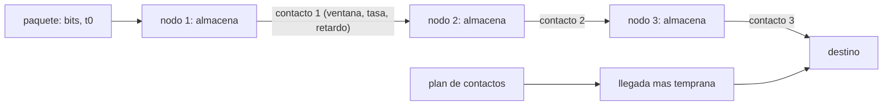

# B89-C13 — Protocolos para espacio profundo

<!-- nav:top -->
[🏠 Programa](../../../../README.md) · [📚 Bloque B89](../../../tronco-comun/B89-comunicaciones-y-navegacion-satelital.md) · [← Anterior: B89-C12 — Telecomandos CCSDS](../B89-C12-telecomandos-ccsds/CLASE.md) · [Siguiente: B89-C14 — Estaciones terrestres →](../B89-C14-estaciones-terrestres/CLASE.md)
<!-- /nav -->

## 1. Ubicación, nivel y alcance

Clase 13 del bloque B89, nivel N3. Cuando los retardos son de minutos y los enlaces intermitentes, los protocolos de Internet no funcionan: hace falta almacenar los datos en cada nodo y reenviarlos cuando haya contacto. Aquí calculas la llegada más temprana de un paquete en una red sintética de un rover, un orbitador y la Red del Espacio Profundo, y la contrastas con una enumeración exhaustiva. Usas [B89-C04](../B89-C04-propagacion-y-perdidas-de-espacio-libre/CLASE.md) para el retardo y [B89-C12](../B89-C12-telecomandos-ccsds/CLASE.md) para ARQ. El plan de contactos es sintético; del Bundle Protocol solo se consultó su descripción general.

## 2. Por qué esta clase existe

Sin almacenamiento y reenvío, un rover marciano no podría comunicarse con Tierra: nunca hay una ruta continua. Entender los contactos, las capacidades y el encaminamiento es la base del diseño de redes interplanetarias. La decisión central: **¿cuándo llegará un paquete a su destino y cuántos datos caben en cada contacto?**

## 3. Lo que podrás hacer al terminar

1. Describir el almacenamiento y reenvío del Bundle Protocol.
2. Representar un plan de contactos con ventanas, tasas y retardos.
3. Calcular la capacidad de cada contacto.
4. Calcular la llegada más temprana con un Dijkstra dependiente del tiempo.
5. Contrastar el resultado con una enumeración exhaustiva.
6. Rotular lo consultado (descripción del BP) frente a lo sintético (plan de contactos).

La evidencia es la **plan de contactos DTN y latencia extremo a extremo** del ejercicio 12 (sección 20).

## 4. Con qué llegas y cómo comprobarlo

1. ¿Qué es un retardo de propagación?
2. ¿Qué es una ventana de contacto?
3. ¿Qué es la capacidad de un contacto?
4. ¿Qué es un algoritmo de camino más corto?
5. ¿Qué es un dato sintético?

<details>
<summary>Ver respuestas</summary>

1. El tiempo que tarda la señal en recorrer el enlace. 2. El intervalo en que dos nodos pueden comunicarse. 3. La tasa por la duración, en bits. 4. Un método para hallar la ruta de menor costo en un grafo. 5. Un dato inventado para el ejemplo.
</details>

Con cuatro o cinco aciertos, sigue; si no, repasa los prerrequisitos.

## 5. Un caso de contexto y casos de referencia

En una red sintética rover–orbitador–DSN–centro, un paquete de 100 Mbit creado a las 0 h llega a las `4,267 h` (latencia `4,267 h`); si se crea a las 2 h, a las `16,267 h`; uno de 600 Mbit creado a las 2 h tarda hasta las `16,558 h`. Nunca hay conexión simultánea extremo a extremo. Es el **ejemplo conductor**.

## 6. Vocabulario

El **Bundle Protocol (BP)** crea una red de **almacenamiento y reenvío** con tolerancia a conectividad intermitente, retransmisión basada en custodia y reportes de estado (CCSDS 734.2-B-1). Un **contacto** es una ventana `(origen, destino, inicio, fin, tasa, retardo)`. La **capacidad** es `tasa × (fin − inicio)`. La **llegada más temprana** es el menor instante de entrega entre todas las rutas. Un **plan de contactos** es la lista de contactos previstos.

## 7. Modelo mental: un correo por relevos con horarios



*Descripción textual:* el paquete se almacena en cada nodo hasta el siguiente contacto; el plan de contactos permite calcular la ruta de llegada más temprana.

Analogía: un correo que va por relevos con horarios fijos: cada estafeta guarda la carta hasta que sale el siguiente transporte. Límite: aquí se ignoran la memoria finita, las prioridades y la fiabilidad de los contactos previstos.

## 8. La explicación, paso a paso

### 8.1 El plan

Rover → orbitador: 10 min cada 12 h a 2 Mbit/s (capacidad `1200 Mbit`); orbitador → DSN: 1 h cada 12 h a 500 kbit/s (`1800 Mbit`, retardo 750 s); DSN → centro continuo. Nunca coinciden los dos primeros enlaces: `no` hay conexión simultánea.

### 8.2 Llegada más temprana

Un paquete de 100 Mbit creado a las 0 h espera el contacto de las 1 h, se almacena y sale por el de las 4 h: llega a las `4,267 h`. El creado a las 2 h espera el contacto de las 13 h y el de las 16 h: `16,267 h`. El de 600 Mbit creado a las 2 h sigue la misma ruta: se transmite en 300 s al orbitador (cabe en los 600 s del contacto) y en 1200 s al DSN, y llega a las `16,558 h`. Un paquete creado a las 26 h ya no tiene contacto con el rover en este plan y no llega.

### 8.3 Comprobación

La ruta de Dijkstra coincide con la enumeración exhaustiva de rutas (diferencia máxima `0.0e+00 s`). Un paquete de 2500 Mbit no cabe en ningún contacto y no llega: la capacidad es una restricción de diseño.

### 8.4 Lectura

La latencia la dominan las esperas de contacto, no el retardo de luz (750 s ≈ 0,21 h). Para reducirla hay que añadir contactos, aumentar la tasa o usar relés adicionales.

## 9. Magnitudes, símbolos y unidades

| Símbolo | Qué es | Unidad | Valor / nota |
|---|---|---|---|
| contacto | ventana de comunicación | (origen, destino, ini, fin, tasa, retardo) | 7 contactos |
| `C` | capacidad de un contacto | bit | 1200×10⁶ (rover) |
| `t₀` | instante de creación | s | 0 a 26 h |
| `t_llegada` | llegada más temprana | s | 15360 |
| latencia | llegada menos creación | h | 4,27 |
| `OWLT` | retardo unidireccional | s | 750 (sintético) |

## 10. Convenciones y referencias

Red de tres saltos con contactos conocidos y fiables, memoria ilimitada, sin pérdidas, tiempo en segundos desde `t = 0`. El plan, las tasas y los retardos son sintéticos. De la CCSDS 734.2-B-1 (septiembre de 2015, leída con PyMuPDF) solo se consultó la descripción general del protocolo (almacenamiento y reenvío, custodia, reportes de estado).

## 11. De dónde sale lo que afirmamos

| ID | Fuente | Localizador | Respalda | Estado |
|---|---|---|---|---|
| S1 | CCSDS 734.2-B-1, CCSDS Bundle Protocol Specification, Blue Book, septiembre de 2015 — https://ccsds.org/Pubs/734x2b1.pdf (PDF leido con PyMuPDF, consultada 2026-11-10) | seccion 1 (introduccion y alcance) | el Bundle Protocol forma una red de almacenamiento y reenvio con tolerancia a conectividad intermitente, retransmision basada en custodia y reportes de estado | Consultada |
| S2 | NASA, Space Communications and Navigation (SCaN) — https://www.nasa.gov/directorates/somd/space-communications-navigation-program/ (consultada 2026-11-10) | pagina completa | Near Space Network (hasta ~1 millon de millas), Deep Space Network con antenas de 34 y 70 m en Goldstone, Madrid y Canberra; las comunicaciones laser transmiten 10 a 100 veces mas datos que los sistemas de RF actuales segun la pagina | Consultada |
| — | Algoritmos de encaminamiento por grafos de contactos (CGR) y camino más corto en tiempo | — | estándar, no consultado; el laboratorio lo contrasta con una segunda vía | No consultada en una fuente concreta |

Límites: no se leyó el formato de los bundles ni la gestión de custodia de la CCSDS 734.2-B-1; no se consultó el encaminamiento CGR; la página de SCaN solo respalda la existencia de la DSN y de la Near Space Network.

## 12. Cómo ver la red de contactos

| Magnitud | Valor |
|---|---|
| llegada (0 h, 100 Mbit) | 4,267 h |
| llegada (2 h, 100 Mbit) | 16,267 h |
| llegada (2 h, 600 Mbit) | 16,558 h |
| llegada (26 h, 100 Mbit) | no llega |
| conexión continua | no |

Descripción larga: la llegada la fijan las esperas de contacto; un paquete mayor que la capacidad de un contacto debería fragmentarse.

## 13. Ejemplo trabajado: el paquete de las 0 h

**Paso 1 · Contacto 1.** Rover → orbitador a la 1 h: transmite 100 Mbit en `100/2 = 50 s`; el orbitador lo almacena.

**Paso 2 · Espera.** El orbitador espera hasta las 4 h.

**Paso 3 · Contacto 2.** Orbitador → DSN: `100/0,5 = 200 s` más 750 s de retardo; llega al DSN a las `4,264 h`.

**Paso 4 · Contacto 3.** Al centro con 10 Mbit/s y 0,05 s: llega a las `4,267 h`.

## 14. Distintas formas de describir una red con contactos

**Por contactos:** lista de ventanas. **Por capacidad:** `tasa × duración`. **Por latencia:** llegada menos creación. **Por rutas:** llegada más temprana.

## 15. Práctica guiada

**Ejercicio 1 · con los pasos indicados.** Capacidad del contacto orbitador–DSN. *Pasos:* `500 kbit/s × 3600 s`.

<details><summary>Solución comentada</summary>

`1800 Mbit`.
</details>

**Ejercicio 2 · con una pista.** Predice si 1000 Mbit caben en un contacto rover–orbitador. *Pista:* capacidad 1200 Mbit.

<details><summary>Solución comentada</summary>

Sí: `1000 < 1200`; se transmiten en 500 s.
</details>

**Ejercicio 3 · casi autónomo.** ¿Por qué la latencia no depende casi del retardo de luz?

<details><summary>Solución comentada</summary>

Porque las esperas de contacto (horas) dominan sobre los 750 s; compara 0,21 h con la latencia.
</details>

## 16. Práctica autónoma, transferencia e integrador

**Ejercicio 4 · autónomo.** Tiempo de transmisión de 100 Mbit a 500 kbit/s.

<details><summary>Solución comentada</summary>

`200 s`.
</details>

**Ejercicio 5 · autónomo.** Latencia del paquete de 100 Mbit creado a las 14 h.

<details><summary>Solución comentada</summary>

`14,267 h`.
</details>

**Ejercicio 6 · autónomo.** ¿Cuántos contactos rover–orbitador hay antes de las 26 h?

<details><summary>Solución comentada</summary>

Tres (1 h, 13 h, 25 h).
</details>

**Ejercicio 7 · autónomo.** Capacidad total de los tres contactos del orbitador a la DSN.

<details><summary>Solución comentada</summary>

`3 × 1800 = 5400 Mbit`.
</details>

**Ejercicio 8 · autónomo.** Si el contacto del rover se alarga de 10 a 20 min, ¿qué cambia en la latencia de 100 Mbit?

<details><summary>Solución comentada</summary>

Nada: la latencia la fija el contacto con el DSN, no el del rover.
</details>

**Ejercicio 9 · transferencia.** **Transferencia.** Un orbitador pierde su contacto de las 4 h. ¿Qué hace un nodo con almacenamiento?

<details><summary>Solución comentada</summary>

Guarda el paquete hasta el siguiente contacto (16 h), aumentando la latencia en 12 h; sin almacenamiento, se perdería.
</details>

**Ejercicio 10 · transferencia.** **Transferencia.** Un diseñador quiere usar TCP extremo a extremo con 750 s de retardo. ¿Es viable?

<details><summary>Solución comentada</summary>

No: TCP asume conectividad continua y retardos de milisegundos; con 750 s por salto y sin ruta continua su handshake y sus ACK no funcionan.
</details>

**Ejercicio 11 · transferencia.** **Transferencia.** Un colega afirma que este plan es el de una misión marciana. ¿Qué corriges?

<details><summary>Solución comentada</summary>

Que es sintético; ningún contacto ni tasa proviene de una misión.
</details>

**Ejercicio 12 · integrador.** **Integrador.** Elabora tu *plan de contactos DTN y latencia extremo a extremo*: tabla de contactos, capacidades y llegadas para cinco paquetes, con qué es consultado y sintético.

<details><summary>Solución comentada</summary>

Secciones 8.1–8.4 y la salida del laboratorio.
</details>

## 17. Laboratorio: almacenamiento y reenvío sobre un plan de contactos

El script [dtn.py](dtn.py) calcula la llegada más temprana de cinco paquetes con un Dijkstra dependiente del tiempo y la contrasta con una enumeración exhaustiva (**comprueba** diferencia < 1e-6 s, que nunca hay conexión extremo a extremo y que un paquete mayor que cualquier contacto no llega).

**Datos:** descripción del BP de CCSDS 734.2-B-1 (consultada); plan, tasas y retardos **sintéticos**. **Predice antes de ejecutar:** ¿cuándo llega el paquete de 100 Mbit creado a las 0 h? (Hacia las 4,3 h.) **Ejecución del 2026-11-10 (Python 3.12.9):**

```text
3.12.9 (biblioteca estandar)
SINTETICO: rover -> orbiter (10 min cada 12 h, 2 Mbit/s) -> DSN (1 h cada 12 h, 500 kbit/s, retardo 750 s) -> centro
Capacidad por contacto: rover-orbiter = 1200 Mbit ; orbiter-DSN = 1800 Mbit
creado [h]  tamano [Mbit]  llegada [h]  latencia [h]  exhaustivo [h]
       0.0            100        4.267         4.267           4.267
       2.0            100       16.267        14.267          16.267
       2.0            600       16.558        14.558          16.558
      14.0            100       28.267        14.267          28.267
      26.0            100     no llega
Conexion extremo a extremo simultanea alguna vez: False
Paquete de 2500 Mbit creado a las 26 h: no cabe en ningun contacto
Diferencia maxima entre Dijkstra y exhaustivo = 0.000e+00 s
Pruebas superadas.
```

```bash
python programa/clases/B89/B89-C13-protocolos-para-espacio-profundo/dtn.py
```

**Límites:** memoria infinita, contactos fiables, sin prioridades ni fragmentación; no implementa el BP.

## 18. Errores frecuentes y cómo corregirlos

**Esperar una ruta continua en una red intermitente.** Se corrige con 8.1.

**Olvidar la capacidad del contacto.** Se corrige con 8.3.

**Confundir latencia con retardo de propagación.** Se corrige con 8.4.

**Presentar el plan sintético como el de una misión.** Se corrige con la sección 10.

## 19. Cómo sabrás que vas bien

Tras la sección 8: ¿qué llegada esperabas para el paquete de las 0 h y cuál obtuviste? Si dudas, repasa el ejemplo 13. Tras el laboratorio: ¿qué comprueba? (ver la sección 17).

## 20. Qué entregas y cómo se evalúa

El producto es tu **plan de contactos DTN y latencia extremo a extremo** (ejercicio 12).

| Criterio | Inicial | En desarrollo | Logrado | Destacado |
|---|---|---|---|---|
| Conceptos | Los confunde | Parciales | Calcula capacidades y llegadas | Explica los límites |
| Cálculo | Sin unidades | Con errores | Tablas completas con unidades | Calcula casos nuevos |
| Numérico | Sin comprobar | Un caso | Contraste con una segunda vía | Interpreta las diferencias |
| Fuentes | Sin fuente | Sin fecha | Fuentes con fecha y estado | Declara lo sintético y lo no consultado |
| Límites | No los nombra | Uno | Tres | Discute qué falta del modelo |

**Condiciones críticas (no se compensan con promedio):** rotular el plan como sintético; citar de la CCSDS solo su descripción general; no presentar el resultado como una medición; no presentar un cálculo como una medición; citar solo lo consultado.

## 21. Ética, seguridad y límites

Clase educativa: los modelos son simplificados y sus datos son sintéticos o ilustrativos; ningún resultado describe un enlace, un satélite ni una misión reales, ni sustituye a la documentación oficial de una misión, a un presupuesto de enlace verificado ni a la coordinación regulatoria.  Accesibilidad: tablas equivalentes a las gráficas, fórmulas en texto, ejercicios sin conexión.

## 22. Para cerrar y seguir

En esta red, un paquete de 100 Mbit tarda `4,27 h` desde las 0 h y `14,27 h` desde las 2 h: esperar contactos pesa más que los 750 s de retardo. Queda una pregunta: ¿qué instalaciones en Tierra sostienen esos contactos?

**Glosario español–inglés.** red tolerante a retardos · *delay-tolerant networking (DTN)*; almacenamiento y reenvío · *store-and-forward*; contacto · *contact*; plan de contactos · *contact plan*; custodia · *custody*.

**Continuidad.** [B89-C14](../B89-C14-estaciones-terrestres/CLASE.md) estudia las estaciones terrestres.

**Referencias:** ver sección 11.

<!-- nav:bottom -->
---

[← Anterior: B89-C12 — Telecomandos CCSDS](../B89-C12-telecomandos-ccsds/CLASE.md) · [📚 Bloque B89](../../../tronco-comun/B89-comunicaciones-y-navegacion-satelital.md) · [Siguiente: B89-C14 — Estaciones terrestres →](../B89-C14-estaciones-terrestres/CLASE.md)
<!-- /nav -->
