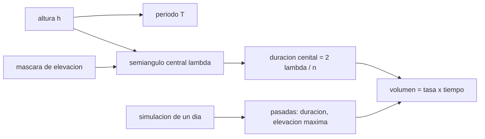

# B89-C14 — Estaciones terrestres

<!-- nav:top -->
[🏠 Programa](../../../../README.md) · [📚 Bloque B89](../../../tronco-comun/B89-comunicaciones-y-navegacion-satelital.md) · [← Anterior: B89-C13 — Protocolos para espacio profundo](../B89-C13-protocolos-para-espacio-profundo/CLASE.md) · [Siguiente: B89-C15 — Rastreo y Doppler →](../B89-C15-rastreo-y-doppler/CLASE.md)
<!-- /nav -->

## 1. Ubicación, nivel y alcance

Clase 14 del bloque B89, nivel N3. Una estación terrestre ve a un satélite bajo solo mientras está por encima de su máscara de elevación; esa geometría fija cuánto tiempo y cuántos datos se pueden transferir. Aquí calculas la duración de una pasada, la simulas durante un día y obtienes el volumen de datos. Usas [B89-C04](../B89-C04-propagacion-y-perdidas-de-espacio-libre/CLASE.md) para la distancia. La Tierra es una esfera de radio medio y la órbita es circular; las constantes `μ`, `R_T` y la velocidad angular terrestre son ilustrativas y no se consultaron.

## 2. Por qué esta clase existe

El tiempo de contacto es el recurso más escaso de un satélite de órbita baja: define cuántos datos bajan por día y cuántas estaciones se necesitan. La decisión central: **¿cuánto contacto y cuántos datos da una estación a un satélite de órbita baja?**

## 3. Lo que podrás hacer al terminar

1. Calcular el periodo de una órbita circular.
2. Calcular el semiángulo central y la duración de una pasada cenital según la máscara de elevación.
3. Simular las pasadas de un día con una geometría esférica.
4. Obtener duración, elevación máxima y número de pasadas.
5. Calcular el volumen de datos de un día a una tasa dada.
6. Rotular lo ilustrativo (constantes, órbita, estación) y lo no consultado.

La evidencia es la **tabla de pasadas de una estación** del ejercicio 12 (sección 20).

## 4. Con qué llegas y cómo comprobarlo

1. ¿Qué es la elevación de un satélite?
2. ¿Qué es una máscara de elevación?
3. ¿Qué es el periodo orbital?
4. ¿Qué es una órbita heliosíncrona?
5. ¿Qué es un dato sintético?

<details>
<summary>Ver respuestas</summary>

1. El ángulo sobre el horizonte local de la estación. 2. El ángulo mínimo para considerar al satélite utilizable. 3. El tiempo de una vuelta. 4. Una órbita retrógrada inclinada que mantiene la hora local de sus pasadas. 5. Un dato inventado para el ejemplo.
</details>

Con cuatro o cinco aciertos, sigue; si no, repasa los prerrequisitos.

## 5. Un caso de contexto y casos de referencia

Un satélite sintético a 600 km (periodo `96,54 min`) sobrevuela cenitalmente a una estación con máscara de 10° durante `8,49 min`; en un día, una estación a 40° N lo ve `4` veces durante `27,9 min`, es decir `3,35 Gbit` a 2 Mbit/s. Es el **ejemplo conductor**; todo es ilustrativo.

## 6. Vocabulario

La **máscara de elevación** es el ángulo mínimo útil. El **ángulo central** `λ` entre la estación y el nadir del satélite cumple `tan ε = (cos λ − R/(R+h))/sin λ`. La **pasada** es el intervalo con el satélite sobre la máscara. La **duración cenital** `2λ_max/n` es la máxima. El **volumen de datos** es tasa por tiempo de contacto.

## 7. Modelo mental: un faro que ve pasar un barco por encima del horizonte



*Descripción textual:* la altura y la máscara dan el semiángulo central y la duración cenital; la simulación de un día da las pasadas reales; con la tasa se obtiene el volumen de datos.

Analogía: un faro que ve pasar un barco solo mientras está sobre el horizonte; cuanto más alto el barco, más tiempo lo ve. Límite: la Tierra real es achatada, tiene relieve y la atmósfera curva el rayo; aquí no se modelan.

## 8. La explicación, paso a paso

### 8.1 Periodo y semiángulo

A 600 km: `T = 2π√(a³/μ) = 96,54 min`. El semiángulo central para la elevación `ε` es `λ = arccos[R cos ε/(R+h)] − ε`.

### 8.2 Duración cenital

Para máscaras de 0°, 5°, 10° y 20°: `12,84`, `10,42`, `8,49` y `5,80 min`. Subir la máscara acorta la pasada.

### 8.3 Verificación

Con una órbita ecuatorial y la estación en el ecuador (sin rotación terrestre), la pasada simulada dura `510,0 s` y la analítica `509,6 s`; la elevación máxima simulada es `89,8°`.

### 8.4 Un día de pasadas

Con una órbita heliosíncrona sintética (97,8°) y una estación a 40° N, se obtienen `4` pasadas con elevaciones máximas entre `17°` y `38°`. El contacto total es `27,9 min` y el volumen a 2 Mbit/s es `3,35 Gbit`. Las pasadas no cenitales duran menos que la cenital.

## 9. Magnitudes, símbolos y unidades

| Símbolo | Qué es | Unidad | Valor / nota |
|---|---|---|---|
| `μ` | parámetro gravitacional terrestre | km³/s² | 398 600,4418 (ilustrativo) |
| `R_T` | radio medio | km | 6371 (ilustrativo) |
| `h` | altitud | km | 600 (sintético) |
| `ε` | máscara de elevación | grados | 10 (sintético) |
| `T` | periodo | min | 96,54 |
| duración | de una pasada | min | hasta 8,49 |
| volumen | datos por día | Gbit | 3,35 |

## 10. Convenciones y referencias

Tierra esférica no rotante (para la verificación) o rotante (para el día), órbita circular, geometría de línea de visión, sin refracción. `μ`, `R_T` y la velocidad angular terrestre son valores de uso común, ilustrativos y no consultados en esta clase. La órbita, la estación y la tasa son sintéticas.

## 11. De dónde sale lo que afirmamos

| ID | Fuente | Localizador | Respalda | Estado |
|---|---|---|---|---|
| S1 | NASA, Space Communications and Navigation (SCaN) — https://www.nasa.gov/directorates/somd/space-communications-navigation-program/ (consultada 2026-11-10) | pagina completa | Near Space Network (hasta ~1 millon de millas), Deep Space Network con antenas de 34 y 70 m en Goldstone, Madrid y Canberra; las comunicaciones laser transmiten 10 a 100 veces mas datos que los sistemas de RF actuales segun la pagina | Consultada |
| — | Constantes `μ`, `R_T` y velocidad angular terrestre | — | valores usuales ilustrativos, no consultados | No consultada en una fuente concreta |
| — | Relaciones estándar (geometría de visibilidad, periodo kepleriano) | — | las verifica el laboratorio con una simulación numérica | No consultada en una fuente concreta |

Límites: la página de SCaN solo respalda que existen la DSN y la Near Space Network y que las antenas de la DSN son de 34 y 70 m; no se consultó ninguna especificación de estación ni las coordenadas de ninguna.

## 12. Cómo ver las pasadas de un día

| Magnitud | Valor |
|---|---|
| periodo a 600 km | 96,54 min |
| pasada cenital (10°) | 8,49 min |
| pasadas en 24 h | 4 |
| contacto total | 27,9 min |
| volumen a 2 Mbit/s | 3,35 Gbit |

Descripción larga: el contacto diario son unas pocas pasadas de minutos; la máscara y la altura fijan su duración.

## 13. Ejemplo trabajado: la pasada cenital con máscara de 10°

**Paso 1 · Radio orbital.** `a = 6371 + 600 = 6971 km`.

**Paso 2 · Semiángulo.** `λ = arccos(6371 cos 10°/6971) − 10° = 15,836°`.

**Paso 3 · Movimiento medio.** `n = 2π/T = 0,0622°/s`.

**Paso 4 · Duración.** `2λ/n = 509,6 s = 8,49 min`.

## 14. Distintas formas de describir el contacto con una estación

**Por geometría:** `h`, `ε`. **Por tiempo:** duración y número de pasadas. **Por volumen:** tasa × tiempo. **Por calidad:** elevación máxima.

## 15. Práctica guiada

**Ejercicio 1 · con los pasos indicados.** Duración cenital con máscara de 0°. *Pasos:* `λ = arccos(R/(R+h))`.

<details><summary>Solución comentada</summary>

`12,84 min`.
</details>

**Ejercicio 2 · con una pista.** Predice si una máscara de 20° acorta o alarga la pasada. *Pista:* se ve menos cielo.

<details><summary>Solución comentada</summary>

La acorta: `5,80 min`.
</details>

**Ejercicio 3 · casi autónomo.** ¿Por qué una pasada baja (elevación máxima de 15°) dura menos que la cenital?

<details><summary>Solución comentada</summary>

Porque la cuerda sobre el círculo de visibilidad es más corta que el diámetro: no cruza por el centro.
</details>

## 16. Práctica autónoma, transferencia e integrador

**Ejercicio 4 · autónomo.** Volumen de una pasada cenital de 10° a 5 Mbit/s.

<details><summary>Solución comentada</summary>

`5 × 510 = 2,55 Gbit`.
</details>

**Ejercicio 5 · autónomo.** Número de vueltas por día a 600 km.

<details><summary>Solución comentada</summary>

`86400/5792 = 14,92`.
</details>

**Ejercicio 6 · autónomo.** Pasadas por día de una estación en el polo con una órbita polar (estimación).

<details><summary>Solución comentada</summary>

Casi todas las vueltas: ~14–15 pasadas, porque el plano orbital pasa siempre cerca del polo.
</details>

**Ejercicio 7 · autónomo.** Tasa mínima para bajar 5 Gbit/día con el contacto simulado.

<details><summary>Solución comentada</summary>

`5 Gbit/1675 s = 2,99 Mbit/s`.
</details>

**Ejercicio 8 · autónomo.** Si se añade una segunda estación idéntica a 30° de longitud, ¿se duplica el contacto?

<details><summary>Solución comentada</summary>

Aproximadamente sí, porque las pasadas se reparten; el laboratorio podría repetirse con `lon = 30`.
</details>

**Ejercicio 9 · transferencia.** **Transferencia.** Un cubesat con 5 minutos de pasada y 100 kbit/s quiere bajar 1 Gbit. ¿Cuántas pasadas necesita?

<details><summary>Solución comentada</summary>

`10⁹/(10⁵ × 300) = 33` pasadas, unos 3 días con ~10 pasadas por día; no es viable para el volumen pedido.
</details>

**Ejercicio 10 · transferencia.** **Transferencia.** Un operador usa una estación con máscara de 3° «para ganar contacto». ¿Qué riesgo corre?

<details><summary>Solución comentada</summary>

A baja elevación hay más atmósfera y multitrayecto (más pérdida y ruido), por lo que el margen del enlace empeora.
</details>

**Ejercicio 11 · transferencia.** **Transferencia.** Un colega afirma que las pasadas simuladas son las de una estación real. ¿Qué corriges?

<details><summary>Solución comentada</summary>

Que son sintéticas: la órbita, la latitud y la máscara son inventadas, y la geometría es esférica.
</details>

**Ejercicio 12 · integrador.** **Integrador.** Elabora tu *tabla de pasadas de una estación*: periodo, duraciones cenitales por máscara, pasadas de un día y volumen, con qué es ilustrativo y sintético.

<details><summary>Solución comentada</summary>

Secciones 8.1–8.4 y la salida del laboratorio.
</details>

## 17. Laboratorio: pasadas de un satélite sobre una estación

El script [pasadas.py](pasadas.py) calcula el periodo, la duración cenital por máscara, simula un día de pasadas y calcula el volumen de datos (**comprueba** que la pasada ecuatorial simulada coincide con la analítica a menos de 1 s y que ninguna pasada dura más que la cenital).

**Datos:** `μ`, `R_T` y velocidad angular terrestre **ilustrativos**; órbita, estación y tasa **sintéticas**. **Predice antes de ejecutar:** ¿cuánto dura una pasada cenital a 600 km con 10° de máscara? (~8 min.) **Ejecución del 2026-11-10 (Python 3.12.9):**

```text
3.12.9 (biblioteca estandar)
ILUSTRATIVO: mu = 398600.4418 km3/s2, Re = 6371.0 km ; SINTETICO: orbita circular de 600 km
Periodo = 96.54 min
Duracion de una pasada cenital segun la mascara de elevacion:
  mascara  0 grados:  12.84 min
  mascara  5 grados:  10.42 min
  mascara 10 grados:   8.49 min
  mascara 20 grados:   5.80 min
Verificacion (orbita ecuatorial, sin rotacion, mascara 10): numerica = 510.0 s ; analitica = 509.6 s
Un dia, SSO 97.8 grados, estacion 40 N 0 E, mascara 10 grados, paso 5 s: 4 pasadas
  inicio  0.113 h ; duracion  7.58 min ; elevacion maxima  32.7 grados
  inicio 11.826 h ; duracion  7.83 min ; elevacion maxima  38.3 grados
  inicio 13.433 h ; duracion  5.50 min ; elevacion maxima  17.4 grados
  inicio 22.661 h ; duracion  7.00 min ; elevacion maxima  26.3 grados
Contacto total = 27.9 min ; volumen a 2 Mbit/s = 3.35 Gbit
Pruebas superadas.
```

```bash
python programa/clases/B89/B89-C14-estaciones-terrestres/pasadas.py
```

**Límites:** Tierra esférica, órbita circular, sin refracción ni relieve; no representa una estación ni un satélite reales.

## 18. Errores frecuentes y cómo corregirlos

**Usar la duración cenital como típica.** Se corrige con 8.4.

**Ignorar la máscara de elevación.** Se corrige con 8.2.

**Contar todo el tiempo sobre el horizonte como utilizable.** Se corrige con la sección 10.

**Presentar la simulación como un calendario real.** Se corrige con la sección 10.

## 19. Cómo sabrás que vas bien

Tras la sección 8: ¿qué duración esperabas y cuál obtuviste? Si dudas, repasa el ejemplo 13. Tras el laboratorio: ¿qué comprueba? (ver la sección 17).

## 20. Qué entregas y cómo se evalúa

El producto es tu **tabla de pasadas de una estación** (ejercicio 12).

| Criterio | Inicial | En desarrollo | Logrado | Destacado |
|---|---|---|---|---|
| Conceptos | Los confunde | Parciales | Calcula periodo, duración y volumen | Explica los límites |
| Cálculo | Sin unidades | Con errores | Tablas completas con unidades | Calcula casos nuevos |
| Numérico | Sin comprobar | Un caso | Contraste con una segunda vía | Interpreta las diferencias |
| Fuentes | Sin fuente | Sin fecha | Fuentes con fecha y estado | Declara lo sintético y lo no consultado |
| Límites | No los nombra | Uno | Tres | Discute qué falta del modelo |

**Condiciones críticas (no se compensan con promedio):** rotular constantes y geometría como ilustrativas; no presentar las pasadas como calendario real; no presentar un cálculo como una medición; citar solo lo consultado.

## 21. Ética, seguridad y límites

Clase educativa: los modelos son simplificados y sus datos son sintéticos o ilustrativos; ningún resultado describe un enlace, un satélite ni una misión reales, ni sustituye a la documentación oficial de una misión, a un presupuesto de enlace verificado ni a la coordinación regulatoria.  Accesibilidad: tablas equivalentes a las gráficas, fórmulas en texto, ejercicios sin conexión.

## 22. Para cerrar y seguir

Una estación ve al satélite `4` veces al día durante `28 min` y recibe `3,4 Gbit` a 2 Mbit/s. Queda una pregunta: ¿cómo se mide la velocidad de la nave a partir de su señal?

**Glosario español–inglés.** estación terrestre · *ground station*; máscara de elevación · *elevation mask*; pasada · *pass*; semiángulo central · *central half-angle*; órbita heliosíncrona · *sun-synchronous orbit*.

**Continuidad.** [B89-C15](../B89-C15-rastreo-y-doppler/CLASE.md) estudia el rastreo y el efecto Doppler.

**Referencias:** ver sección 11.

<!-- nav:bottom -->
---

[← Anterior: B89-C13 — Protocolos para espacio profundo](../B89-C13-protocolos-para-espacio-profundo/CLASE.md) · [📚 Bloque B89](../../../tronco-comun/B89-comunicaciones-y-navegacion-satelital.md) · [Siguiente: B89-C15 — Rastreo y Doppler →](../B89-C15-rastreo-y-doppler/CLASE.md)
<!-- /nav -->
