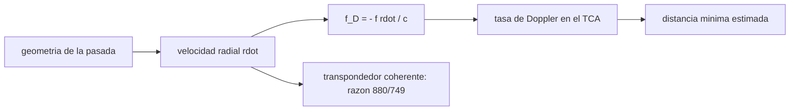

# B89-C15 — Rastreo y Doppler

<!-- nav:top -->
[🏠 Programa](../../../../README.md) · [📚 Bloque B89](../../../tronco-comun/B89-comunicaciones-y-navegacion-satelital.md) · [← Anterior: B89-C14 — Estaciones terrestres](../B89-C14-estaciones-terrestres/CLASE.md) · [Siguiente: B89-C16 — GNSS como navegación de satélites →](../B89-C16-gnss-como-navegacion-de-satelites/CLASE.md)
<!-- /nav -->

## 1. Ubicación, nivel y alcance

Clase 15 del bloque B89, nivel N3. La señal que llega de una nave no solo trae datos: su frecuencia revela la velocidad radial por el efecto Doppler, y su evolución durante una pasada revela la geometría. Aquí calculas la curva Doppler de una pasada de órbita baja en banda X, su tasa de variación y la razón de un transpondedor coherente. Usas [B89-C14](../B89-C14-estaciones-terrestres/CLASE.md) para la geometría y [B89-C10](../B89-C10-sincronizacion-de-portadora/CLASE.md) para el lazo que lo sigue. La órbita y la estación son sintéticas; `μ`, `R_T` y la razón 880/749 son ilustrativas y no se consultaron.

## 2. Por qué esta clase existe

El Doppler es la medida básica de rastreo: se usa para determinar la órbita y obliga a diseñar los lazos de portadora y los planes de frecuencia. La decisión central: **¿cuánto se desplaza la frecuencia durante una pasada y qué información de la órbita contiene?**

## 3. Lo que podrás hacer al terminar

1. Calcular el Doppler de ida `f_D = −f ṙ/c` en una pasada.
2. Obtener la velocidad radial por derivación numérica y analítica.
3. Calcular la tasa de Doppler en el punto de máxima aproximación.
4. Estimar la distancia mínima a partir de la pendiente del Doppler.
5. Explicar la razón de transpondedor coherente en un enlace de ida y vuelta.
6. Rotular lo consultado (`c`) frente a lo ilustrativo (constantes, razón 880/749) y lo sintético (pasada).

La evidencia es la **curva Doppler de una pasada** del ejercicio 12 (sección 20).

## 4. Con qué llegas y cómo comprobarlo

1. ¿Qué es la velocidad radial?
2. ¿Qué es el efecto Doppler?
3. ¿Qué es el punto de máxima aproximación (TCA)?
4. ¿Qué es un transpondedor coherente?
5. ¿Qué es un dato sintético?

<details>
<summary>Ver respuestas</summary>

1. La componente de la velocidad a lo largo de la línea de visión. 2. El cambio de frecuencia por movimiento relativo. 3. El instante de mínima distancia. 4. Un equipo que devuelve la portadora con una frecuencia relacionada por una razón fija. 5. Un dato inventado para el ejemplo.
</details>

Con cuatro o cinco aciertos, sigue; si no, repasa los prerrequisitos.

## 5. Un caso de contexto y casos de referencia

En una pasada sintética de un satélite a 600 km sobre una estación a 3° de latitud, el Doppler de ida en banda X es `187,1 kHz` al aparecer (AOS), `-0,000 kHz` en el punto de máxima aproximación y `-187,1 kHz` al ocultarse (LOS), con una tasa de `-2106,7 Hz/s` en el TCA. Es el **ejemplo conductor**; todo es sintético.

## 6. Vocabulario

El **Doppler de ida** es `f_D = −f ṙ/c`, con `ṙ` la velocidad radial (positiva si se aleja). La **tasa de Doppler** `ḟ_D` es su derivada. El **TCA** es el instante de mínima distancia `ρ_min`; allí `ṙ = 0`. El **Doppler de ida y vuelta** coherente recibe `f_rx = (880/749) f_up (1 + …)`: la nave devuelve la portadora multiplicada por la razón de transpondedor (880/749 se usa aquí como ilustración).

## 7. Modelo mental: la sirena de una ambulancia que pasa



*Descripción textual:* la geometría da la velocidad radial; con ella se calcula el Doppler, su tasa en el TCA (de donde se estima la distancia mínima) y el Doppler de ida y vuelta con el transpondedor.

Analogía: el tono de la sirena de una ambulancia baja de golpe al pasar frente a ti; cuanto más cerca pasa, más brusco es el cambio. Límite: aquí se usa un modelo clásico no relativista, sin atmósfera ni rotación terrestre.

## 8. La explicación, paso a paso

### 8.1 Geometría de la pasada

Con la estación a 3° de latitud el rango mínimo es `694,07 km` y la elevación máxima `58,29°`; con máscara de 10° la pasada dura `8,33 min` (`AOS = -250,0 s`, `LOS = 250,0 s`).

### 8.2 Doppler

`f_D = −f ṙ/c` con `f = 8,4 GHz` y `c = 299 792,458 km/s`: AOS `-6,6787 km/s` → `187,132 kHz`; TCA `0,0000 km/s` → `-0,000 kHz`; LOS `6,6787 km/s` → `-187,132 kHz`. La curva es una «S» que cruza cero en el TCA. La derivada numérica coincide con la analítica a `1.1e-08 km/s`.

### 8.3 Tasa y distancia mínima

En el TCA la tasa es `-2106,74 Hz/s`. El modelo rectilíneo `f v²/(cρ)` da `2308,34 Hz/s` (error de ≈ 9 % porque ignora la curvatura de la órbita); añadiendo la aceleración centrípeta, `2078,51 Hz/s`. Invirtiendo este modelo desde la pendiente se recupera `ρ_min = 685,7 km` (real `694,1 km`): el Doppler contiene información de la órbita.

### 8.4 Transpondedor coherente

Un transpondedor con razón `880/749 = 1,17490` devuelve la portadora ascendente (7,19 GHz, ilustrativa) multiplicada por la razón; el Doppler de ida y vuelta en el TCA es `-0,000 kHz` y en el AOS `376,4 kHz`: más del doble del de ida porque cuenta dos trayectos.

## 9. Magnitudes, símbolos y unidades

| Símbolo | Qué es | Unidad | Valor / nota |
|---|---|---|---|
| `c` | velocidad de la luz | km/s | 299 792,458 (exacta) |
| `ṙ` | velocidad radial | km/s | -6,679 (AOS) |
| `f_D` | Doppler de ida | Hz | 187,1×10³ (AOS) |
| `ḟ_D` | tasa de Doppler | Hz/s | -2106,7 |
| `ρ_min` | distancia mínima | km | 694,07 |
| razón | transpondedor | — | 880/749 (ilustrativa) |

## 10. Convenciones y referencias

Tierra esférica no rotante, órbita circular ecuatorial, estación a 3° de latitud, modelo clásico no relativista. `c` de NIST (CODATA 2022, consultada); `μ`, `R_T` y la razón 880/749 son ilustrativos y no consultados; la banda de ascenso de 7,19 GHz también es ilustrativa. La pasada es sintética.

## 11. De dónde sale lo que afirmamos

| ID | Fuente | Localizador | Respalda | Estado |
|---|---|---|---|---|
| S1 | NIST, CODATA 2022: velocidad de la luz en el vacio — https://physics.nist.gov/cgi-bin/cuu/Value?c (consultada 2026-11-10) | valor de la pagina | c = 299 792 458 m/s (exacta) | Consultada |
| S2 | NASA/JPL, DSN Telecommunications Link Design Handbook (810-005) — https://deepspace.jpl.nasa.gov/dsndocs/810-005/ (consultada 2026-11-10) | pagina de indice | existencia y estructura por modulos (material introductorio, interfaces del enlace espacial, procesamiento de datos de estacion, propiedades de estacion terrestre, informacion complementaria); no se leyeron los modulos | Consultada |
| — | Valores de `μ`, `R_T` y razón de transpondedor 880/749 | — | ilustrativos, no consultados | No consultada en una fuente concreta |
| — | Relaciones estándar (Doppler clásico, derivada de la distancia) | — | las verifica el laboratorio con una segunda vía (derivación numérica frente a analítica) | No consultada en una fuente concreta |

Límites: del manual DSN 810-005 solo se consultó la página de índice; no se consultó ninguna especificación de transpondedor ni los esquemas de rastreo de la DSN.

## 12. Cómo ver la curva Doppler

| Magnitud | Valor |
|---|---|
| Doppler en el AOS | 187,13 kHz |
| Doppler en el TCA | -0,000 kHz |
| tasa en el TCA | -2106,74 Hz/s |
| `ρ_min` recuperado | 685,7 km |
| Doppler ida y vuelta en el AOS | 376,4 kHz |

Descripción larga: la curva Doppler es una S que cruza cero en el TCA; su pendiente central da la distancia mínima.

## 13. Ejemplo trabajado: el Doppler en el AOS

**Paso 1 · Velocidad radial.** `ṙ = -6,6787 km/s` (se acerca).

**Paso 2 · Cociente.** `ṙ/c = -2,228×10⁻⁵`.

**Paso 3 · Doppler.** `f_D = −8,4×10⁹ × ṙ/c = 187,132 kHz`.

**Paso 4 · Lectura.** Positivo: la frecuencia recibida es mayor que la emitida mientras se acerca.

## 14. Distintas formas de describir una pasada con el Doppler

**Por velocidad radial:** `ṙ(t)`. **Por Doppler:** `f_D(t)`. **Por tasa:** `ḟ_D`. **Por geometría:** `ρ_min`. **De ida y vuelta:** con la razón del transpondedor.

## 15. Práctica guiada

**Ejercicio 1 · con los pasos indicados.** Doppler de ida para `ṙ = −5 km/s` en X. *Pasos:* `−f ṙ/c`.

<details><summary>Solución comentada</summary>

`140,10 kHz`.
</details>

**Ejercicio 2 · con una pista.** Predice el signo del Doppler en el LOS. *Pista:* se aleja.

<details><summary>Solución comentada</summary>

Negativo: `-187,13 kHz`.
</details>

**Ejercicio 3 · casi autónomo.** ¿Por qué la curva es simétrica respecto del TCA?

<details><summary>Solución comentada</summary>

Porque para una órbita circular y una estación casi en el plano, el acercamiento y el alejamiento son simétricos en la velocidad radial; compara AOS y LOS.
</details>

## 16. Práctica autónoma, transferencia e integrador

**Ejercicio 4 · autónomo.** Doppler de ida en banda S (2,2 GHz) para `ṙ = −5 km/s`.

<details><summary>Solución comentada</summary>

`36,69 kHz`.
</details>

**Ejercicio 5 · autónomo.** Razón entre el Doppler de X y de S.

<details><summary>Solución comentada</summary>

`8,4/2,2 = 3,82`.
</details>

**Ejercicio 6 · autónomo.** Tasa de Doppler si `ρ_min` fuera 1200 km en lugar de 600 con igual velocidad (modelo rectilíneo).

<details><summary>Solución comentada</summary>

Se reduce a la mitad.
</details>

**Ejercicio 7 · autónomo.** Velocidad radial máxima aproximada de la pasada.

<details><summary>Solución comentada</summary>

`6,68 km/s`.
</details>

**Ejercicio 8 · autónomo.** Cuántos Hz/s de variación debe seguir un lazo en X en el TCA.

<details><summary>Solución comentada</summary>

`2107 Hz/s`: más que el de C10 (5 Hz/s), por lo que requiere un lazo más ancho o Doppler predicho.
</details>

**Ejercicio 9 · transferencia.** **Transferencia.** Una sonda en órbita marciana usa un transpondedor 880/749 con ascenso a 7,19 GHz. ¿Qué frecuencia de descenso esperas sin Doppler?

<details><summary>Solución comentada</summary>

`7,19 × 880/749 = 8,448 GHz`, dentro de la banda X (las frecuencias son ilustrativas).
</details>

**Ejercicio 10 · transferencia.** **Transferencia.** ¿Qué haría un operador para mantener el enganche con un Doppler de ±200 kHz?

<details><summary>Solución comentada</summary>

Barrer (o precompensar) la frecuencia del receptor con la predicción de la órbita y usar un lazo de seguimiento ajustado a la tasa.
</details>

**Ejercicio 11 · transferencia.** **Transferencia.** Un colega usa 880/749 como «la razón de la DSN» sin fuente. ¿Qué corriges?

<details><summary>Solución comentada</summary>

Que en esta clase es ilustrativa: no se consultó el manual de enlace ni la especificación del transpondedor.
</details>

**Ejercicio 12 · integrador.** **Integrador.** Elabora tu *curva Doppler de una pasada*: tabla de `ṙ` y `f_D` en AOS, TCA y LOS, tasa, `ρ_min` recuperado y Doppler de ida y vuelta, con qué es consultado, ilustrativo y sintético.

<details><summary>Solución comentada</summary>

Secciones 8.1–8.4 y la salida del laboratorio.
</details>

## 17. Laboratorio: curva Doppler de una pasada

El script [doppler.py](doppler.py) calcula la velocidad radial, el Doppler en AOS, TCA y LOS, la tasa en el TCA y la distancia mínima recuperada desde la pendiente (**comprueba** derivada numérica frente a analítica, la tasa del modelo con aceleración centrípeta a menos del 2 % y `ρ_min` a menos de 15 km).

**Datos:** `c` de NIST CODATA 2022 (consultada); `μ`, `R_T` y razón 880/749 **ilustrativos**; pasada **sintética**. **Predice antes de ejecutar:** ¿cuánto vale el Doppler de ida en el TCA? (Casi cero.) **Ejecución del 2026-11-10 (Python 3.12.9):**

```text
3.12.9 (biblioteca estandar)
ILUSTRATIVO/SINTETICO: orbita ecuatorial de 600 km, estacion a 3 grados de latitud, banda X 8.4 GHz, mascara 10 grados
AOS = -250.0 s ; LOS = 250.0 s ; duracion = 8.33 min ; elevacion maxima = 58.29 grados ; rango minimo = 694.07 km
  AOS: velocidad radial =  -6.6787 km/s ; Doppler de ida = +187.132 kHz
  TCA: velocidad radial =  +0.0000 km/s ; Doppler de ida =   -0.000 kHz
  LOS: velocidad radial =  +6.6787 km/s ; Doppler de ida = -187.132 kHz
Tasa de Doppler en el TCA = -2106.74 Hz/s
  modelo rectilineo f v^2/(c rho) = 2308.34 Hz/s ; con aceleracion centripeta = 2078.51 Hz/s
  rango minimo recuperado desde la pendiente = 685.68 km (real 694.07 km)
Razon de transpondedor 880/749 = 1.17490 ; Doppler de ida y vuelta (ascendente 7.19 GHz) en TCA = -0.000 kHz
Diferencia derivada numerica frente a analitica = 1.12e-08 km/s
Pruebas superadas.
```

```bash
python programa/clases/B89/B89-C15-rastreo-y-doppler/doppler.py
```

**Límites:** Tierra esférica no rotante, modelo clásico y órbita circular; no simula un transpondedor ni ruido.

## 18. Errores frecuentes y cómo corregirlos

**Confundir el signo del Doppler.** Se corrige con 8.2.

**Usar el modelo rectilíneo para la tasa.** Se corrige con 8.3.

**Olvidar que el Doppler de ida y vuelta cuenta dos trayectos.** Se corrige con 8.4.

**Presentar la razón 880/749 como especificación.** Se corrige con la sección 10.

## 19. Cómo sabrás que vas bien

Tras la sección 8: ¿qué Doppler esperabas en el AOS y cuál obtuviste? Si dudas, repasa el ejemplo 13. Tras el laboratorio: ¿qué comprueba? (ver la sección 17).

## 20. Qué entregas y cómo se evalúa

El producto es tu **curva Doppler de una pasada** (ejercicio 12).

| Criterio | Inicial | En desarrollo | Logrado | Destacado |
|---|---|---|---|---|
| Conceptos | Los confunde | Parciales | Calcula Doppler, tasa y ρ_min | Explica los límites |
| Cálculo | Sin unidades | Con errores | Tablas completas con unidades | Calcula casos nuevos |
| Numérico | Sin comprobar | Un caso | Contraste con una segunda vía | Interpreta las diferencias |
| Fuentes | Sin fuente | Sin fecha | Fuentes con fecha y estado | Declara lo sintético y lo no consultado |
| Límites | No los nombra | Uno | Tres | Discute qué falta del modelo |

**Condiciones críticas (no se compensan con promedio):** rotular la pasada y la razón como sintéticas o ilustrativas; usar `c` con su fuente y fecha; no presentar un cálculo como una medición; citar solo lo consultado.

## 21. Ética, seguridad y límites

Clase educativa: los modelos son simplificados y sus datos son sintéticos o ilustrativos; ningún resultado describe un enlace, un satélite ni una misión reales, ni sustituye a la documentación oficial de una misión, a un presupuesto de enlace verificado ni a la coordinación regulatoria.  Accesibilidad: tablas equivalentes a las gráficas, fórmulas en texto, ejercicios sin conexión.

## 22. Para cerrar y seguir

La pasada sintética recorre `187 kHz` a `187 kHz` con `2107 Hz/s` en el centro, y de esa pendiente se recupera la distancia mínima. Queda una pregunta: ¿cómo se calcula una posición a partir de señales?

**Glosario español–inglés.** efecto Doppler · *Doppler effect*; velocidad radial · *range rate*; punto de máxima aproximación · *time of closest approach (TCA)*; transpondedor coherente · *coherent transponder*; tasa de Doppler · *Doppler rate*.

**Continuidad.** [B89-C16](../B89-C16-gnss-como-navegacion-de-satelites/CLASE.md) estudia el GNSS como navegación.

**Referencias:** ver sección 11.

<!-- nav:bottom -->
---

[← Anterior: B89-C14 — Estaciones terrestres](../B89-C14-estaciones-terrestres/CLASE.md) · [📚 Bloque B89](../../../tronco-comun/B89-comunicaciones-y-navegacion-satelital.md) · [Siguiente: B89-C16 — GNSS como navegación de satélites →](../B89-C16-gnss-como-navegacion-de-satelites/CLASE.md)
<!-- /nav -->
