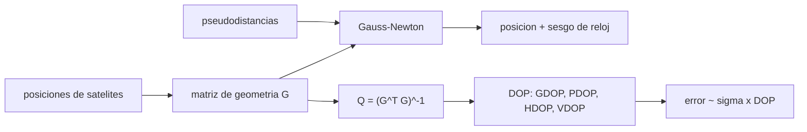

# B89-C16 — GNSS como navegación de satélites

<!-- nav:top -->
[🏠 Programa](../../../../README.md) · [📚 Bloque B89](../../../tronco-comun/B89-comunicaciones-y-navegacion-satelital.md) · [← Anterior: B89-C15 — Rastreo y Doppler](../B89-C15-rastreo-y-doppler/CLASE.md) · [Siguiente: B89-C17 — Constelaciones y cobertura →](../B89-C17-constelaciones-y-cobertura/CLASE.md)
<!-- /nav -->

## 1. Ubicación, nivel y alcance

Clase 16 del bloque B89, nivel N3. Un receptor GNSS mide la distancia aparente (pseudodistancia) a varios satélites de posición conocida y resuelve cuatro incógnitas: su posición y el sesgo de su reloj. Aquí implementas esa solución por mínimos cuadrados con una constelación sintética y calculas la dilución de la precisión. Usas [B89-C04](../B89-C04-propagacion-y-perdidas-de-espacio-libre/CLASE.md) para el retardo y [B89-C15](../B89-C15-rastreo-y-doppler/CLASE.md) para la medida por señal. La constelación, el ruido y el sesgo de reloj son sintéticos; el radio orbital y el terrestre son ilustrativos. No se consultaron las interfaces de GPS ni Galileo.

## 2. Por qué esta clase existe

Todo satélite o usuario que se posiciona con GNSS depende de la geometría de los satélites visibles: la misma medida con mala geometría puede multiplicar el error. La decisión central: **¿qué precisión de posición da una geometría dada de satélites y cuántos hacen falta?**

## 3. Lo que podrás hacer al terminar

1. Plantear la pseudodistancia `ρ = d + c·δt` y linealizarla.
2. Resolver posición y sesgo de reloj con Gauss–Newton.
3. Calcular GDOP, PDOP, HDOP, VDOP y TDOP.
4. Relacionar el error de posición con `σ·PDOP` mediante una simulación.
5. Comparar una geometría buena con una mala.
6. Rotular lo consultado (`c`) frente a lo sintético (constelación, ruido, reloj).

La evidencia es la **ficha de posición y DOP** del ejercicio 12 (sección 20).

## 4. Con qué llegas y cómo comprobarlo

1. ¿Qué es una pseudodistancia?
2. ¿Por qué se necesitan al menos 4 satélites?
3. ¿Qué es una linealización?
4. ¿Qué son los mínimos cuadrados?
5. ¿Qué es un dato sintético?

<details>
<summary>Ver respuestas</summary>

1. La distancia medida por el tiempo de viaje, afectada por el error del reloj del receptor. 2. Porque hay 4 incógnitas: tres coordenadas y el sesgo de reloj. 3. Aproximar una función por su tangente cerca de un punto. 4. Un método para ajustar incógnitas minimizando la suma de residuos al cuadrado. 5. Un dato inventado para el ejemplo.
</details>

Con cuatro o cinco aciertos, sigue; si no, repasa los prerrequisitos.

## 5. Un caso de contexto y casos de referencia

Con una constelación sintética de 24 satélites, un receptor a 40° N ve `7` con máscara de 10°; su `PDOP` es `2,00` y con ruido de 3 m el error 3D rms simulado es `6,21 m` frente a `σ·PDOP = 5,99 m`. Con los 4 satélites de menor elevación el `PDOP` es `5,79`. Es el **ejemplo conductor**; todo es sintético.

## 6. Vocabulario

La **pseudodistancia** es `ρᵢ = |sᵢ − x| + c δt`. La **matriz de geometría** `G` tiene filas `[−uᵢ, 1]` con `uᵢ` el vector unitario al satélite. La **dilución de la precisión** `DOP` viene de `(GᵀG)⁻¹`; `PDOP = √(Q₁₁+Q₂₂+Q₃₃)`, `TDOP = √Q₄₄`, `GDOP` suma las cuatro. El **error de posición** es aproximadamente `σ_UERE × DOP`.

## 7. Modelo mental: la triangulación con un reloj desajustado



*Descripción textual:* las posiciones de los satélites dan la matriz de geometría; con las pseudodistancias, Gauss–Newton da la posición y el reloj; de la misma matriz salen los DOP, que escalan el error.

Analogía: ubicar un punto con círculos centrados en las balizas; si las balizas están juntas, los círculos se cruzan en ángulos pequeños y el punto queda difuso. Límite: aquí no hay ionosfera (C21), troposfera, multitrayecto ni errores de efemérides.

## 8. La explicación, paso a paso

### 8.1 El modelo

`ρᵢ = √((xₛ−x)²+…) + c δt + ε`. Linealizado en torno a `x₀`: `Δρ = G Δx`, con `Δx = [Δx, Δy, Δz, c δt]`. Se itera hasta que la corrección baja de 10⁻⁹ m.

### 8.2 Solución sin ruido

Con pseudodistancias exactas y un sesgo de reloj de 10⁻⁴ s (30 km), la posición y `c δt` se recuperan con error de `1.4e-09 m`: la matemática funciona.

### 8.3 DOP

Con `7` satélites visibles: `GDOP = 2,27`, `PDOP = 2,00`, `HDOP = 1,13`, `VDOP = 1,65`, `TDOP = 1,09`. El vertical es peor que el horizontal porque no hay satélites bajo el horizonte.

### 8.4 Ruido

Con `σ = 3 m` por pseudodistancia, 400 ensayos con `random.Random(89)` dan un error 3D rms de `6,21 m`; la teoría `σ·PDOP` da `5,99 m` (diferencia 3,6 %). Con solo los 4 satélites de menor elevación `PDOP = 5,79`; con los 4 más altos (agrupados cerca del cenit), `13,68`: la geometría importa tanto como el ruido.

## 9. Magnitudes, símbolos y unidades

| Símbolo | Qué es | Unidad | Valor / nota |
|---|---|---|---|
| `c` | velocidad de la luz | m/s | 299 792 458 (exacta) |
| `ρ` | pseudodistancia | m | ~2×10⁷ |
| `δt` | sesgo de reloj | s | 10⁻⁴ (sintético) |
| `σ` | ruido de pseudodistancia | m | 3 (sintético) |
| `PDOP` | dilución de la precisión de posición | — | 2,00 |
| `TDOP` | dilución temporal | — | 1,09 |
| error 3D | rms | m | 6,21 |

## 10. Convenciones y referencias

Coordenadas cartesianas terrestres, Tierra esférica de radio ilustrativo 6371 km, órbitas circulares de 26 560 km (ilustrativo), 24 satélites sintéticos en 6 planos a 55°, máscara de 10°. Errores solo de ruido blanco gaussiano; sin ionosfera, troposfera ni multitrayecto. `c` de NIST CODATA 2022 (consultada).

## 11. De dónde sale lo que afirmamos

| ID | Fuente | Localizador | Respalda | Estado |
|---|---|---|---|---|
| S1 | NIST, CODATA 2022: velocidad de la luz en el vacio — https://physics.nist.gov/cgi-bin/cuu/Value?c (consultada 2026-11-10) | valor de la pagina | c = 299 792 458 m/s (exacta) | Consultada |
| — | Constelaciones, señales y precisiones de GPS y Galileo (ICD y estándar de desempeño) | — | no consultados; la constelación es sintética | No consultada en una fuente concreta |
| — | Relaciones estándar (linealización de pseudodistancias, DOP) | — | las verifica el laboratorio con una segunda vía (solución exacta sin ruido y simulación) | No consultada en una fuente concreta |

Límites: no se consultó ningún documento de GPS o Galileo (la descarga del estándar de desempeño de GPS fue rechazada con error 403); las cifras de precisión de los sistemas reales no se citan.

## 12. Cómo ver la geometría GNSS

| Magnitud | Valor |
|---|---|
| satélites visibles | 7 |
| `PDOP` | 2,00 |
| `HDOP` / `VDOP` | 1,13 / 1,65 |
| error 3D rms simulado | 6,21 m |
| `σ·PDOP` | 5,99 m |

Descripción larga: el error de posición es el error de medida multiplicado por el DOP; el vertical es peor que el horizontal.

## 13. Ejemplo trabajado: del DOP al error

**Paso 1 · Medida.** `σ = 3 m` por pseudodistancia.

**Paso 2 · Geometría.** `PDOP = 2,00`.

**Paso 3 · Error esperado.** `3 × 2,00 = 5,99 m`.

**Paso 4 · Simulación.** `6,21 m` (diferencia 3,6 %).

## 14. Distintas formas de describir la precisión GNSS

**Por geometría:** matriz `G`. **Por DOP:** GDOP, PDOP, HDOP, VDOP, TDOP. **Por error:** `σ × DOP`. **Por reloj:** `c δt` y `TDOP`.

## 15. Práctica guiada

**Ejercicio 1 · con los pasos indicados.** ¿Cuántas incógnitas tiene el problema? *Pasos:* posición y reloj.

<details><summary>Solución comentada</summary>

Cuatro.
</details>

**Ejercicio 2 · con una pista.** Predice el error 3D con `σ = 5 m` y `PDOP = 2`. *Pista:* `σ × PDOP`.

<details><summary>Solución comentada</summary>

`10 m`.
</details>

**Ejercicio 3 · casi autónomo.** ¿Por qué el `VDOP` suele ser mayor que el `HDOP`?

<details><summary>Solución comentada</summary>

Porque todos los satélites están por encima del horizonte y no hay rayos que acoten la altura desde abajo.
</details>

## 16. Práctica autónoma, transferencia e integrador

**Ejercicio 4 · autónomo.** Error en el tiempo del receptor con `TDOP = 1,09` y `σ = 3 m`.

<details><summary>Solución comentada</summary>

`10,9 ns`.
</details>

**Ejercicio 5 · autónomo.** Sesgo de reloj de 10⁻⁴ s en metros.

<details><summary>Solución comentada</summary>

`c × 10⁻⁴ = 29 979 m`.
</details>

**Ejercicio 6 · autónomo.** Con 5 satélites en lugar de 4, ¿el sistema está sobredeterminado?

<details><summary>Solución comentada</summary>

Sí: 5 ecuaciones y 4 incógnitas; los mínimos cuadrados reducen el ruido.
</details>

**Ejercicio 7 · autónomo.** Cociente entre el `PDOP` de los 4 satélites más altos y el de los 4 más bajos.

<details><summary>Solución comentada</summary>

`2,36`: los más altos, agrupados cerca del cenit, dan peor geometría.
</details>

**Ejercicio 8 · autónomo.** Si `σ` se reduce a la mitad y la geometría no cambia, ¿qué pasa con el error?

<details><summary>Solución comentada</summary>

Se reduce a la mitad.
</details>

**Ejercicio 9 · transferencia.** **Transferencia.** Un receptor en un cañón urbano solo ve satélites al sur. ¿Qué ocurre con el DOP?

<details><summary>Solución comentada</summary>

Sube mucho (geometría degenerada hacia un lado); se pierde precisión aunque haya 6 satélites.
</details>

**Ejercicio 10 · transferencia.** **Transferencia.** Un satélite en órbita baja usa GNSS: ¿qué cambia respecto de un receptor terrestre?

<details><summary>Solución comentada</summary>

Los satélites visibles están en todas las direcciones (también bajo el horizonte local), la velocidad es alta y el Doppler es grande; el DOP puede ser mejor, pero hay que compensar el movimiento.
</details>

**Ejercicio 11 · transferencia.** **Transferencia.** Un colega dice que este error de 3D es la precisión de GPS. ¿Qué corriges?

<details><summary>Solución comentada</summary>

Es una simulación sintética solo con ruido blanco; no incluye ionosfera ni otros errores, y no se consultó el desempeño publicado de ningún sistema.
</details>

**Ejercicio 12 · integrador.** **Integrador.** Elabora tu *ficha de posición y DOP*: satélites visibles, DOP, error simulado y teórico, y comparación de geometrías, con qué es consultado y sintético.

<details><summary>Solución comentada</summary>

Secciones 8.1–8.4 y la salida del laboratorio.
</details>

## 17. Laboratorio: posición por pseudodistancias y DOP

El script [gnss.py](gnss.py) resuelve la posición y el reloj con Gauss–Newton, calcula los DOP y compara el error simulado con `σ·PDOP` (**comprueba** que sin ruido el error es < 10⁻⁵ m y que el error rms difiere menos de 10 % de la teoría).

**Datos:** `c` de NIST CODATA 2022 (consultada); constelación, radios, ruido y reloj **sintéticos o ilustrativos**. **Predice antes de ejecutar:** ¿cuánto es el error 3D rms con `σ = 3 m`? (≈ 3 × PDOP.) **Ejecución del 2026-11-10 (Python 3.12.9):**

```text
3.12.9 (biblioteca estandar), random.Random(89)
SINTETICO: 24 satelites a 26560 km (6 planos, 55 grados), receptor 40 N 0 E, mascara 10 grados, sigma = 3 m
Satelites visibles = 7 ; elevaciones = [10.4, 18.6, 23.8, 39.3, 41.4, 59.0, 73.3]
Error sin ruido = 1.40e-09 m (posicion y c*dt)
DOP: GDOP = 2.27 ; PDOP = 2.00 ; HDOP = 1.13 ; VDOP = 1.65 ; TDOP = 1.09
Error 3D rms (400 ensayos) = 6.21 m ; teoria sigma*PDOP = 5.99 m ; diferencia = 3.6 %
PDOP con 4 satelites de menor elevacion = 5.79 ; con 4 de mayor elevacion = 13.68
Pruebas superadas.
```

```bash
python programa/clases/B89/B89-C16-gnss-como-navegacion-de-satelites/gnss.py
```

**Límites:** solo ruido blanco; sin ionosfera, troposfera, multitrayecto ni errores de órbita; Tierra esférica.

## 18. Errores frecuentes y cómo corregirlos

**Olvidar el sesgo de reloj como cuarta incógnita.** Se corrige con 8.1.

**Creer que más satélites siempre mejora el error.** Se corrige con 8.4: depende de la geometría.

**Confundir `σ` con el error de posición.** Se corrige con 8.4.

**Presentar la constelación sintética como GPS.** Se corrige con la sección 10.

## 19. Cómo sabrás que vas bien

Tras la sección 8: ¿qué error esperabas y cuál obtuviste? Si dudas, repasa el ejemplo 13. Tras el laboratorio: ¿qué comprueba? (ver la sección 17).

## 20. Qué entregas y cómo se evalúa

El producto es tu **ficha de posición y DOP** (ejercicio 12).

| Criterio | Inicial | En desarrollo | Logrado | Destacado |
|---|---|---|---|---|
| Conceptos | Los confunde | Parciales | Resuelve la posición y calcula DOP | Explica los límites |
| Cálculo | Sin unidades | Con errores | Tablas completas con unidades | Calcula casos nuevos |
| Numérico | Sin comprobar | Un caso | Contraste con una segunda vía | Interpreta las diferencias |
| Fuentes | Sin fuente | Sin fecha | Fuentes con fecha y estado | Declara lo sintético y lo no consultado |
| Límites | No los nombra | Uno | Tres | Discute qué falta del modelo |

**Condiciones críticas (no se compensan con promedio):** rotular la constelación como sintética; no citar desempeños de GPS o Galileo no consultados; no presentar un cálculo como una medición; citar solo lo consultado.

## 21. Ética, seguridad y límites

Clase educativa: los modelos son simplificados y sus datos son sintéticos o ilustrativos; ningún resultado describe un enlace, un satélite ni una misión reales, ni sustituye a la documentación oficial de una misión, a un presupuesto de enlace verificado ni a la coordinación regulatoria.  Accesibilidad: tablas equivalentes a las gráficas, fórmulas en texto, ejercicios sin conexión.

## 22. Para cerrar y seguir

Con `PDOP = 2,00` y 3 m de ruido, el error 3D es de `6,21 m`; con los 4 satélites más altos sería `6,8` veces mayor. Queda una pregunta: ¿cómo se reparten los satélites para cubrir toda la Tierra?

**Glosario español–inglés.** pseudodistancia · *pseudorange*; dilución de la precisión · *dilution of precision (DOP)*; mínimos cuadrados · *least squares*; sesgo de reloj · *clock bias*; matriz de geometría · *geometry matrix*.

**Continuidad.** [B89-C17](../B89-C17-constelaciones-y-cobertura/CLASE.md) estudia las constelaciones y su cobertura.

**Referencias:** ver sección 11.

<!-- nav:bottom -->
---

[← Anterior: B89-C15 — Rastreo y Doppler](../B89-C15-rastreo-y-doppler/CLASE.md) · [📚 Bloque B89](../../../tronco-comun/B89-comunicaciones-y-navegacion-satelital.md) · [Siguiente: B89-C17 — Constelaciones y cobertura →](../B89-C17-constelaciones-y-cobertura/CLASE.md)
<!-- /nav -->
