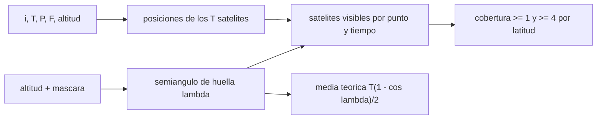

# B89-C17 — Constelaciones y cobertura

<!-- nav:top -->
[🏠 Programa](../../../../README.md) · [📚 Bloque B89](../../../tronco-comun/B89-comunicaciones-y-navegacion-satelital.md) · [← Anterior: B89-C16 — GNSS como navegación de satélites](../B89-C16-gnss-como-navegacion-de-satelites/CLASE.md) · [Siguiente: B89-C18 — Comunicaciones ópticas espaciales →](../B89-C18-comunicaciones-opticas-espaciales/CLASE.md)
<!-- /nav -->

## 1. Ubicación, nivel y alcance

Clase 17 del bloque B89, nivel N3. Una constelación reparte satélites en planos para que casi siempre haya alguno visible desde cualquier punto; la cobertura depende de la altitud, la máscara de elevación y la geometría. Aquí generas una constelación Walker delta sintética, calculas su cobertura por latitud y verificas el número medio de satélites visibles con una fórmula exacta. Usas [B89-C14](../B89-C14-estaciones-terrestres/CLASE.md) para la huella y [B89-C16](../B89-C16-gnss-como-navegacion-de-satelites/CLASE.md) para el uso en navegación. Todos los parámetros son sintéticos; `μ` y el radio terrestre son ilustrativos.

## 2. Por qué esta clase existe

El número de satélites, su altitud y la inclinación fijan cuánta gente o cuántos usuarios ven al menos uno (o cuatro, para navegar) y cuánto cuesta lograrlo. La decisión central: **¿cuántos satélites y qué geometría dan la cobertura necesaria?**

## 3. Lo que podrás hacer al terminar

1. Generar una constelación Walker delta `i:T/P/F`.
2. Calcular la huella de un satélite (semiángulo central).
3. Calcular la fracción de cobertura simple y cuádruple por banda de latitud.
4. Comprobar el promedio global de visibles con `T(1 − cos λ)/2`.
5. Comparar dos constelaciones de distinto tamaño.
6. Rotular lo sintético (constelación) y lo ilustrativo (constantes).

La evidencia es la **mapa tabular de cobertura** del ejercicio 12 (sección 20).

## 4. Con qué llegas y cómo comprobarlo

1. ¿Qué es una constelación Walker?
2. ¿Qué es la huella de un satélite?
3. ¿Qué es el área de un casquete esférico?
4. ¿Qué es una fracción ponderada por área?
5. ¿Qué es un dato sintético?

<details>
<summary>Ver respuestas</summary>

1. Un conjunto de `T` satélites en `P` planos igualmente espaciados con la misma inclinación. 2. La región de la Tierra desde la que se ve por encima de la máscara. 3. `2πR²(1 − cos λ)` para semiángulo `λ`. 4. Un promedio donde cada banda pesa por su área (∝ cos de la latitud). 5. Un dato inventado para el ejemplo.
</details>

Con cuatro o cinco aciertos, sigue; si no, repasa los prerrequisitos.

## 5. Un caso de contexto y casos de referencia

Una constelación sintética 55°: 24/6/1 a 1200 km, con máscara de 10°, tiene una huella de semiángulo `24,03°`, `1,04` satélites visibles en promedio (teoría `1,04`), cobertura simple `83,7 %` y cuádruple `0,0 %`. Con 12 satélites la cobertura simple baja a `47,5 %`. Es el **ejemplo conductor**.

## 6. Vocabulario

Una **constelación Walker delta** `i:T/P/F` tiene `T` satélites en `P` planos con inclinación `i`; `F` fija el desfase entre planos. La **huella** es el casquete de semiángulo `λ`. La **cobertura simple** es la fracción de tiempo con al menos un satélite visible; la **cuádruple**, con al menos cuatro. El **promedio global de visibles** es `T(1 − cos λ)/2` si los satélites se distribuyen uniformemente.

## 7. Modelo mental: faroles repartidos que iluminan círculos sobre la Tierra



*Descripción textual:* los parámetros dan las posiciones; la altitud y la máscara dan la huella; juntos dan los visibles y la cobertura, contrastados con la media teórica.

Analogía: farolas repartidas por un parque; cada una ilumina un círculo, y la zona más oscura depende de cómo se reparten. Límite: la media global es exacta solo para una distribución uniforme; la distribución real concentra satélites en latitudes cercanas a la inclinación.

## 8. La explicación, paso a paso

### 8.1 Huella

A 1200 km con máscara de 10°, `λ = arccos[R cos ε/(R+h)] − ε = 24,03°`: cada satélite cubre un casquete del `4,3 %` de la Tierra.

### 8.2 Promedio de visibles

Si los `T = 24` satélites se repartieran uniformemente, se verían `T(1 − cos λ)/2 = 1,040`. La simulación ponderada por área da `1,037` (diferencia 0,3 %): se cumple porque el tiempo promedia la distribución.

### 8.3 Cobertura por latitud

La cobertura global simple es `83,7 %` y la cuádruple `0,0 %`. Por bandas, los visibles medios van de `0,00` a `1,39`: los polos quedan sin cobertura (más allá de `i + λ ≈ 79°`) y el ecuador tiene menos visibles que las medias latitudes, porque la inclinación de 55° concentra los satélites hacia ±55°.

### 8.4 Tamaño de la constelación

Con 12 satélites (12/3/1) los visibles medios bajan a `0,519` (teoría `0,520`) y la cobertura simple a `47,5 %`: reducir `T` a la mitad reduce los visibles a la mitad, pero la cobertura cae más rápido.

## 9. Magnitudes, símbolos y unidades

| Símbolo | Qué es | Unidad | Valor / nota |
|---|---|---|---|
| `i` | inclinación | grados | 55 (sintético) |
| `T`, `P`, `F` | satélites, planos y desfase | — | 24, 6, 1 |
| `h` | altitud | km | 1200 (sintético) |
| `ε` | máscara | grados | 10 |
| `λ` | semiángulo de huella | grados | 24,03 |
| visibles | promedio global | — | 1,04 |
| cobertura | ≥1 / ≥4 | % | 83,7 / 0,0 |

## 10. Convenciones y referencias

Tierra esférica, órbitas circulares, geometría de línea de visión, rejilla de 15° con paso de tiempo de 120 s durante una vuelta, promedios ponderados por área (`cos φ`). `μ` y el radio terrestre ilustrativos (no consultados); la constelación es sintética.

## 11. De dónde sale lo que afirmamos

| ID | Fuente | Localizador | Respalda | Estado |
|---|---|---|---|---|
| — | Constantes `μ` y `R_T` | — | ilustrativos, no consultados | No consultada en una fuente concreta |
| — | Relaciones estándar (constelación Walker, área de un casquete, media de visibles) | — | las verifica el laboratorio contra la simulación | No consultada en una fuente concreta |
| — | Constelaciones reales de GNSS o de comunicaciones | — | no consultadas | No consultada en una fuente concreta |

Límites: esta clase no usa constantes consultadas ni constelaciones reales; el muestreo de una sola vuelta y de la rejilla de 15° es grueso.

## 12. Cómo ver la cobertura de la constelación

| Magnitud | Valor |
|---|---|
| `λ` | 24,03° |
| visibles medios (sim./teoría) | 1,04 / 1,04 |
| cobertura ≥ 1 | 83,7 % |
| cobertura ≥ 4 | 0,0 % |
| cobertura ≥ 1 con 12 satélites | 47,5 % |

Descripción larga: la media de visibles sigue una ley exacta; la cobertura simple y cuádruple dependen de la distribución en latitud.

## 13. Ejemplo trabajado: los visibles medios de 24 satélites

**Paso 1 · Huella.** `λ = 24,03°`, `cos λ = 0,9133`.

**Paso 2 · Fracción de la esfera.** `(1 − cos λ)/2 = 0,0433`.

**Paso 3 · Visibles.** `24 × 0,0433 = 1,040`.

**Paso 4 · Simulación.** `1,037`.

## 14. Distintas formas de describir la cobertura de una constelación

**Por parámetros:** `i:T/P/F`. **Por huella:** `λ`. **Por visibles:** media y cobertura ≥ 1, ≥ 4. **Por latitud:** perfil de cobertura.

## 15. Práctica guiada

**Ejercicio 1 · con los pasos indicados.** Fracción de la Tierra que cubre un satélite con `λ = 20°`. *Pasos:* `(1 − cos 20°)/2`.

<details><summary>Solución comentada</summary>

`3,02 %`.
</details>

**Ejercicio 2 · con una pista.** Predice cuántos visibles hay con `T = 48` y la misma huella. *Pista:* proporcional a `T`.

<details><summary>Solución comentada</summary>

`2,08`.
</details>

**Ejercicio 3 · casi autónomo.** ¿Por qué la cobertura simple no es `T × fracción`?

<details><summary>Solución comentada</summary>

Porque las huellas se solapan y el promedio de visibles cuenta los solapes varias veces; la cobertura solo cuenta si hay al menos uno.
</details>

## 16. Práctica autónoma, transferencia e integrador

**Ejercicio 4 · autónomo.** Semiángulo para `h = 550 km` y máscara 25°.

<details><summary>Solución comentada</summary>

`8,46°`.
</details>

**Ejercicio 5 · autónomo.** Número de satélites por plano en una Walker 24/6/1.

<details><summary>Solución comentada</summary>

`24/6 = 4`.
</details>

**Ejercicio 6 · autónomo.** Desfase entre satélites de planos vecinos en una Walker `T/P/F`.

<details><summary>Solución comentada</summary>

`360° × F/T = 15°` (con `F = 1`, `T = 24`).
</details>

**Ejercicio 7 · autónomo.** Visibles medios de la banda más poblada del laboratorio.

<details><summary>Solución comentada</summary>

`1,39`.
</details>

**Ejercicio 8 · autónomo.** Con una máscara mayor (30°), ¿suben o bajan los visibles medios?

<details><summary>Solución comentada</summary>

Bajan: la huella se encoge.
</details>

**Ejercicio 9 · transferencia.** **Transferencia.** Un operador necesita ≥ 4 satélites visibles el 99 % del tiempo en el ecuador. ¿Basta esta constelación?

<details><summary>Solución comentada</summary>

No: la cobertura cuádruple global es `0,0 %`; faltan satélites o mayor altitud.
</details>

**Ejercicio 10 · transferencia.** **Transferencia.** Una constelación de órbita baja tiene huellas pequeñas. ¿Qué compensa con más satélites?

<details><summary>Solución comentada</summary>

El número `T` necesario para la misma cobertura crece como `1/(1 − cos λ)`; por eso las megaconstelaciones de LEO son muy numerosas.
</details>

**Ejercicio 11 · transferencia.** **Transferencia.** Un compañero presenta estas coberturas como las de una constelación real. ¿Qué corriges?

<details><summary>Solución comentada</summary>

Que son sintéticas, con muestreo grueso y sin considerar ocultaciones ni terreno.
</details>

**Ejercicio 12 · integrador.** **Integrador.** Elabora tu *mapa tabular de cobertura*: tabla por banda de latitud, global ponderado, comparación 24/6/1 frente a 12/3/1 y la verificación de la media teórica, con qué es sintético e ilustrativo.

<details><summary>Solución comentada</summary>

Secciones 8.1–8.4 y la salida del laboratorio.
</details>

## 17. Laboratorio: cobertura de una constelación Walker

El script [cobertura.py](cobertura.py) genera dos constelaciones Walker, calcula visibles y cobertura por latitud y contrasta la media global con `T(1 − cos λ)/2` (**comprueba** diferencia < 5 % y < 8 %).

**Datos:** constelaciones, altitud y máscara **sintéticas**; `μ` y `R_T` **ilustrativos**. **Predice antes de ejecutar:** ¿cuántos visibles medios esperas? (≈ 1,0.) **Ejecución del 2026-11-10 (Python 3.12.9):**

```text
3.12.9 (biblioteca estandar)
SINTETICO: Walker delta 55: 24/6/1, altitud 1200 km, mascara 10 grados ; semi-angulo de huella = 24.03 grados
 lat [deg]  visibles (media)  cob >= 1  cob >= 4
     -82.5              0.00     0.000     0.000
     -67.5              0.80     0.802     0.000
     -52.5              1.34     0.981     0.000
     -37.5              1.39     0.997     0.000
     -22.5              1.01     0.833     0.000
      -7.5              0.82     0.748     0.000
       7.5              0.82     0.748     0.000
      22.5              1.01     0.833     0.000
      37.5              1.39     0.997     0.000
      52.5              1.34     0.981     0.000
      67.5              0.80     0.802     0.000
      82.5              0.00     0.000     0.000
Global ponderado por area: visibles = 1.037 ; cobertura >= 1 = 0.837 ; >= 4 = 0.000
Teoria T(1 - cos lambda)/2 = 1.040 (diferencia 0.3 %)
Constelacion 12/3/1: visibles = 0.519 (teoria 0.520) ; cobertura >= 1 = 0.475
Pruebas superadas.
```

```bash
python programa/clases/B89/B89-C17-constelaciones-y-cobertura/cobertura.py
```

**Límites:** rejilla de 15°, una vuelta de muestreo; Tierra esférica; sin ocultaciones ni terreno; no representa una constelación real.

## 18. Errores frecuentes y cómo corregirlos

**Confundir visibles medios con cobertura.** Se corrige con 8.2 y 8.3.

**Suponer cobertura uniforme en latitud.** Se corrige con 8.3.

**Olvidar la máscara de elevación.** Se corrige con 8.1.

**Presentar la constelación sintética como real.** Se corrige con la sección 10.

## 19. Cómo sabrás que vas bien

Tras la sección 8: ¿cuántos visibles esperabas y cuántos obtuviste? Si dudas, repasa el ejemplo 13. Tras el laboratorio: ¿qué comprueba? (ver la sección 17).

## 20. Qué entregas y cómo se evalúa

El producto es tu **mapa tabular de cobertura** (ejercicio 12).

| Criterio | Inicial | En desarrollo | Logrado | Destacado |
|---|---|---|---|---|
| Conceptos | Los confunde | Parciales | Calcula huella, visibles y cobertura | Explica los límites |
| Cálculo | Sin unidades | Con errores | Tablas completas con unidades | Calcula casos nuevos |
| Numérico | Sin comprobar | Un caso | Contraste con una segunda vía | Interpreta las diferencias |
| Fuentes | Sin fuente | Sin fecha | Fuentes con fecha y estado | Declara lo sintético y lo no consultado |
| Límites | No los nombra | Uno | Tres | Discute qué falta del modelo |

**Condiciones críticas (no se compensan con promedio):** rotular la constelación como sintética; contrastar la simulación con la media teórica; no presentar un cálculo como una medición; citar solo lo consultado.

## 21. Ética, seguridad y límites

Clase educativa: los modelos son simplificados y sus datos son sintéticos o ilustrativos; ningún resultado describe un enlace, un satélite ni una misión reales, ni sustituye a la documentación oficial de una misión, a un presupuesto de enlace verificado ni a la coordinación regulatoria.  Accesibilidad: tablas equivalentes a las gráficas, fórmulas en texto, ejercicios sin conexión.

## 22. Para cerrar y seguir

Una constelación 24/6/1 a 1200 km ve `1,0` satélites en promedio, con `84 %` de cobertura simple y `0 %` cuádruple. Queda una pregunta: ¿puede la luz sustituir a las ondas de radio?

**Glosario español–inglés.** constelación Walker · *Walker constellation*; huella · *footprint*; cobertura · *coverage*; satélites visibles · *satellites in view*; plano orbital · *orbital plane*.

**Continuidad.** [B89-C18](../B89-C18-comunicaciones-opticas-espaciales/CLASE.md) estudia las comunicaciones ópticas.

**Referencias:** ver sección 11.

<!-- nav:bottom -->
---

[← Anterior: B89-C16 — GNSS como navegación de satélites](../B89-C16-gnss-como-navegacion-de-satelites/CLASE.md) · [📚 Bloque B89](../../../tronco-comun/B89-comunicaciones-y-navegacion-satelital.md) · [Siguiente: B89-C18 — Comunicaciones ópticas espaciales →](../B89-C18-comunicaciones-opticas-espaciales/CLASE.md)
<!-- /nav -->
