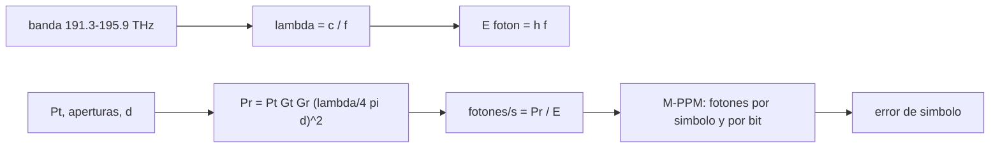

# B89-C18 — Comunicaciones ópticas espaciales

<!-- nav:top -->
[🏠 Programa](../../../../README.md) · [📚 Bloque B89](../../../tronco-comun/B89-comunicaciones-y-navegacion-satelital.md) · [← Anterior: B89-C17 — Constelaciones y cobertura](../B89-C17-constelaciones-y-cobertura/CLASE.md) · [Siguiente: B89-C19 — Coordinación del espectro ante ITU →](../B89-C19-coordinacion-del-espectro-ante-itu/CLASE.md)
<!-- /nav -->

## 1. Ubicación, nivel y alcance

Clase 18 del bloque B89, nivel N3. Un enlace óptico usa luz infrarroja en vez de radio: las aperturas son pequeñas, las ganancias enormes y la señal llega como unos pocos fotones por símbolo, que se codifican con la posición de un pulso (PPM). Aquí lees la banda óptica de la CCSDS 141.0-B-1, calculas un presupuesto de fotones a la Luna y simulas el error de 16-PPM. Usas [B89-C04](../B89-C04-propagacion-y-perdidas-de-espacio-libre/CLASE.md) para la pérdida de espacio libre. El enlace es sintético; de la norma solo se usaron los parámetros del transmisor consultados.

## 2. Por qué esta clase existe

Las comunicaciones ópticas prometen más tasa por masa y potencia que la radio; entender el presupuesto de fotones y la modulación por posición de pulso explica por qué y a qué costo (apuntamiento, nubes). La decisión central: **¿cuántos fotones por bit llegan y qué error de símbolo implica la modulación PPM elegida?**

## 3. Lo que podrás hacer al terminar

1. Convertir la banda óptica de la CCSDS 141.0-B-1 de frecuencia a longitud de onda.
2. Calcular la energía de un fotón y la tasa de fotones recibidos.
3. Calcular ganancias de apertura y pérdida de espacio libre en el infrarrojo.
4. Calcular la tasa binaria y los fotones por bit de un PPM.
5. Verificar el error de símbolo de PPM sin fondo con una simulación de Poisson.
6. Rotular lo consultado (banda, c) frente a lo sintético (enlace) y lo no consultado (`h`).

La evidencia es la **presupuesto de un enlace óptico sintético** del ejercicio 12 (sección 20).

## 4. Con qué llegas y cómo comprobarlo

1. ¿Cuál es la relación entre `λ` y `f`?
2. ¿Qué es un fotón y cuánta energía lleva?
3. ¿Qué es una distribución de Poisson?
4. ¿Qué es la modulación por posición de pulso (PPM)?
5. ¿Qué es un dato sintético?

<details>
<summary>Ver respuestas</summary>

1. `λ = c/f`. 2. El cuanto de luz, con energía `hf`. 3. La distribución del número de eventos independientes en un intervalo, con media `λ`. 4. Codificar `log₂ M` bits en la ranura (de `M`) donde aparece un pulso. 5. Un dato inventado para el ejemplo.
</details>

Con cuatro o cinco aciertos, sigue; si no, repasa los prerrequisitos.

## 5. Un caso de contexto y casos de referencia

La banda C óptica de la CCSDS 141.0-B-1 (191,3–195,9 THz) corresponde a `1530,33`–`1567,13 nm`. En un enlace sintético a la Luna (0,5 W, 10 cm y 40 cm, 1550 nm) llegan `1,08e+10 fotones/s`; con 16-PPM y ranuras de 1 ns, la tasa es `125,0 Mbit/s` con `8,68e+01` fotones por bit. Es el **ejemplo conductor**.

## 6. Vocabulario

La **banda C óptica** de la norma va de 191,3 a 195,9 THz (rejilla de 100 GHz de la UIT-T G.694.1). El **PPM de orden `M`** coloca un pulso en una de `M` ranuras (`log₂ M` bits). La **detección de fotones** cuenta fotones por ranura. El **error de símbolo sin fondo** es `e^{−n_s}(M−1)/M`. Los **fotones por bit** miden la eficiencia energética.

## 7. Modelo mental: morse con una linterna: el tiempo codifica el mensaje



*Descripción textual:* la banda da la longitud de onda y la energía del fotón; el presupuesto da la potencia recibida y los fotones por segundo; con el PPM se obtienen fotones por símbolo, por bit y el error.

Analogía: enviar un mensaje con una linterna indicando en cuál de 16 instantes enciende el destello. Límite: hay que detectar el destello sobre un fondo de luz; las nubes, el apuntamiento y la turbulencia no se modelan.

## 8. La explicación, paso a paso

### 8.1 La banda

`λ = c/f`: `1530,33 nm` (195,9 THz) a `1567,13 nm` (191,3 THz), como indica la norma (1530,33 a 1567,13 nm). A 1550 nm el fotón lleva `1,28e-19 J`.

### 8.2 Presupuesto sintético

`G = (πD/λ)²` da `106,1 dBi` (10 cm) y `118,2 dBi` (40 cm); la pérdida de espacio libre a 384 400 km es `309,9 dB`. La potencia recibida es `1,39e-09 W` = `1,08e+10 fotones/s`.

### 8.3 PPM

16-PPM lleva 4 bits por símbolo; con ranuras de 1 ns y 16 de guarda (ilustrativo), cada símbolo dura 32 ns: `125,0 Mbit/s`, `3,47e+02` fotones por símbolo y `8,68e+01` por bit.

### 8.4 Error de símbolo

Sin fondo el símbolo se pierde si el pulso no produce ningún fotón (probabilidad `e^{−n_s}`) y se adivina entre las `M` ranuras: `P = e^{−n_s}(M−1)/M`. Para `n_s = 1, 3, 6` la simulación da `0,3449`, `0,0464`, `0,0025` frente a `0,3449`, `0,0467`, `0,0023`. Con fondo `n_b = 0,5` por ranura y `n_s = 6`, el error sube a `0,0369`. El enlace sintético tiene `3,47e+02` fotones por pulso, muy por encima de esos `n_s`; los valores bajos representan un enlace degradado (mayor distancia, nubes o desapuntamiento).

## 9. Magnitudes, símbolos y unidades

| Símbolo | Qué es | Unidad | Valor / nota |
|---|---|---|---|
| `f` | frecuencia de la banda C óptica | THz | 191,3 a 195,9 (CCSDS 141.0-B-1) |
| `λ` | longitud de onda | nm | 1530,33 a 1567,13 |
| `h` | constante de Planck | J s | 6,62607015×10⁻³⁴ (exacta, no consultada) |
| `E_γ` | energía del fotón a 1550 nm | J | 1,28e-19 |
| `P_r` | potencia recibida | W | 1,39e-09 |
| `n_s` | fotones de señal por pulso | — | 1, 3, 6 |
| tasa | 16-PPM, ranura 1 ns | Mbit/s | 125,0 |

## 10. Convenciones y referencias

Modulación 16-PPM con detección de fotones por conteo de ranuras (máxima verosimilitud con desempate aleatorio); distribución de Poisson; espacio libre, sin atmósfera, sin errores de apuntamiento ni de turbulencia. La banda y la tolerancia de frecuencia (±10 GHz) provienen de CCSDS 141.0-B-1 (agosto de 2019, leída con PyMuPDF); `c` de NIST (consultada); `h` es la constante exacta del SI, no consultada en esta sesión; potencias, aperturas y distancia son sintéticas.

## 11. De dónde sale lo que afirmamos

| ID | Fuente | Localizador | Respalda | Estado |
|---|---|---|---|---|
| S1 | CCSDS 141.0-B-1, Optical Communications Physical Layer, Blue Book, agosto de 2019 — https://ccsds.org/Pubs/141x0b1.pdf (PDF leido con PyMuPDF, consultada 2026-11-10) | secciones 3 y 4 (parametros del transmisor) | banda C optica de 191,3 a 195,9 THz (1530,33 a 1567,13 nm en vacio); tolerancia de frecuencia central ±10 GHz; centros en 1070, 1064,15 y 1030 nm; el PPM del sublayer de codificacion se convierte en OOK por ranura; anchos de ranura de 0,125 a 512 ns | Consultada |
| S2 | CCSDS 142.0-B-1, Optical Communications Coding and Synchronization, Blue Book, agosto de 2019 — https://ccsds.org/Pubs/142x0b1.pdf (PDF leido con PyMuPDF, consultada 2026-11-10) | indice y secciones 1-3 | esquema SCPPM (codigo convolucional en serie concatenado con modulacion PPM), entrelazador de canal y marcador de sincronizacion de palabra de codigo | Consultada |
| S3 | NIST, CODATA 2022: velocidad de la luz en el vacio — https://physics.nist.gov/cgi-bin/cuu/Value?c (consultada 2026-11-10) | valor de la pagina | c = 299 792 458 m/s (exacta) | Consultada |
| S4 | NASA, Space Communications and Navigation (SCaN) — https://www.nasa.gov/directorates/somd/space-communications-navigation-program/ (consultada 2026-11-10) | pagina completa | Near Space Network (hasta ~1 millon de millas), Deep Space Network con antenas de 34 y 70 m en Goldstone, Madrid y Canberra; las comunicaciones laser transmiten 10 a 100 veces mas datos que los sistemas de RF actuales segun la pagina | Consultada |
| — | Constante de Planck `h` | — | exacta en el SI; no consultada en una fuente en esta sesión | No consultada en una fuente concreta |
| — | Relaciones estándar (ganancia de apertura, Friis, error de PPM sin fondo) | — | las verifica el laboratorio con una simulación | No consultada en una fuente concreta |

Límites: de la CCSDS 142.0-B-1 solo se consultó que el esquema es SCPPM (código convolucional en serie con PPM) con entrelazador y marcador de sincronización; no se leyó el codificador. La página de SCaN menciona 10 a 100 veces más datos que RF y no cuantifica casos.

## 12. Cómo ver el enlace óptico

| Magnitud | Valor |
|---|---|
| banda en nm | 1530,33–1567,13 |
| fotones/s recibidos | 1,08e+10 |
| tasa 16-PPM | 125,0 Mbit/s |
| fotones por bit | 8,68e+01 |
| error con `n_s = 3` | 0,0464 (teoría 0,0467) |

Descripción larga: la señal llega como fotones contables; el error de PPM cae como `e^{−n_s}`; un fondo de luz lo eleva.

## 13. Ejemplo trabajado: fotones por bit

**Paso 1 · Fotones por segundo.** `1,08e+10`.

**Paso 2 · Duración de un símbolo.** `32 ns`.

**Paso 3 · Fotones por símbolo.** `3,47e+02`.

**Paso 4 · Por bit.** `3,47e+02/4 = 8,68e+01`.

## 14. Distintas formas de describir un enlace óptico

**Por frecuencia/longitud de onda:** banda. **Por fotones:** tasa y por bit. **Por modulación:** orden del PPM. **Por error:** `e^{−n_s}(M−1)/M`.

## 15. Práctica guiada

**Ejercicio 1 · con los pasos indicados.** Longitud de onda de 193,4 THz. *Pasos:* `c/f`.

<details><summary>Solución comentada</summary>

`1550,12 nm`.
</details>

**Ejercicio 2 · con una pista.** Predice el error de 16-PPM con `n_s = 4` y sin fondo. *Pista:* `e^{-4}×15/16`.

<details><summary>Solución comentada</summary>

`0,0172`.
</details>

**Ejercicio 3 · casi autónomo.** ¿Por qué el error disminuye al aumentar `n_s` pero no a cero con fondo?

<details><summary>Solución comentada</summary>

Porque con fondo hay ranuras vacías que reciben fotones y pueden superar a la ranura de señal.
</details>

## 16. Práctica autónoma, transferencia e integrador

**Ejercicio 4 · autónomo.** Bits por símbolo de 64-PPM.

<details><summary>Solución comentada</summary>

`log₂ 64 = 6`.
</details>

**Ejercicio 5 · autónomo.** Tasa de 64-PPM con ranuras de 2 ns y 64 ranuras de guarda.

<details><summary>Solución comentada</summary>

`6/(128×2 ns) = 23,4 Mbit/s`.
</details>

**Ejercicio 6 · autónomo.** Energía de un fotón a 1064 nm (`h c/λ`).

<details><summary>Solución comentada</summary>

`1,87e-19 J`.
</details>

**Ejercicio 7 · autónomo.** Ganancia en dBi de 20 cm a 1550 nm.

<details><summary>Solución comentada</summary>

`112,2 dBi`.
</details>

**Ejercicio 8 · autónomo.** Si la distancia se duplica, ¿cuántos dB baja la potencia?

<details><summary>Solución comentada</summary>

`6,02 dB` (como en C04).
</details>

**Ejercicio 9 · transferencia.** **Transferencia.** Un enlace queda con 0,5 fotones por pulso. ¿Es viable con PPM sin código?

<details><summary>Solución comentada</summary>

No: `e^{-0,5}×15/16 = 0,57`; hace falta codificación (CCSDS 142.0-B-1 especifica SCPPM) o más fotones.
</details>

**Ejercicio 10 · transferencia.** **Transferencia.** ¿Qué ventaja ofrece el óptico con ganancias de 100 dBi respecto de X?

<details><summary>Solución comentada</summary>

Haces muy estrechos: mucha ganancia con aperturas pequeñas, a costa de un apuntamiento extremadamente fino.
</details>

**Ejercicio 11 · transferencia.** **Transferencia.** Un compañero afirma que el enlace sintético es el de una misión lunar. ¿Qué corriges?

<details><summary>Solución comentada</summary>

Que es sintético; de la norma solo se usaron parámetros del transmisor y la banda.
</details>

**Ejercicio 12 · integrador.** **Integrador.** Elabora tu *presupuesto de un enlace óptico sintético*: banda, fotones/s, tasa, fotones por bit y error de PPM, con qué es consultado, sintético y no consultado.

<details><summary>Solución comentada</summary>

Secciones 8.1–8.4 y la salida del laboratorio.
</details>

## 17. Laboratorio: banda óptica, fotones y 16-PPM

El script [optico.py](optico.py) convierte la banda de la CCSDS 141.0-B-1 a longitudes de onda, calcula el presupuesto de fotones a la Luna y simula el error de 16-PPM (**comprueba** 1530,33 y 1567,13 nm y que el error simulado difiere menos de 4 errores estándar del teórico).

**Datos:** banda de CCSDS 141.0-B-1 y `c` de NIST (consultadas); `h` exacta del SI (no consultada); enlace **sintético**, semilla 89. **Predice antes de ejecutar:** ¿cuántos nm abarca la banda? (1530,33 a 1567,13.) **Ejecución del 2026-11-10 (Python 3.12.9):**

```text
3.12.9 (biblioteca estandar), random.Random(89)
Banda C optica CCSDS 141.0-B-1: 191.3-195.9 THz -> 1530.33 a 1567.13 nm (vacio)
1550 nm: f = 193.414 THz ; energia del foton = 1.2816e-19 J
SINTETICO: Pt = 0.5 W, aperturas 10 cm (Tx) y 40 cm (Rx), d = 384 400 km, 1550 nm
  Gt = 106.1 dBi ; Gr = 118.2 dBi ; perdida de espacio libre = 309.9 dB
  Pr = 1.390e-09 W = 1.085e+10 fotones/s
  16-PPM, ranura 1 ns, 16 ranuras de guarda: 4 bit/simbolo ; tasa = 125.0 Mbit/s
  fotones por simbolo = 3.471e+02 ; por bit = 8.677e+01
Error de simbolo 16-PPM sin fondo (60000 simbolos): simulado frente a e^-ns (M-1)/M
  ns = 1.0: simulado = 0.3449 ; teorico = 0.3449
  ns = 3.0: simulado = 0.0464 ; teorico = 0.0467
  ns = 6.0: simulado = 0.0025 ; teorico = 0.0023
Con ns = 6 y fondo nb por ranura (20000 simbolos):
  nb = 0.0: P_error = 0.0022
  nb = 0.1: P_error = 0.0105
  nb = 0.5: P_error = 0.0369
Pruebas superadas.
```

```bash
python programa/clases/B89/B89-C18-comunicaciones-opticas-espaciales/optico.py
```

**Límites:** sin atmósfera, turbulencia ni apuntamiento; PPM sin SCPPM real; Poisson aproximado con gaussiana para media > 30.

## 18. Errores frecuentes y cómo corregirlos

**Mezclar frecuencia en THz con `c` en m/s sin convertir.** Se corrige con 8.1.

**Creer que la ganancia óptica es gratis.** Se corrige con 8.2 y el ejercicio 10.

**Ignorar el fondo de luz.** Se corrige con 8.4.

**Presentar el enlace sintético como una misión.** Se corrige con la sección 10.

## 19. Cómo sabrás que vas bien

Tras la sección 8: ¿cuántos fotones por bit esperabas y cuántos obtuviste? Si dudas, repasa el ejemplo 13. Tras el laboratorio: ¿qué comprueba? (ver la sección 17).

## 20. Qué entregas y cómo se evalúa

El producto es tu **presupuesto de un enlace óptico sintético** (ejercicio 12).

| Criterio | Inicial | En desarrollo | Logrado | Destacado |
|---|---|---|---|---|
| Conceptos | Los confunde | Parciales | Calcula fotones y error de PPM | Explica los límites |
| Cálculo | Sin unidades | Con errores | Tablas completas con unidades | Calcula casos nuevos |
| Numérico | Sin comprobar | Un caso | Contraste con una segunda vía | Interpreta las diferencias |
| Fuentes | Sin fuente | Sin fecha | Fuentes con fecha y estado | Declara lo sintético y lo no consultado |
| Límites | No los nombra | Uno | Tres | Discute qué falta del modelo |

**Condiciones críticas (no se compensan con promedio):** rotular el enlace como sintético; separar lo consultado de lo no consultado (`h`); no presentar la simulación como medición; no presentar un cálculo como una medición; citar solo lo consultado.

## 21. Ética, seguridad y límites

Clase educativa: los modelos son simplificados y sus datos son sintéticos o ilustrativos; ningún resultado describe un enlace, un satélite ni una misión reales, ni sustituye a la documentación oficial de una misión, a un presupuesto de enlace verificado ni a la coordinación regulatoria.  Accesibilidad: tablas equivalentes a las gráficas, fórmulas en texto, ejercicios sin conexión.

## 22. Para cerrar y seguir

Un enlace óptico sintético a la Luna recibe `1,08e+10 fotones/s`, `8,68e+01` por bit con 16-PPM. Queda una pregunta: ¿quién autoriza qué frecuencias usa cada misión?

**Glosario español–inglés.** comunicaciones ópticas · *optical communications*; modulación por posición de pulso · *pulse position modulation (PPM)*; fotón · *photon*; distribución de Poisson · *Poisson distribution*; fotones por bit · *photons per bit*.

**Continuidad.** [B89-C19](../B89-C19-coordinacion-del-espectro-ante-itu/CLASE.md) estudia la coordinación del espectro ante la UIT.

**Referencias:** ver sección 11.

<!-- nav:bottom -->
---

[← Anterior: B89-C17 — Constelaciones y cobertura](../B89-C17-constelaciones-y-cobertura/CLASE.md) · [📚 Bloque B89](../../../tronco-comun/B89-comunicaciones-y-navegacion-satelital.md) · [Siguiente: B89-C19 — Coordinación del espectro ante ITU →](../B89-C19-coordinacion-del-espectro-ante-itu/CLASE.md)
<!-- /nav -->
