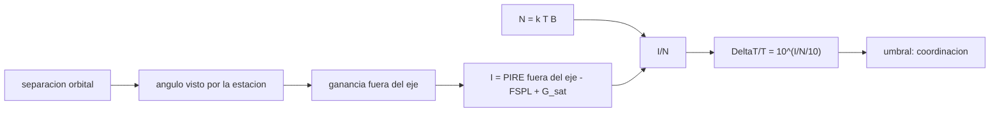

# B89-C19 — Coordinación del espectro ante ITU

<!-- nav:top -->
[🏠 Programa](../../../../README.md) · [📚 Bloque B89](../../../tronco-comun/B89-comunicaciones-y-navegacion-satelital.md) · [← Anterior: B89-C18 — Comunicaciones ópticas espaciales](../B89-C18-comunicaciones-opticas-espaciales/CLASE.md) · [Siguiente: B89-C20 — Diseño de red de comunicaciones de misión →](../B89-C20-diseno-de-red-de-comunicaciones-de-mision/CLASE.md)
<!-- /nav -->

## 1. Ubicación, nivel y alcance

Clase 19 del bloque B89, nivel N3. El espectro radioeléctrico es compartido, y antes de operar un satélite hay que demostrar ante la UIT (y las demás administraciones) que su interferencia es tolerable. Aquí calculas la interferencia de una estación terrena hacia un satélite geoestacionario vecino, la razón `I/N`, la degradación de temperatura `ΔT/T` y la separación orbital mínima. Usas [B89-C02](../B89-C02-frecuencia-y-espectro-espacial/CLASE.md) para el espectro y [B89-C05](../B89-C05-presupuesto-de-enlace/CLASE.md) para el balance. **No se consultaron las recomendaciones UIT-R ni el Apéndice 8 del Reglamento:** la envolvente de antena y el umbral del 6 % son ilustrativos; los datos son sintéticos.

## 2. Por qué esta clase existe

Sin coordinación no hay licencia ni protección: la separación orbital, la potencia y el diagrama de antena se negocian con números como los de esta clase. La decisión central: **¿qué separación orbital hace aceptable la interferencia de un sistema hacia otro?**

## 3. Lo que podrás hacer al terminar

1. Describir qué coordina la UIT y qué contiene el Reglamento de Radiocomunicaciones.
2. Calcular el ángulo entre dos satélites geoestacionarios visto desde una estación.
3. Calcular la interferencia `I`, el ruido `N` y la razón `I/N`.
4. Convertir `I/N` en `ΔT/T` y compararla con un umbral.
5. Hallar la separación mínima por bisección.
6. Rotular lo consultado (Reglamento, constantes) frente a lo ilustrativo y lo sintético.

La evidencia es la **ficha de coordinación sintética** del ejercicio 12 (sección 20).

## 4. Con qué llegas y cómo comprobarlo

1. ¿Qué es la UIT?
2. ¿Qué es una órbita geoestacionaria?
3. ¿Qué es la ganancia fuera del eje?
4. ¿Qué es `I/N`?
5. ¿Qué es un dato sintético?

<details>
<summary>Ver respuestas</summary>

1. La Unión Internacional de Telecomunicaciones, agencia de la ONU que coordina el espectro y las órbitas. 2. Una órbita ecuatorial de ~35 786 km con periodo de un día sideral. 3. La ganancia de una antena en una dirección distinta de su máximo. 4. La razón entre la potencia de interferencia y la del ruido, en dB. 5. Un dato inventado para el ejemplo.
</details>

Con cuatro o cinco aciertos, sigue; si no, repasa los prerrequisitos.

## 5. Un caso de contexto y casos de referencia

En un caso sintético, una estación terrena a 14 GHz con PIRE de 60 dBW interfiere a un satélite vecino con `ΔT/T = 0,017` a 2° de separación, `0,0017` a 5°. El umbral ilustrativo del 6 % (`I/N = -12,22 dB`) se alcanza a `1,21°`. Es el **ejemplo conductor**; todo es ilustrativo.

## 6. Vocabulario

El **Reglamento de Radiocomunicaciones** de la UIT, con ediciones periódicas (la última consultada es la de 2024), contiene los cuadros de atribución y los procedimientos de coordinación y notificación de redes de satélites. La **interferencia** `I` es la potencia no deseada recibida; `N = k T B`. **`ΔT/T = I/(k T B)`** es el aumento relativo de la temperatura de ruido del sistema. La **separación orbital** es la diferencia de longitud entre dos satélites geoestacionarios.

## 7. Modelo mental: dos conversaciones en una misma sala



*Descripción textual:* la separación orbital da el ángulo y la ganancia fuera del eje; con la pérdida y la ganancia del satélite se obtiene la interferencia; frente al ruido da `I/N` y `ΔT/T`, que se compara con el umbral.

Analogía: dos conversaciones en una sala; cuanto más lejos y más dirigida la voz, menos molesta al vecino. Límite: la coordinación real considera muchos casos (enlaces ascendentes, descendentes, redes no geoestacionarias) y se negocia entre administraciones; esta clase muestra solo un cálculo base.

## 8. La explicación, paso a paso

### 8.1 Qué es la coordinación

Antes de usar una asignación, el operador notifica su red a la administración, que la coordina con la UIT y con las redes que podrían verse afectadas. El Reglamento (edición 2024, según la página consultada) recoge apéndices, resoluciones y recomendaciones asociadas. Los umbrales numéricos concretos no se consultaron.

### 8.2 Geometría

Dos satélites geoestacionarios separados `Δ` se ven desde una estación ecuatorial con un ángulo algo mayor: `2,356°` para 2°, `5,888°` para 5°, bien aproximado por `Δ·R_geo/(R_geo − R_T)` (error < 0,0 %).

### 8.3 Interferencia

Con una envolvente ilustrativa `32 − 25 log₁₀ θ` dBi, la PIRE fuera del eje, la pérdida de espacio libre a 14 GHz (`FSPL` de C04) y 30 dBi del satélite se obtiene `I`; `N = k T B = -126,05 dBW`. A 2°: `I/N = -17,70 dB`; a 3°: `-22,11 dB`; a 5°: `-27,65 dB`; a 8°: `-32,75 dB`.

### 8.4 Separación mínima

`ΔT/T = 10^(I/N/10)`. Con el umbral ilustrativo de 6 % (`I/N = -12,22 dB`) la separación mínima es `1,21°`; con 1 %, `2,47°`. Un umbral más estricto exige más separación o menos potencia fuera del eje.

## 9. Magnitudes, símbolos y unidades

| Símbolo | Qué es | Unidad | Valor / nota |
|---|---|---|---|
| `R_geo` | radio de la órbita geoestacionaria | m | 4,2164×10⁷ (ilustrativo) |
| `Δ` | separación orbital | grados | 2, 3, 5, 8 |
| `θ` | ángulo visto | grados | 2,356 |
| `G(θ)` | ganancia fuera del eje (ilustrativa) | dBi | 22,70 |
| `I/N` | interferencia a ruido | dB | -17,70 |
| `ΔT/T` | degradación de temperatura | — | 0,017 |
| `k` | constante de Boltzmann | J/K | 1,380649×10⁻²³ (exacta) |

## 10. Convenciones y referencias

Estación terrena ecuatorial en la longitud 0 y satélites geoestacionarios en el ecuador; enlace ascendente a 14 GHz; sin lluvia; interferencia de una sola entrada. Constantes `k` y `c` de NIST (consultadas); radios de la órbita geoestacionaria y de la Tierra ilustrativos; la envolvente de antena y el umbral del 6 % son **ilustrativos y no consultados**; potencias, temperatura y ancho de banda son sintéticos.

## 11. De dónde sale lo que afirmamos

| ID | Fuente | Localizador | Respalda | Estado |
|---|---|---|---|---|
| S1 | UIT, Reglamento de Radiocomunicaciones (Radio Regulations) — https://www.itu.int/pub/R-REG-RR (consultada 2026-11-10) | pagina de la publicacion | la edicion mas reciente listada es la de 2024 e incorpora las revisiones hasta la CMR-23; contiene apendices, resoluciones y recomendaciones | Consultada |
| S2 | NIST, CODATA 2022: constante de Boltzmann — https://physics.nist.gov/cgi-bin/cuu/Value?k (consultada 2026-11-10) | valor de la pagina | k = 1,380 649 × 10⁻²³ J/K (exacta) | Consultada |
| S3 | NIST, CODATA 2022: velocidad de la luz en el vacio — https://physics.nist.gov/cgi-bin/cuu/Value?c (consultada 2026-11-10) | valor de la pagina | c = 299 792 458 m/s (exacta) | Consultada |
| — | Envolventes de antena de estaciones terrenas (Recomendaciones UIT-R) y criterios de coordinación (Apéndice 8) | — | no consultados; ilustrativos | No consultada en una fuente concreta |
| — | Relaciones estándar (`ΔT/T = I/(kTB)`, geometría geoestacionaria) | — | las verifica el laboratorio con una segunda vía (aproximación angular y monotonía) | No consultada en una fuente concreta |

Límites: de la UIT solo se consultó la página de la publicación del Reglamento (existencia, edición 2024 y que incluye apéndices y resoluciones); no se leyó ningún artículo ni apéndice; el cálculo no es una coordinación real.

## 12. Cómo ver la interferencia entre vecinos

| Magnitud | Valor |
|---|---|
| ángulo a 2° de separación | 2,356° |
| `I/N` a 2° | -17,70 dB |
| `ΔT/T` a 5° | 0,0017 |
| umbral 6 % | I/N = -12,22 dB |
| separación mínima (6 %) | 1,21° |

Descripción larga: la interferencia baja rápidamente con la separación gracias a la directividad de la antena; el umbral fija la separación mínima.

## 13. Ejemplo trabajado: el ΔT/T a 5°

**Paso 1 · Ángulo.** `θ = 5,888°`.

**Paso 2 · Ganancia fuera del eje.** `32 − 25 log₁₀ 5,888 = 12,75 dBi`.

**Paso 3 · `I/N`.** `-27,65 dB`.

**Paso 4 · `ΔT/T`.** `10^(-27,65/10) = 0,0017`.

## 14. Distintas formas de describir la interferencia entre redes

**Por ángulo:** separación y geometría. **Por potencia:** `I`, `N`. **Por razón:** `I/N`. **Por degradación:** `ΔT/T`. **Por umbral:** separación mínima.

## 15. Práctica guiada

**Ejercicio 1 · con los pasos indicados.** Convierte 6 % en `I/N` en dB. *Pasos:* `10 log₁₀ 0,06`.

<details><summary>Solución comentada</summary>

`-12,22 dB`.
</details>

**Ejercicio 2 · con una pista.** Predice qué pasa con `ΔT/T` si la PIRE fuera del eje baja 3 dB. *Pista:* proporcional a la potencia.

<details><summary>Solución comentada</summary>

Se reduce a la mitad.
</details>

**Ejercicio 3 · casi autónomo.** ¿Por qué la interferencia cae tan rápido con la separación?

<details><summary>Solución comentada</summary>

Porque la ganancia fuera del eje cae como `−25 log₁₀ θ` y `θ` crece casi linealmente con la separación; mira el término logarítmico.
</details>

## 16. Práctica autónoma, transferencia e integrador

**Ejercicio 4 · autónomo.** `N` para `T = 500 K` y `B = 36 MHz`.

<details><summary>Solución comentada</summary>

`10 log₁₀(k·500·36e6) = -126,05 dBW`.
</details>

**Ejercicio 5 · autónomo.** `ΔT/T` si `I/N = −20 dB`.

<details><summary>Solución comentada</summary>

`0,01`.
</details>

**Ejercicio 6 · autónomo.** Ángulo aproximado visto para 3° de separación.

<details><summary>Solución comentada</summary>

`3 × 42164/(42164 − 6371) = 3,534°`.
</details>

**Ejercicio 7 · autónomo.** Separación mínima para el umbral de 1 %.

<details><summary>Solución comentada</summary>

`2,47°`.
</details>

**Ejercicio 8 · autónomo.** Si la antena terrena mejora y baja 5 dB la ganancia fuera del eje, ¿qué ocurre con la separación mínima?

<details><summary>Solución comentada</summary>

Disminuye: se tolera menos separación porque la interferencia baja 5 dB.
</details>

**Ejercicio 9 · transferencia.** **Transferencia.** Un operador ubica su satélite a 2° del vecino. ¿Cumple el 6 % y el 1 %?

<details><summary>Solución comentada</summary>

Cumple el 6 % (`ΔT/T = 0,017`) pero no el 1 % (que pide `2,47°`); para un criterio más estricto debería reducir la PIRE fuera del eje, usar una antena de mejor diagrama o negociar condiciones en la coordinación.
</details>

**Ejercicio 10 · transferencia.** **Transferencia.** ¿Qué falta para convertir este cálculo en una coordinación real?

<details><summary>Solución comentada</summary>

Los criterios reglamentarios, los diagramas de antena oficiales, los enlaces descendentes, la lluvia y el procedimiento ante la administración y la UIT.
</details>

**Ejercicio 11 · transferencia.** **Transferencia.** Un colega cita el 6 % y la envolvente 32−25 log θ como «el Reglamento». ¿Qué corriges?

<details><summary>Solución comentada</summary>

Que no se consultaron: son ilustrativos; el Reglamento solo se consultó en su página de publicación.
</details>

**Ejercicio 12 · integrador.** **Integrador.** Elabora tu *ficha de coordinación sintética*: ángulos, `I/N`, `ΔT/T` para cuatro separaciones, separación mínima y la lista de qué es consultado, ilustrativo y sintético.

<details><summary>Solución comentada</summary>

Secciones 8.1–8.4 y la salida del laboratorio.
</details>

## 17. Laboratorio: interferencia entre satélites geoestacionarios

El script [coordinacion.py](coordinacion.py) calcula el ángulo visto, la ganancia fuera del eje, `I/N`, `ΔT/T` para cuatro separaciones y la separación mínima por bisección (**comprueba** la monotonía, que `ΔT/T` en la separación mínima sea 0,06 y que el ángulo aproximado difiera menos de 15 %).

**Datos:** `k` y `c` de NIST CODATA 2022 (consultadas); envolvente, umbral, radios y enlace **ilustrativos/sintéticos**. **Predice antes de ejecutar:** ¿a cuántos grados cae `ΔT/T` por debajo de 6 %? (Hacia 1,2°.) **Ejecución del 2026-11-10 (Python 3.12.9):**

```text
3.12.9 (biblioteca estandar)
SINTETICO/ILUSTRATIVO: enlace ascendente 14 GHz, PIRE 60 dBW (antena de 50 dBi), G_sat 30 dBi, T_sis 500 K, B 36 MHz, GEO 42 164 km
 sep [deg]  angulo [deg]  G fuera eje   I [dBW]   N [dBW]  I/N [dB]  DeltaT/T
       2.0         2.356        22.70   -143.75   -126.05    -17.70    0.0170
       3.0         3.534        18.29   -148.15   -126.05    -22.11    0.0062
       5.0         5.888        12.75   -153.70   -126.05    -27.65    0.0017
       8.0         9.417         7.65   -158.79   -126.05    -32.75    0.0005
Umbral Delta T/T = 6 % equivale a I/N = -12.22 dB
Separacion minima para 6 %: 1.21 grados ; para 1 %: 2.47 grados
Delta T/T en la separacion minima = 0.0600
Pruebas superadas.
```

```bash
python programa/clases/B89/B89-C19-coordinacion-del-espectro-ante-itu/coordinacion.py
```

**Límites:** una sola entrada, sin lluvia, ecuador y envolvente ilustrativa; no es una coordinación ni un resultado regulatorio.

## 18. Errores frecuentes y cómo corregirlos

**Confundir `I/N` con `ΔT/T`.** Se corrige con 8.3 y 8.4.

**Tomar un umbral ilustrativo como norma.** Se corrige con la sección 10.

**Olvidar la ganancia fuera del eje.** Se corrige con 8.3.

**Creer que esta clase sustituye a una coordinación.** Se corrige con la sección 21.

## 19. Cómo sabrás que vas bien

Tras la sección 8: ¿qué separación esperabas y cuál obtuviste? Si dudas, repasa el ejemplo 13. Tras el laboratorio: ¿qué comprueba? (ver la sección 17).

## 20. Qué entregas y cómo se evalúa

El producto es tu **ficha de coordinación sintética** (ejercicio 12).

| Criterio | Inicial | En desarrollo | Logrado | Destacado |
|---|---|---|---|---|
| Conceptos | Los confunde | Parciales | Calcula `I/N`, `ΔT/T` y separación | Explica los límites |
| Cálculo | Sin unidades | Con errores | Tablas completas con unidades | Calcula casos nuevos |
| Numérico | Sin comprobar | Un caso | Contraste con una segunda vía | Interpreta las diferencias |
| Fuentes | Sin fuente | Sin fecha | Fuentes con fecha y estado | Declara lo sintético y lo no consultado |
| Límites | No los nombra | Uno | Tres | Discute qué falta del modelo |

**Condiciones críticas (no se compensan con promedio):** rotular envolvente y umbral como ilustrativos y no consultados; no presentar el cálculo como coordinación real; no presentar un cálculo como una medición; citar solo lo consultado.

## 21. Ética, seguridad y límites

Clase educativa: los modelos son simplificados y sus datos son sintéticos o ilustrativos; ningún resultado describe un enlace, un satélite ni una misión reales, ni sustituye a la documentación oficial de una misión, a un presupuesto de enlace verificado ni a la coordinación regulatoria.  Accesibilidad: tablas equivalentes a las gráficas, fórmulas en texto, ejercicios sin conexión.

## 22. Para cerrar y seguir

A 5° de separación la interferencia sintética es `ΔT/T = 0,0017`; el umbral ilustrativo del 6 % se alcanza a `1,21°`. Queda una pregunta: ¿cómo se integran todos estos elementos en una red de misión?

**Glosario español–inglés.** Unión Internacional de Telecomunicaciones · *International Telecommunication Union (ITU)*; coordinación · *coordination*; razón interferencia a ruido · *interference-to-noise ratio*; separación orbital · *orbital spacing*; ganancia fuera del eje · *off-axis gain*.

**Continuidad.** [B89-C20](../B89-C20-diseno-de-red-de-comunicaciones-de-mision/CLASE.md) integra todo en el diseño de una red de comunicaciones de misión.

**Referencias:** ver sección 11.

<!-- nav:bottom -->
---

[← Anterior: B89-C18 — Comunicaciones ópticas espaciales](../B89-C18-comunicaciones-opticas-espaciales/CLASE.md) · [📚 Bloque B89](../../../tronco-comun/B89-comunicaciones-y-navegacion-satelital.md) · [Siguiente: B89-C20 — Diseño de red de comunicaciones de misión →](../B89-C20-diseno-de-red-de-comunicaciones-de-mision/CLASE.md)
<!-- /nav -->
