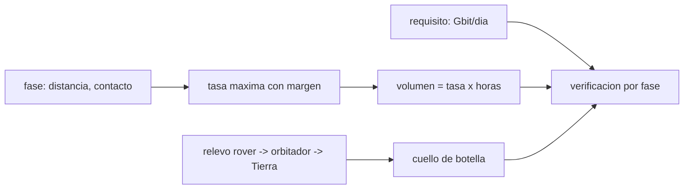

# B89-C20 — Diseño de red de comunicaciones de misión

<!-- nav:top -->
[🏠 Programa](../../../../README.md) · [📚 Bloque B89](../../../tronco-comun/B89-comunicaciones-y-navegacion-satelital.md) · [← Anterior: B89-C19 — Coordinación del espectro ante ITU](../B89-C19-coordinacion-del-espectro-ante-itu/CLASE.md) · [Siguiente: B89-C21 — Efectos ionosféricos y centelleo en señales GNSS →](../B89-C21-efectos-ionosfericos-y-centelleo-en-senales-gnss/CLASE.md)
<!-- /nav -->

## 1. Ubicación, nivel y alcance

Clase 20 del bloque B89, nivel N3. Diseñar la red de comunicaciones de una misión es cerrar, fase por fase y requisito por requisito, el balance de enlaces, el volumen de datos y la arquitectura (enlace directo o relevo). Aquí integras lo visto en el bloque: usas el presupuesto de [B89-C05](../B89-C05-presupuesto-de-enlace/CLASE.md), el volumen por contacto de [B89-C14](../B89-C14-estaciones-terrestres/CLASE.md) y el almacenamiento y reenvío de [B89-C13](../B89-C13-protocolos-para-espacio-profundo/CLASE.md) para dimensionar una misión sintética. El equipo, las fases y los requisitos son sintéticos; no representa ninguna misión real.

## 2. Por qué esta clase existe

Una red de misión se diseña contra requisitos verificables: cuántos datos por día, con qué margen, en cada fase. Un diseño sin esa trazabilidad no se puede verificar ni defender. La decisión central: **¿cumple el diseño el requisito de datos en cada fase y cuándo conviene un relevo?**

## 3. Lo que podrás hacer al terminar

1. Calcular la tasa máxima con margen de un enlace directo en cada fase.
2. Calcular el volumen diario y compararlo con un requisito.
3. Dimensionar un relevo rover–orbitador–Tierra y encontrar su cuello de botella.
4. Integrar numéricamente el volumen con distancia variable y comprobar la convergencia.
5. Redactar la verificación de requisitos con margen.
6. Rotular lo consultado (`k`, `c`) frente a lo sintético (equipo, fases, requisitos).

La evidencia es la **arquitectura de red de una misión sintética** del ejercicio 12 (sección 20).

## 4. Con qué llegas y cómo comprobarlo

1. ¿Qué es un requisito verificable?
2. ¿Qué es un presupuesto de enlace?
3. ¿Qué es un relevo?
4. ¿Qué es la regla del trapecio?
5. ¿Qué es un dato sintético?

<details>
<summary>Ver respuestas</summary>

1. Una condición cuantitativa que se puede comprobar con un análisis, ensayo o inspección. 2. El balance en dB de un enlace que termina en un margen. 3. Un satélite que retransmite datos entre un usuario y la Tierra. 4. Un método de integración numérica por tramos lineales. 5. Un dato inventado para el ejemplo.
</details>

Con cuatro o cinco aciertos, sigue; si no, repasa los prerrequisitos.

## 5. Un caso de contexto y casos de referencia

Para una misión sintética con requisito de `30,0 Gbit/día`, el enlace directo en banda X con 100 W, antenas de 46 y 68 dBi y 8 h de contacto entrega `106,70 Gbit/día` a 1 UA, `47,42` a 1,5 UA y `17,07` a 2,5 UA. Con relevo, el rover aporta `1,92 Gbit` por sol. Es el **ejemplo conductor**.

## 6. Vocabulario

La **tasa máxima** es la que deja un margen dado: `R = 10^{(C/N₀ − (Eb/N₀)_req − M)/10}`. El **volumen diario** es tasa por horas de contacto. La **verificación de requisitos** compara el resultado con el requisito y declara el margen. El **relevo** reenvía datos de un usuario cercano. El **cuello de botella** es el eslabón de menor capacidad.

## 7. Modelo mental: una cañería cuyo caudal lo fija el tramo más angosto



*Descripción textual:* el requisito se compara con el volumen que sale de la tasa máxima y las horas de contacto de cada fase; en el relevo, el eslabón más pequeño fija lo que llega.

Analogía: una cañería con tramos de distinto diámetro; el caudal lo fija el más angosto. Límite: el modelo usa tasas constantes, un solo escenario y contacto continuo de 8 h; las pérdidas, el clima y la disponibilidad de la estación reducirían el volumen.

## 8. La explicación, paso a paso

### 8.1 Enlace directo por fase

Con el modelo de C05: a 0,5 UA, `14820 kbit/s` (`426,8 Gbit/día`); a 1,0 UA, `3705 kbit/s` (`106,70`); a 1,5 UA, `1647 kbit/s` (`47,42`); a 2,5 UA, `593 kbit/s` (`17,07`). La tasa cae con el cuadrado de la distancia.

### 8.2 Verificación del requisito

El requisito de `30,0 Gbit/día` se cumple en `crucero 0.5 UA, cercana 1.0 UA, media 1.5 UA` y no en `lejana 2.5 UA`. La razón al requisito (`0,57` en la fase más lejana) es el margen de diseño.

### 8.3 Relevo

El rover entrega `2 × 8 min × 2 Mbit/s = 1,92 Gbit` por sol al orbitador; el orbitador transmite `47,42 Gbit/día` a la Tierra a 1,5 UA. El cuello de botella es `el enlace rover–orbitador`; el volumen útil es `1,92 Gbit/día`.

### 8.4 Volumen acumulado

Con una distancia creciente de 1,0 a 2,5 UA en 100 días, la regla del trapecio da `4293,0`, `4268,42` y `4268,17 Gbit` con 10, 100 y 1000 pasos; la convergencia entre 100 y 1000 pasos es `5.8e-05`.

## 9. Magnitudes, símbolos y unidades

| Símbolo | Qué es | Unidad | Valor / nota |
|---|---|---|---|
| `R` | tasa máxima con margen | bit/s | 1647×10³ (1,5 UA) |
| `M` | margen de diseño | dB | 3 (sintético) |
| `(Eb/N₀)_req` | requerido con código | dB | 3,5 (sintético) |
| `t_c` | contacto diario | h | 8 (sintético) |
| `V` | volumen diario | Gbit/día | 47,42 |
| `V_req` | requisito | Gbit/día | 30,0 |
| razón | volumen/requisito | — | 1,58 |

## 10. Convenciones y referencias

Enlace directo de bajada en banda X con el modelo de C05; relevo UHF rover–orbitador de 2 Mbit/s con 2 pasadas de 8 min por sol; contacto de 8 h/día; distancias de fase redondeadas e ilustrativas. `k` y `c` de NIST (CODATA 2022, consultadas); todo lo demás es sintético.

## 11. De dónde sale lo que afirmamos

| ID | Fuente | Localizador | Respalda | Estado |
|---|---|---|---|---|
| S1 | NIST, CODATA 2022: constante de Boltzmann — https://physics.nist.gov/cgi-bin/cuu/Value?k (consultada 2026-11-10) | valor de la pagina | k = 1,380 649 × 10⁻²³ J/K (exacta) | Consultada |
| S2 | NIST, CODATA 2022: velocidad de la luz en el vacio — https://physics.nist.gov/cgi-bin/cuu/Value?c (consultada 2026-11-10) | valor de la pagina | c = 299 792 458 m/s (exacta) | Consultada |
| S3 | NASA, Space Communications and Navigation (SCaN) — https://www.nasa.gov/directorates/somd/space-communications-navigation-program/ (consultada 2026-11-10) | pagina completa | Near Space Network (hasta ~1 millon de millas), Deep Space Network con antenas de 34 y 70 m en Goldstone, Madrid y Canberra; las comunicaciones laser transmiten 10 a 100 veces mas datos que los sistemas de RF actuales segun la pagina | Consultada |
| S4 | NASA/JPL, DSN Telecommunications Link Design Handbook (810-005) — https://deepspace.jpl.nasa.gov/dsndocs/810-005/ (consultada 2026-11-10) | pagina de indice | existencia y estructura por modulos (material introductorio, interfaces del enlace espacial, procesamiento de datos de estacion, propiedades de estacion terrestre, informacion complementaria); no se leyeron los modulos | Consultada |
| — | Relaciones estándar (presupuesto de enlace, regla del trapecio) | — | las verifica el laboratorio por convergencia numérica | No consultada en una fuente concreta |

Límites: la página de SCaN solo respalda la existencia de la DSN y de la Near Space Network; del manual DSN 810-005 solo se consultó el índice; no se consultó ninguna misión real ni la disponibilidad real de estaciones.

## 12. Cómo ver el cierre de requisitos

| Magnitud | Valor |
|---|---|
| volumen a 1 UA | 106,70 Gbit/día |
| volumen a 2,5 UA | 17,07 Gbit/día |
| razón al requisito (2,5 UA) | 0,57 |
| relevo útil | 1,92 Gbit/día |
| convergencia numérica | 5.8e-05 |

Descripción larga: el volumen cae con el cuadrado de la distancia; el requisito se cumple hasta cierta distancia; en el relevo manda el eslabón más pequeño.

## 13. Ejemplo trabajado: el volumen a 2,5 UA

**Paso 1 · Tasa máxima.** `592,8 kbit/s` (modelo de C05 con margen de 3 dB).

**Paso 2 · Contacto.** `8 h × 3600 = 28 800 s`.

**Paso 3 · Volumen.** `592801 × 28 800 = 17,073 Gbit`.

**Paso 4 · Razón al requisito.** `17,073/30,0 = 0,57`.

## 14. Distintas formas de describir un diseño de red de misión

**Por fase:** distancia y tasa. **Por volumen:** Gbit/día. **Por requisito:** razón y margen. **Por arquitectura:** directo o relevo. **Por cuello de botella:** eslabón mínimo.

## 15. Práctica guiada

**Ejercicio 1 · con los pasos indicados.** Volumen de una tasa de 100 kbit/s durante 8 h. *Pasos:* `10⁵ × 28 800`.

<details><summary>Solución comentada</summary>

`2,88 Gbit`.
</details>

**Ejercicio 2 · con una pista.** Predice cómo cambia la tasa al duplicar la distancia. *Pista:* `FSPL`.

<details><summary>Solución comentada</summary>

Se divide por 4.
</details>

**Ejercicio 3 · casi autónomo.** ¿Por qué el relevo no cumple el requisito aquí aunque el orbitador pueda enviar a la Tierra más de lo pedido?

<details><summary>Solución comentada</summary>

Porque el eslabón rover–orbitador entrega solo `1,92 Gbit` por sol: manda el tramo más angosto, no el más potente.
</details>

## 16. Práctica autónoma, transferencia e integrador

**Ejercicio 4 · autónomo.** Razón de la fase a 1,0 UA frente al requisito.

<details><summary>Solución comentada</summary>

`3,56`.
</details>

**Ejercicio 5 · autónomo.** Contacto necesario a 2,5 UA para cumplir el requisito.

<details><summary>Solución comentada</summary>

`30e9/592801 s = 14,1 h`: más de las 8 h disponibles.
</details>

**Ejercicio 6 · autónomo.** Tasa mínima para cumplir el requisito en 8 h.

<details><summary>Solución comentada</summary>

`30e9/28 800 = 1041,7 kbit/s`.
</details>

**Ejercicio 7 · autónomo.** Margen de potencia (dB) de la fase a 1 UA para cumplir exactamente el requisito.

<details><summary>Solución comentada</summary>

`10 log₁₀(3,56) = 5,51 dB` adicionales sobre el margen de 3 dB.
</details>

**Ejercicio 8 · autónomo.** Error relativo de la integración con 10 pasos respecto de 1000.

<details><summary>Solución comentada</summary>

`0,582 %`.
</details>

**Ejercicio 9 · transferencia.** **Transferencia.** Una fase a 2,5 UA no cumple. ¿Qué tres cambios de diseño podrían arreglarlo?

<details><summary>Solución comentada</summary>

Más potencia o ganancia de antena, más horas de contacto, o códigos mejores (menor `Eb/N₀` requerido); cada uno con su costo.
</details>

**Ejercicio 10 · transferencia.** **Transferencia.** ¿Qué riesgo tiene diseñar con contacto continuo de 8 h/día?

<details><summary>Solución comentada</summary>

Que la disponibilidad real de estaciones, el clima y las pasadas del relevo sean menores; el requisito debe verificarse con el calendario real.
</details>

**Ejercicio 11 · transferencia.** **Transferencia.** Un colega presenta esta red como la de una misión real. ¿Qué corriges?

<details><summary>Solución comentada</summary>

Que el equipo, las fases y los requisitos son sintéticos; solo `k` y `c` y la existencia de las redes DSN y Near Space Network se consultaron.
</details>

**Ejercicio 12 · integrador.** **Integrador.** Elabora tu *arquitectura de red de una misión sintética*: tabla por fase (tasa, volumen, razón), relevo y cuello de botella, convergencia numérica y la lista de qué es consultado y sintético.

<details><summary>Solución comentada</summary>

Secciones 8.1–8.4 y la salida del laboratorio.
</details>

## 17. Laboratorio: red de misión: directo, relevo y requisitos

El script [red_mision.py](red_mision.py) calcula la tasa y el volumen diario por fase, dimensiona un relevo y verifica el requisito, e integra el volumen de 100 días con distancia creciente (**comprueba** convergencia < 10⁻³ entre 100 y 1000 pasos).

**Datos:** `k` y `c` de NIST CODATA 2022 (consultadas); equipo, fases, relevo y requisito **sintéticos**; UA redondeada **ilustrativa**. **Predice antes de ejecutar:** ¿en qué fases se cumple el requisito de 30 Gbit/día? (En las tres más cercanas; no a 2,5 UA.) **Ejecución del 2026-11-10 (Python 3.12.9):**

```text
3.12.9 (biblioteca estandar)
SINTETICO: directo a Tierra, X 8.4 GHz, 100 W, Gt 46 dBi, Gr 68 dBi, T 25 K, Eb/N0 req 3.5 dB, margen 3 dB, 8 h/dia
Requisito sintetico: 30.0 Gbit/dia
fase                tasa [kbit/s]  volumen [Gbit/dia]  razon al requisito  cumple
crucero 0.5 UA            14820.0             426.817               14.23      si
cercana 1.0 UA             3705.0             106.704                3.56      si
media 1.5 UA               1646.7              47.424                1.58      si
lejana 2.5 UA               592.8              17.073                0.57      no
Relevo: rover -> orbitador = 1.920 Gbit/sol ; orbitador -> Tierra (1.5 UA) = 47.424 Gbit/dia ; util = 1.920
Volumen en 100 dias (trapecio,   10 pasos) = 4293.02 Gbit
Volumen en 100 dias (trapecio,  100 pasos) = 4268.42 Gbit
Volumen en 100 dias (trapecio, 1000 pasos) = 4268.17 Gbit
Convergencia 100 -> 1000 pasos = 5.79e-05
Pruebas superadas.
```

```bash
python programa/clases/B89/B89-C20-diseno-de-red-de-comunicaciones-de-mision/red_mision.py
```

**Límites:** contacto continuo de 8 h, tasa constante por día, sin clima ni disponibilidad real; no representa una misión.

## 18. Errores frecuentes y cómo corregirlos

**Verificar el requisito sin margen.** Se corrige con 8.2.

**Olvidar el cuello de botella del relevo.** Se corrige con 8.3.

**Usar una sola fase como representativa.** Se corrige con 8.1.

**Presentar la red sintética como una misión.** Se corrige con la sección 10.

## 19. Cómo sabrás que vas bien

Tras la sección 8: ¿en qué fases esperabas cumplir y en cuáles cumpliste? Si dudas, repasa el ejemplo 13. Tras el laboratorio: ¿qué comprueba? (ver la sección 17).

## 20. Qué entregas y cómo se evalúa

El producto es tu **arquitectura de red de una misión sintética** (ejercicio 12).

| Criterio | Inicial | En desarrollo | Logrado | Destacado |
|---|---|---|---|---|
| Conceptos | Los confunde | Parciales | Calcula tasa, volumen y verificación | Explica los límites |
| Cálculo | Sin unidades | Con errores | Tablas completas con unidades | Calcula casos nuevos |
| Numérico | Sin comprobar | Un caso | Contraste con una segunda vía | Interpreta las diferencias |
| Fuentes | Sin fuente | Sin fecha | Fuentes con fecha y estado | Declara lo sintético y lo no consultado |
| Límites | No los nombra | Uno | Tres | Discute qué falta del modelo |

**Condiciones críticas (no se compensan con promedio):** rotular equipo, fases y requisitos como sintéticos; declarar el margen; no presentar la red como una misión real; no presentar un cálculo como una medición; citar solo lo consultado.

## 21. Ética, seguridad y límites

Clase educativa: los modelos son simplificados y sus datos son sintéticos o ilustrativos; ningún resultado describe un enlace, un satélite ni una misión reales, ni sustituye a la documentación oficial de una misión, a un presupuesto de enlace verificado ni a la coordinación regulatoria.  Accesibilidad: tablas equivalentes a las gráficas, fórmulas en texto, ejercicios sin conexión.

## 22. Para cerrar y seguir

En esta misión sintética el enlace directo entrega `47,4 Gbit/día` a 1,5 UA y `17,1` a 2,5 UA frente a un requisito de `30`; el cuello de botella manda. Queda una pregunta: ¿qué pasa cuando la señal de la misión es casi invisible?

**Glosario español–inglés.** red de misión · *mission network*; verificación de requisitos · *requirements verification*; relevo · *relay*; cuello de botella · *bottleneck*; volumen de datos · *data volume*.

**Continuidad.** [B89-C21](../B89-C21-efectos-ionosfericos-y-centelleo-en-senales-gnss/CLASE.md) cierra el bloque base; la ampliación empieza con los efectos ionosféricos en GNSS.

**Referencias:** ver sección 11.

<!-- nav:bottom -->
---

[← Anterior: B89-C19 — Coordinación del espectro ante ITU](../B89-C19-coordinacion-del-espectro-ante-itu/CLASE.md) · [📚 Bloque B89](../../../tronco-comun/B89-comunicaciones-y-navegacion-satelital.md) · [Siguiente: B89-C21 — Efectos ionosféricos y centelleo en señales GNSS →](../B89-C21-efectos-ionosfericos-y-centelleo-en-senales-gnss/CLASE.md)
<!-- /nav -->
