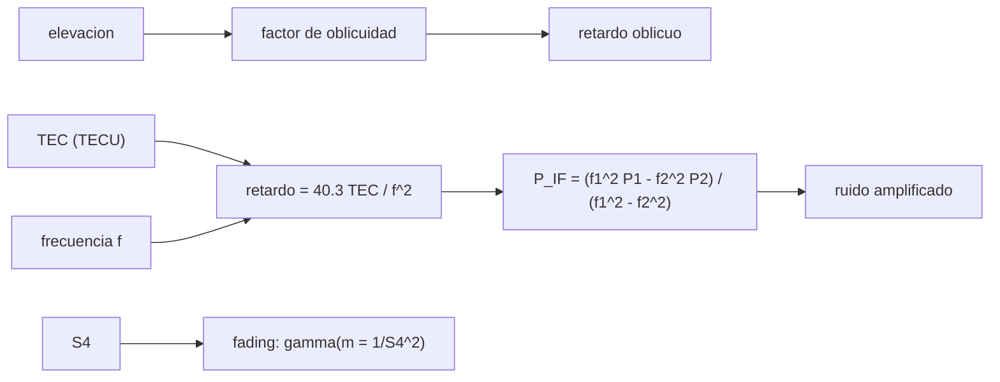

# B89-C21 — Efectos ionosféricos y centelleo en señales GNSS

<!-- nav:top -->
[🏠 Programa](../../../../README.md) · [📚 Bloque B89](../../../tronco-comun/B89-comunicaciones-y-navegacion-satelital.md) · [← Anterior: B89-C20 — Diseño de red de comunicaciones de misión](../B89-C20-diseno-de-red-de-comunicaciones-de-mision/CLASE.md) · [Siguiente: B89-C22 — Propagación ionosférica y comunicaciones HF →](../B89-C22-propagacion-ionosferica-y-comunicaciones-hf/CLASE.md)
<!-- /nav -->

## 1. Ubicación, nivel y alcance

Clase 21 del bloque B89, nivel N3 (ampliación). La ionosfera retrasa las señales de GNSS en proporción a su contenido electrónico y al inverso del cuadrado de la frecuencia; además, sus irregularidades producen centelleo, un desvanecimiento rápido que puede romper el seguimiento. Aquí calculas el retardo de primer orden, el factor de oblicuidad, la combinación libre de ionosfera con dos frecuencias y el desvanecimiento por centelleo. Completa [B89-C16](../B89-C16-gnss-como-navegacion-de-satelites/CLASE.md), que supuso un medio sin ionosfera. **La constante 40,3 y las frecuencias de GPS son valores usuales no consultados** (la fuente prevista, Navipedia, no estuvo disponible); TEC, ruido y centelleo son sintéticos.

## 2. Por qué esta clase existe

La ionosfera es el mayor error de un receptor GNSS de una sola frecuencia y el origen de pérdidas de señal en regiones ecuatoriales y polares; sin entenderla no se puede interpretar un error de posición. La decisión central: **¿cuánto error añade la ionosfera, cómo se elimina y cuándo el centelleo hace perder la señal?**

## 3. Lo que podrás hacer al terminar

1. Calcular el retardo de primer orden `40,3·TEC/f²` en dos frecuencias.
2. Calcular el factor de oblicuidad con una capa fina.
3. Formar la combinación libre de ionosfera y su amplificación de ruido.
4. Verificar la amplificación con una simulación de Monte Carlo.
5. Generar desvanecimiento por centelleo con el índice S4.
6. Rotular lo no consultado (constante, frecuencias) y lo sintético (TEC, ruido).

La evidencia es la **ficha de error ionosférico de una señal GNSS** del ejercicio 12 (sección 20).

## 4. Con qué llegas y cómo comprobarlo

1. ¿Qué es el contenido total de electrones (TEC)?
2. ¿Qué es un medio dispersivo?
3. ¿Qué es una combinación de observables?
4. ¿Qué es el centelleo?
5. ¿Qué es un dato sintético?

<details>
<summary>Ver respuestas</summary>

1. El número de electrones en una columna de 1 m² a lo largo del rayo; 1 TECU = 10¹⁶ el/m². 2. Uno donde el retardo depende de la frecuencia. 3. Una suma ponderada de medidas de dos frecuencias. 4. Fluctuaciones rápidas de amplitud y fase por irregularidades del medio. 5. Un dato inventado para el ejemplo.
</details>

Con cuatro o cinco aciertos, sigue; si no, repasa los prerrequisitos.

## 5. Un caso de contexto y casos de referencia

Con 50 TECU, el retardo de primer orden es `8,12 m` en L1 y `13,37 m` en L2 (zenit). A 20° de elevación, L1 llega a `17,86 m`. La combinación L1/L2 lo elimina a costa de multiplicar el ruido por `2,978`. Es el **ejemplo conductor**; todo es ilustrativo o sintético.

## 6. Vocabulario

El **retardo ionosférico de grupo** de primer orden es `Δ = 40,3·TEC/f²` (m, con TEC en el/m² y `f` en Hz). El **factor de oblicuidad** `1/√(1 − (R cos E/(R+h))²)` convierte vertical en oblicuo. La **combinación libre de ionosfera** es `P_IF = (f₁²P₁ − f₂²P₂)/(f₁² − f₂²)`. El **índice S4** es la desviación típica de la potencia normalizada; la potencia sigue una gamma de forma `m = 1/S4²` (Nakagami-m).

## 7. Modelo mental: un medio que frena más a las ondas lentas



*Descripción textual:* el TEC y la frecuencia dan el retardo, que la elevación multiplica; con dos frecuencias se forma la combinación libre de ionosfera, que amplifica el ruido; el índice S4 genera el desvanecimiento por centelleo.

Analogía: un camino con arena que frena más a los vehículos lentos (frecuencias bajas); comparando dos vehículos se deduce cuánta arena hay. Límite: es un modelo de primer orden y de capa fina; los términos de orden superior, los gradientes y las tormentas no se incluyen.

## 8. La explicación, paso a paso

### 8.1 Retardo vertical

Con `Δ = 40,3·TEC/f²`: 10 TECU → `1,62 m` (L1) y `2,67 m` (L2); 50 TECU → `8,12` y `13,37 m`; 100 TECU → `16,24` y `26,74 m`. El cociente L2/L1 es `1,6469 = (f₁/f₂)²`.

### 8.2 Oblicuidad

Con una capa a 350 km, el factor vale `1,000` en el cenit, `1,348` a 45°, `2,200` a 20° y `3,039` a 5°; el retardo de L1 con 50 TECU a 20° es `17,86 m`.

### 8.3 Combinación libre de ionosfera

Con 50 TECU y `σ = 0,3 m` por frecuencia (20 000 ensayos): L1 sola tiene sesgo `8,120 m`; la combinación tiene sesgo `0,0032 m` y dispersión `0,897 m`, igual a la teoría `2,978σ = 0,893 m`. Elimina el sesgo ionosférico de primer orden al precio de triplicar el ruido.

### 8.4 Centelleo

Con `S4 = 0,3 / 0,6 / 1,0` la media de potencia es 1 y el S4 medido `0,300`, `0,604`, `1,001`; la probabilidad de caer más de 10 dB es `0,0000`, `0,0049` y `0,0959`. Con centelleo fuerte aparecen desvanecimientos profundos que hacen perder el seguimiento de la portadora (C10, C24).

## 9. Magnitudes, símbolos y unidades

| Símbolo | Qué es | Unidad | Valor / nota |
|---|---|---|---|
| TEC | contenido total de electrones | TECU | 10, 50, 100 (sintético) |
| `f₁`, `f₂` | frecuencias de las portadoras | Hz | 1575,42e6; 1227,60e6 (usuales, no consultadas) |
| `Δ` | retardo ionosférico de grupo | m | 8,12 (L1, 50 TECU) |
| `h` | altura de la capa fina | m | 3,5×10⁵ (ilustrativo) |
| `S4` | índice de centelleo | — | 0,3 / 0,6 / 1,0 |
| `m` | forma de Nakagami | — | 1/S4² |

## 10. Convenciones y referencias

Capa ionosférica fina esférica a 350 km, retardo de primer orden, TEC constante, ruido gaussiano de 0,3 m por frecuencia, centelleo de potencia con distribución gamma de media 1; semilla 89. La constante 40,3 m Hz²/(el/m²) y las frecuencias L1 y L2 son valores usuales **no consultados**. No hay efecto de segundo orden ni troposfera.

## 11. De dónde sale lo que afirmamos

| ID | Fuente | Localizador | Respalda | Estado |
|---|---|---|---|---|
| S1 | NIST, CODATA 2022: velocidad de la luz en el vacio — https://physics.nist.gov/cgi-bin/cuu/Value?c (consultada 2026-11-10) | valor de la pagina | c = 299 792 458 m/s (exacta) | Consultada |
| — | Constante 40,3 del retardo ionosférico y frecuencias L1 y L2 | — | valores usuales, no consultados (Navipedia no estuvo disponible) | No consultada en una fuente concreta |
| — | Relaciones estándar (oblicuidad de capa fina, combinación libre de ionosfera, Nakagami-m) | — | las verifica el laboratorio con simulación independiente | No consultada en una fuente concreta |

Límites: no se consultó ninguna fuente sobre ionosfera; la constante y las frecuencias no están respaldadas por una consulta; los índices TEC y S4 son sintéticos y no describen ninguna tormenta real.

## 12. Cómo ver la ionosfera en la señal

| Magnitud | Valor |
|---|---|
| retardo L1, 50 TECU, cenit | 8,12 m |
| retardo L1 a 20° | 17,86 m |
| ruido de la combinación | 0,897 m |
| sesgo con la combinación | 0,0032 m |
| P(caída > 10 dB), S4 = 1 | 0,0959 |

Descripción larga: el retardo crece con el TEC y la oblicuidad, la combinación de dos frecuencias lo elimina con más ruido y el centelleo añade desvanecimientos profundos.

## 13. Ejemplo trabajado: el retardo en L1

**Paso 1 · TEC.** `50 TECU = 5×10¹⁷ el/m²`.

**Paso 2 · Frecuencia.** `f₁² = (1,57542×10⁹)² = 2,4821×10¹⁸ Hz²`.

**Paso 3 · Retardo.** `40,3 × 5×10¹⁷ / 2,4821×10¹⁸ = 8,119 m`.

**Paso 4 · A 20°.** `× 2,200 = 17,86 m`.

## 14. Distintas formas de describir el efecto de la ionosfera

**Por TEC:** retardo vertical. **Por geometría:** factor de oblicuidad. **Por dos frecuencias:** combinación libre. **Por centelleo:** S4 y fading.

## 15. Práctica guiada

**Ejercicio 1 · con los pasos indicados.** Retardo en L2 con 20 TECU. *Pasos:* `40,3×20e16/f₂²`.

<details><summary>Solución comentada</summary>

`5,35 m`.
</details>

**Ejercicio 2 · con una pista.** Predice la razón entre retardos de L1 y L2. *Pista:* `(f₂/f₁)²`.

<details><summary>Solución comentada</summary>

`0,6072`.
</details>

**Ejercicio 3 · casi autónomo.** ¿Por qué la combinación libre aumenta el ruido?

<details><summary>Solución comentada</summary>

Porque resta dos medidas ruidosas con pesos mayores que 1 (`f₁²/(f₁²−f₂²) = 2,55` y `f₂²/(f₁²−f₂²) = 1,55`); mira el factor `√(f₁⁴+f₂⁴)/(f₁²−f₂²)`.
</details>

## 16. Práctica autónoma, transferencia e integrador

**Ejercicio 4 · autónomo.** Factor de oblicuidad a 30° de elevación.

<details><summary>Solución comentada</summary>

`1,751`.
</details>

**Ejercicio 5 · autónomo.** Retardo oblicuo de L1 con 30 TECU a 30°.

<details><summary>Solución comentada</summary>

`4,87 × 1,751 = 8,53 m`.
</details>

**Ejercicio 6 · autónomo.** Forma `m` de Nakagami para `S4 = 0,5`.

<details><summary>Solución comentada</summary>

`m = 4`.
</details>

**Ejercicio 7 · autónomo.** TEC que causa 10 m de retardo en L1.

<details><summary>Solución comentada</summary>

`10×(1575,42e6)²/(40,3×10¹⁶) = 61,6 TECU`.
</details>

**Ejercicio 8 · autónomo.** Diferencia de retardo entre L2 y L1 con 50 TECU y su uso.

<details><summary>Solución comentada</summary>

`5,25 m`: es proporcional al TEC y permite estimarlo con dos frecuencias.
</details>

**Ejercicio 9 · transferencia.** **Transferencia.** Un receptor monofrecuencia en el ecuador al atardecer con TEC alto. ¿Qué error espera?

<details><summary>Solución comentada</summary>

Decenas de metros en el rango oblicuo (50–100 TECU a baja elevación); debe usar un modelo de ionosfera o dos frecuencias.
</details>

**Ejercicio 10 · transferencia.** **Transferencia.** Un receptor entra en centelleo fuerte (`S4 ≈ 1`). ¿Qué problemas aparecen?

<details><summary>Solución comentada</summary>

Desvanecimientos de más de 10 dB con probabilidad `0,096`: el lazo de portadora (C10) puede perder el enganche y la combinación libre amplifica el ruido.
</details>

**Ejercicio 11 · transferencia.** **Transferencia.** Un compañero usa 40,3 y 1575,42 MHz como «constantes del estándar». ¿Qué corriges?

<details><summary>Solución comentada</summary>

Que no se consultaron en esta clase: son valores usuales, y la fuente prevista no estuvo disponible.
</details>

**Ejercicio 12 · integrador.** **Integrador.** Elabora tu *ficha de error ionosférico de una señal GNSS*: retardos por TEC y frecuencia, oblicuidad, combinación libre con su ruido y la tabla de centelleo, con qué es consultado, no consultado y sintético.

<details><summary>Solución comentada</summary>

Secciones 8.1–8.4 y la salida del laboratorio.
</details>

## 17. Laboratorio: retardo ionosférico, combinación libre y centelleo

El script [ionosfera.py](ionosfera.py) calcula el retardo por TEC y frecuencia, la oblicuidad, la combinación libre de ionosfera con su ruido y el desvanecimiento por centelleo (**comprueba** `L2/L1 = (f₁/f₂)²`, que el sesgo de la combinación sea < 0,02 m y su ruido coincida con la teoría a 3 %, y que el S4 medido coincida con el de entrada a 3 %).

**Datos:** `40,3` y frecuencias de GPS **usuales, no consultadas**; TEC, ruido y S4 **sintéticos**; semilla 89. **Predice antes de ejecutar:** ¿cuánto ruido tendrá la combinación libre con `σ = 0,3 m`? (≈ 0,9 m.) **Ejecución del 2026-11-10 (Python 3.12.9):**

```text
3.12.9 (biblioteca estandar), random.Random(89)
ILUSTRATIVO: L1 = 1575.42 MHz, L2 = 1227.60 MHz (valores usuales, no consultados); delta = 40.3 TEC / f^2
 TEC [TECU]  retardo L1 [m]  retardo L2 [m]
         10           1.624           2.674
         50           8.119          13.371
        100          16.237          26.742
Retardo L2 / L1 = 1.6469 = (f1/f2)^2
Factor de oblicuidad (capa fina a 350 km): 90 grados: 1.000, 45 grados: 1.348, 20 grados: 2.200, 10 grados: 2.789, 5 grados: 3.039
Retardo L1 con 50 TECU a 20 grados de elevacion = 17.864 m
Combinacion libre de ionosfera con sigma = 0.3 m por frecuencia, TEC = 50 TECU (20000 ensayos):
  L1 sola: sesgo = 8.120 m ; sigma = 0.302 m
  L1/L2 libre: sesgo = +0.0032 m ; sigma = 0.897 m ; teoria = 2.9783 x sigma = 0.893 m
Centelleo (Nakagami-m, m = 1/S4^2, 100000 muestras): S4 -> media, S4 medido, P(potencia < -10 dB)
  S4 = 0.3: media = 0.9986 ; S4 medido = 0.3000 ; P(< -10 dB) = 0.0000
  S4 = 0.6: media = 1.0013 ; S4 medido = 0.6041 ; P(< -10 dB) = 0.0049
  S4 = 1.0: media = 0.9895 ; S4 medido = 1.0012 ; P(< -10 dB) = 0.0959
Pruebas superadas.
```

```bash
python programa/clases/B89/B89-C21-efectos-ionosfericos-y-centelleo-en-senales-gnss/ionosfera.py
```

**Límites:** primer orden, capa fina y TEC constante; sin segundo orden, gradientes ni tormentas; el centelleo se modela solo en amplitud.

## 18. Errores frecuentes y cómo corregirlos

**Aplicar el retardo ionosférico como de fase en vez de grupo.** Se corrige con el vocabulario: aquí es de grupo (el de fase tiene signo opuesto).

**Olvidar la oblicuidad.** Se corrige con 8.2.

**Creer que la combinación libre es gratis.** Se corrige con 8.3.

**Presentar constante y frecuencias como consultadas.** Se corrige con la sección 11.

## 19. Cómo sabrás que vas bien

Tras la sección 8: ¿qué retardo esperabas en L1 con 50 TECU y cuál obtuviste? Si dudas, repasa el ejemplo 13. Tras el laboratorio: ¿qué comprueba? (ver la sección 17).

## 20. Qué entregas y cómo se evalúa

El producto es tu **ficha de error ionosférico de una señal GNSS** (ejercicio 12).

| Criterio | Inicial | En desarrollo | Logrado | Destacado |
|---|---|---|---|---|
| Conceptos | Los confunde | Parciales | Calcula retardo, oblicuidad y combinación | Explica los límites |
| Cálculo | Sin unidades | Con errores | Tablas completas con unidades | Calcula casos nuevos |
| Numérico | Sin comprobar | Un caso | Contraste con una segunda vía | Interpreta las diferencias |
| Fuentes | Sin fuente | Sin fecha | Fuentes con fecha y estado | Declara lo sintético y lo no consultado |
| Límites | No los nombra | Uno | Tres | Discute qué falta del modelo |

**Condiciones críticas (no se compensan con promedio):** rotular la constante y las frecuencias como no consultadas; rotular TEC y S4 como sintéticos; no presentar un cálculo como una medición; citar solo lo consultado.

## 21. Ética, seguridad y límites

Clase educativa: los modelos son simplificados y sus datos son sintéticos o ilustrativos; ningún resultado describe un enlace, un satélite ni una misión reales, ni sustituye a la documentación oficial de una misión, a un presupuesto de enlace verificado ni a la coordinación regulatoria.  Accesibilidad: tablas equivalentes a las gráficas, fórmulas en texto, ejercicios sin conexión.

## 22. Para cerrar y seguir

Con 50 TECU, L1 se retrasa `8,1 m` en el cenit y `17,9 m` a 20°; la combinación de dos frecuencias lo elimina con `3,0` veces más ruido. Queda una pregunta: ¿qué hace la ionosfera con las ondas de radio de baja frecuencia?

**Glosario español–inglés.** contenido total de electrones · *total electron content (TEC)*; centelleo · *scintillation*; combinación libre de ionosfera · *ionosphere-free combination*; factor de oblicuidad · *obliquity factor*; índice S4 · *S4 index*.

**Continuidad.** [B89-C22](../B89-C22-propagacion-ionosferica-y-comunicaciones-hf/CLASE.md) estudia la propagación ionosférica y las comunicaciones HF.

**Referencias:** ver sección 11.

<!-- nav:bottom -->
---

[← Anterior: B89-C20 — Diseño de red de comunicaciones de misión](../B89-C20-diseno-de-red-de-comunicaciones-de-mision/CLASE.md) · [📚 Bloque B89](../../../tronco-comun/B89-comunicaciones-y-navegacion-satelital.md) · [Siguiente: B89-C22 — Propagación ionosférica y comunicaciones HF →](../B89-C22-propagacion-ionosferica-y-comunicaciones-hf/CLASE.md)
<!-- /nav -->
