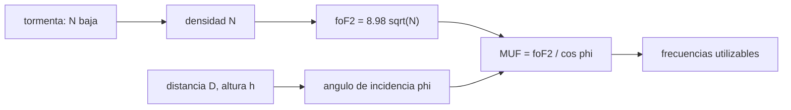

# B89-C22 — Propagación ionosférica y comunicaciones HF

<!-- nav:top -->
[🏠 Programa](../../../../README.md) · [📚 Bloque B89](../../../tronco-comun/B89-comunicaciones-y-navegacion-satelital.md) · [← Anterior: B89-C21 — Efectos ionosféricos y centelleo en señales GNSS](../B89-C21-efectos-ionosfericos-y-centelleo-en-senales-gnss/CLASE.md) · [Siguiente: B89-C23 — Relación C/N0, Eb/N0 y tasa de error de bit →](../B89-C23-relacion-c-n0-eb-n0-y-tasa-de-error-de-bit/CLASE.md)
<!-- /nav -->

## 1. Ubicación, nivel y alcance

Clase 22 del bloque B89, nivel N3 (ampliación). Las ondas de HF (3–30 MHz) se reflejan en la ionosfera y permiten comunicar más allá del horizonte; la frecuencia máxima utilizable depende de la densidad de electrones y de la distancia, y una tormenta geomagnética la reduce. Aquí calculas la frecuencia de plasma, la frecuencia crítica, la MUF por la ley de la secante en geometría esférica y el efecto de una tormenta. Completa [B89-C04](../B89-C04-propagacion-y-perdidas-de-espacio-libre/CLASE.md), que trata la pérdida en espacio libre sin ionosfera. **La relación `f_p = 8,98√N` y la ley de la secante son estándar y no se consultaron;** las densidades son sintéticas.

## 2. Por qué esta clase existe

En un apagón de enlaces por satélite o en regiones remotas, el HF sigue siendo un medio de comunicación; saber qué frecuencia usar a cada hora y distancia, y cómo la perturba una tormenta, decide si el enlace existe. La decisión central: **¿qué frecuencias reflejan en la ionosfera para una distancia dada y cómo cambian durante una tormenta?**

## 3. Lo que podrás hacer al terminar

1. Calcular la frecuencia de plasma y la frecuencia crítica a partir de la densidad de electrones.
2. Calcular el ángulo de incidencia y la MUF para varias distancias en geometría esférica.
3. Verificar la MUF con una segunda derivación geométrica.
4. Comparar el modelo de Tierra plana con el esférico.
5. Calcular el efecto de una reducción de densidad (tormenta) sobre la MUF.
6. Rotular lo no consultado (relaciones estándar) y lo sintético (densidades).

La evidencia es la **tabla de frecuencias utilizables en HF** del ejercicio 12 (sección 20).

## 4. Con qué llegas y cómo comprobarlo

1. ¿Qué es la frecuencia de plasma?
2. ¿Qué es la ionosfera?
3. ¿Qué es el ángulo de incidencia?
4. ¿Qué es la ley de la secante?
5. ¿Qué es un dato sintético?

<details>
<summary>Ver respuestas</summary>

1. La frecuencia bajo la cual un plasma refleja las ondas. 2. La región de la alta atmósfera con electrones libres, entre unos 60 y 1000 km. 3. El ángulo entre el rayo y la normal de la capa. 4. La relación `MUF = f_c / cos φ` entre la frecuencia crítica y la oblicua. 5. Un dato inventado para el ejemplo.
</details>

Con cuatro o cinco aciertos, sigue; si no, repasa los prerrequisitos.

## 5. Un caso de contexto y casos de referencia

Con una densidad máxima sintética de `10¹² m⁻³` la frecuencia crítica es `8,98 MHz`; para un salto de 2000 km la MUF es `25,3 MHz`. De noche (`2×10¹¹`) cae a `11,3 MHz` y en una tormenta sintética (`4×10¹¹`), a `16,0 MHz`. Es el **ejemplo conductor**; todo es sintético.

## 6. Vocabulario

La **frecuencia de plasma** es `f_p = 8,98√N` Hz (con `N` en m⁻³). La **frecuencia crítica** `foF2` es la de plasma en el máximo de la capa F2: una onda vertical de frecuencia mayor la atraviesa. La **MUF** (frecuencia máxima utilizable) para un salto de distancia `D` es `foF2/cos φ`, con `φ` el ángulo de incidencia en la capa. Un **salto** es un trayecto tierra–ionosfera–tierra.

## 7. Modelo mental: una pelota que rebota en un techo que depende de la velocidad



*Descripción textual:* la densidad da la frecuencia crítica; la distancia y la altura dan el ángulo de incidencia; juntos dan la MUF; una tormenta cambia la densidad y por tanto la MUF.

Analogía: una pelota lanzada contra un techo que solo rebota las lanzadas lentas; para que una lanzada rápida rebote hay que tirarla muy inclinada. Límite: la ionosfera real tiene varias capas, absorción, variación diaria y no es un espejo plano de altura fija.

## 8. La explicación, paso a paso

### 8.1 Frecuencia crítica

`f_p = 8,98√N`: `N = 10¹² m⁻³` → `8,980 MHz` (día); `2×10¹¹` → `4,016 MHz` (noche); `4×10¹¹` → `5,679 MHz` (tormenta sintética).

### 8.2 Geometría esférica

Con una capa a 300 km, el ángulo de incidencia pasa de `39,3°` (500 km) a `72,7°` (3500 km); la elevación de salida baja de `48,4°` a `1,6°`. La distancia máxima de un salto (elevación 0) es `3836 km`.

### 8.3 MUF

`MUF = foF2/cos φ`. De día: 500 km `11,6 MHz`; 1000 km `16,7`; 2000 km `25,3`; 3000 km `29,5`; 3500 km `30,2 MHz`. Dos derivaciones geométricas distintas coinciden a `5.6e-07 Hz`. El modelo de Tierra plana a 1000 km da `17,5 MHz` frente a `16,7 MHz` esférico.

### 8.4 Tormenta

Con la densidad en `4×10¹¹` la MUF baja a `63 %` de la diurna (misma razón en todas las distancias, `√(N₂/N₁)`): a 2000 km, de `25,3` a `16,0 MHz`. Las frecuencias altas dejan de reflejarse y atraviesan la ionosfera; hay que bajar de banda.

## 9. Magnitudes, símbolos y unidades

| Símbolo | Qué es | Unidad | Valor / nota |
|---|---|---|---|
| `N` | densidad máxima de electrones | m⁻³ | 10¹² / 2×10¹¹ / 4×10¹¹ (sintéticos) |
| `f_p` | frecuencia de plasma | Hz | 8,98×10⁶ (día) |
| `h` | altura de la capa F2 | km | 300 (ilustrativo) |
| `D` | distancia del salto | km | 500 a 3500 |
| `φ` | ángulo de incidencia | grados | 69,2 |
| MUF | frecuencia máxima utilizable | Hz | 25,3×10⁶ (2000 km, día) |

## 10. Convenciones y referencias

Capa F2 fina y especular a 300 km sobre una Tierra esférica de 6371 km (valores ilustrativos), reflexión a mitad de camino, sin absorción ni campo magnético. `f_p = 8,98√N` y la ley de la secante son relaciones estándar **no consultadas**. Las densidades de día, noche y tormenta son sintéticas.

## 11. De dónde sale lo que afirmamos

| ID | Fuente | Localizador | Respalda | Estado |
|---|---|---|---|---|
| — | Relaciones estándar (frecuencia de plasma `8,98√N`, ley de la secante, geometría esférica) | — | no consultadas; el laboratorio las verifica con una segunda derivación geométrica | No consultada en una fuente concreta |
| — | Modelos ionosféricos (IRI) y datos de ionosondas | — | no consultados | No consultada en una fuente concreta |

Límites: esta clase no usa ninguna fuente consultada; las densidades no proceden de ninguna ionosonda ni modelo y no describen una tormenta real.

## 12. Cómo ver la MUF de un enlace HF

| Magnitud | Valor |
|---|---|
| `foF2` de día | 8,98 MHz |
| MUF a 2000 km, día | 25,3 MHz |
| MUF a 2000 km, noche | 11,3 MHz |
| MUF a 2000 km, tormenta | 16,0 MHz |
| salto máximo | 3836 km |

Descripción larga: la MUF crece con la distancia, cae de noche y se reduce con la raíz de la densidad en una tormenta.

## 13. Ejemplo trabajado: la MUF a 2000 km de día

**Paso 1 · Frecuencia crítica.** `8,98√(10¹²) = 8,980 MHz`.

**Paso 2 · Incidencia.** `φ = 69,20°`.

**Paso 3 · Secante.** `1/cos φ = 2,816`.

**Paso 4 · MUF.** `8,980 × 2,816 = 25,29 MHz`.

## 14. Distintas formas de describir la utilidad de una banda HF

**Por densidad:** `foF2`. **Por geometría:** `φ` y `D`. **Por MUF:** frecuencia máxima. **Por tormenta:** reducción de `N`.

## 15. Práctica guiada

**Ejercicio 1 · con los pasos indicados.** `foF2` para `N = 5×10¹¹`. *Pasos:* `8,98√N`.

<details><summary>Solución comentada</summary>

`6,35 MHz`.
</details>

**Ejercicio 2 · con una pista.** Predice qué pasa con la MUF si `N` se reduce a la cuarta parte. *Pista:* `√N`.

<details><summary>Solución comentada</summary>

Se reduce a la mitad.
</details>

**Ejercicio 3 · casi autónomo.** ¿Por qué la MUF crece con la distancia del salto?

<details><summary>Solución comentada</summary>

Porque el rayo incide más oblicuo (mayor `φ`), `1/cos φ` crece y la capa refleja frecuencias más altas.
</details>

## 16. Práctica autónoma, transferencia e integrador

**Ejercicio 4 · autónomo.** MUF a 3000 km de noche.

<details><summary>Solución comentada</summary>

`13,17 MHz`.
</details>

**Ejercicio 5 · autónomo.** Razón entre las MUF de día y de noche para cualquier distancia.

<details><summary>Solución comentada</summary>

`√(10¹²/2×10¹¹) = 2,236`.
</details>

**Ejercicio 6 · autónomo.** Distancia máxima de un salto con una capa a 400 km (esfera de 6371 km).

<details><summary>Solución comentada</summary>

`2×6371×arccos(6371/6771) = 4402 km`.
</details>

**Ejercicio 7 · autónomo.** Por qué la fórmula plana `1/cos φ` con `tan φ = (D/2)/h` es peor a distancias grandes.

<details><summary>Solución comentada</summary>

Porque ignora la curvatura: el ángulo de incidencia real es menor que el plano (compara 1000 km en el laboratorio).
</details>

**Ejercicio 8 · autónomo.** Un radioaficionado quiere comunicar a 3000 km de día. ¿Puede usar 32 MHz?

<details><summary>Solución comentada</summary>

No: la MUF diurna a 3000 km es `29,5 MHz`; 32 MHz la supera y atravesaría la capa.
</details>

**Ejercicio 9 · transferencia.** **Transferencia.** Durante una tormenta la MUF cae al 63 % de la diurna. ¿Qué haría el operador?

<details><summary>Solución comentada</summary>

Pasar a una banda más baja (de 20 a 12 MHz, por ejemplo) y repetir el cálculo con el nuevo `foF2`.
</details>

**Ejercicio 10 · transferencia.** **Transferencia.** ¿Qué falta para predecir un enlace HF real?

<details><summary>Solución comentada</summary>

Absorción en la capa D (frecuencia mínima), ruido atmosférico, varias capas, campo magnético y datos de ionosonda; aquí solo se calcula la MUF.
</details>

**Ejercicio 11 · transferencia.** **Transferencia.** Un colega usa `8,98√N` y las densidades de aquí como si fueran de una ionosonda. ¿Qué corriges?

<details><summary>Solución comentada</summary>

Que son sintéticas y que la relación es estándar, no consultada.
</details>

**Ejercicio 12 · integrador.** **Integrador.** Elabora tu *tabla de frecuencias utilizables en HF*: `foF2` de tres condiciones y MUF para cinco distancias, con qué es sintético y no consultado.

<details><summary>Solución comentada</summary>

Secciones 8.1–8.4 y la salida del laboratorio.
</details>

## 17. Laboratorio: frecuencia crítica y MUF

El script [hf.py](hf.py) calcula `foF2` de tres condiciones y la MUF para cinco distancias en geometría esférica y compara con Tierra plana (**comprueba** que dos derivaciones geométricas coinciden a menos de 1 Hz y que el salto máximo supera 3000 km).

**Datos:** relaciones estándar **no consultadas**; densidades y altura de la capa **sintéticas/ilustrativas**. **Predice antes de ejecutar:** ¿cuánto cae la MUF de noche respecto de la de día? (Por `√5 ≈ 2,24`.) **Ejecución del 2026-11-10 (Python 3.12.9):**

```text
3.12.9 (biblioteca estandar)
SINTETICO: N_max dia = 1e12 m^-3, noche = 2e11, tormenta = 4e11 ; capa F2 a 300 km (ilustrativo)
  n_dia     : foF2 = 8.98 sqrt(N) =  8.980 MHz
  n_noche   : foF2 = 8.98 sqrt(N) =  4.016 MHz
  n_tormenta: foF2 = 8.98 sqrt(N) =  5.679 MHz
  D [km]  elev. [deg]  inc. [deg]   MUF dia  MUF noche  MUF tormenta   [MHz]
     500        48.41       39.34     11.61       5.19          7.34
    1000        28.12       57.39     16.66       7.45         10.54
    2000        11.81       69.20     25.29      11.31         15.99
    3000         4.26       72.25     29.45      13.17         18.63
    3500         1.58       72.68     30.17      13.49         19.08
Diferencia entre las dos formas de calcular la MUF = 5.63e-07 Hz
Tierra plana a 1000 km: MUF = 17.45 MHz (esfera: 16.66 MHz)
Distancia maxima de un salto (elevacion 0) = 3836 km
Pruebas superadas.
```

```bash
python programa/clases/B89/B89-C22-propagacion-ionosferica-y-comunicaciones-hf/hf.py
```

**Límites:** capa especular única, sin absorción, sin campo magnético, sin variación temporal; no predice un enlace real.

## 18. Errores frecuentes y cómo corregirlos

**Aplicar la secante con ángulo de incidencia plano a grandes distancias.** Se corrige con 8.3.

**Confundir `foF2` con la MUF.** Se corrige con 8.3.

**Creer que bajar la frecuencia nunca falla.** Se corrige con el ejercicio 10: hay absorción.

**Presentar las densidades sintéticas como mediciones.** Se corrige con la sección 10.

## 19. Cómo sabrás que vas bien

Tras la sección 8: ¿qué MUF esperabas a 2000 km y cuál obtuviste? Si dudas, repasa el ejemplo 13. Tras el laboratorio: ¿qué comprueba? (ver la sección 17).

## 20. Qué entregas y cómo se evalúa

El producto es tu **tabla de frecuencias utilizables en HF** (ejercicio 12).

| Criterio | Inicial | En desarrollo | Logrado | Destacado |
|---|---|---|---|---|
| Conceptos | Los confunde | Parciales | Calcula foF2, φ y MUF | Explica los límites |
| Cálculo | Sin unidades | Con errores | Tablas completas con unidades | Calcula casos nuevos |
| Numérico | Sin comprobar | Un caso | Contraste con una segunda vía | Interpreta las diferencias |
| Fuentes | Sin fuente | Sin fecha | Fuentes con fecha y estado | Declara lo sintético y lo no consultado |
| Límites | No los nombra | Uno | Tres | Discute qué falta del modelo |

**Condiciones críticas (no se compensan con promedio):** rotular densidades como sintéticas y relaciones como no consultadas; no presentar la tabla como predicción; no presentar un cálculo como una medición; citar solo lo consultado.

## 21. Ética, seguridad y límites

Clase educativa: los modelos son simplificados y sus datos son sintéticos o ilustrativos; ningún resultado describe un enlace, un satélite ni una misión reales, ni sustituye a la documentación oficial de una misión, a un presupuesto de enlace verificado ni a la coordinación regulatoria.  Accesibilidad: tablas equivalentes a las gráficas, fórmulas en texto, ejercicios sin conexión.

## 22. Para cerrar y seguir

Con densidad sintética de día, `foF2 = 9,0 MHz` y la MUF a 2000 km es `25,3 MHz`; una tormenta la baja a `16,0 MHz`. Queda una pregunta: ¿cómo se traduce la potencia recibida en una tasa de error?

**Glosario español–inglés.** frecuencia de plasma · *plasma frequency*; frecuencia crítica · *critical frequency*; frecuencia máxima utilizable · *maximum usable frequency (MUF)*; ionosfera · *ionosphere*; salto · *hop*.

**Continuidad.** [B89-C23](../B89-C23-relacion-c-n0-eb-n0-y-tasa-de-error-de-bit/CLASE.md) relaciona `C/N0`, `Eb/N0` y la tasa de error.

**Referencias:** ver sección 11.

<!-- nav:bottom -->
---

[← Anterior: B89-C21 — Efectos ionosféricos y centelleo en señales GNSS](../B89-C21-efectos-ionosfericos-y-centelleo-en-senales-gnss/CLASE.md) · [📚 Bloque B89](../../../tronco-comun/B89-comunicaciones-y-navegacion-satelital.md) · [Siguiente: B89-C23 — Relación C/N0, Eb/N0 y tasa de error de bit →](../B89-C23-relacion-c-n0-eb-n0-y-tasa-de-error-de-bit/CLASE.md)
<!-- /nav -->
