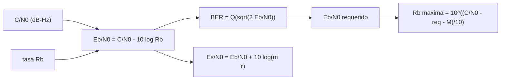

# B89-C23 — Relación C/N0, Eb/N0 y tasa de error de bit

<!-- nav:top -->
[🏠 Programa](../../../../README.md) · [📚 Bloque B89](../../../tronco-comun/B89-comunicaciones-y-navegacion-satelital.md) · [← Anterior: B89-C22 — Propagación ionosférica y comunicaciones HF](../B89-C22-propagacion-ionosferica-y-comunicaciones-hf/CLASE.md) · [Siguiente: B89-C24 — Recepción de telemetría débil →](../B89-C24-recepcion-de-telemetria-debil/CLASE.md)
<!-- /nav -->

## 1. Ubicación, nivel y alcance

Clase 23 del bloque B89, nivel N3 (ampliación). Cerrar un presupuesto de enlace ([B89-C05](../B89-C05-presupuesto-de-enlace/CLASE.md)) exige traducir la potencia y el ruido en una tasa de error de bit: `C/N₀` pasa a `Eb/N₀` al fijar la tasa de bits, y de ahí sale la BER de la modulación ([B89-C08](../B89-C08-modulacion-digital/CLASE.md)). Aquí encadenas las tres magnitudes, calculas la tasa máxima para una BER objetivo y verificas la cadena con una simulación de Monte Carlo. Los valores de `C/N₀` y las tasas son sintéticos.

## 2. Por qué esta clase existe

La tasa de datos es la variable que el ingeniero puede elegir: cada duplicación cuesta 3 dB de `Eb/N₀`. Esta cadena es la forma de decidir cuántos bits por segundo soporta un enlace. La decisión central: **¿cuál es la tasa máxima de datos que cumple una BER objetivo con el `C/N₀` disponible?**

## 3. Lo que podrás hacer al terminar

1. Convertir `C/N₀` en `Eb/N₀` con `Eb/N₀ = C/N₀ − 10 log₁₀ R_b`.
2. Convertir `Eb/N₀` en `Es/N₀` según bits por símbolo y tasa del código.
3. Hallar el `Eb/N₀` requerido para varias BER objetivo.
4. Despejar la tasa máxima con y sin margen.
5. Verificar la cadena `C/N₀ → Eb/N₀ → BER` con Monte Carlo.
6. Rotular lo sintético (`C/N₀`, tasas) y los alcances del modelo (BPSK/AWGN).

La evidencia es la **tabla de tasas de datos por margen** del ejercicio 12 (sección 20).

## 4. Con qué llegas y cómo comprobarlo

1. ¿Qué es `C/N₀`?
2. ¿Qué es `Eb/N₀`?
3. ¿Qué relación hay entre `C`, `E_b` y `R_b`?
4. ¿Qué es la BER?
5. ¿Qué es un dato sintético?

<details>
<summary>Ver respuestas</summary>

1. La razón entre la potencia de portadora y la densidad espectral de ruido, en dB-Hz. 2. La energía por bit dividida por la densidad espectral de ruido, en dB. 3. `C = E_b R_b`. 4. La fracción de bits erróneos. 5. Un dato inventado para el ejemplo.
</details>

Con cuatro o cinco aciertos, sigue; si no, repasa los prerrequisitos.

## 5. Un caso de contexto y casos de referencia

A `C/N₀ = 50 dB-Hz`, 10 kbit/s dan `Eb/N₀ = 10,00 dB` y 100 kbit/s, `0,00 dB`. BPSK pide `9,588 dB` para 10⁻⁵: la tasa máxima es `11,00 kbit/s` sin margen y `5,51 kbit/s` con 3 dB. Es el **ejemplo conductor**; todo es sintético.

## 6. Vocabulario

`C/N₀ = E_b R_b/N₀`, es decir `Eb/N₀ = C/N₀ − 10 log₁₀ R_b` (dB). `Es/N₀ = Eb/N₀ + 10 log₁₀(m r)`, con `m` bits por símbolo y `r` la tasa del código. La **tasa máxima** con margen `M` es `R_b = 10^{(C/N₀ − (Eb/N₀)_req − M)/10}`. La **BER de BPSK** es `Q(√(2Eb/N₀))`.

## 7. Modelo mental: repartir un presupuesto de energía entre bits



*Descripción textual:* la potencia por densidad de ruido y la tasa dan la energía por bit; esta da la BER; invirtiendo la relación se obtiene la tasa máxima; con el código y la modulación se pasa a energía por símbolo.

Analogía: un presupuesto de energía que se reparte entre los bits; más bits por segundo significan menos energía por bit. Límite: el modelo es BPSK ideal con ruido gaussiano; un sistema real tiene pérdidas de implementación y códigos que cambian el requisito.

## 8. La explicación, paso a paso

### 8.1 De C/N₀ a Eb/N₀

`Eb/N₀ = C/N₀ − 10 log₁₀ R_b`: con 40 dB-Hz y 1, 10, 100 kbit/s se obtiene `10,00`, `0,00` y `-10,00 dB`; con 60 dB-Hz, `30,00`, `20,00` y `10,00 dB`. Duplicar la tasa cuesta `3,010 dB`.

### 8.2 Eb/N₀ requerido

Para BER 10⁻³, 10⁻⁵ y 10⁻⁷, BPSK pide `6,790`, `9,588` y `11,309 dB`: pasar de 10⁻³ a 10⁻⁵ cuesta `2,8 dB` y de 10⁻⁵ a 10⁻⁷, `1,7 dB`.

### 8.3 Tasa máxima

Despejando `R_b`: con 40, 50 y 60 dB-Hz, `1,10`, `11,00` y `109,95 kbit/s` sin margen, y `0,55`, `5,51` y `55,11 kbit/s` con 3 dB de margen. Cada 10 dB de `C/N₀` valen un factor 10 en la tasa.

### 8.4 Es/N₀ y verificación

Con QPSK y código 1/2 (`m r = 1`), `Es/N₀` coincide con `Eb/N₀`: `9,588 dB`. Una simulación a `C/N₀ = 47 dB-Hz` y 10 kbit/s (`Eb/N₀ = 7,00 dB`) con 500 000 bits da BER `7,60e-04` frente a la teoría `7,73e-04` (z = `0,32`): la cadena es coherente.

## 9. Magnitudes, símbolos y unidades

| Símbolo | Qué es | Unidad | Valor / nota |
|---|---|---|---|
| `C/N₀` | portadora a densidad de ruido | dB-Hz | 40, 50, 60 (sintéticos) |
| `R_b` | tasa de bits | bit/s | 10³ a 10⁵ |
| `Eb/N₀` | energía por bit a densidad de ruido | dB | 10,00 |
| `Es/N₀` | energía por símbolo | dB | 9,588 |
| BER | tasa de error de bit | — | 10⁻³, 10⁻⁵, 10⁻⁷ |
| `M` | margen | dB | 0 y 3 |

## 10. Convenciones y referencias

BPSK coherente con ruido gaussiano y sincronismo perfecto; BER objetivo 10⁻⁵ salvo indicación. Tasas y `C/N₀` sintéticos; la simulación usa `random.Random(89)`. La relación `Eb/N₀ = C/N₀ − 10 log R_b` y la BER de BPSK son relaciones estándar no consultadas en una fuente concreta.

## 11. De dónde sale lo que afirmamos

| ID | Fuente | Localizador | Respalda | Estado |
|---|---|---|---|---|
| — | Relaciones estándar (`C/N₀`, `Eb/N₀`, `Es/N₀`, BER de BPSK) | — | las verifica el laboratorio con una simulación de Monte Carlo independiente | No consultada en una fuente concreta |

Límites: esta clase no usa constantes ni documentos consultados; el requisito de BPSK no incluye pérdida de implementación ni código; ningún valor describe un enlace real.

## 12. Cómo ver la cadena potencia–tasa–error

| Magnitud | Valor |
|---|---|
| `Eb/N₀` a 50 dB-Hz y 10 kbit/s | 10,00 dB |
| `Eb/N₀` requerido, BER 10⁻⁵ | 9,588 dB |
| tasa máxima a 50 dB-Hz | 11,00 kbit/s |
| con 3 dB de margen | 5,51 kbit/s |
| BER simulada / teórica | 7,60e-04 / 7,73e-04 |

Descripción larga: cada duplicación de la tasa baja 3 dB el `Eb/N₀`, y cada 10 dB de `C/N₀` permiten diez veces más tasa.

## 13. Ejemplo trabajado: la tasa máxima a 50 dB-Hz

**Paso 1 · `Eb/N₀` requerido.** `9,588 dB`.

**Paso 2 · Presupuesto.** `50 − 9,588 = 40,412 dB`.

**Paso 3 · Tasa.** `10^(40,412/10) = 10995 bit/s`.

**Paso 4 · Con 3 dB de margen.** `5511 bit/s`.

## 14. Distintas formas de describir la capacidad de un enlace

**Por potencia:** `C/N₀`. **Por energía por bit:** `Eb/N₀`. **Por error:** BER. **Por tasa:** `R_b` máxima. **Por símbolo:** `Es/N₀`.

## 15. Práctica guiada

**Ejercicio 1 · con los pasos indicados.** `Eb/N₀` con `C/N₀ = 45 dB-Hz` y 5 kbit/s. *Pasos:* `45 − 10 log₁₀ 5000`.

<details><summary>Solución comentada</summary>

`8,01 dB`.
</details>

**Ejercicio 2 · con una pista.** Predice cuántos dB cuesta pasar de 10 a 40 kbit/s. *Pista:* `10 log₁₀ 4`.

<details><summary>Solución comentada</summary>

`6,02 dB`.
</details>

**Ejercicio 3 · casi autónomo.** ¿Por qué 10 dB más de `C/N₀` permiten 10 veces más tasa a igual BER?

<details><summary>Solución comentada</summary>

Porque `R_b = C/N₀ − (Eb/N₀)_req` en dB; sumar 10 dB al presupuesto equivale a multiplicar `R_b` por 10.
</details>

## 16. Práctica autónoma, transferencia e integrador

**Ejercicio 4 · autónomo.** BER de BPSK con `Eb/N₀ = 7 dB`.

<details><summary>Solución comentada</summary>

`7,73e-04`.
</details>

**Ejercicio 5 · autónomo.** `Eb/N₀` requerido para 10⁻⁷ si el sistema tiene 1,5 dB de pérdida de implementación.

<details><summary>Solución comentada</summary>

`12,809 dB`.
</details>

**Ejercicio 6 · autónomo.** Tasa máxima a 55 dB-Hz sin margen.

<details><summary>Solución comentada</summary>

`34,77 kbit/s`.
</details>

**Ejercicio 7 · autónomo.** `Es/N₀` de 8PSK con código 2/3 si `Eb/N₀ = 5 dB` (`m r = 2`).

<details><summary>Solución comentada</summary>

`5 + 3,01 = 8,01 dB`.
</details>

**Ejercicio 8 · autónomo.** Si el margen exigido sube de 3 a 6 dB, ¿en qué factor baja la tasa?

<details><summary>Solución comentada</summary>

`10^(−0,3) = 0,501`: a la mitad.
</details>

**Ejercicio 9 · transferencia.** **Transferencia.** Un enlace tiene `C/N₀ = 38 dB-Hz` y requiere 20 kbit/s. ¿Cierra con BPSK a 10⁻⁵?

<details><summary>Solución comentada</summary>

`Eb/N₀ = 38 − 43,01 = −5,01 dB` frente a `9,59 dB` requeridos: faltan `14,6 dB`; no cierra.
</details>

**Ejercicio 10 · transferencia.** **Transferencia.** Un código con ganancia de 6 dB, ¿cuánto sube la tasa máxima?

<details><summary>Solución comentada</summary>

Cuatro veces (`10^0,6 = 3,98`).
</details>

**Ejercicio 11 · transferencia.** **Transferencia.** Un colega confunde `Eb/N₀` de 10 dB con `C/N₀` de 10 dB-Hz. ¿Qué corriges?

<details><summary>Solución comentada</summary>

Que son magnitudes distintas: `Eb/N₀` es adimensional (dB) y `C/N₀` está en dB-Hz; se relacionan por la tasa.
</details>

**Ejercicio 12 · integrador.** **Integrador.** Elabora tu *tabla de tasas de datos por margen*: `Eb/N₀` para tres `C/N₀` y tres tasas, `Eb/N₀` requerido y tasa máxima con 0 y 3 dB de margen, con la verificación por simulación.

<details><summary>Solución comentada</summary>

Secciones 8.1–8.4 y la salida del laboratorio.
</details>

## 17. Laboratorio: C/N₀, Eb/N₀ y BER

El script [cn0_ebn0.py](cn0_ebn0.py) calcula `Eb/N₀` para tres `C/N₀` y tres tasas, el requerido de BPSK para tres BER, la tasa máxima con y sin margen y simula la cadena `C/N₀ → Eb/N₀ → BER` (**comprueba** que la tasa máxima reproduce la BER objetivo, que duplicar la tasa cuesta 3,01 dB y que el Monte Carlo difiere menos de 4 σ de la teoría).

**Datos:** `C/N₀`, tasas y semilla 89 **sintéticos**; relaciones estándar. **Predice antes de ejecutar:** ¿cuántos dB cuesta duplicar la tasa? (3,01 dB.) **Ejecución del 2026-11-10 (Python 3.12.9):**

```text
3.12.9 (biblioteca estandar), random.Random(89)
Eb/N0 requerido por BPSK: BER 1e-3 = 6.790 dB ; 1e-5 = 9.588 dB ; 1e-7 = 11.309 dB
Eb/N0 [dB] = C/N0 [dB-Hz] - 10 log10(Rb):
  C/N0   Rb=1 kbit/s   10 kbit/s   100 kbit/s
    40         10.00        0.00       -10.00
    50         20.00       10.00         0.00
    60         30.00       20.00        10.00
Tasa maxima para BER 1e-5 (sin margen / con 3 dB de margen):
  C/N0 = 40 dB-Hz:      1.10 /      0.55 kbit/s
  C/N0 = 50 dB-Hz:     11.00 /      5.51 kbit/s
  C/N0 = 60 dB-Hz:    109.95 /     55.11 kbit/s
Duplicar la tasa cuesta 3.010 dB ; Es/N0 para QPSK con codigo 1/2 a Eb/N0 requerido = 9.588 dB (BPSK sin codigo: 9.588 dB)
Monte Carlo (C/N0 = 47 dB-Hz, Rb = 10 kbit/s -> Eb/N0 = 7.00 dB, 500000 bits): BER = 7.6000e-04 ; teoria = 7.7267e-04 ; z = 0.32
BER frente a la tasa a C/N0 = 50 dB-Hz: 10 kbit/s: 3.87e-06, 20 kbit/s: 7.83e-04, 50 kbit/s: 2.28e-02, 100 kbit/s: 7.86e-02
Pruebas superadas.
```

```bash
python programa/clases/B89/B89-C23-relacion-c-n0-eb-n0-y-tasa-de-error-de-bit/cn0_ebn0.py
```

**Límites:** BPSK ideal sin código ni pérdida de implementación; AWGN; no representa un enlace real.

## 18. Errores frecuentes y cómo corregirlos

**Confundir `C/N₀` con `Eb/N₀`.** Se corrige con 8.1.

**Olvidar convertir `R_b` a dB.** Se corrige con 8.1.

**Ignorar el margen.** Se corrige con 8.3.

**Presentar los valores sintéticos como un enlace real.** Se corrige con la sección 10.

## 19. Cómo sabrás que vas bien

Tras la sección 8: ¿qué tasa máxima esperabas a 50 dB-Hz y cuál obtuviste? Si dudas, repasa el ejemplo 13. Tras el laboratorio: ¿qué comprueba? (ver la sección 17).

## 20. Qué entregas y cómo se evalúa

El producto es tu **tabla de tasas de datos por margen** (ejercicio 12).

| Criterio | Inicial | En desarrollo | Logrado | Destacado |
|---|---|---|---|---|
| Conceptos | Los confunde | Parciales | Convierte `C/N₀`, `Eb/N₀` y BER | Explica los límites |
| Cálculo | Sin unidades | Con errores | Tablas completas con unidades | Calcula casos nuevos |
| Numérico | Sin comprobar | Un caso | Contraste con una segunda vía | Interpreta las diferencias |
| Fuentes | Sin fuente | Sin fecha | Fuentes con fecha y estado | Declara lo sintético y lo no consultado |
| Límites | No los nombra | Uno | Tres | Discute qué falta del modelo |

**Condiciones críticas (no se compensan con promedio):** rotular `C/N₀` y tasas como sintéticos; declarar el margen y la BER objetivo; no presentar un cálculo como una medición; citar solo lo consultado.

## 21. Ética, seguridad y límites

Clase educativa: los modelos son simplificados y sus datos son sintéticos o ilustrativos; ningún resultado describe un enlace, un satélite ni una misión reales, ni sustituye a la documentación oficial de una misión, a un presupuesto de enlace verificado ni a la coordinación regulatoria.  Accesibilidad: tablas equivalentes a las gráficas, fórmulas en texto, ejercicios sin conexión.

## 22. Para cerrar y seguir

A 50 dB-Hz, BPSK a 10⁻⁵ admite `11,0 kbit/s` (`5,5` con 3 dB de margen); la simulación confirma la cadena. Queda una pregunta: ¿cómo recibir una señal cuando `C/N₀` es muy bajo?

**Glosario español–inglés.** densidad de ruido · *noise spectral density*; energía por bit · *energy per bit*; tasa de error de bit · *bit error rate*; margen · *margin*; tasa de datos · *data rate*.

**Continuidad.** [B89-C24](../B89-C24-recepcion-de-telemetria-debil/CLASE.md) estudia la recepción de telemetría débil.

**Referencias:** ver sección 11.

<!-- nav:bottom -->
---

[← Anterior: B89-C22 — Propagación ionosférica y comunicaciones HF](../B89-C22-propagacion-ionosferica-y-comunicaciones-hf/CLASE.md) · [📚 Bloque B89](../../../tronco-comun/B89-comunicaciones-y-navegacion-satelital.md) · [Siguiente: B89-C24 — Recepción de telemetría débil →](../B89-C24-recepcion-de-telemetria-debil/CLASE.md)
<!-- /nav -->
