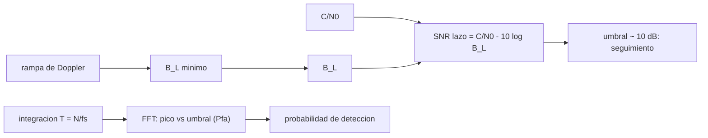

# B89-C24 — Recepción de telemetría débil

<!-- nav:top -->
[🏠 Programa](../../../../README.md) · [📚 Bloque B89](../../../tronco-comun/B89-comunicaciones-y-navegacion-satelital.md) · [← Anterior: B89-C23 — Relación C/N0, Eb/N0 y tasa de error de bit](../B89-C23-relacion-c-n0-eb-n0-y-tasa-de-error-de-bit/CLASE.md) · [Siguiente: B89-C25 — Protección criptográfica de enlaces espaciales →](../B89-C25-proteccion-criptografica-de-enlaces-espaciales/CLASE.md)
<!-- /nav -->

## 1. Ubicación, nivel y alcance

Clase 24 del bloque B89, nivel N3 (ampliación `0.2.0`). En espacio profundo la señal llega cerca del umbral: hay que recibirla con lazos de portadora muy estrechos o detectarla por integración larga. Aquí calculas la SNR del lazo y su umbral, el ancho de banda mínimo frente al Doppler y simulas la detección de una portadora por FFT con falsa alarma controlada. Usas [B89-C10](../B89-C10-sincronizacion-de-portadora/CLASE.md) para el lazo y [B89-C23](../B89-C23-relacion-c-n0-eb-n0-y-tasa-de-error-de-bit/CLASE.md) para `C/N₀`. Señal y ruido son sintéticos; los umbrales y relaciones son estándar no consultados.

## 2. Por qué esta clase existe

Cuando una nave está lejos o en emergencia, recibir su portadora a unos pocos dB-Hz marca la diferencia entre confirmar su estado o perderla; el costo es tiempo de integración o un lazo difícil de enganchar. La decisión central: **¿cómo detectar y seguir una portadora muy débil sin tantas falsas alarmas?**

## 3. Lo que podrás hacer al terminar

1. Calcular la SNR del lazo `C/N₀ − 10 log B_L` y el `C/N₀` mínimo para un umbral de 10 dB.
2. Calcular el ancho de banda de lazo mínimo para seguir una rampa de Doppler.
3. Fijar un umbral de detección para una probabilidad de falsa alarma.
4. Estimar por simulación la probabilidad de detección en función de `C/N₀`.
5. Relacionar tiempo de integración y sensibilidad.
6. Rotular lo sintético (señal, ruido) y lo no consultado (umbral de 10 dB).

La evidencia es la **ficha de detección de una portadora débil** del ejercicio 12 (sección 20).

## 4. Con qué llegas y cómo comprobarlo

1. ¿Qué es la SNR del lazo?
2. ¿Qué es una FFT?
3. ¿Qué es una falsa alarma?
4. ¿Qué es la integración coherente?
5. ¿Qué es un dato sintético?

<details>
<summary>Ver respuestas</summary>

1. La razón entre la potencia de portadora y el ruido en el ancho de banda de lazo. 2. Un algoritmo rápido para la transformada discreta de Fourier. 3. Declarar detección cuando solo hay ruido. 4. Sumar muestras con fase conocida para concentrar la señal en un bin. 5. Un dato inventado para el ejemplo.
</details>

Con cuatro o cinco aciertos, sigue; si no, repasa los prerrequisitos.

## 5. Un caso de contexto y casos de referencia

A `C/N₀ = 30 dB-Hz`, un lazo de 10 Hz tiene SNR de `20,0 dB` y uno de 0,1 Hz, `40,0 dB`. Con una FFT de 1024 muestras (T = 64 s) y falsa alarma de 10⁻³, la detección sintética pasa de `0,02` a −12 dB-Hz a `0,98` a −4 dB-Hz. Es el **ejemplo conductor**; todo es sintético.

## 6. Vocabulario

La **SNR del lazo** es `C/N₀/B_L`; un **umbral de seguimiento** típico es de unos 10 dB (valor estándar no consultado). La **detección por FFT** integra `N` muestras: el bin de la portadora acumula `N` veces la potencia y el ruido por bin tiene media `σ²N`. La **falsa alarma** por bin `p_b` fija el umbral `−σ²N ln p_b` (ruido exponencial). El **tiempo de integración** `T = N/f_s` fija la resolución `1/T`.

## 7. Modelo mental: oír un susurro promediando mucho tiempo



*Descripción textual:* la SNR del lazo y su umbral fijan el `C/N₀` mínimo; el Doppler fija el ancho mínimo del lazo; la integración larga y la FFT detectan una portadora más débil, con un umbral derivado de la falsa alarma.

Analogía: oír un susurro: escuchar más tiempo (integrar) permite distinguirlo del ruido, pero hay que saber en qué frecuencia buscarlo. Límite: la integración coherente exige frecuencia casi constante durante `T`; el Doppler variable obliga a compensarlo o a dividir en tramos.

## 8. La explicación, paso a paso

### 8.1 Umbral del lazo

`SNR_L = C/N₀ − 10 log₁₀ B_L`. Con `C/N₀ = 30 dB-Hz`: `B_L = 0,1 Hz` → `40,0 dB`; `1 Hz` → `30,0 dB`; `10 Hz` → `20,0 dB`. Para una SNR de lazo de 10 dB hacen falta `0,0`, `10,0` y `20,0 dB-Hz` respectivamente: estrechar el lazo baja el umbral.

### 8.2 El límite lo pone el Doppler

Con la relación de C10 (error por rampa `2πḟ/ω_n²`), el ancho mínimo para un error ≤ 0,3 rad es `0,243 Hz` para 0,01 Hz/s, `0,767 Hz` para 0,1 Hz/s y `2,427 Hz` para 1 Hz/s. Un Doppler rápido impide un lazo muy estrecho.

### 8.3 Detección por FFT

Con `N = 1024` muestras a 16 Hz (`T = 64 s`) la ganancia de integración es `10 log₁₀ N = 30 dB`. El umbral para falsa alarma de 10⁻³ en el barrido de `1024` bins se fija con el ruido; en solo ruido, la simulación da `0,0025` falsas alarmas en `400` ensayos.

### 8.4 Probabilidad de detección

Con `C/N₀ = −12, −10, −8, −6, −4 dB-Hz` la SNR en el bin es `6,1, 8,1, 10,1, 12,1, 14,1 dB` y la probabilidad de detectar y localizar el bin correcto es `0,02, 0,05, 0,27, 0,60, 0,98`. Integrar más tiempo desplaza toda la curva hacia `C/N₀` más bajos.

## 9. Magnitudes, símbolos y unidades

| Símbolo | Qué es | Unidad | Valor / nota |
|---|---|---|---|
| `C/N₀` | portadora a densidad de ruido | dB-Hz | −12 a 30 (sintéticos) |
| `B_L` | ancho de banda del lazo | Hz | 0,1; 1; 10 |
| `SNR_L` | SNR del lazo | dB | 30,0 |
| `N`, `T` | muestras y tiempo de integración | —, s | 1024, 64 |
| `P_fa` | probabilidad de falsa alarma | — | 10⁻³ |
| `P_d` | probabilidad de detección | — | 0,27 |

## 10. Convenciones y referencias

Portadora compleja de amplitud 1 más ruido blanco gaussiano complejo, `f_s = 16 Hz`, FFT de 1024 puntos (radix-2 recursiva), tono centrado en un bin entero elegido al azar; semilla 89. El umbral de SNR de lazo de 10 dB y la fórmula de umbral por falsa alarma son estándar no consultados. Todo sintético.

## 11. De dónde sale lo que afirmamos

| ID | Fuente | Localizador | Respalda | Estado |
|---|---|---|---|---|
| S1 | NASA/JPL, DSN Telecommunications Link Design Handbook (810-005) — https://deepspace.jpl.nasa.gov/dsndocs/810-005/ (consultada 2026-11-10) | pagina de indice | existencia y estructura por modulos (material introductorio, interfaces del enlace espacial, procesamiento de datos de estacion, propiedades de estacion terrestre, informacion complementaria); no se leyeron los modulos | Consultada |
| — | Umbral de seguimiento de 10 dB y relaciones de detección con falsa alarma | — | estándar, no consultado; el laboratorio verifica la falsa alarma por simulación | No consultada en una fuente concreta |
| — | Prácticas de la DSN para señales débiles | — | no consultadas | No consultada en una fuente concreta |

Límites: del manual DSN 810-005 solo se consultó la página de índice; no se consultó ninguna técnica operativa de recepción de señal débil.

## 12. Cómo ver la detección de una señal débil

| Magnitud | Valor |
|---|---|
| SNR de lazo, `B_L` = 1 Hz, 30 dB-Hz | 30,0 dB |
| `C/N₀` mínimo, `B_L` = 0,1 Hz | 0,0 dB-Hz |
| `P_fa` simulada | 0,0025 |
| `P_d` a −12 dB-Hz | 0,02 |
| `P_d` a −4 dB-Hz | 0,98 |

Descripción larga: la detección pasa de casi nula a casi segura en pocos decibelios; estrechar el lazo o integrar más baja el `C/N₀` mínimo.

## 13. Ejemplo trabajado: el umbral con B_L = 1 Hz

**Paso 1 · Objetivo.** SNR de lazo de 10 dB.

**Paso 2 · Relación.** `C/N₀ = SNR_L + 10 log₁₀ B_L`.

**Paso 3 · Con `B_L = 1 Hz`.** `10 + 0 = 10 dB-Hz`.

**Paso 4 · Con `B_L = 0,1 Hz`.** `10 − 10 = 0 dB-Hz` (`0,0`): el lazo más estrecho tolera una señal 10 dB más débil.

## 14. Distintas formas de describir la recepción de una señal débil

**Por lazo:** SNR_L y `B_L`. **Por Doppler:** `B_L` mínimo. **Por detección:** FFT y umbral. **Por probabilidades:** `P_fa` y `P_d`.

## 15. Práctica guiada

**Ejercicio 1 · con los pasos indicados.** SNR de lazo con `C/N₀ = 25 dB-Hz` y `B_L = 2 Hz`. *Pasos:* `25 − 10 log₁₀ 2`.

<details><summary>Solución comentada</summary>

`21,99 dB`.
</details>

**Ejercicio 2 · con una pista.** Predice qué `B_L` da 10 dB con `C/N₀ = 15 dB-Hz`. *Pista:* `10 log₁₀ B_L = 5`.

<details><summary>Solución comentada</summary>

`B_L = 3,16 Hz`.
</details>

**Ejercicio 3 · casi autónomo.** ¿Por qué no basta con estrechar el lazo indefinidamente?

<details><summary>Solución comentada</summary>

Porque el Doppler variable exige un ancho mínimo (`ω_n² ≥ 2πḟ/error`); un lazo demasiado estrecho pierde la portadora.
</details>

## 16. Práctica autónoma, transferencia e integrador

**Ejercicio 4 · autónomo.** Ganancia de integración de una FFT de 4096 muestras.

<details><summary>Solución comentada</summary>

`10 log₁₀ 4096 = 36,1 dB`.
</details>

**Ejercicio 5 · autónomo.** `B_L` mínimo para 0,5 Hz/s con error ≤ 0,3 rad.

<details><summary>Solución comentada</summary>

`1,716 Hz`.
</details>

**Ejercicio 6 · autónomo.** Resolución en frecuencia de una integración de 64 s.

<details><summary>Solución comentada</summary>

`1/64 = 15,6 mHz`.
</details>

**Ejercicio 7 · autónomo.** Umbral de potencia para `P_fa = 10⁻³` en 1024 bins, en unidades de la media de ruido por bin.

<details><summary>Solución comentada</summary>

`−ln(1 − (1 − 10⁻³)^(1/1024)) = 13,84`.
</details>

**Ejercicio 8 · autónomo.** Si se duplica `T`, ¿cuánto baja el `C/N₀` detectable?

<details><summary>Solución comentada</summary>

`3 dB`.
</details>

**Ejercicio 9 · transferencia.** **Transferencia.** Una sonda en emergencia emite una portadora a `C/N₀ = −7 dB-Hz`. ¿Puede detectarla una integración de 64 s?

<details><summary>Solución comentada</summary>

La SNR en el bin de la simulación a −8 dB-Hz es `10,1 dB` con `P_d = 0,27`; a −7 dB-Hz sería algo mayor, pero aún parcial: conviene integrar más tiempo (cada duplicación de `T` gana 3 dB) y conocer el Doppler.
</details>

**Ejercicio 10 · transferencia.** **Transferencia.** Un receptor con Doppler de 1 Hz/s intenta integrar 64 s coherentes. ¿Qué ocurre?

<details><summary>Solución comentada</summary>

El tono se desplaza 64 Hz durante la integración y su energía se reparte entre muchos bins; hay que compensar el Doppler o integrar por tramos.
</details>

**Ejercicio 11 · transferencia.** **Transferencia.** Un colega afirma que el umbral de 10 dB es «norma de la DSN». ¿Qué corriges?

<details><summary>Solución comentada</summary>

Que es un valor estándar usual no consultado; del manual DSN solo se consultó el índice.
</details>

**Ejercicio 12 · integrador.** **Integrador.** Elabora tu *ficha de detección de una portadora débil*: SNR de lazo y umbral, `B_L` mínimo, `P_fa` y `P_d` simuladas, con qué es sintético y no consultado.

<details><summary>Solución comentada</summary>

Secciones 8.1–8.4 y la salida del laboratorio.
</details>

## 17. Laboratorio: seguimiento y detección de una portadora débil

El script [senal_debil.py](senal_debil.py) calcula la SNR del lazo, el `C/N₀` de umbral, el `B_L` mínimo frente al Doppler y simula una FFT con falsa alarma controlada y la probabilidad de detección (**comprueba** `P_fa` simulada < 0,02, que `P_d` crece con `C/N₀` y supera 0,95 a −4 dB-Hz).

**Datos:** señal, ruido y semilla 89 **sintéticos**; umbral de 10 dB **no consultado**. **Predice antes de ejecutar:** ¿cuál es la probabilidad de detección a −12 dB-Hz? (Baja, menor que 0,6.) **Ejecución del 2026-11-10 (Python 3.12.9):**

```text
3.12.9 (biblioteca estandar), random.Random(89)
SNR del lazo = C/N0 - 10 log10(B_L) con C/N0 = 30 dB-Hz: B_L = 0.1 Hz: 40.0 dB, B_L = 1.0 Hz: 30.0 dB, B_L = 10.0 Hz: 20.0 dB
C/N0 minimo para SNR de lazo de 10 dB: B_L = 0.1 Hz: 0.0 dB-Hz, B_L = 1.0 Hz: 10.0 dB-Hz, B_L = 10.0 Hz: 20.0 dB-Hz
B_L minimo para seguir una rampa (error <= 0.3 rad):
  rampa 0.01 Hz/s: B_L >= 0.243 Hz
  rampa 0.1 Hz/s: B_L >= 0.767 Hz
  rampa 1.0 Hz/s: B_L >= 2.427 Hz
Deteccion por FFT de 1024 muestras (T = 64 s), Pfa objetivo 1e-03
  falsas alarmas simuladas = 0.0025 en 400 ensayos (solo ruido)
  C/N0 = -12 dB-Hz: SNR en el bin =   6.1 dB ; P_deteccion = 0.020
  C/N0 = -10 dB-Hz: SNR en el bin =   8.1 dB ; P_deteccion = 0.047
  C/N0 = -8 dB-Hz: SNR en el bin =  10.1 dB ; P_deteccion = 0.273
  C/N0 = -6 dB-Hz: SNR en el bin =  12.1 dB ; P_deteccion = 0.600
  C/N0 = -4 dB-Hz: SNR en el bin =  14.1 dB ; P_deteccion = 0.980
Pruebas superadas.
```

```bash
python programa/clases/B89/B89-C24-recepcion-de-telemetria-debil/senal_debil.py
```

**Límites:** tono en bin entero y Doppler nulo; integración coherente única; no representa un receptor real.

## 18. Errores frecuentes y cómo corregirlos

**Creer que un lazo más estrecho siempre es mejor.** Se corrige con 8.2.

**Fijar el umbral sin considerar la falsa alarma.** Se corrige con 8.3.

**Olvidar el Doppler al integrar.** Se corrige con el ejercicio 10.

**Presentar un umbral no consultado como norma.** Se corrige con la sección 11.

## 19. Cómo sabrás que vas bien

Tras la sección 8: ¿qué `P_d` esperabas a −8 dB-Hz y cuál obtuviste? Si dudas, repasa el ejemplo 13. Tras el laboratorio: ¿qué comprueba? (ver la sección 17).

## 20. Qué entregas y cómo se evalúa

El producto es tu **ficha de detección de una portadora débil** (ejercicio 12).

| Criterio | Inicial | En desarrollo | Logrado | Destacado |
|---|---|---|---|---|
| Conceptos | Los confunde | Parciales | Calcula SNR de lazo, B_L mínimo y detección | Explica los límites |
| Cálculo | Sin unidades | Con errores | Tablas completas con unidades | Calcula casos nuevos |
| Numérico | Sin comprobar | Un caso | Contraste con una segunda vía | Interpreta las diferencias |
| Fuentes | Sin fuente | Sin fecha | Fuentes con fecha y estado | Declara lo sintético y lo no consultado |
| Límites | No los nombra | Uno | Tres | Discute qué falta del modelo |

**Condiciones críticas (no se compensan con promedio):** rotular señal y ruido como sintéticos; declarar `P_fa`; no presentar el umbral de 10 dB como norma; no presentar un cálculo como una medición; citar solo lo consultado.

## 21. Ética, seguridad y límites

Clase educativa: los modelos son simplificados y sus datos son sintéticos o ilustrativos; ningún resultado describe un enlace, un satélite ni una misión reales, ni sustituye a la documentación oficial de una misión, a un presupuesto de enlace verificado ni a la coordinación regulatoria.  Accesibilidad: tablas equivalentes a las gráficas, fórmulas en texto, ejercicios sin conexión.

## 22. Para cerrar y seguir

Un lazo de 0,1 Hz sigue una portadora a `0 dB-Hz` si el Doppler lo permite, y una FFT de 64 s la detecta con `P_d = 0,60` a −6 dB-Hz. Queda una pregunta: ¿cómo se protege un enlace que se recibe así?

**Glosario español–inglés.** señal débil · *weak signal*; umbral de seguimiento · *tracking threshold*; integración coherente · *coherent integration*; probabilidad de falsa alarma · *false alarm probability*; probabilidad de detección · *detection probability*.

**Continuidad.** [B89-C25](../B89-C25-proteccion-criptografica-de-enlaces-espaciales/CLASE.md) cierra el bloque con la protección criptográfica de los enlaces.

**Referencias:** ver sección 11.

<!-- nav:bottom -->
---

[← Anterior: B89-C23 — Relación C/N0, Eb/N0 y tasa de error de bit](../B89-C23-relacion-c-n0-eb-n0-y-tasa-de-error-de-bit/CLASE.md) · [📚 Bloque B89](../../../tronco-comun/B89-comunicaciones-y-navegacion-satelital.md) · [Siguiente: B89-C25 — Protección criptográfica de enlaces espaciales →](../B89-C25-proteccion-criptografica-de-enlaces-espaciales/CLASE.md)
<!-- /nav -->
