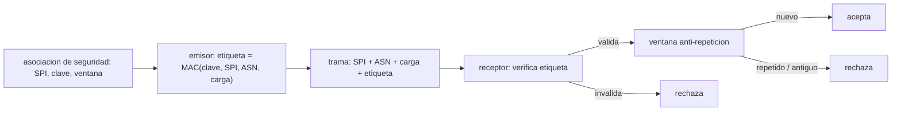

# B89-C25 — Protección criptográfica de enlaces espaciales

<!-- nav:top -->
[🏠 Programa](../../../../README.md) · [📚 Bloque B89](../../../tronco-comun/B89-comunicaciones-y-navegacion-satelital.md) · [← Anterior: B89-C24 — Recepción de telemetría débil](../B89-C24-recepcion-de-telemetria-debil/CLASE.md) · [Siguiente: B90-C01 — Plan de ensamblaje e integración →](../../B90/B90-C01-plan-de-ensamblaje-e-integracion/CLASE.md)
<!-- /nav -->

## 1. Ubicación, nivel y alcance

Clase 25 del bloque B89, nivel N3 (ampliación `0.2.0`). Un enlace espacial sin protección permite que cualquiera con una antena envíe comandos o repita los que escuchó. La capa de seguridad de enlace de datos añade autenticación (y, opcionalmente, cifrado) a cada trama y una ventana contra repeticiones. Aquí lees lo que dice la CCSDS 355.0-B-2 sobre el algoritmo base y simulas, con una herramienta **solo didáctica**, la autenticación de tramas, la ventana anti-repetición y la sobrecarga. Usas [B89-C11](../B89-C11-telemetria-ccsds/CLASE.md) y [B89-C12](../B89-C12-telecomandos-ccsds/CLASE.md) para las tramas. **El laboratorio no implementa AES-GCM ni el protocolo SDLS y no es criptografía de producción.**

## 2. Por qué esta clase existe

Los comandos son la superficie más sensible de una misión; sin autenticación y sin protección contra repetición, una trama capturada podría reutilizarse, y un CRC solo detecta errores, no ataques (C12). La decisión central: **¿cómo garantizar que una trama es auténtica, íntegra y no repetida, y cuánto cuesta en sobrecarga?**

## 3. Lo que podrás hacer al terminar

1. Explicar qué servicios da el protocolo de seguridad de enlace de datos según la CCSDS 355.0-B-2.
2. Distinguir un CRC de una etiqueta de autenticación.
3. Simular una asociación de seguridad con autenticación por HMAC como sustituto didáctico.
4. Implementar una ventana anti-repetición por número de secuencia.
5. Calcular la sobrecarga y la eficiencia con campos de seguridad.
6. Rotular lo consultado (algoritmo base de la norma) frente a lo ilustrativo y didáctico.

La evidencia es la **ficha de una asociación de seguridad** del ejercicio 12 (sección 20).

## 4. Con qué llegas y cómo comprobarlo

1. ¿Qué es la autenticación?
2. ¿Qué es un ataque de repetición?
3. ¿Qué es una etiqueta (MAC)?
4. ¿Qué es una asociación de seguridad?
5. ¿Qué es un dato sintético?

<details>
<summary>Ver respuestas</summary>

1. Comprobar que el mensaje proviene de quien dice y no fue alterado. 2. Reenviar una trama válida capturada antes. 3. Un valor calculado con una clave secreta que acompaña al mensaje. 4. El conjunto de parámetros (algoritmo, clave, ventana) que comparten emisor y receptor. 5. Un dato inventado para el ejemplo.
</details>

Con cuatro o cinco aciertos, sigue; si no, repasa los prerrequisitos.

## 5. Un caso de contexto y casos de referencia

En un escenario sintético de 10 tramas, el receptor acepta `5`, rechaza las repeticiones, la carga alterada, la etiqueta falsa y la trama fuera de la ventana de 64. Los campos de seguridad ilustrativos (SPI 2 + IV 12 + etiqueta 16 = `30` octetos) bajan la eficiencia de un bloque de 1115 octetos de `0,9928` a `0,9659`. Es el **ejemplo conductor**; es didáctico.

## 6. Vocabulario

El **protocolo de seguridad de enlace de datos (SDLS)** de la CCSDS protege tramas con autenticación y/o cifrado. Su base de interoperabilidad es el **cifrado autenticado AES en modo Galois/Counter (GCM)** con clave de 256 bits. Una **asociación de seguridad (SA)** fija algoritmo, clave, tamaño de etiqueta y ventana. El **SPI** identifica la SA. La **ventana anti-repetición** rechaza números de secuencia ya vistos o demasiado antiguos. La **etiqueta** autentica cabecera y carga.

## 7. Modelo mental: un sello de lacre numerado en cada carta



*Descripción textual:* el emisor calcula una etiqueta con la clave de la asociación de seguridad; el receptor verifica la etiqueta y luego la ventana de secuencia: solo las tramas válidas y nuevas se aceptan.

Analogía: una carta con un sello de lacre numerado: el sello prueba el remitente y que no se abrió; el número impide reutilizar una carta vieja. Límite: la seguridad depende de la gestión de claves y de la implementación, no solo del formato de la trama.

## 8. La explicación, paso a paso

### 8.1 Qué dice la norma

La CCSDS 355.0-B-2 (julio de 2022, leída con PyMuPDF) define un protocolo de seguridad para enlaces de datos de telemetría, telecomando, AOS y USLP. Su parámetro de implementación base para interoperabilidad es cifrado autenticado con AES en modo GCM, clave de 256 bits (la norma enumera también algoritmos de autenticación y la posibilidad de algoritmos específicos de cada agencia). Los parámetros de la asociación de seguridad incluyen algoritmo, clave, máscara de autenticación y ventana de secuencia.

### 8.2 Escenario sintético

Con una etiqueta HMAC-SHA256 truncada a 16 octetos (didáctica): `ASN 0 legitima` → aceptada; la repetición de ASN 1 se rechaza; el ASN 3 tardío dentro de la ventana se acepta una vez y su repetición se rechaza; la carga alterada y la etiqueta aleatoria se rechazan por autenticación; con ASN 200 la ventana de 64 se desplaza y el ASN 100 queda fuera. Se aceptan `5` de `10`.

### 8.3 Alteración y falsificación

Un solo bit alterado en la carga cambia la etiqueta en `1000/1000` casos. Con una etiqueta de solo 16 bits un atacante acierta al azar con probabilidad `2⁻¹⁶`: `6` aciertos en `300000` intentos frente a `4,58` esperados; con 128 bits habría `3.40e+38` combinaciones.

### 8.4 Sobrecarga

Con campos ilustrativos (SPI 2, IV 12, etiqueta 16 octetos = `30`), un bloque de `1115` octetos con cabecera de 8 deja `1077` octetos de datos: la eficiencia baja de `0,9928` a `0,9659`. Proteger cuesta capacidad.

## 9. Magnitudes, símbolos y unidades

| Símbolo | Qué es | Unidad | Valor / nota |
|---|---|---|---|
| clave | clave simétrica | bits | 256 (sintética) |
| etiqueta | MAC de autenticación | octetos | 16 (ilustrativa) |
| `W` | ventana anti-repetición | números | 64 (ilustrativa) |
| ASN | número de secuencia | — | 0 a 200 |
| sobrecarga | SPI + IV + etiqueta | octetos | 30 |
| eficiencia | datos útiles/bloque | — | 0,9659 |

## 10. Convenciones y referencias

Receptor con una asociación de seguridad, ventana deslizante de 64 números y etiqueta calculada con HMAC-SHA256 truncada (sustituto **didáctico**); los tamaños de campo y la ventana son ilustrativos. De la CCSDS 355.0-B-2 se usó solo el algoritmo base de interoperabilidad (AES-GCM, clave de 256 bits) y los parámetros de la asociación de seguridad. Claves, tramas y ataques son sintéticos; no usar nunca claves de ejemplo en un sistema real.

## 11. De dónde sale lo que afirmamos

| ID | Fuente | Localizador | Respalda | Estado |
|---|---|---|---|---|
| S1 | CCSDS 355.0-B-2, Space Data Link Security Protocol, Blue Book, julio de 2022 — https://ccsds.org/Pubs/355x0b2.pdf (PDF leido con PyMuPDF, consultada 2026-11-10) | secciones de algoritmos y asociaciones de seguridad | implementacion base de interoperabilidad: cifrado autenticado AES en modo Galois/Counter (GCM) con clave de 256 bits; parametros de la asociacion de seguridad (SA) | Consultada |
| — | Formato exacto de cabecera y cola de seguridad de la CCSDS 355.0-B-2 y tamaños de sus campos | — | no leídos en detalle; los tamaños del laboratorio son ilustrativos | No consultada en una fuente concreta |
| — | HMAC-SHA256 y la teoría de autenticación de mensajes | — | estándar; el laboratorio solo lo usa como herramienta didáctica | No consultada en una fuente concreta |

Límites: de la CCSDS 355.0-B-2 se consultó el algoritmo base y los parámetros de la asociación de seguridad, no el procedimiento completo ni la gestión de claves; el laboratorio no implementa AES-GCM, no cifra y no cumple el estándar.

## 12. Cómo ver la protección de una trama

| Magnitud | Valor |
|---|---|
| tramas aceptadas (escenario) | 5 de 10 |
| alteraciones detectadas | 1000/1000 |
| falsificaciones con 16 bits | 6 (esperadas 4,6) |
| sobrecarga | 30 octetos |
| eficiencia | 0,9928 → 0,9659 |

Descripción larga: la autenticación detecta cualquier alteración, la ventana bloquea repeticiones y la protección cuesta unos pocos octetos por trama.

## 13. Ejemplo trabajado: una repetición bloqueada

**Paso 1 · Trama legítima.** ASN 1 con etiqueta válida: aceptada; `max_ASN = 1`.

**Paso 2 · Repetición.** El atacante reenvía ASN 1: la etiqueta es válida (es una copia exacta).

**Paso 3 · Ventana.** ASN 1 ya está en el conjunto de vistos.

**Paso 4 · Resultado.** Rechazada por repetición: la autenticación sola no habría bastado.

## 14. Distintas formas de describir la protección de un enlace

**Por servicio:** autenticación, cifrado, ambos. **Por parámetros:** SA (algoritmo, clave, ventana). **Por ataque:** alteración, falsificación, repetición. **Por costo:** sobrecarga y eficiencia.

## 15. Práctica guiada

**Ejercicio 1 · con los pasos indicados.** Eficiencia con sobrecarga de 30 octetos en 1115 octetos. *Pasos:* `(1115 − 8 − 30)/1115`.

<details><summary>Solución comentada</summary>

`0,9659`.
</details>

**Ejercicio 2 · con una pista.** Predice si la ventana acepta ASN 40 con `max_ASN = 100` y `W = 64`. *Pista:* `40 ≤ 100 − 64`.

<details><summary>Solución comentada</summary>

Sí: se rechaza todo `asn ≤ max_ASN − W = 36`; `40 > 36` está dentro de la ventana y se acepta si no se vio antes.
</details>

**Ejercicio 3 · casi autónomo.** ¿Por qué la autenticación sola no detiene la repetición?

<details><summary>Solución comentada</summary>

Porque una copia exacta de una trama válida tiene una etiqueta válida; hace falta el número de secuencia y la ventana.
</details>

## 16. Práctica autónoma, transferencia e integrador

**Ejercicio 4 · autónomo.** Probabilidad de acertar una etiqueta de 32 bits al azar.

<details><summary>Solución comentada</summary>

`2⁻³² = 2,3×10⁻¹⁰`.
</details>

**Ejercicio 5 · autónomo.** Número de combinaciones de una clave de 256 bits.

<details><summary>Solución comentada</summary>

`2²⁵⁶ ≈ 1,16×10⁷⁷`.
</details>

**Ejercicio 6 · autónomo.** Octetos de sobrecarga si la etiqueta pasa de 16 a 8.

<details><summary>Solución comentada</summary>

`2 + 12 + 8 = 22`.
</details>

**Ejercicio 7 · autónomo.** Ventana de 64 con `max_ASN = 200`: ¿cuál es el menor ASN aceptable?

<details><summary>Solución comentada</summary>

`201 − 64 = 137` (se aceptan ASN > 136).
</details>

**Ejercicio 8 · autónomo.** Diferencia de uso entre CRC (C12) y etiqueta de autenticación.

<details><summary>Solución comentada</summary>

El CRC detecta errores aleatorios sin clave; la etiqueta requiere una clave secreta y detecta alteraciones deliberadas.
</details>

**Ejercicio 9 · transferencia.** **Transferencia.** Un operador reutiliza el mismo ASN tras reiniciar el transmisor. ¿Qué ocurre?

<details><summary>Solución comentada</summary>

Todas las tramas nuevas se rechazan como repeticiones; hay que sincronizar el contador (o cambiar la clave/SA).
</details>

**Ejercicio 10 · transferencia.** **Transferencia.** Un atacante graba una orden y la reproduce a la semana. ¿Qué la detiene?

<details><summary>Solución comentada</summary>

El número de secuencia ya visto (o fuera de la ventana); sin la clave no puede fabricar una nueva etiqueta.
</details>

**Ejercicio 11 · transferencia.** **Transferencia.** Un compañero propone usar este laboratorio de HMAC en una misión real. ¿Qué respondes?

<details><summary>Solución comentada</summary>

No: es didáctico, no implementa AES-GCM ni SDLS, usa una clave sintética y no se auditó; la criptografía real debe usar implementaciones certificadas y gestión de claves.
</details>

**Ejercicio 12 · integrador.** **Integrador.** Elabora tu *ficha de una asociación de seguridad*: parámetros, el escenario de ataques con su resultado, sobrecarga y eficiencia, con qué es consultado, didáctico y sintético.

<details><summary>Solución comentada</summary>

Secciones 8.1–8.4 y la salida del laboratorio.
</details>

## 17. Laboratorio: autenticación de tramas y ventana anti-repetición (didáctico)

El script [enlace_seguro.py](enlace_seguro.py) simula una asociación de seguridad con HMAC como sustituto didáctico: un escenario de diez tramas legítimas, repetidas, alteradas y fuera de ventana, la alteración de un bit en 1000 tramas, una falsificación con etiqueta de 16 bits y la sobrecarga (**comprueba** el resultado esperado de cada trama del escenario, 1000/1000 alteraciones detectadas y la tasa de falsificación ≈ 2⁻¹⁶).

**Datos:** algoritmo base de CCSDS 355.0-B-2 (consultado: AES-GCM, 256 bits); **HMAC didáctico**, claves, tamaños y ventana **ilustrativos o sintéticos**. **Predice antes de ejecutar:** ¿cuántas de las 10 tramas del escenario se aceptan? (5.) **Ejecución del 2026-11-10 (Python 3.12.9):**

```text
3.12.9 (biblioteca estandar)
DIDACTICO: HMAC-SHA256 truncado a 16 octetos como sustituto; NO es AES-GCM ni SDLS. Clave sintetica de 256 bits
  ASN 0 legitima                                     -> aceptada
  ASN 1 legitima                                     -> aceptada
  ASN 1 repetida                                     -> rechazada: repeticion
  ASN 5 legitima (salto)                             -> aceptada
  ASN 3 legitima (tarde, dentro de la ventana)       -> aceptada
  ASN 3 repetida                                     -> rechazada: repeticion
  ASN 6 con la carga alterada                        -> rechazada: autenticacion
  ASN 200 legitima                                   -> aceptada
  ASN 100 legitima (fuera de la ventana de 64)       -> rechazada: fuera de ventana
  ASN 7 con etiqueta aleatoria                       -> rechazada: autenticacion
Tramas aceptadas = 5 de 10
Alteracion de 1 bit detectada en 1000/1000 tramas
Falsificacion con etiqueta de 16 bits: 6 aciertos en 300000 intentos ; esperados 4.58 (2^-16)
Sobrecarga ilustrativa = 30 octetos (SPI 2 + IV 12 + etiqueta 16) en un bloque de 1115 octetos
  datos utiles: 1077 octetos ; eficiencia 0.9928 -> 0.9659
Etiqueta de 128 bits: 2^128 = 3.403e+38 combinaciones
Pruebas superadas.
```

```bash
python programa/clases/B89/B89-C25-proteccion-criptografica-de-enlaces-espaciales/enlace_seguro.py
```

**Límites:** no es AES-GCM ni SDLS; sin cifrado, sin gestión de claves, sin sincronización de contadores; no usar como criptografía real.

## 18. Errores frecuentes y cómo corregirlos

**Creer que un CRC protege contra un atacante.** Se corrige con el ejercicio 8.

**Olvidar la ventana anti-repetición.** Se corrige con 8.2 y el ejemplo 13.

**Usar claves de ejemplo en un sistema real.** Se corrige con la sección 10.

**Presentar el laboratorio como implementación del estándar.** Se corrige con la sección 21.

## 19. Cómo sabrás que vas bien

Tras la sección 8: ¿cuántas tramas esperabas aceptar y cuántas aceptó el receptor? Si dudas, repasa el ejemplo 13. Tras el laboratorio: ¿qué comprueba? (ver la sección 17).

## 20. Qué entregas y cómo se evalúa

El producto es tu **ficha de una asociación de seguridad** (ejercicio 12).

| Criterio | Inicial | En desarrollo | Logrado | Destacado |
|---|---|---|---|---|
| Conceptos | Los confunde | Parciales | Distingue autenticación, repetición y sobrecarga | Explica los límites |
| Cálculo | Sin unidades | Con errores | Tablas completas con unidades | Calcula casos nuevos |
| Numérico | Sin comprobar | Un caso | Contraste con una segunda vía | Interpreta las diferencias |
| Fuentes | Sin fuente | Sin fecha | Fuentes con fecha y estado | Declara lo sintético y lo no consultado |
| Límites | No los nombra | Uno | Tres | Discute qué falta del modelo |

**Condiciones críticas (no se compensan con promedio):** rotular el laboratorio como didáctico y no AES-GCM; usar de la norma solo lo consultado; no reutilizar claves de ejemplo; no presentar un cálculo como una medición; citar solo lo consultado.

## 21. Ética, seguridad y límites

Clase educativa: los modelos son simplificados y sus datos son sintéticos o ilustrativos; ningún resultado describe un enlace, un satélite ni una misión reales, ni sustituye a la documentación oficial de una misión, a un presupuesto de enlace verificado ni a la coordinación regulatoria. La seguridad de un sistema real exige criptografía auditada, gestión de claves y revisión independiente; esta clase no sustituye nada de eso ni debe usarse para proteger una misión. Accesibilidad: tablas equivalentes a las gráficas, fórmulas en texto, ejercicios sin conexión.

## 22. Para cerrar y seguir

El receptor sintético acepta `5` de 10 tramas, detecta `1000/1000` alteraciones y la protección cuesta `30` octetos por trama. Con esto se cierra el bloque: de la onda electromagnética a un enlace protegido.

**Glosario español–inglés.** seguridad de enlace de datos · *data link security*; asociación de seguridad · *security association*; etiqueta de autenticación · *authentication tag*; ataque de repetición · *replay attack*; ventana anti-repetición · *anti-replay window*.

**Continuidad.** cierra el bloque B89; la continuidad es el siguiente bloque del área A07.

**Referencias:** ver sección 11.

<!-- nav:bottom -->
---

[← Anterior: B89-C24 — Recepción de telemetría débil](../B89-C24-recepcion-de-telemetria-debil/CLASE.md) · [📚 Bloque B89](../../../tronco-comun/B89-comunicaciones-y-navegacion-satelital.md) · [Siguiente: B90-C01 — Plan de ensamblaje e integración →](../../B90/B90-C01-plan-de-ensamblaje-e-integracion/CLASE.md)
<!-- /nav -->
