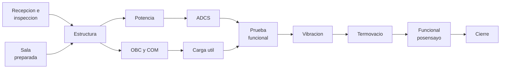

# B90-C01 — Plan de ensamblaje e integración

<!-- nav:top -->
[🏠 Programa](../../../../README.md) · [📚 Bloque B90](../../../tronco-comun/B90-integracion-ensayos-y-calificacion-espacial.md) · [← Anterior: B89-C25 — Protección criptográfica de enlaces espaciales](../../../tronco-comun/B89-comunicaciones-y-navegacion-satelital.md#b89-c25) · [Siguiente: B90-C02 — Buenas prácticas de sala limpia →](../B90-C02-buenas-practicas-de-sala-limpia/CLASE.md)
<!-- /nav -->

## 1. Ubicación, nivel y alcance

Clase 1 del bloque B90. Nivel N3. Antes de unir una sola pieza, un proyecto necesita un **plan de ensamblaje, integración y prueba** (AIT, por *assembly, integration and test*): qué se une, en qué orden, con qué verificación entre paso y paso y cuánto tarda. Aquí lo tratas como una **red de tareas**: calculas la ruta crítica, las holguras y el efecto de una falla. Todos los datos son **sintéticos**: una red de ejemplo para un CubeSat 3U que no describe ningún proyecto real.

## 2. Por qué esta clase existe

La integración es la fase donde los errores de diseño se vuelven visibles y caros. Un plan que no distingue las tareas críticas de las que tienen holgura gasta esfuerzo en el lugar equivocado. La decisión central: **¿qué tareas fijan la duración y cuánto retrasa una falla en cada una?**

## 3. Lo que podrás hacer al terminar

1. Describir la integración como un proceso ascendente con verificación entre niveles.
2. Construir una red de tareas con predecesoras y calcular inicio y fin más tempranos y más tardíos.
3. Obtener la ruta crítica y la holgura de cada tarea.
4. Verificar la ruta crítica enumerando todos los caminos de la red.
5. Estimar el efecto de una falla (retrabajo y repetición) en el calendario.
6. Separar lo consultado (principios de integración de NASA) de lo sintético (tareas y duraciones).

La evidencia es el **plan con ruta crítica y holguras** del ejercicio 12 (sección 20).

## 4. Con qué llegas y cómo comprobarlo

1. ¿Qué es un subsistema y qué es una interfaz?
2. ¿Qué diferencia hay entre verificar y validar?
3. ¿Qué es un grafo dirigido sin ciclos?
4. ¿Qué es una predecesora de una tarea?
5. ¿Qué es una comprobación independiente?

<details>
<summary>Ver respuestas</summary>

1. Un subsistema es un conjunto de componentes con una función; una interfaz es el límite por el que dos elementos intercambian energía, datos o carga. 2. Verificar es comprobar que el producto cumple sus requisitos; validar es comprobar que sirve para su uso previsto. 3. Un conjunto de nodos con flechas sin vueltas: permite ordenar las tareas. 4. Una tarea que debe terminar antes. 5. Calcular lo mismo por otra vía y comparar.
</details>

Con cuatro o cinco aciertos, sigue; si no, repasa los prerrequisitos.

## 5. Un caso de contexto y casos de referencia

Un equipo universitario debe integrar un CubeSat 3U con 13 tareas: recepción de unidades, preparación de sala, arnés, estructura, potencia, computador y comunicaciones, control de actitud, carga útil, prueba funcional, vibración, *bakeout* termovacío, prueba posensayo y cierre. Con las duraciones de ejemplo, el proyecto dura **24 días** y la ruta crítica tiene **9 tareas**. Todo es **sintético**: no es el calendario de un proyecto real.

## 6. Vocabulario

**Ensamblaje:** unir piezas mecánicamente. **Integración:** unir elementos y comprobar que interactúan como se espera. **Prueba:** obtener datos del producto bajo condiciones controladas. **Ruta crítica:** la cadena de tareas sin holgura que fija la duración. **Holgura** (*float*): cuánto puede atrasarse una tarea sin atrasar el proyecto, `LS − ES`. **Pasada hacia adelante:** calcula inicio (`ES`) y fin (`EF`) más tempranos. **Pasada hacia atrás:** calcula fin (`LF`) e inicio (`LS`) más tardíos. **Retrabajo:** corregir un producto no conforme.

## 7. Modelo mental: una red que se construye de abajo hacia arriba



*Descripción textual:* la integración avanza de recepción a estructura, de allí a potencia y a computador/comunicaciones, luego a control de actitud y carga útil, y todo converge en la prueba funcional, seguida de vibración, termovacío, prueba posensayo y cierre.

Analogía: es una receta con varios cocineros: la comida sale cuando termina el plato más lento, no cuando termina el más rápido. Límite: una receta no tiene fallas que obliguen a repetir un paso; el plan sí debe prever retrabajo.

## 8. La explicación, paso a paso

### 8.1 Qué dice la fuente sobre integrar

El *Systems Engineering Handbook* de NASA (F3) dice que el propósito de la integración es asegurar que los elementos funcionen como un todo, que se construye de abajo hacia arriba y que cada nivel se comprueba antes de unirse al superior. Sus actividades incluyen preparar el plan y la secuencia, recibir y inspeccionar productos, confirmar que cada uno fue validado, preparar el entorno, ensamblar y registrar decisiones y anomalías. Advierte que pequeños cambios de secuencia pueden tener grandes efectos y que planificar tarde causa retrasos.

### 8.2 Pasada hacia adelante

`ES(t) = máx EF(p)` sobre las predecesoras `p` y `EF = ES + d`. En la red de ejemplo, `EF` de la estructura (C) es 4 d porque debe esperar a recepción (2 d) y sala (1 d): `ES(C) = máx(2, 1) = 2`.

### 8.3 Pasada hacia atrás y holgura

`LF(t) = mín LS(s)` sobre las sucesoras `s` y `LS = LF − d`; la holgura es `LS − ES`. Las tareas con holgura cero forman la ruta crítica: A, C, E, G, H, I, J, K, L. El arnés (M) tiene 2 d de holgura: puede tardar hasta 6 d sin retrasar el proyecto.

### 8.4 Efecto de una falla

Si la prueba funcional H falla, hay que añadir retrabajo (3 d) y repetirla (2 d). Como H está en la ruta crítica, el proyecto se alarga **5 d** (de 24 a 29 d). Un retraso de 2 d en el arnés, en cambio, se absorbe por completo en su holgura.

| Tarea afectada | En ruta crítica | Efecto en el proyecto |
|---|---|---|
| H con retrabajo y repetición | Sí | +5 d |
| M con 2 d de retraso | No (holgura 2 d) | 0 d |

## 9. Magnitudes, símbolos y unidades

| Símbolo | Qué es | Unidad | Valor / nota |
|---|---|---|---|
| `d` | duración de la tarea | d de trabajo | datos sintéticos |
| `ES`, `EF` | inicio y fin más tempranos | d | calculados |
| `LS`, `LF` | inicio y fin más tardíos | d | calculados |
| `h` | holgura `LS − ES` | d | 0 en la ruta crítica |
| `T` | duración del proyecto | d | 24 d |

## 10. Convenciones y referencias

Unidad: días de trabajo consecutivos, sin calendario de feriados. Una tarea comienza cuando terminan todas sus predecesoras; no hay recursos limitados (un solo equipo puede hacer tareas en paralelo). Las duraciones y las dependencias son **sintéticas**. Tolerancia: igualdad exacta de enteros entre la ruta crítica y el camino más largo. No hay sistema de referencia físico.

## 11. De dónde sale lo que afirmamos

| ID | Fuente | Localizador | Respalda | Estado |
|---|---|---|---|---|
| F3 | NASA, Systems Engineering Handbook, 5.2 Product Integration — https://www.nasa.gov/reference/5-2-product-integration/ (consultada 2026-11-10) | sección 5.2 | propósito de la integración, entradas, actividades, secuencia ascendente, dominios de interfaz y errores frecuentes | Consultada |
| F8 | Cal Poly CubeSat Program, CubeSat Design Specification Rev. 14.1 (febrero de 2022) — PDF https://static1.squarespace.com/static/5418c831e4b0fa4ecac1bacd/t/62193b7fc9e72e0053f00910/1645820809779/CDS+REV14_1+2022-02-09.pdf (consultada 2026-11-10 con PyMuPDF) | secciones 2.2, 2.3, 2.4 y 3 (3.1–3.5) | ensayos típicos (vibración aleatoria, bakeout termovacío, choque, inspección visual), calificación, protovuelo y aceptación, tres inhibidores independientes, rieles y centro de gravedad (tabla 2) | Consultada |
| F13 | NASA, State-of-the-Art of Small Spacecraft Technology, edición 2026 — https://www.nasa.gov/smallsat-institute/sst-soa/ (consultada 2026-11-10) | página de la edición | edición de mayo de 2026 y que su capítulo 10 trata integración, lanzamiento y despliegue; el contenido del capítulo no se consultó | Consultada (solo la página) |
| — | Texto de las normas ECSS (verificación, ensayos, EMC, limpieza, carga de nave) | — | — | No consultada |
| — | Método de la ruta crítica (CPM) | — | las pasadas hacia adelante y hacia atrás son relaciones estándar que el laboratorio verifica con una enumeración independiente de caminos | No consultada en una fuente concreta |

Límites: F3 describe el proceso de integración y F8 los ensayos típicos de un CubeSat (F13 solo se cita por su capítulo de integración, no leído); ninguna fuente da duraciones; las duraciones y la red son de ejemplo.

## 12. Cómo ver la red

| Tarea | Inicio | Fin | Holgura (d) |
|---|---|---|---|
| A recepción | 0 | 2 | 0 |
| M arnés | 0 | 4 | 2 |
| E OBC y COM | 4 | 7 | 0 |
| D potencia | 4 | 7 | 2 |
| H funcional | 11 | 13 | 0 |
| L cierre | 22 | 24 | 0 |

Descripción larga: los caminos de potencia y control de actitud (D, F) y el del arnés (M) tienen holgura; el camino de computador, comunicaciones y carga útil (E, G) y la cadena de ensayos no.

## 13. Ejemplo trabajado: la holgura del control de actitud

**Paso 1 · Pasada hacia adelante.** F (ADCS) empieza cuando termina D (EPS): `ES(F) = 7`, `EF(F) = 9`.

**Paso 2 · Pasada hacia atrás.** H empieza en 11, así que `LF(F) = 11` y `LS(F) = 9`.

**Paso 3 · Holgura.** `h(F) = LS − ES = 9 − 7 = 2 d`.

**Paso 4 · Comprobación.** La enumeración de caminos da 5 caminos; el más largo (24 d) pasa por A-C-E-G-H-I-J-K-L, no por F.

## 14. Distintas formas de describir el plan

**Red de precedencia (esta clase):** tareas con dependencias, adecuada para holguras. **Diagrama de Gantt:** barras sobre un calendario, buena para comunicar. **Hoja de ruta por modelos:** modelo de ingeniería, de calificación y de vuelo (ver C24). Las tres representan el mismo plan con otro énfasis.

## 15. Práctica guiada

**Ejercicio 1 · con los pasos indicados.** Calcula `ES` y `EF` de la tarea E (OBC y COM) sabiendo que depende de C y que `d(E) = 3`. *Pasos:* `EF(C)`, `ES(E)`, `EF(E)`.

<details><summary>Solución comentada</summary>

`EF(C) = 4`; `ES(E) = 4`; `EF(E) = 7` d.
</details>

**Ejercicio 2 · con una pista.** Halla la holgura de D (EPS). *Pista:* D alimenta a F, que debe terminar antes de 11.

<details><summary>Solución comentada</summary>

D termina en 7 y F dura 2, de modo que F puede empezar como tarde en 9 y D debe terminar en 9: `h(D) = 9 − 7 = 2 d`.
</details>

**Ejercicio 3 · casi autónomo.** ¿Cuántos días dura el proyecto si el *bakeout* (J) pasa de 4 a 6 d?

<details><summary>Solución comentada</summary>

J está en la ruta crítica: 24 + 2 = **26 d**.
</details>

## 16. Práctica autónoma, transferencia e integrador

**Ejercicio 4 · autónomo.** Suma las duraciones de la ruta crítica A, C, E, G, H, I, J, K, L.

<details><summary>Solución comentada</summary>

`2 + 2 + 3 + 4 + 2 + 3 + 4 + 2 + 2 = 24 d`.
</details>

**Ejercicio 5 · autónomo.** Si la carga útil (G) se atrasa 3 d, ¿cuánto se atrasa el proyecto?

<details><summary>Solución comentada</summary>

G no tiene holgura: **3 d**.
</details>

**Ejercicio 6 · autónomo.** El arnés (M) pasa de 4 a 7 d. ¿Cuánto se atrasa el proyecto?

<details><summary>Solución comentada</summary>

Retraso de 3 d con holgura de 2 d: el proyecto se atrasa **1 d**.
</details>

**Ejercicio 7 · autónomo.** ¿Por qué la preparación de sala (B) tiene holgura 1 d?

<details><summary>Solución comentada</summary>

Dura 1 d, pero C espera 2 d a la recepción (A); B puede empezar hasta en 1 d sin retrasar C.
</details>

**Ejercicio 8 · autónomo.** Una falla en la vibración (I) exige 3 d de retrabajo y repetir I (3 d). ¿Cuál es la nueva duración?

<details><summary>Solución comentada</summary>

I está en la ruta crítica: `24 + 3 + 3 = 30 d`.
</details>

**Ejercicio 9 · transferencia.** **Transferencia.** Un colega propone usar estas duraciones para el calendario de su misión. ¿Es válido?

<details><summary>Solución comentada</summary>

No: son datos sintéticos de ejemplo; su proyecto necesita sus propias duraciones, recursos y disponibilidad de instalaciones.
</details>

**Ejercicio 10 · transferencia.** **Transferencia.** Si la cámara de vacío (J) se comparte con otro proyecto y solo está libre desde el día 20, ¿qué cambia en el modelo?

<details><summary>Solución comentada</summary>

Aparece una restricción de recurso: `ES(J) ≥ 20`, de modo que J se retrasa 4 d y el proyecto pasa a 28 d. La red sin recursos no lo veía.
</details>

**Ejercicio 11 · transferencia.** **Transferencia.** ¿Qué riesgo se oculta si el plan solo contiene tareas sin retrabajo?

<details><summary>Solución comentada</summary>

Se subestima la duración: el ejercicio 8 muestra que una sola falla en la ruta crítica suma varios días; conviene reservar tiempo de contingencia (C20 lo modela con probabilidades).
</details>

**Ejercicio 12 · integrador.** **Integrador.** Elabora tu *plan con ruta crítica y holguras*: tabla de tareas con `ES`, `EF`, `LS`, `LF`, holgura, ruta crítica, efecto de una falla y lista de qué es consultado y sintético.

<details><summary>Solución comentada</summary>

Secciones 8.2–8.4 y la salida del laboratorio.
</details>

## 17. Laboratorio: ruta crítica de una red AIT

El script [plan_ensamblaje.py](plan_ensamblaje.py) calcula las pasadas hacia adelante y hacia atrás, la holgura y la ruta crítica, **comprueba** que la ruta crítica iguala el camino más largo de una enumeración independiente y que una falla en H suma exactamente retrabajo más repetición. Usa la biblioteca común [b90_comun.py](../b90_comun.py).

**Datos:** red y duraciones **sintéticas**; sin constantes físicas. **Predice antes de ejecutar:** ¿qué tarea tiene holgura 2 d además del arnés? (D y F, ver ejercicio 2.) Ejecución del 2026-11-10 (Python 3.12.9, numpy 2.4.4):

```text
Python 3.12.9 | numpy 2.4.4
Datos SINTETICOS: red AIT de un CubeSat 3U de ejemplo; duraciones en dias de trabajo
Duracion del proyecto = 24 d ; tareas = 13
id  inicio  fin  holgura  tarea
 A      0     2       0  Recepcion e inspeccion de unidades
 B      0     1       1  Preparacion de sala limpia
 M      0     4       2  Fabricacion del arnes
 C      2     4       0  Integracion de estructura y rieles
 D      4     7       2  Integracion de EPS y bateria
 E      4     7       0  Integracion de OBC y comunicaciones
 F      7     9       2  Integracion de ADCS
 G      7    11       0  Integracion de carga util
 H     11    13       0  Prueba funcional integrada
 I     13    16       0  Ensayo de vibracion
 J     16    20       0  Bakeout termico en vacio
 K     20    22       0  Prueba funcional posensayo
 L     22    24       0  Revision de datos y cierre
Ruta critica: A -> C -> E -> G -> H -> I -> J -> K -> L
Caminos inicio-fin = 5 ; el mas largo = 24 d por A-C-E-G-H-I-J-K-L
Con una falla en H: duracion = 29 d (aumento = 5 d = 3 + 2)
Holgura de M (arnes) = 2 d ; retraso de 2 d en M cambia la duracion en 0 d
Pruebas superadas.
```

```bash
python programa/clases/B90/B90-C01-plan-de-ensamblaje-e-integracion/plan_ensamblaje.py
```

**Límites:** sin recursos limitados ni calendario; duraciones deterministas; una sola falla; no hay costos.

## 18. Errores frecuentes y cómo corregirlos

**Suponer que toda tarea retrasa el proyecto.** Calcula su holgura (8.3)

**Planificar sin retrabajo.** Reserva contingencia (8.4)

**Presentar la red de ejemplo como un calendario real.** Revisa la sección 10

## 19. Cómo sabrás que vas bien

Tras la sección 8: ¿cuántos días se atrasa el proyecto si una tarea con holgura 2 d se atrasa 3 d? Si dudas, repasa el ejercicio 6. Tras el laboratorio: ¿qué comprueba la enumeración de caminos? (ver sección 17).

## 20. Qué entregas y cómo se evalúa

El producto es tu **plan con ruta crítica y holguras** (ejercicio 12).

| Criterio | Inicial | En desarrollo | Logrado | Destacado |
|---|---|---|---|---|
| Conceptos | Los confunde | Parciales | Explica el método y su dominio | Explica los límites y las alternativas |
| Cálculo | Sin unidades | Con errores | Resultados con unidades y comprobados | Resuelve casos nuevos |
| Numérico | Sin comprobar | Un caso | Verifica con una comprobación independiente en varios casos | Interpreta las diferencias y los fallos |
| Fuentes | Sin fuente | Sin fecha | Fuentes con fecha y estado | Declara lo sintético y lo no consultado |
| Límites | No los nombra | Uno | Tres | Discute qué falta del modelo |

**Condiciones críticas (no se compensan con promedio):** rotular los datos como sintéticos; verificar cada resultado con una comprobación independiente; citar solo lo consultado.

## 21. Ética, seguridad y límites

Clase educativa: la red y las duraciones son de ejemplo y no sustituyen el plan de integración de un proyecto aprobado por sus responsables. Accesibilidad: tablas equivalentes a las gráficas, fórmulas en texto, ejercicios sin conexión.

## 22. Para cerrar y seguir

Con las duraciones de ejemplo, el proyecto dura 24 d, la ruta crítica tiene 9 tareas y una falla en la prueba funcional cuesta 5 d; el arnés absorbe 2 d de retraso. Queda una pregunta: ¿en qué ambiente se hace todo esto sin ensuciar el hardware?

**Glosario español–inglés.** ensamblaje · *assembly*; integración · *integration*; ruta crítica · *critical path*; holgura · *float/slack*; retrabajo · *rework*; predecesora · *predecessor*.

**Continuidad.** [B90-C02](../B90-C02-buenas-practicas-de-sala-limpia/CLASE.md) trata el ambiente limpio donde se integra.

**Referencias:** ver sección 11.

<!-- nav:bottom -->
---

[← Anterior: B89-C25 — Protección criptográfica de enlaces espaciales](../../../tronco-comun/B89-comunicaciones-y-navegacion-satelital.md#b89-c25) · [📚 Bloque B90](../../../tronco-comun/B90-integracion-ensayos-y-calificacion-espacial.md) · [Siguiente: B90-C02 — Buenas prácticas de sala limpia →](../B90-C02-buenas-practicas-de-sala-limpia/CLASE.md)
<!-- /nav -->
