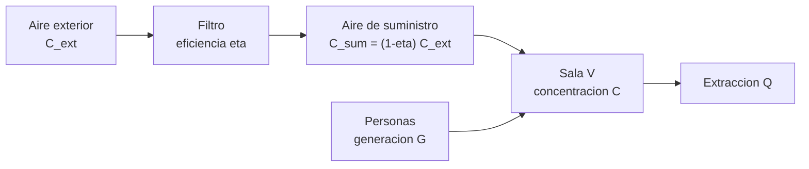

# B90-C02 — Buenas prácticas de sala limpia

<!-- nav:top -->
[🏠 Programa](../../../../README.md) · [📚 Bloque B90](../../../tronco-comun/B90-integracion-ensayos-y-calificacion-espacial.md) · [← Anterior: B90-C01 — Plan de ensamblaje e integración](../B90-C01-plan-de-ensamblaje-e-integracion/CLASE.md) · [Siguiente: B90-C03 — Protección frente a ESD →](../B90-C03-proteccion-frente-a-esd/CLASE.md)
<!-- /nav -->

## 1. Ubicación, nivel y alcance

Clase 2 del bloque B90. Nivel N3. La integración de hardware espacial se hace en una **sala limpia**: un recinto donde se controlan las partículas del aire (y, según el caso, la temperatura, la humedad y los microbios). Aquí cuantificas el control con un **balance de partículas**: cuántas partículas por metro cúbico admite cada clase, cuántas genera la gente y cuánto tarda la sala en recuperarse tras un evento. Todos los datos son **sintéticos**: una sala de ejemplo de 60 m³.

## 2. Por qué esta clase existe

Una partícula sobre una óptica, un sello o un contacto puede degradar una misión; las partículas llegan con el aire, la ropa y las herramientas. La decisión central: **¿qué clase de sala puede sostener esta actividad con este número de personas, y cuánto hay que esperar tras una perturbación?**

## 3. Lo que podrás hacer al terminar

1. Calcular el límite de partículas por metro cúbico de una clase y de un tamaño dado.
2. Calcular las renovaciones de aire por hora de una sala.
3. Plantear y resolver el balance de partículas en mezcla perfecta.
4. Calcular el tiempo de recuperación tras un evento y comprobarlo con RK4.
5. Estimar la mejor clase que sostiene un número de personas.
6. Separar lo consultado (prácticas de sala en protección planetaria) de lo no consultado (norma ISO) y de lo sintético.

La evidencia es la **ficha de una sala con su tiempo de recuperación** del ejercicio 12 (sección 20).

## 4. Con qué llegas y cómo comprobarlo

1. ¿Qué es una concentración en partículas/m³?
2. ¿Qué es un caudal de aire en m³/s?
3. ¿Qué es una ecuación diferencial de primer orden y cuál es su solución exponencial?
4. ¿Qué es una mezcla perfecta?
5. ¿Qué es una comprobación independiente?

<details>
<summary>Ver respuestas</summary>

1. El número de partículas contenidas en un metro cúbico de aire. 2. El volumen de aire que pasa por segundo. 3. `dC/dt = −(C − C_ss)/τ` tiene solución `C = C_ss + (C₀ − C_ss) e^{−t/τ}`. 4. La suposición de que el aire del recinto tiene la misma concentración en todos los puntos. 5. Resolver lo mismo por otro método y comparar.
</details>

Con cuatro o cinco aciertos, sigue; si no, repasa los prerrequisitos.

## 5. Un caso de contexto y casos de referencia

Una sala de 5 m × 4 m × 3 m (60 m³) recibe 0,60 m³/s de aire filtrado: **36 renovaciones por hora**. Con 2 personas, cada una generando 5 × 10⁴ partículas/s mayores o iguales a 0,5 µm, la concentración en régimen es **168 417 part/m³**, dentro del límite de una clase ISO 7 (351 676) y 48 veces el de una ISO 5. Los valores de generación, caudal y filtro son **sintéticos**.

## 6. Vocabulario

**Sala limpia:** recinto con control de partículas y otros contaminantes. **Clase de limpieza:** número `N` que fija el límite de partículas por tamaño. **Filtro de alta eficiencia:** filtro que retiene la fracción `η` de las partículas del aire que lo cruza. **Renovaciones por hora (ACH):** `Q·3600/V`. **Mezcla perfecta:** concentración uniforme en el recinto. **Régimen:** estado donde la concentración ya no cambia. **Recuperación:** tiempo para volver bajo un límite tras un evento.

## 7. Modelo mental: un balde con grifo, desagüe y fuente



*Descripción textual:* el aire exterior pasa por el filtro y entra con muy pocas partículas; dentro de la sala las personas generan partículas; la extracción retira aire con la concentración de la sala.

Analogía: un balde con un grifo de agua casi limpia, una fuente de tinta (la gente) y un desagüe: el nivel de tinta se estabiliza donde lo que entra iguala lo que sale. Límite: en una sala real el aire no se mezcla perfecto; hay zonas con más partículas (detrás de un equipo, cerca de una puerta).

## 8. La explicación, paso a paso

### 8.1 Qué hace una sala limpia en un programa espacial

La página de protección planetaria de NASA (F5) describe que las naves se construyen en salas limpias que cumplen especificaciones ISO de partículas y flujo de aire, con personal totalmente vestido, y que el hardware limpio debe protegerse de la recontaminación hasta el lanzamiento. Para la categoría III menciona salas de clase 100 000 «o mejor». La clasificación ISO exacta de cada sala la fija la norma ISO 14644-1, que no se consultó.

### 8.2 Límite por clase

La relación de clasificación es `C_N(D) = 10^N (0,1/D)^2,08` (partículas/m³, `D` en µm), relación conocida que no se consultó en el texto de la norma. Para 0,5 µm: ISO 5 → 3 517; ISO 6 → 35 168; ISO 7 → 351 676; ISO 8 → 3 516 757 part/m³ (la tabla de la norma redondea a 3 520, 35 200, 352 000 y 3 520 000). Cada clase multiplica el límite por 10.

### 8.3 Balance de partículas

Con `V` el volumen, `Q` el caudal de suministro, `C_sum = (1 − η) C_ext` la concentración del aire filtrado y `G` la generación:
`V dC/dt = Q (C_sum − C) + G`, con régimen `C_ss = C_sum + G/Q` y solución
`C(t) = C_ss + (C₀ − C_ss) e^{−Q t/V}`.
Con `Q = 0,60 m³/s`, `η = 0,99995`, `C_ext = 3,5 × 10⁷` y `G = 10⁵ part/s` (2 personas): `C_sum = 1 750` y `C_ss = 168 417 part/m³`.

### 8.4 Recuperación y efecto de las personas

Tras un evento que lleva la concentración a 10 veces el límite ISO 7 (3,52 × 10⁶), el tiempo para bajar a 90 % del límite es `t = (V/Q) ln[(C₀ − C_ss)/(C_obj − C_ss)] = 312 s = 5,2 min`. La constante de tiempo `V/Q` vale 100 s.

| Personas | `C_ss` (part/m³) | Mejor clase |
|---|---|---|
| 0 | 1 750 | ISO 5 |
| 2 | 168 417 | ISO 7 |
| 4 | 335 083 | ISO 7 |
| 8 | 668 417 | ISO 8 |

## 9. Magnitudes, símbolos y unidades

| Símbolo | Qué es | Unidad | Valor / nota |
|---|---|---|---|
| `N` | clase de limpieza | — | 5 a 8 |
| `D` | tamaño de partícula | µm | 0,5 |
| `V` | volumen de la sala | m³ | 60 |
| `Q` | caudal de suministro | m³/s | 0,60 |
| `η` | eficiencia del filtro | — | 0,99995 (sintético) |
| `G` | generación | part/s | 10⁵ (2 personas, sintético) |
| `C_ss` | concentración en régimen | part/m³ | 168 417 |

## 10. Convenciones y referencias

Partículas ≥ 0,5 µm, concentración en partículas por metro cúbico. Modelo de mezcla perfecta, sin deposición en superficies ni aire de retorno. Sistema de referencia: no aplica. Tolerancia: RK4 (paso 0,5 s) frente a solución exacta con error relativo `< 10⁻⁶`. Todos los parámetros de la sala y la generación por persona son **sintéticos**.

## 11. De dónde sale lo que afirmamos

| ID | Fuente | Localizador | Respalda | Estado |
|---|---|---|---|---|
| F5 | NASA, Planetary Protection (SMA) — https://sma.nasa.gov/sma-disciplines/planetary-protection (consultada 2026-11-10) | página (leída hasta el carácter 100 000 de 123 869) | categorías I–V, sala limpia ISO, métodos de reducción de biocarga, definición y medición de biocarga, límite de 300 esporas/m² para el rover de Marte según la página, y documentos asociados | Consultada (parcial) |
| F9 | ECSS, listado de normas activas — https://ecss.nl/standards/active-standards/ (consultada 2026-11-10) | solo títulos y fechas | existencia, código y fecha de ECSS-E-ST-10-02C Rev.1, ECSS-E-ST-10-03C Rev.1, ECSS-E-ST-20-07C Rev.2, ECSS-Q-ST-70-01C Rev.1, ECSS-E-ST-20-06C Rev.1, ECSS-Q-ST-70-55C y ECSS-U-ST-20C | Consultada (solo títulos y fechas; el texto de las normas no se consultó) |
| — | ISO 14644-1 (clasificación de salas limpias) | — | — | No consultada (de pago) |
| — | Relación `C_N(D) = 10^N (0,1/D)^2,08` y balance de partículas en mezcla perfecta | — | las verifica el laboratorio (valores de 3 517 y 351 676 frente a la tabla conocida y RK4 frente a la solución exacta) | No consultada en una fuente concreta |

Límites: F5 describe la práctica de sala limpia sin dar el balance; F9 solo confirma que existe ECSS-Q-ST-70-01C Rev.1 (limpieza y control de contaminación, 15-10-2025) y ECSS-Q-ST-70-50C (monitoreo de partículas); su contenido no se consultó.

## 12. Cómo ver el balance

| Magnitud | Valor |
|---|---|
| Renovaciones | 36,0 1/h |
| `C_ss` con 2 personas | 168 417 part/m³ |
| `t` de recuperación | 312 s |
| error RK4 | 7,6 × 10⁻¹² |

Descripción larga: tras el evento la concentración decae exponencialmente hacia 168 417; el límite ISO 7 se alcanza a los 5,2 min.

## 13. Ejemplo trabajado: cuánto se tarda en volver a ISO 7

**Paso 1 · Datos.** `V/Q = 60/0,6 = 100 s`; `C₀ = 3 516 757`; `C_obj = 316 508`; `C_ss = 168 417`.

**Paso 2 · Cociente.** `(C₀ − C_ss)/(C_obj − C_ss) = 3 348 340/148 091 = 22,61`.

**Paso 3 · Tiempo.** `t = 100 ln 22,61 = 312 s`.

**Paso 4 · Comprobación.** RK4 con paso de 0,5 s da 316 269,9 part/m³, igual al valor exacto con error `7,6 × 10⁻¹²`.

## 14. Distintas formas de describir el control

**Por concentración:** el balance de esta clase. **Por renovaciones de aire:** 36 por hora aquí. **Por dosis en la superficie:** depósito sobre el hardware (C04). Son vistas del mismo control con distinta pregunta.

## 15. Práctica guiada

**Ejercicio 1 · con los pasos indicados.** Calcula las renovaciones por hora de una sala de 80 m³ con 0,5 m³/s. *Pasos:* `Q·3600`, dividir por `V`.

<details><summary>Solución comentada</summary>

`0,5 × 3600/80 = 22,5` renovaciones por hora.
</details>

**Ejercicio 2 · con una pista.** Calcula el límite ISO 6 a 0,5 µm. *Pista:* `10⁶ × 0,2^2,08`.

<details><summary>Solución comentada</summary>

`0,2^2,08 = 0,03517`; límite `= 35 168 part/m³`.
</details>

**Ejercicio 3 · casi autónomo.** Calcula `C_ss` con 4 personas.

<details><summary>Solución comentada</summary>

`1 750 + 4 × 5 × 10⁴/0,6 = 335 083 part/m³`.
</details>

## 16. Práctica autónoma, transferencia e integrador

**Ejercicio 4 · autónomo.** Con 2 personas, ¿cuántas veces el límite ISO 5 es `C_ss`?

<details><summary>Solución comentada</summary>

`168 417/3 517 = 47,9`.
</details>

**Ejercicio 5 · autónomo.** Si el caudal sube al doble (1,2 m³/s), ¿cuál es `C_ss` con 2 personas y `C_sum` igual?

<details><summary>Solución comentada</summary>

`1 750 + 10⁵/1,2 = 85 083 part/m³` (la mitad de la generación por m³/s).
</details>

**Ejercicio 6 · autónomo.** ¿Cuál es la constante de tiempo `V/Q` con el caudal doble?

<details><summary>Solución comentada</summary>

`60/1,2 = 50 s`: la recuperación es el doble de rápida.
</details>

**Ejercicio 7 · autónomo.** ¿Por qué no es posible llegar a ISO 5 con 2 personas y este caudal?

<details><summary>Solución comentada</summary>

Porque `C_ss ≥ G/Q = 166 667` es 47 veces el límite ISO 5; hace falta reducir `G` (menos personas, ropa) o subir `Q`.
</details>

**Ejercicio 8 · autónomo.** Si `η` baja a 0,999, ¿cuánto vale `C_sum`?

<details><summary>Solución comentada</summary>

`(1 − 0,999) × 3,5 × 10⁷ = 35 000 part/m³`: un filtro degradado multiplica por 20 el aire de suministro.
</details>

**Ejercicio 9 · transferencia.** **Transferencia.** Un colega afirma que su sala «es ISO 7» porque tiene los mismos números. ¿Es válido?

<details><summary>Solución comentada</summary>

No: la clasificación se mide con un contador de partículas en puntos definidos; el modelo solo estima el régimen con datos sintéticos.
</details>

**Ejercicio 10 · transferencia.** **Transferencia.** ¿Qué cambia si se quiere controlar partículas de 5 µm?

<details><summary>Solución comentada</summary>

`C_N(5) = 10^N × 0,02^2,08` es mucho menor (en ISO 7: 2 930 part/m³ frente a 351 676 a 0,5 µm); además, las partículas grandes se depositan por gravedad y el modelo de mezcla perfecta no sirve.
</details>

**Ejercicio 11 · transferencia.** **Transferencia.** ¿Por qué un mismo evento deja la sala fuera de clase solo unos minutos pero el hardware puede quedar contaminado?

<details><summary>Solución comentada</summary>

El aire se recupera con `V/Q`, pero las partículas depositadas en superficies no se van con el aire; el control de depósito es el tema de C04.
</details>

**Ejercicio 12 · integrador.** **Integrador.** Elabora tu *ficha de sala con su tiempo de recuperación*: volumen, caudal, renovaciones, `C_ss` por número de personas, mejor clase, tiempo de recuperación y lista de qué es consultado, no consultado y sintético.

<details><summary>Solución comentada</summary>

Secciones 8.2–8.4 y la salida del laboratorio.
</details>

## 17. Laboratorio: balance de partículas de una sala

El script [sala_limpia.py](sala_limpia.py) calcula los límites por clase, las renovaciones, el régimen y el tiempo de recuperación, y **comprueba** que RK4 coincide con la solución exacta (error `< 10⁻⁶`) y que cada clase multiplica el límite por 10. Usa la biblioteca común [b90_comun.py](../b90_comun.py).

**Datos:** sala, caudal, filtro y generación **sintéticos**; la relación de clase no se consultó en la norma. **Predice antes de ejecutar:** ¿cumple ISO 5 la sala con 2 personas? (No: 47,9 veces el límite.) Ejecución del 2026-11-10 (Python 3.12.9, numpy 2.4.4):

```text
Python 3.12.9 | numpy 2.4.4
Datos SINTETICOS: sala de 5 m x 4 m x 3 m, 2 personas; particulas >= 0.5 um
clase ISO   limite a 0.5 um [part/m3]
  ISO 5             3517
  ISO 6            35168
  ISO 7           351676
  ISO 8          3516757
V = 60 m3 ; Q = 0.6 m3/s ; renovaciones = 36.0 1/h ; C_sum = 1750 ; C_ss = 168417 part/m3
  ISO 5: NO CUMPLE en regimen (C_ss/limite = 47.89)
  ISO 7: CUMPLE en regimen (C_ss/limite = 0.48)
Evento: C0 = 3516757 ; objetivo = 316508 ; tiempo de recuperacion = 312 s = 5.2 min
RK4 en t = 312.0 s: 316269.9 ; exacto = 316269.9 ; error relativo = 7.63e-12
  0 personas: C_ss =       1750 part/m3  -> mejor clase cumplida a 0.5 um: ISO 5
  2 personas: C_ss =     168417 part/m3  -> mejor clase cumplida a 0.5 um: ISO 7
  4 personas: C_ss =     335083 part/m3  -> mejor clase cumplida a 0.5 um: ISO 7
  8 personas: C_ss =     668417 part/m3  -> mejor clase cumplida a 0.5 um: ISO 8
Pruebas superadas.
```

```bash
python programa/clases/B90/B90-C02-buenas-practicas-de-sala-limpia/sala_limpia.py
```

**Límites:** mezcla perfecta, sin deposición, una sola fuente de partículas, un tamaño de partícula, sin humedad ni presión diferencial.

## 18. Errores frecuentes y cómo corregirlos

**Creer que una sala limpia no genera partículas.** Cuenta la generación de las personas (8.3)

**Confundir la clase con la limpieza de la superficie.** El aire y las superficies se controlan por separado (C04)

**Presentar los parámetros de ejemplo como los de una sala real.** Revisa la sección 10

## 19. Cómo sabrás que vas bien

Tras la sección 8: ¿qué pasa con `C_ss` si el caudal se duplica? Si dudas, repasa el ejercicio 5. Tras el laboratorio: ¿qué comprueba RK4? (ver sección 17).

## 20. Qué entregas y cómo se evalúa

El producto es tu **ficha de sala con su tiempo de recuperación** (ejercicio 12).

| Criterio | Inicial | En desarrollo | Logrado | Destacado |
|---|---|---|---|---|
| Conceptos | Los confunde | Parciales | Explica el método y su dominio | Explica los límites y las alternativas |
| Cálculo | Sin unidades | Con errores | Resultados con unidades y comprobados | Resuelve casos nuevos |
| Numérico | Sin comprobar | Un caso | Verifica con una comprobación independiente en varios casos | Interpreta las diferencias y los fallos |
| Fuentes | Sin fuente | Sin fecha | Fuentes con fecha y estado | Declara lo sintético y lo no consultado |
| Límites | No los nombra | Uno | Tres | Discute qué falta del modelo |

**Condiciones críticas (no se compensan con promedio):** rotular los datos como sintéticos; verificar cada resultado con una comprobación independiente; citar solo lo consultado.

## 21. Ética, seguridad y límites

Clase educativa: la sala, los filtros y las generaciones son de ejemplo y no sustituyen la clasificación y calificación de una sala real por personal acreditado. Accesibilidad: tablas equivalentes a las gráficas, fórmulas en texto, ejercicios sin conexión.

## 22. Para cerrar y seguir

Con 36 renovaciones por hora y 2 personas, la sala de ejemplo sostiene una clase ISO 7 y se recupera de un evento en 5,2 min. Queda una pregunta: ¿qué ocurre con la electricidad estática que genera ese mismo personal al moverse?

**Glosario español–inglés.** sala limpia · *cleanroom*; partícula · *particle*; renovaciones por hora · *air changes per hour*; filtro de alta eficiencia · *HEPA filter*; régimen · *steady state*; mezcla perfecta · *well-mixed*.

**Continuidad.** [B90-C03](../B90-C03-proteccion-frente-a-esd/CLASE.md) trata la protección frente a la descarga electrostática.

**Referencias:** ver sección 11.

<!-- nav:bottom -->
---

[← Anterior: B90-C01 — Plan de ensamblaje e integración](../B90-C01-plan-de-ensamblaje-e-integracion/CLASE.md) · [📚 Bloque B90](../../../tronco-comun/B90-integracion-ensayos-y-calificacion-espacial.md) · [Siguiente: B90-C03 — Protección frente a ESD →](../B90-C03-proteccion-frente-a-esd/CLASE.md)
<!-- /nav -->
