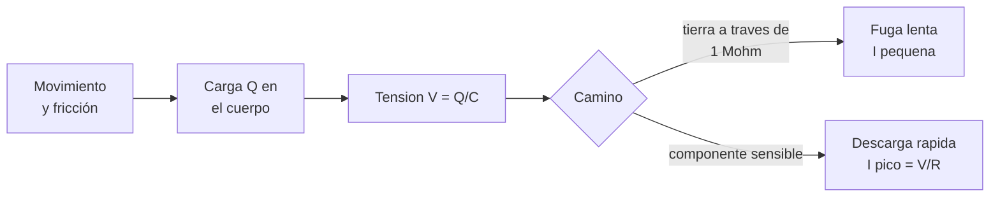

# B90-C03 — Protección frente a ESD

<!-- nav:top -->
[🏠 Programa](../../../../README.md) · [📚 Bloque B90](../../../tronco-comun/B90-integracion-ensayos-y-calificacion-espacial.md) · [← Anterior: B90-C02 — Buenas prácticas de sala limpia](../B90-C02-buenas-practicas-de-sala-limpia/CLASE.md) · [Siguiente: B90-C04 — Control de contaminación →](../B90-C04-control-de-contaminacion/CLASE.md)
<!-- /nav -->

## 1. Ubicación, nivel y alcance

Clase 3 del bloque B90. Nivel N3. La **descarga electrostática** (ESD) es el paso rápido de carga entre dos objetos a distinto potencial. Puede dañar un componente sin que el operador lo note. Aquí modelas la descarga como un circuito RC (el modelo convencional de cuerpo humano), calculas carga, energía y corriente pico, y ves cómo una resistencia de fuga controla el riesgo. Los parámetros del modelo son **convencionales** (no consultados en el texto de una norma) y los umbrales de sensibilidad y tensiones son **sintéticos**.

## 2. Por qué esta clase existe

Un componente electrónico puede quedar con una falla latente tras una descarga que nadie sintió: una persona percibe una chispa solo por encima de unos miles de voltios (orden de magnitud no consultado), por encima de lo que puede dañar a un componente sensible. La decisión central: **¿cómo se evita que la carga se acumule y cómo se limita la corriente cuando se descarga?**

## 3. Lo que podrás hacer al terminar

1. Calcular carga, energía y corriente pico de una descarga RC.
2. Integrar numéricamente la corriente y comprobar la energía disipada.
3. Comparar la tensión de descarga con un umbral de sensibilidad.
4. Calcular el tiempo de decaimiento de la tensión del cuerpo según la resistencia de fuga.
5. Explicar por qué una resistencia mayor reduce la corriente pico pero alarga el decaimiento.
6. Separar lo consultado (existencia de S20.20) de lo convencional y de lo sintético.

La evidencia es el **análisis de una descarga y su control** del ejercicio 12 (sección 20).

## 4. Con qué llegas y cómo comprobarlo

1. ¿Qué relación hay entre carga, capacitancia y tensión?
2. ¿Qué es la constante de tiempo `τ = RC`?
3. ¿Qué energía almacena un capacitor?
4. ¿Qué es la ley de Ohm?
5. ¿Qué es una comprobación independiente?

<details>
<summary>Ver respuestas</summary>

1. `Q = C V`. 2. El tiempo en que la tensión cae a `1/e` (37 %). 3. `E = ½ C V²`. 4. `V = I R`. 5. Calcular lo mismo por otro método y comparar.
</details>

Con cuatro o cinco aciertos, sigue; si no, repasa los prerrequisitos.

## 5. Un caso de contexto y casos de referencia

Un operador se mueve en la sala y su cuerpo (150 pF) acumula 0,1 µC: **667 V**. Si toca una pista de circuito, el modelo de descarga de 100 pF a través de 1,5 kΩ con 2 000 V libera **200 µJ** con una corriente pico de **1,33 A** y una constante de tiempo de **150 ns**. Con una resistencia de fuga de 1 MΩ la corriente pico de la tensión corporal cae a 0,67 mA. Todo es **sintético** o convencional.

## 6. Vocabulario

**ESD:** descarga electrostática. **Modelo de cuerpo humano:** circuito RC que representa la descarga de una persona. **Carga triboeléctrica:** carga generada por contacto y separación de materiales. **Resistencia de fuga:** camino resistivo que permite disipar la carga lentamente. **Falla latente:** daño que no se manifiesta hasta después. **Zona protegida contra ESD:** área con control de carga (superficies disipativas, puesta a tierra, ropa).

## 7. Modelo mental: un capacitor que se vacía por una resistencia



*Descripción textual:* el movimiento carga el cuerpo, la carga produce una tensión `V = Q/C`; si hay un camino resistivo a tierra la carga se disipa lentamente con corriente pequeña, y si el camino es un componente sensible se produce una descarga rápida con corriente pico `V/R`.

Analogía: una olla con agua puede vaciarse por un grifo (lento y seguro) o por un tubo ancho que golpea una pieza delicada. Límite: la analogía no refleja que la tensión depende de la capacitancia, que cambia con la posición del cuerpo.

## 8. La explicación, paso a paso

### 8.1 Qué se sabe de las normas

La ESD Association (F11) publica ANSI/ESD S20.20 (versión 2021 citada en su página) y su página indica que el Departamento de Defensa de EE. UU. pasó de MIL-STD-1686C a S20.20; no da su título completo ni sus requisitos. ECSS mantiene ECSS-E-ST-20-06C Rev.1 *Spacecraft charging* (15-05-2019), que es de carga de naves y no de manipulación de componentes; su texto no se consultó (F9). Los valores de modelo de esta clase son convencionales y no se leyeron en una norma.

### 8.2 El circuito de descarga

Un capacitor `C` cargado a `V` se descarga por `R`: `i(t) = (V/R) e^{−t/τ}` con `τ = RC`. La carga es `Q = C V`, la energía `E = ½ C V²` y la corriente pico `I = V/R`. Con `C = 100 pF` y `R = 1,5 kΩ`: `τ = 150 ns`.

| `V` (V) | `Q` (nC) | `E` (µJ) | `I` pico (A) |
|---|---|---|---|
| 250 | 25,0 | 3,1 | 0,167 |
| 500 | 50,0 | 12,5 | 0,333 |
| 1 000 | 100,0 | 50,0 | 0,667 |
| 2 000 | 200,0 | 200,0 | 1,333 |
| 4 000 | 400,0 | 800,0 | 2,667 |
| 8 000 | 800,0 | 3 200,0 | 5,333 |

Dato clave: la energía crece con `V²`; dos veces la tensión son cuatro veces la energía.

### 8.3 Verificación numérica

Integrando `i(t)` con la regla del trapecio hasta `12 τ` se obtiene `Q = 199,9988 nC` (fórmula 200,0000) y, integrando `i² R`, `E = 200,0000 µJ` (fórmula 200,0000). La pequeña diferencia de carga viene de truncar la cola de la exponencial en `12 τ`.

### 8.4 Control por resistencia de fuga

El cuerpo con `C_b = 150 pF` y `Q₀ = 0,1 µC` queda a `V_b = 667 V`. Conectado a tierra por una resistencia `R_f` decae con `τ_f = R_f C_b` y la corriente pico es `V_b/R_f`:

| `R_f` (Ω) | `τ_f` (s) | tiempo hasta 100 V (s) | `I` pico (A) |
|---|---|---|---|
| 10⁶ | 1,5 × 10⁻⁴ | 2,8 × 10⁻⁴ | 6,7 × 10⁻⁴ |
| 10⁹ | 0,15 | 0,28 | 6,7 × 10⁻⁷ |
| 10¹¹ | 15 | 28,5 | 6,7 × 10⁻⁹ |

Una resistencia de 1 MΩ disipa la carga en una fracción de milisegundo con 0,67 mA; una de 10¹¹ Ω la limita a nanoamperios pero tarda casi 30 s.

## 9. Magnitudes, símbolos y unidades

| Símbolo | Qué es | Unidad | Valor / nota |
|---|---|---|---|
| `C` | capacitancia del modelo | pF | 100 (convencional) |
| `R` | resistencia de descarga | Ω | 1 500 (convencional) |
| `V` | tensión de descarga | V | 250 a 8 000 (ejemplo) |
| `Q`, `E`, `I` | carga, energía, corriente pico | nC, µJ, A | calculadas |
| `C_b`, `Q₀` | capacitancia y carga del cuerpo | pF, µC | 150, 0,1 (sintéticos) |
| `τ` | constante de tiempo | ns, s | 150 ns |

## 10. Convenciones y referencias

Unidades SI. Modelo: un solo capacitor y una sola resistencia, sin inductancia ni capacitancia parásita; no representa las formas de onda normalizadas que una norma especifica. Sistema de referencia: no aplica. Tolerancias: integración numérica frente a fórmula `< 10⁻⁴` relativo; Euler (paso 0,1 µs) frente a exponencial `< 10⁻³`. Umbrales de sensibilidad y tensiones: **sintéticos**.

## 11. De dónde sale lo que afirmamos

| ID | Fuente | Localizador | Respalda | Estado |
|---|---|---|---|---|
| F11 | ESD Association, Standards — https://www.esda.org/standards/ (consultada 2026-11-10) | página de normas | existencia de ANSI/ESD S20.20 (versión 2021) y que el DoD pasó de MIL-STD-1686C a S20.20; no da título completo ni contenido | Consultada (solo la mención) |
| F9 | ECSS, listado de normas activas — https://ecss.nl/standards/active-standards/ (consultada 2026-11-10) | solo títulos y fechas | existencia, código y fecha de ECSS-E-ST-10-02C Rev.1, ECSS-E-ST-10-03C Rev.1, ECSS-E-ST-20-07C Rev.2, ECSS-Q-ST-70-01C Rev.1, ECSS-E-ST-20-06C Rev.1, ECSS-Q-ST-70-55C y ECSS-U-ST-20C | Consultada (solo títulos y fechas; el texto de las normas no se consultó) |
| — | MIL-STD-461, MIL-STD-1540 y MIL-STD-810 | — | — | No consultada |
| — | Parámetros convencionales C = 100 pF, R = 1,5 kΩ del modelo de cuerpo humano; descarga RC | — | el laboratorio verifica solo la matemática del circuito (carga, energía, tiempos) | No consultada en una fuente concreta |

Límites: ninguna fuente consultada da requisitos de ESD ni niveles de sensibilidad; los umbrales de la clase son de ejemplo.

## 12. Cómo ver la descarga

| Magnitud | Valor |
|---|---|
| `τ` | 150 ns |
| `E` a 2 000 V | 200 µJ |
| `I` pico a 2 000 V | 1,333 A |
| `V_b` | 667 V |

Descripción larga: la corriente salta a `V/R` y decae exponencialmente; con mayor resistencia de fuga el pico baja y la cola se alarga.

## 13. Ejemplo trabajado: una descarga de 2 000 V

**Paso 1 · Datos.** `C = 100 pF`, `R = 1,5 kΩ`, `V = 2 000 V`.

**Paso 2 · Carga y energía.** `Q = 100×10⁻¹² × 2000 = 200 nC`; `E = ½ × 10⁻¹⁰ × 4×10⁶ = 200 µJ`.

**Paso 3 · Pico y tiempo.** `I = 2000/1500 = 1,333 A`; `τ = 150 ns`.

**Paso 4 · Comprobación.** La integración numérica de `i²R` da `200,0000 µJ`, igual a la fórmula.

## 14. Distintas formas de describir el riesgo

**Por tensión:** cuántos voltios tiene el cuerpo. **Por energía:** cuántos microjulios llegan al componente. **Por corriente pico:** cuántos amperios cruzan la unión. Un componente puede tener un umbral definido en cualquiera de las tres; esta clase compara tensiones por simplicidad.

## 15. Práctica guiada

**Ejercicio 1 · con los pasos indicados.** Calcula la energía de una descarga de 1 000 V con 100 pF. *Pasos:* `V²`, por `C`, entre 2.

<details><summary>Solución comentada</summary>

`E = ½ × 100×10⁻¹² × 10⁶ = 50 µJ`.
</details>

**Ejercicio 2 · con una pista.** Calcula la corriente pico a 4 000 V con 1,5 kΩ. *Pista:* `V/R`.

<details><summary>Solución comentada</summary>

`4000/1500 = 2,667 A`.
</details>

**Ejercicio 3 · casi autónomo.** ¿Qué tensión tiene un cuerpo de 150 pF con 0,3 µC?

<details><summary>Solución comentada</summary>

`V = Q/C = 0,3×10⁻⁶/150×10⁻¹² = 2 000 V`.
</details>

## 16. Práctica autónoma, transferencia e integrador

**Ejercicio 4 · autónomo.** Si se duplica la tensión, ¿cómo cambia la energía?

<details><summary>Solución comentada</summary>

Se cuadruplica (`E ∝ V²`).
</details>

**Ejercicio 5 · autónomo.** ¿Cuántas veces supera una descarga de 2 000 V el umbral sintético de 500 V?

<details><summary>Solución comentada</summary>

4 veces.
</details>

**Ejercicio 6 · autónomo.** Calcula `τ_f` con 1 GΩ y 150 pF.

<details><summary>Solución comentada</summary>

`10⁹ × 150×10⁻¹² = 0,15 s`.
</details>

**Ejercicio 7 · autónomo.** Calcula el tiempo para pasar de 667 V a 100 V con `τ_f = 0,15 s`.

<details><summary>Solución comentada</summary>

`t = 0,15 ln(6,67) = 0,285 s`.
</details>

**Ejercicio 8 · autónomo.** ¿Por qué no conviene unir directamente el cuerpo a tierra con 0 Ω?

<details><summary>Solución comentada</summary>

La corriente pico sería `V_b/R` sin límite: con una resistencia pequeña la descarga es violenta; una resistencia de fuga la mantiene lenta y limita la corriente (8.4).
</details>

**Ejercicio 9 · transferencia.** **Transferencia.** Un colega usa la tabla 8.2 para afirmar que su componente soporta «2 000 V». ¿Es válido?

<details><summary>Solución comentada</summary>

No: la tabla muestra cálculos de un circuito convencional; la sensibilidad de su componente la da su hoja de datos o su ensayo, no esta clase.
</details>

**Ejercicio 10 · transferencia.** **Transferencia.** ¿Qué ocurre con la tensión si el cuerpo se aleja del suelo y su capacitancia baja a 50 pF con la misma carga?

<details><summary>Solución comentada</summary>

`V = Q/C` sube a `0,1×10⁻⁶/50×10⁻¹² = 2 000 V`: separar el cuerpo de tierra triplica la tensión.
</details>

**Ejercicio 11 · transferencia.** **Transferencia.** ¿Por qué la ESD es un tema de integración y no solo de diseño?

<details><summary>Solución comentada</summary>

Porque el daño lo causa la manipulación (personas, herramientas, embalajes) durante el ensamblaje; el diseño solo fija la sensibilidad.
</details>

**Ejercicio 12 · integrador.** **Integrador.** Elabora tu *análisis de una descarga y su control*: tabla de carga, energía y corriente pico, tensión del cuerpo, efecto de la resistencia de fuga y lista de qué es consultado, convencional y sintético.

<details><summary>Solución comentada</summary>

Secciones 8.2–8.4 y la salida del laboratorio.
</details>

## 17. Laboratorio: descarga RC y fuga

El script [descarga_esd.py](descarga_esd.py) tabula carga, energía y corriente pico, integra numéricamente la descarga de 2 000 V y calcula el decaimiento con tres resistencias de fuga; **comprueba** carga y energía con tolerancia `10⁻⁴`, que una resistencia mayor limita la corriente y que Euler concuerda con la exponencial. Usa la biblioteca común [b90_comun.py](../b90_comun.py).

**Datos:** `C`, `R`, tensiones, carga y umbral **sintéticos o convencionales**; sin constantes con fuente. **Predice antes de ejecutar:** ¿cuánto vale la energía a 2 000 V? (200 µJ.) Ejecución del 2026-11-10 (Python 3.12.9, numpy 2.4.4):

```text
Python 3.12.9 | numpy 2.4.4
Datos SINTETICOS: parametros convencionales C = 100 pF, R = 1.5 kohm; tensiones de ejemplo
tau = R C = 150.0 ns
V [V]   Q [nC]   E [uJ]   I_pico [A]
   250     25.0      3.1      0.167
   500     50.0     12.5      0.333
  1000    100.0     50.0      0.667
  2000    200.0    200.0      1.333
  4000    400.0    800.0      2.667
  8000    800.0   3200.0      5.333
V = 2000 V: Q numerica = 199.9988 nC (formula 200.0000) ; E numerica = 200.0000 uJ (formula 200.0000)
Componente con umbral SINTETICO de 500 V: una descarga de 2000 V supera el umbral por factor 4.0
Tension del cuerpo con Q0 = 0.1 uC y C_b = 150 pF: 667 V
R de fuga [ohm]    tau [s]    t hasta 100 V [s]   I_pico [A]
      1e+06   1.500e-04       2.846e-04    6.667e-04
      1e+09   1.500e-01       2.846e-01    6.667e-07
      1e+11   1.500e+01       2.846e+01    6.667e-09
Euler (h = 0.1 us) tras un tau (150 us): 245.17 V ; exacto = 245.25 V
Pruebas superadas.
```

```bash
python programa/clases/B90/B90-C03-proteccion-frente-a-esd/descarga_esd.py
```

**Límites:** un solo capacitor y una sola resistencia; sin inductancia; sin humedad ni materiales; no se calcula el daño al componente.

## 18. Errores frecuentes y cómo corregirlos

**Creer que si no se siente no hay daño.** La percepción humana exige varios miles de voltios (orden de magnitud no consultado); un componente sensible puede dañarse con menos (sección 2)

**Usar 0 Ω hacia tierra.** Limita la corriente con resistencia de fuga (8.4)

**Presentar la tabla como niveles de una norma.** Revisa la sección 10

## 19. Cómo sabrás que vas bien

Tras la sección 8: ¿cómo cambia la energía si se duplica la tensión? Si dudas, repasa el ejercicio 4. Tras el laboratorio: ¿qué comprueba la integración numérica? (ver sección 17).

## 20. Qué entregas y cómo se evalúa

El producto es tu **análisis de una descarga y su control** (ejercicio 12).

| Criterio | Inicial | En desarrollo | Logrado | Destacado |
|---|---|---|---|---|
| Conceptos | Los confunde | Parciales | Explica el método y su dominio | Explica los límites y las alternativas |
| Cálculo | Sin unidades | Con errores | Resultados con unidades y comprobados | Resuelve casos nuevos |
| Numérico | Sin comprobar | Un caso | Verifica con una comprobación independiente en varios casos | Interpreta las diferencias y los fallos |
| Fuentes | Sin fuente | Sin fecha | Fuentes con fecha y estado | Declara lo sintético y lo no consultado |
| Límites | No los nombra | Uno | Tres | Discute qué falta del modelo |

**Condiciones críticas (no se compensan con promedio):** rotular los datos como sintéticos; verificar cada resultado con una comprobación independiente; citar solo lo consultado.

## 21. Ética, seguridad y límites

Clase educativa: los parámetros son convencionales y los umbrales de ejemplo; no sustituyen el programa de control de ESD de una instalación ni la sensibilidad medida de un componente. Accesibilidad: tablas equivalentes a las gráficas, fórmulas en texto, ejercicios sin conexión.

## 22. Para cerrar y seguir

Una descarga de 2 000 V en el modelo convencional libera 200 µJ y 1,33 A de pico; una resistencia de fuga de 1 MΩ la reduce a 0,67 mA. Queda una pregunta: además de partículas y cargas, ¿qué otras moléculas ensucian el hardware?

**Glosario español–inglés.** descarga electrostática · *electrostatic discharge (ESD)*; resistencia de fuga · *bleed resistor*; carga triboeléctrica · *triboelectric charge*; corriente pico · *peak current*; falla latente · *latent failure*.

**Continuidad.** [B90-C04](../B90-C04-control-de-contaminacion/CLASE.md) trata el control de contaminación molecular y de partículas.

**Referencias:** ver sección 11.

<!-- nav:bottom -->
---

[← Anterior: B90-C02 — Buenas prácticas de sala limpia](../B90-C02-buenas-practicas-de-sala-limpia/CLASE.md) · [📚 Bloque B90](../../../tronco-comun/B90-integracion-ensayos-y-calificacion-espacial.md) · [Siguiente: B90-C04 — Control de contaminación →](../B90-C04-control-de-contaminacion/CLASE.md)
<!-- /nav -->
