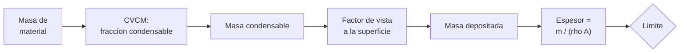

# B90-C04 — Control de contaminación

<!-- nav:top -->
[🏠 Programa](../../../../README.md) · [📚 Bloque B90](../../../tronco-comun/B90-integracion-ensayos-y-calificacion-espacial.md) · [← Anterior: B90-C03 — Protección frente a ESD](../B90-C03-proteccion-frente-a-esd/CLASE.md) · [Siguiente: B90-C05 — Documentación de interfaces →](../B90-C05-documentacion-de-interfaces/CLASE.md)
<!-- /nav -->

## 1. Ubicación, nivel y alcance

Clase 4 del bloque B90. Nivel N3. La contaminación del hardware espacial no es solo polvo: los materiales de la propia nave **desprenden moléculas** en vacío y estas pueden condensarse sobre una óptica, un radiador o un panel solar. Aquí calculas un **presupuesto de depósito molecular**: cuánta masa condensable aporta un material, qué fracción llega a una superficie sensible y qué espesor de película resulta. Todos los datos son **sintéticos**; los umbrales de la clase (1,0 % de pérdida de masa, 0,10 % de condensables y 10 nm) son **valores de ejemplo**, no los de una especificación.

## 2. Por qué esta clase existe

Una película de pocas decenas de nanómetros sobre un espejo puede cambiar su reflectancia o su absorción térmica sin que nada se vea. La decisión central: **¿qué materiales se admiten, cuánto se hornea y qué se aleja de las superficies sensibles?**

## 3. Lo que podrás hacer al terminar

1. Calcular pérdida total de masa (TML) y volátiles condensables (CVCM) de una muestra.
2. Convertir un material de la nave en una masa condensable.
3. Calcular el factor de vista entre una fuente y un receptor y comprobarlo numéricamente.
4. Estimar el espesor depositado y compararlo con un límite.
5. Calcular la eficiencia mínima de eliminación (*bakeout*) para cumplir.
6. Separar lo consultado (que los datos de desgasificación se reportan como TML y CVCM) de lo no consultado (umbrales) y de lo sintético.

La evidencia es el **presupuesto de depósito molecular** del ejercicio 12 (sección 20).

## 4. Con qué llegas y cómo comprobarlo

1. ¿Qué es el vacío y por qué las moléculas salen de un material en él?
2. ¿Qué es el ángulo sólido y qué es una fuente lambertiana?
3. ¿Qué significa porcentaje de masa?
4. ¿Qué es una integral numérica por celdas?
5. ¿Qué es una comprobación independiente?

<details>
<summary>Ver respuestas</summary>

1. Un espacio con presión mucho menor que la ambiente; los gases disueltos y adsorbidos escapan del material. 2. Una fuente cuya emisión por ángulo es proporcional al coseno respecto de su normal. 3. La masa de una parte dividida por la masa total, por cien. 4. Dividir el dominio en celdas, evaluar en el centro y sumar. 5. Calcular lo mismo por otro método y comparar.
</details>

Con cuatro o cinco aciertos, sigue; si no, repasa los prerrequisitos.

## 5. Un caso de contexto y casos de referencia

Un adhesivo de 50 g con TML de 0,90 % y CVCM de 0,050 % libera **25 mg de condensables**. Un receptor óptico de 50 mm × 50 mm a 0,32 m (centro desplazado 0,1 m) recibe una fracción de **7,12 × 10⁻³**, es decir **178 µg**, una película de **71 nm**: siete veces el límite de ejemplo de 10 nm. Un *bakeout* con eficiencia de 90 % la lleva a 7,1 nm. Todo es **sintético**.

## 6. Vocabulario

**Desgasificación:** liberación de gases de un material en vacío. **TML:** pérdida total de masa, `100 (mᵢ − m_f)/mᵢ`. **CVCM:** volátiles condensables recogidos, `100 m_col/mᵢ`. **Factor de vista:** fracción de la emisión de una superficie que alcanza a otra. **Bakeout:** calentamiento en vacío para expulsar volátiles antes del vuelo. **Película molecular:** capa de moléculas condensadas.

## 7. Modelo mental: de la masa a una película



*Descripción textual:* la masa del material y su fracción condensable dan la masa que puede condensarse; el factor de vista decide cuánta llega a la superficie y la densidad y el área convierten esa masa en un espesor que se compara con un límite.

Analogía: una olla que hierve en una cocina: parte del vapor llega al espejo del baño según lo lejos y cómo esté orientado. Límite: aquí todo lo que llega se pega; en la realidad el pegado depende de la temperatura de la superficie y de la molécula.

## 8. La explicación, paso a paso

### 8.1 Qué dicen las fuentes

La base de datos de desgasificación de NASA GSFC (F12) indica que los datos siguen la prueba ASTM E595 y reportan pérdida total de masa (TML) y volátiles condensables recogidos (CVCM) como medio para juzgar si un material sirve para vuelo espacial; la página no da umbrales ni condiciones de ensayo. *CubeSat 101* (F7) explica que el *bakeout* termovacío se exige en casi todas las misiones para que los materiales expulsen contaminantes antes del lanzamiento. ECSS-Q-ST-70-01C Rev.1 *Cleanliness and contamination control* existe (F9) y su texto no se consultó.

### 8.2 TML y CVCM

Una muestra de 200,0 mg que termina en 198,2 mg tiene `TML = 100 × 1,8/200 = 0,90 %`; si el colector gana 0,10 mg, `CVCM = 100 × 0,10/200 = 0,050 %`. Ambos cumplen los límites de ejemplo (1,0 % y 0,10 %).

### 8.3 Masa condensable y factor de vista

De 50 g de adhesivo: `m_cond = 50 g × 0,050/100 = 25 mg`. Para un receptor plano `A` visto desde una fuente puntual lambertiana:
`F = ∫ cos θ_e cos θ_r /(π r²) dA`.
Con el receptor a `z = 0,30 m`, desplazado `x = 0,10 m` y planos paralelos, la integral numérica (400 × 400 celdas) da `F = 7,1203 × 10⁻³` y la aproximación puntual `cos² A/(π r²) = 7,1620 × 10⁻³`: diferencia de 0,58 %.

### 8.4 Espesor y mitigación

`m_dep = m_cond F = 178,0 µg`; con `ρ = 1 000 kg/m³` y `A = 2,5 × 10⁻³ m²`: `espesor = m_dep/(ρ A) = 71,2 nm`. La eficiencia mínima de eliminación para llegar a 10 nm es `1 − 10/71,2 = 86,0 %`.

| Eficiencia | Espesor (nm) | ¿Cumple 10 nm? |
|---|---|---|
| 0 | 71,20 | No |
| 0,50 | 35,60 | No |
| 0,90 | 7,12 | Sí |
| 0,95 | 3,56 | Sí |

Con `cos θ_e cos θ_r = 0,9`, el espesor cae con `1/r²`: 318 nm a 0,15 m, 80 nm a 0,30 m y 20 nm a 0,60 m.

## 9. Magnitudes, símbolos y unidades

| Símbolo | Qué es | Unidad | Valor / nota |
|---|---|---|---|
| `TML`, `CVCM` | pérdida de masa y condensables | % | 0,90 y 0,050 |
| `m_cond` | masa condensable | mg | 25,0 |
| `F` | factor de vista | — | 7,12 × 10⁻³ |
| `m_dep` | masa depositada | µg | 178,0 |
| `ρ` | densidad de la película | kg/m³ | 1 000 (sintético) |
| `espesor` | espesor depositado | nm | 71,2 |

## 10. Convenciones y referencias

Fuente puntual lambertiana, receptor plano paralelo, sin reflexiones ni reevaporación; coeficiente de pegado 1. Unidades: g, mg, µg, m, nm. Sistema de referencia: origen en la fuente, `z` hacia el receptor. Tolerancia: integral numérica frente a aproximación puntual `< 3 %`. Los límites (1,0 %, 0,10 %, 10 nm), la masa de adhesivo, la densidad y la geometría son **sintéticos**.

## 11. De dónde sale lo que afirmamos

| ID | Fuente | Localizador | Respalda | Estado |
|---|---|---|---|---|
| F12 | NASA GSFC, Outgassing Database — https://etd.gsfc.nasa.gov/capabilities/outgassing-database/ (consultada 2026-11-10) | página | los datos de desgasificación siguen ASTM E595 y reportan pérdida total de masa (TML) y volátiles condensables recogidos (CVCM); la página no da umbrales | Consultada |
| F7 | NASA CubeSat Launch Initiative, CubeSat 101: Basic Concepts and Processes for First-Time CubeSat Developers (octubre de 2017) — PDF https://www.nasa.gov/wp-content/uploads/2017/03/nasa_csli_cubesat_101_508.pdf (consultada 2026-11-10 con PyMuPDF) | capítulo 6, secciones 6.9.2 y 6.9.3 y prueba DITL | el ICD fija niveles y duraciones de vibración y bakeout; contenido mínimo de los informes; no modificar el hardware tras el ensayo; el ciclado termovacío no se exige habitualmente | Consultada |
| F9 | ECSS, listado de normas activas — https://ecss.nl/standards/active-standards/ (consultada 2026-11-10) | solo títulos y fechas | existencia, código y fecha de ECSS-E-ST-10-02C Rev.1, ECSS-E-ST-10-03C Rev.1, ECSS-E-ST-20-07C Rev.2, ECSS-Q-ST-70-01C Rev.1, ECSS-E-ST-20-06C Rev.1, ECSS-Q-ST-70-55C y ECSS-U-ST-20C | Consultada (solo títulos y fechas; el texto de las normas no se consultó) |
| — | Texto de las normas ECSS (verificación, ensayos, EMC, limpieza, carga de nave) | — | — | No consultada |
| — | Definiciones de TML y CVCM como cocientes de masa, factor de vista lambertiano y espesor `m/(ρA)` | — | las verifica el laboratorio con integración numérica | No consultada en una fuente concreta |
| — | Umbrales de TML y CVCM de uso común | — | usados solo como límites de ejemplo | No consultada (F12 no los da) |

Límites: ninguna fuente consultada da umbrales ni geometrías; el presupuesto es didáctico.

## 12. Cómo ver el presupuesto

| Magnitud | Valor |
|---|---|
| `m_cond` | 25,0 mg |
| `F` (numérico) | 7,1203 × 10⁻³ |
| espesor | 71,2 nm |
| eficiencia mínima | 86,0 % |

Descripción larga: el espesor es proporcional a la masa condensable y al factor de vista; baja a cero cuando el *bakeout* elimina todo y cae con el cuadrado de la distancia.

## 13. Ejemplo trabajado: ¿cumple el receptor?

**Paso 1 · Condensables.** `50 g × 0,050/100 = 25 mg`.

**Paso 2 · Factor de vista.** `F = 7,1203 × 10⁻³` (integral numérica).

**Paso 3 · Masa y espesor.** `m_dep = 25 mg × F = 178,0 µg`; espesor `= 71,2 nm`.

**Paso 4 · Decisión.** 71,2 > 10 nm: no cumple sin mitigar; con *bakeout* de 90 % da 7,12 nm y cumple.

## 14. Distintas formas de describir la contaminación

**Por material:** TML y CVCM de cada pieza. **Por ruta:** factor de vista y temperaturas de las superficies. **Por efecto:** espesor, transmitancia o cambio de absortividad. Esta clase une las dos primeras para llegar al espesor; el efecto requiere datos ópticos que no se tratan.

## 15. Práctica guiada

**Ejercicio 1 · con los pasos indicados.** Calcula `TML` y `CVCM` de una muestra de 100,0 mg que termina en 99,3 mg con 0,05 mg en el colector. *Pasos:* diferencia, cociente, por cien.

<details><summary>Solución comentada</summary>

`TML = 100 × 0,7/100 = 0,70 %`; `CVCM = 100 × 0,05/100 = 0,050 %`.
</details>

**Ejercicio 2 · con una pista.** Calcula la masa condensable de 200 g con CVCM de 0,08 %. *Pista:* `m × CVCM/100`.

<details><summary>Solución comentada</summary>

`200 × 0,0008 = 0,16 g = 160 mg`.
</details>

**Ejercicio 3 · casi autónomo.** Con `F = 7,12 × 10⁻³` y 25 mg, calcula la masa depositada.

<details><summary>Solución comentada</summary>

`25 mg × 7,12×10⁻³ = 0,178 mg = 178 µg`.
</details>

## 16. Práctica autónoma, transferencia e integrador

**Ejercicio 4 · autónomo.** Calcula el espesor de 178 µg sobre 25 cm² con ρ = 1 000 kg/m³.

<details><summary>Solución comentada</summary>

`1,78×10⁻⁷ kg/(1000 × 2,5×10⁻³ m²) = 7,12×10⁻⁸ m = 71,2 nm`.
</details>

**Ejercicio 5 · autónomo.** ¿Qué eficiencia de eliminación hace falta si el límite es 20 nm?

<details><summary>Solución comentada</summary>

`1 − 20/71,2 = 71,9 %`.
</details>

**Ejercicio 6 · autónomo.** Si el receptor se aleja de 0,30 a 0,60 m (cos² fijo), ¿cómo cambia el espesor?

<details><summary>Solución comentada</summary>

Se divide por 4: de 79,6 a 19,9 nm (tabla 8.4).
</details>

**Ejercicio 7 · autónomo.** ¿Cuántas veces supera el límite de ejemplo el depósito sin mitigar?

<details><summary>Solución comentada</summary>

`71,2/10 = 7,1` veces.
</details>

**Ejercicio 8 · autónomo.** ¿Por qué el error de la aproximación puntual es solo de 0,58 %?

<details><summary>Solución comentada</summary>

Porque el receptor (5 cm) es pequeño frente a la distancia (0,32 m): `cos²/r²` casi no varía sobre su superficie.
</details>

**Ejercicio 9 · transferencia.** **Transferencia.** Un colega usa los 10 nm como límite de su misión. ¿Es válido?

<details><summary>Solución comentada</summary>

No: es un valor de ejemplo; el límite de una misión sale de su especificación de contaminación.
</details>

**Ejercicio 10 · transferencia.** **Transferencia.** ¿Qué cambia si la superficie receptora está muy fría y la fuente muy caliente?

<details><summary>Solución comentada</summary>

El pegado aumenta (la superficie fría condensa más) y la desgasificación también; el modelo con pegado 1 subestimaría la fuente y es conservador solo para el pegado.
</details>

**Ejercicio 11 · transferencia.** **Transferencia.** ¿Por qué se hornea el hardware en vacío antes de integrar la óptica?

<details><summary>Solución comentada</summary>

Porque el *bakeout* hace que la materia liberable salga en tierra y no sobre la óptica en órbita (F7); en términos del modelo, reduce `m_cond`.
</details>

**Ejercicio 12 · integrador.** **Integrador.** Elabora tu *presupuesto de depósito molecular*: TML y CVCM, masa condensable, factor de vista, masa depositada, espesor, eficiencia mínima de eliminación y lista de qué es consultado, no consultado y sintético.

<details><summary>Solución comentada</summary>

Secciones 8.2–8.4 y la salida del laboratorio.
</details>

## 17. Laboratorio: presupuesto de depósito

El script [deposito_molecular.py](deposito_molecular.py) calcula TML y CVCM, el factor de vista por integral numérica, el espesor depositado y la eficiencia de eliminación necesaria; **comprueba** la aproximación puntual (`< 3 %`) y que la eficiencia mínima llega justo al límite. Usa la biblioteca común [b90_comun.py](../b90_comun.py).

**Datos:** masas, geometría, densidad y límites **sintéticos**; sin constantes con fuente. **Predice antes de ejecutar:** ¿cuántos nm se depositan sin *bakeout*? (≈71 nm.) Ejecución del 2026-11-10 (Python 3.12.9, numpy 2.4.4):

```text
Python 3.12.9 | numpy 2.4.4
Datos SINTETICOS: adhesivo de 50 g, receptor optico de 50 mm x 50 mm a 0.3 m
Muestra: TML = 0.90 % (limite de ejemplo 1.0) ; CVCM = 0.050 % (limite de ejemplo 0.1)
Condensables de 50 g de material: 25.0 mg
Factor de vista: numerico = 7.120344e-03 ; puntual = 7.161972e-03 ; diferencia = 0.58 %
Deposito sin mitigar: 178.0 ug = 178009 ng ; espesor = 71.2 nm (limite de ejemplo 10.0 nm)
Mitigacion (bakeout): eficiencia -> espesor [nm] -> cumple?
   0.00 ->  71.20 nm -> NO
   0.50 ->  35.60 nm -> NO
   0.90 ->   7.12 nm -> SI
   0.95 ->   3.56 nm -> SI
Eficiencia minima de eliminacion = 86.0 %
Distancia r [m] -> espesor [nm] (cos(te) cos(tr) = 0.9 fijo)
   0.15 ->   318.31
   0.30 ->    79.58
   0.60 ->    19.89
Pruebas superadas.
```

```bash
python programa/clases/B90/B90-C04-control-de-contaminacion/deposito_molecular.py
```

**Límites:** fuente puntual, pegado 1, sin reevaporación ni reflexión, una sola fuente y un solo receptor, película de densidad fija.

## 18. Errores frecuentes y cómo corregirlos

**Confundir TML con CVCM.** TML es todo lo que sale; CVCM solo lo que se condensa en el colector (8.2)

**Suponer que lo que sale llega entero a la óptica.** Aplica el factor de vista (8.3)

**Presentar los límites de ejemplo como los de una misión.** Revisa la sección 10

## 19. Cómo sabrás que vas bien

Tras la sección 8: ¿qué pasa con el espesor si la distancia se duplica? Si dudas, repasa el ejercicio 6. Tras el laboratorio: ¿qué comprueba la integral numérica? (ver sección 17).

## 20. Qué entregas y cómo se evalúa

El producto es tu **presupuesto de depósito molecular** (ejercicio 12).

| Criterio | Inicial | En desarrollo | Logrado | Destacado |
|---|---|---|---|---|
| Conceptos | Los confunde | Parciales | Explica el método y su dominio | Explica los límites y las alternativas |
| Cálculo | Sin unidades | Con errores | Resultados con unidades y comprobados | Resuelve casos nuevos |
| Numérico | Sin comprobar | Un caso | Verifica con una comprobación independiente en varios casos | Interpreta las diferencias y los fallos |
| Fuentes | Sin fuente | Sin fecha | Fuentes con fecha y estado | Declara lo sintético y lo no consultado |
| Límites | No los nombra | Uno | Tres | Discute qué falta del modelo |

**Condiciones críticas (no se compensan con promedio):** rotular los datos como sintéticos; verificar cada resultado con una comprobación independiente; citar solo lo consultado.

## 21. Ética, seguridad y límites

Clase educativa: los materiales, geometrías y límites son de ejemplo y no sustituyen el plan de control de contaminación de un proyecto ni los datos de materiales ensayados. Accesibilidad: tablas equivalentes a las gráficas, fórmulas en texto, ejercicios sin conexión.

## 22. Para cerrar y seguir

Con los datos de ejemplo, 25 mg de condensables dejan 71 nm sobre una óptica y un *bakeout* de 86 % o más lo lleva al límite. Queda una pregunta: ¿dónde queda registrado todo esto para que otro equipo pueda unir sus piezas con las nuestras?

**Glosario español–inglés.** desgasificación · *outgassing*; pérdida total de masa · *total mass loss (TML)*; volátiles condensables · *collected volatile condensable material (CVCM)*; factor de vista · *view factor*; película molecular · *molecular film*.

**Continuidad.** [B90-C05](../B90-C05-documentacion-de-interfaces/CLASE.md) trata cómo se documentan las interfaces entre elementos.

**Referencias:** ver sección 11.

<!-- nav:bottom -->
---

[← Anterior: B90-C03 — Protección frente a ESD](../B90-C03-proteccion-frente-a-esd/CLASE.md) · [📚 Bloque B90](../../../tronco-comun/B90-integracion-ensayos-y-calificacion-espacial.md) · [Siguiente: B90-C05 — Documentación de interfaces →](../B90-C05-documentacion-de-interfaces/CLASE.md)
<!-- /nav -->
