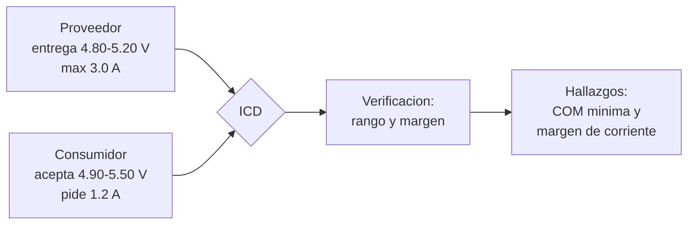

# B90-C05 — Documentación de interfaces

<!-- nav:top -->
[🏠 Programa](../../../../README.md) · [📚 Bloque B90](../../../tronco-comun/B90-integracion-ensayos-y-calificacion-espacial.md) · [← Anterior: B90-C04 — Control de contaminación](../B90-C04-control-de-contaminacion/CLASE.md) · [Siguiente: B90-C06 — Integración mecánica de subsistemas →](../B90-C06-integracion-mecanica-de-subsistemas/CLASE.md)
<!-- /nav -->

## 1. Ubicación, nivel y alcance

Clase 5 del bloque B90. Nivel N3. Una **interfaz** es el límite por el que dos elementos intercambian energía, datos, calor o carga, y un **documento de control de interfaces** (ICD) es el acuerdo escrito que dice qué entrega cada lado y qué puede recibir el otro. Aquí compruebas un ICD sintético: la **compatibilidad eléctrica** (rangos de tensión y margen de corriente) y la **compatibilidad mecánica** (apilamiento de tolerancias en el peor caso y en forma estadística). Todos los datos son **sintéticos**.

## 2. Por qué esta clase existe

La mayoría de los problemas de integración nacen en interfaces mal definidas: un equipo entrega 4,8 V y el otro necesita 4,9 V; un agujero admite 0,25 mm de desalineación y la pila de tolerancias llega a 0,40 mm. La decisión central: **¿las interfaces del ICD son compatibles antes de unir el hardware?**

## 3. Lo que podrás hacer al terminar

1. Enumerar los dominios de una interfaz y qué debe incluir un ICD.
2. Comprobar que el rango de salida de un proveedor cabe en el de entrada de un consumidor.
3. Calcular el margen de corriente de un riel.
4. Apilar tolerancias en el peor caso y en forma RSS.
5. Estimar la probabilidad de interferencia con Monte Carlo y con convolución numérica.
6. Separar lo consultado (dominios de interfaz y requisitos del CubeSat) de lo sintético.

La evidencia es el **ICD verificado con su matriz de compatibilidad** del ejercicio 12 (sección 20).

## 4. Con qué llegas y cómo comprobarlo

1. ¿Qué es una tolerancia?
2. ¿Qué es una distribución uniforme y cuál es su desviación estándar?
3. ¿Qué es un margen de diseño?
4. ¿Qué es una convolución?
5. ¿Qué es una comprobación independiente?

<details>
<summary>Ver respuestas</summary>

1. La variación admisible de una dimensión o un valor. 2. Todos los valores de `−a` a `+a` son igual de probables; `σ = a/√3`. 3. La diferencia relativa entre la capacidad y la demanda. 4. La operación que da la distribución de una suma de variables independientes. 5. Calcular lo mismo por otro método y comparar.
</details>

Con cuatro o cinco aciertos, sigue; si no, repasa los prerrequisitos.

## 5. Un caso de contexto y casos de referencia

Un riel regulado de 5 V entrega entre 4,80 y 5,20 V y hasta 3,0 A. Tres consumidores piden 4,5–5,5 V (OBC), 4,9–5,5 V (comunicaciones) y 4,75–5,25 V (carga útil), con 0,8, 1,2 y 0,9 A. La revisión detecta **dos hallazgos**: las comunicaciones necesitan 4,9 V mínimo y el riel puede dar 4,8 V; y la corriente total (2,90 A) deja un margen de solo **3,3 %**. En la mecánica, un perno de 3,0 mm en un agujero de 3,5 mm tiene holgura radial de 0,25 mm y un apilamiento de cuatro tolerancias de 0,40 mm en el peor caso. Todo es **sintético**.

## 6. Vocabulario

**ICD:** documento de control de interfaces. **Proveedor y consumidor:** quien entrega y quien recibe en la interfaz. **Margen:** `1 − demanda/capacidad`. **Peor caso:** suma de todas las tolerancias en la dirección más desfavorable. **RSS:** raíz de la suma de cuadrados, estimación estadística de la pila. **Holgura:** diferencia de radio entre agujero y perno. **Matriz de compatibilidad:** tabla que cruza cada interfaz con su verificación.

## 7. Modelo mental: un contrato con firma de los dos lados



*Descripción textual:* el proveedor declara su rango de salida, el consumidor su rango de entrada y su corriente; el ICD los cruza y la verificación produce hallazgos cuando el rango no cabe o el margen es insuficiente.

Analogía: un enchufe y una clavija: no basta con que encajen, ambos deben coincidir en tensión y corriente. Límite: un ICD real también cubre datos, calor, software y operaciones, no solo estos dos dominios.

## 8. La explicación, paso a paso

### 8.1 Qué es una interfaz según la fuente

El *Systems Engineering Handbook* de NASA (F3) dice que las interfaces abarcan dominios mecánico, fluido, térmico, eléctrico, de datos, lógico (software) y humano, además de apoyo al ensamblaje, mantenimiento y prueba; que se verifica su compatibilidad al desarrollar requisitos, que las interacciones pueden ser sutiles y que los ICD, junto con el plan de integración, son entradas de la integración. La *CubeSat Design Specification* (F8) fija, por ejemplo, rieles, tres inhibidores independientes y ajustes de dispensador, lo que ilustra una interfaz mecánica y funcional normalizada.

### 8.2 Compatibilidad eléctrica

Condición de rango: `V_min,prov ≥ V_min,cons` y `V_max,prov ≤ V_max,cons`. En el ejemplo, las comunicaciones fallan en el mínimo (4,80 < 4,90) y los demás cumplen. Condición de corriente: margen `= 1 − ΣI/I_max = 1 − 2,90/3,0 = 3,3 %`, por debajo del 20 % de ejemplo.

### 8.3 Compatibilidad mecánica: peor caso y RSS

Con cuatro contribuciones de ±0,05, ±0,10, ±0,10 y ±0,15 mm: peor caso `= 0,400 mm`; RSS `= √(0,05² + 0,10² + 0,10² + 0,15²) = 0,2121 mm`. Con holgura de 0,25 mm el peor caso **no cumple** y el RSS **sí**: la diferencia está en suponer que todas las tolerancias alcanzan su extremo a la vez.

### 8.4 La probabilidad de interferencia

Si cada contribución es uniforme, la sigma de la suma es `RSS/√3 = 0,1225 mm` (Monte Carlo: 0,1225). La probabilidad de que el desplazamiento supere 0,25 mm es `3,46 × 10⁻²` por Monte Carlo (2 × 10⁶ muestras, semilla 90) y `3,48 × 10⁻²` por convolución numérica de las cuatro distribuciones: **3,5 %**, no cero. El peor caso garantiza cero fallas; el RSS acepta un riesgo que debe cuantificarse.

## 9. Magnitudes, símbolos y unidades

| Símbolo | Qué es | Unidad | Valor / nota |
|---|---|---|---|
| `V_min`, `V_max` | rango de tensión | V | ver sección 5 |
| `I_max`, `ΣI` | corriente máxima y demandada | A | 3,0 y 2,90 |
| margen | `1 − ΣI/I_max` | — | 3,3 % |
| `t_i` | tolerancia de la contribución `i` | mm | 0,05 a 0,15 |
| WC, RSS | peor caso y estadístico | mm | 0,400 y 0,2121 |
| holgura | `(d_agujero − d_perno)/2` | mm | 0,25 |

## 10. Convenciones y referencias

Unidades V, A, mm. Las contribuciones son independientes y uniformes entre `−t_i` y `+t_i`; el desplazamiento se trata como unidimensional. Sistema de referencia: no aplica. Tolerancias: Monte Carlo con semilla 90 y 2 × 10⁶ muestras; convolución y Monte Carlo coinciden a `6 × 10⁻⁴`. Rangos, corrientes y tolerancias son **sintéticos**; el margen mínimo de 20 % es un valor de ejemplo.

## 11. De dónde sale lo que afirmamos

| ID | Fuente | Localizador | Respalda | Estado |
|---|---|---|---|---|
| F2 | NASA, Systems Engineering Handbook, 5.3 Product Verification — https://www.nasa.gov/reference/5-3-product-verification/ (consultada 2026-11-10) | sección 5.3 | métodos de verificación (análisis, demostración, inspección, prueba); verificación frente a validación; definiciones de calificación, aceptación y pruebas de extremo a extremo; manejo de discrepancias | Consultada |
| F3 | NASA, Systems Engineering Handbook, 5.2 Product Integration — https://www.nasa.gov/reference/5-2-product-integration/ (consultada 2026-11-10) | sección 5.2 | propósito de la integración, entradas, actividades, secuencia ascendente, dominios de interfaz y errores frecuentes | Consultada |
| F8 | Cal Poly CubeSat Program, CubeSat Design Specification Rev. 14.1 (febrero de 2022) — PDF https://static1.squarespace.com/static/5418c831e4b0fa4ecac1bacd/t/62193b7fc9e72e0053f00910/1645820809779/CDS+REV14_1+2022-02-09.pdf (consultada 2026-11-10 con PyMuPDF) | secciones 2.2, 2.3, 2.4 y 3 (3.1–3.5) | ensayos típicos (vibración aleatoria, bakeout termovacío, choque, inspección visual), calificación, protovuelo y aceptación, tres inhibidores independientes, rieles y centro de gravedad (tabla 2) | Consultada |
| — | Texto de las normas ECSS (verificación, ensayos, EMC, limpieza, carga de nave) | — | — | No consultada |
| — | Suma de peor caso, RSS y convolución de distribuciones uniformes | — | las verifica el laboratorio con Monte Carlo y convolución | No consultada en una fuente concreta |

Límites: ni F3 ni F8 dan los valores del ICD de ejemplo; F8 solo se cita para ilustrar una interfaz normalizada.

## 12. Cómo ver la compatibilidad

| Elemento | Resultado |
|---|---|
| OBC | cumple |
| COM | falla en `V_min` |
| Carga útil | cumple |
| Margen de corriente | 3,3 % (insuficiente) |
| Pila WC / RSS | 0,400 / 0,2121 mm |

Descripción larga: la matriz tiene un fallo de tensión y uno de margen; la tolerancia mecánica pasa por RSS pero no por peor caso.

## 13. Ejemplo trabajado: la comunicación en el riel de 5 V

**Paso 1 · Rangos.** Proveedor 4,80–5,20 V; consumidor 4,90–5,50 V.

**Paso 2 · Mínimo.** `4,80 ≥ 4,90` es falso: incompatible.

**Paso 3 · Máximo.** `5,20 ≤ 5,50` es verdadero.

**Paso 4 · Acción.** Subir el mínimo del riel a 4,90 V, bajar el requisito del consumidor o añadir un regulador: la decisión se registra como cambio al ICD, no como retoque en el taller.

## 14. Distintas formas de describir una interfaz

**Por dominio:** mecánica, eléctrica, datos, térmica. **Por proveedor y consumidor:** quién garantiza qué. **Por verificación:** cómo se comprobará (análisis, inspección, demostración o prueba; F2). Un ICD completo tiene las tres vistas.

## 15. Práctica guiada

**Ejercicio 1 · con los pasos indicados.** Calcula el margen de corriente si la demanda es 2,4 A con capacidad de 3,0 A. *Pasos:* cociente, resta.

<details><summary>Solución comentada</summary>

`1 − 2,4/3,0 = 0,20 = 20 %`: cumple el mínimo de ejemplo.
</details>

**Ejercicio 2 · con una pista.** Calcula el peor caso de ±0,1, ±0,2 y ±0,2 mm. *Pista:* suma.

<details><summary>Solución comentada</summary>

`0,1 + 0,2 + 0,2 = 0,5 mm`.
</details>

**Ejercicio 3 · casi autónomo.** Calcula el RSS del ejercicio 2.

<details><summary>Solución comentada</summary>

`√(0,01 + 0,04 + 0,04) = √0,09 = 0,30 mm`.
</details>

## 16. Práctica autónoma, transferencia e integrador

**Ejercicio 4 · autónomo.** ¿Es compatible un consumidor de 4,75–5,25 V con un riel de 4,80–5,20 V?

<details><summary>Solución comentada</summary>

Sí: `4,80 ≥ 4,75` y `5,20 ≤ 5,25`.
</details>

**Ejercicio 5 · autónomo.** Calcula la holgura radial de un perno de 4,0 mm en un agujero de 4,5 mm.

<details><summary>Solución comentada</summary>

`(4,5 − 4,0)/2 = 0,25 mm`.
</details>

**Ejercicio 6 · autónomo.** Una pila de tres tolerancias de ±0,10 mm cada una: peor caso y RSS.

<details><summary>Solución comentada</summary>

`0,30 mm` y `0,1 √3 = 0,173 mm`.
</details>

**Ejercicio 7 · autónomo.** ¿Cuál es la sigma de una uniforme de ±0,15 mm?

<details><summary>Solución comentada</summary>

`0,15/√3 = 0,0866 mm`.
</details>

**Ejercicio 8 · autónomo.** ¿Por qué RSS ≥ la sigma del Monte Carlo en este caso?

<details><summary>Solución comentada</summary>

RSS suma las semianchuras `t_i` en cuadratura; la sigma real de una uniforme es `t_i/√3`, menor: por eso `σ = RSS/√3`.
</details>

**Ejercicio 9 · transferencia.** **Transferencia.** Un colega concluye que «el 3,5 % de las uniones interferirá». ¿Es válido?

<details><summary>Solución comentada</summary>

Solo para las tolerancias y la geometría de ejemplo; en su diseño las distribuciones y la holgura son otras.
</details>

**Ejercicio 10 · transferencia.** **Transferencia.** ¿Qué dominio de interfaz omite este laboratorio y que sí exige el ICD de un CubeSat?

<details><summary>Solución comentada</summary>

Entre otros, el de datos y el térmico; F3 enumera los dominios y F8 incluye requisitos funcionales como los inhibidores independientes.
</details>

**Ejercicio 11 · transferencia.** **Transferencia.** ¿Cuándo conviene el peor caso y cuándo el estadístico?

<details><summary>Solución comentada</summary>

Peor caso cuando la falla es crítica o las unidades son pocas; estadístico cuando hay muchas unidades y una falla ocasional es tolerable y se cuantifica.
</details>

**Ejercicio 12 · integrador.** **Integrador.** Elabora tu *ICD verificado con su matriz de compatibilidad*: rangos, corrientes, margen, pila de tolerancias (WC y RSS), probabilidad de interferencia, hallazgos y lista de qué es consultado y sintético.

<details><summary>Solución comentada</summary>

Secciones 8.2–8.4 y la salida del laboratorio.
</details>

## 17. Laboratorio: verificación de un ICD sintético

El script [icd_compatibilidad.py](icd_compatibilidad.py) revisa rangos de tensión y margen de corriente, apila tolerancias y estima la probabilidad de interferencia; **comprueba** que los hallazgos son exactamente dos, que la sigma de uniformes es RSS/√3 y que convolución y Monte Carlo coinciden. Usa la biblioteca común [b90_comun.py](../b90_comun.py).

**Datos:** rangos, corrientes y tolerancias **sintéticos**; sin constantes con fuente. **Predice antes de ejecutar:** ¿cuántos hallazgos habrá? (Dos: COM y margen.) Ejecución del 2026-11-10 (Python 3.12.9, numpy 2.4.4):

```text
Python 3.12.9 | numpy 2.4.4
Datos SINTETICOS: ICD de un bus regulado de 5 V y de una union atornillada
Proveedor: EPS riel 5 V salida 4.8-5.2 V, maximo 3.0 A
  OBC         acepta 4.5-5.5 V -> minimo OK ; maximo OK
  COM         acepta 4.9-5.5 V -> minimo FALLA ; maximo OK
  Carga util  acepta 4.75-5.25 V -> minimo OK ; maximo OK
Corriente total = 2.90 A ; margen = 3.3 % (minimo de ejemplo 20 %)
Hallazgos: COM: tension minima; margen de corriente
Apilamiento: peor caso = +-0.400 mm ; RSS = +-0.2121 mm ; sigma Monte Carlo = 0.1225 mm
Holgura radial = 0.25 mm : peor caso NO CUMPLE ; RSS CUMPLE ; P(interferencia) Monte Carlo = 3.46e-02
P(interferencia) por convolucion numerica = 3.48e-02
Pruebas superadas.
```

```bash
python programa/clases/B90/B90-C05-documentacion-de-interfaces/icd_compatibilidad.py
```

**Límites:** solo tensión, corriente y una dimensión; contribuciones independientes; no cubre datos, térmica ni software.

## 18. Errores frecuentes y cómo corregirlos

**Revisar solo el valor nominal.** Revisa mínimos y máximos (8.2)

**Apilar tolerancias solo con RSS sin cuantificar el riesgo.** Calcula la probabilidad (8.4)

**Presentar el ICD de ejemplo como real.** Revisa la sección 10

## 19. Cómo sabrás que vas bien

Tras la sección 8: ¿por qué un diseño puede pasar RSS y fallar el peor caso? Si dudas, repasa el ejercicio 11. Tras el laboratorio: ¿qué contrasta la convolución? (ver sección 17).

## 20. Qué entregas y cómo se evalúa

El producto es tu **ICD verificado con su matriz de compatibilidad** (ejercicio 12).

| Criterio | Inicial | En desarrollo | Logrado | Destacado |
|---|---|---|---|---|
| Conceptos | Los confunde | Parciales | Explica el método y su dominio | Explica los límites y las alternativas |
| Cálculo | Sin unidades | Con errores | Resultados con unidades y comprobados | Resuelve casos nuevos |
| Numérico | Sin comprobar | Un caso | Verifica con una comprobación independiente en varios casos | Interpreta las diferencias y los fallos |
| Fuentes | Sin fuente | Sin fecha | Fuentes con fecha y estado | Declara lo sintético y lo no consultado |
| Límites | No los nombra | Uno | Tres | Discute qué falta del modelo |

**Condiciones críticas (no se compensan con promedio):** rotular los datos como sintéticos; verificar cada resultado con una comprobación independiente; citar solo lo consultado.

## 21. Ética, seguridad y límites

Clase educativa: el ICD, los rangos y las tolerancias son de ejemplo y no sustituyen un ICD firmado entre las partes de un proyecto ni su revisión. Accesibilidad: tablas equivalentes a las gráficas, fórmulas en texto, ejercicios sin conexión.

## 22. Para cerrar y seguir

El ICD de ejemplo tiene dos hallazgos eléctricos y una holgura mecánica que cumple por RSS (0,2121 mm) pero no por peor caso (0,400 mm), con 3,5 % de probabilidad de interferencia. Queda una pregunta: ¿cómo se unen mecánicamente los subsistemas una vez aceptadas las interfaces?

**Glosario español–inglés.** documento de control de interfaces · *interface control document (ICD)*; peor caso · *worst case*; raíz de la suma de cuadrados · *root sum square (RSS)*; holgura · *clearance*; margen · *margin*.

**Continuidad.** [B90-C06](../B90-C06-integracion-mecanica-de-subsistemas/CLASE.md) trata la integración mecánica: precarga, masa y centro de gravedad.

**Referencias:** ver sección 11.

<!-- nav:bottom -->
---

[← Anterior: B90-C04 — Control de contaminación](../B90-C04-control-de-contaminacion/CLASE.md) · [📚 Bloque B90](../../../tronco-comun/B90-integracion-ensayos-y-calificacion-espacial.md) · [Siguiente: B90-C06 — Integración mecánica de subsistemas →](../B90-C06-integracion-mecanica-de-subsistemas/CLASE.md)
<!-- /nav -->
