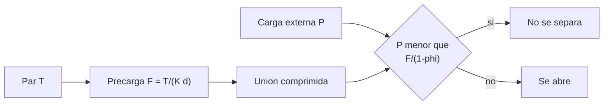

# B90-C06 — Integración mecánica de subsistemas

<!-- nav:top -->
[🏠 Programa](../../../../README.md) · [📚 Bloque B90](../../../tronco-comun/B90-integracion-ensayos-y-calificacion-espacial.md) · [← Anterior: B90-C05 — Documentación de interfaces](../B90-C05-documentacion-de-interfaces/CLASE.md) · [Siguiente: B90-C07 — Integración eléctrica de buses →](../B90-C07-integracion-electrica-de-buses/CLASE.md)
<!-- /nav -->

## 1. Ubicación, nivel y alcance

Clase 6 del bloque B90. Nivel N3. Integrar mecánicamente es unir subsistemas con uniones atornilladas y dejar el conjunto con la **masa, el centro de masa y las inercias** que el lanzador y el control de actitud necesitan. Aquí calculas la **precarga** de un perno a partir de su par de apriete, el margen de separación de la unión y las propiedades de masa de un CubeSat 3U de ejemplo. Todos los datos son **sintéticos**; los límites de centro de gravedad sí vienen de una fuente consultada.

## 2. Por qué esta clase existe

Un perno mal apretado se afloja con la vibración o se rompe por exceso de carga; un centro de masa fuera de rango desvía la nave en el despliegue. La decisión central: **¿qué par de apriete garantiza que la unión no se separe ni se plastifique, y el conjunto queda dentro de los límites de masa?**

## 3. Lo que podrás hacer al terminar

1. Calcular la precarga de un perno con `F = T/(K d)` y su rango por la dispersión de `K`.
2. Calcular la tensión de precarga y su margen a fluencia.
3. Calcular la carga de separación de una unión con el factor de carga `φ` y su margen.
4. Calcular el centro de masa y el tensor de inercia de un ensamble por ejes paralelos.
5. Comprobar el centro de masa con los límites del CubeSat 3U.
6. Separar lo consultado (límites de CG del CDS) de lo sintético y de lo no consultado.

La evidencia es el **balance de masa y precarga del ensamble** del ejercicio 12 (sección 20).

## 4. Con qué llegas y cómo comprobarlo

1. ¿Qué es un par de apriete y en qué unidades se da?
2. ¿Qué es el centro de masa de un conjunto de cuerpos?
3. ¿Qué es un momento de inercia y qué dice el teorema de ejes paralelos?
4. ¿Qué es un margen de seguridad?
5. ¿Qué es una comprobación independiente?

<details>
<summary>Ver respuestas</summary>

1. La fuerza que gira un perno por su brazo, en N·m. 2. El promedio de posiciones ponderado por las masas. 3. La resistencia a la rotación; `I = I_cm + m d²`. 4. `MS = capacidad/(demanda × FS) − 1`. 5. Calcular lo mismo por otro método y comparar.
</details>

Con cuatro o cinco aciertos, sigue; si no, repasa los prerrequisitos.

## 5. Un caso de contexto y casos de referencia

Un perno M3 con par de 1,0 N·m y `K = 0,20` tiene una precarga de **1 667 N**; con `K` entre 0,15 y 0,25 va de **1 333 a 2 222 N**. Un CubeSat 3U de siete piezas suma **3,25 kg**, con centro de masa en **(1,85; −1,11; 22,92) mm**, dentro de los límites de ±20, ±20 y ±70 mm. Todo es **sintético** salvo los límites de centro de gravedad.

## 6. Vocabulario

**Precarga:** fuerza de tracción que el apriete deja en el perno. **Coeficiente de par `K`:** relaciona par y precarga e incluye la fricción. **Factor de carga `φ`:** fracción de una carga externa que absorbe el perno. **Margen de separación:** margen de que la unión no se abra. **Centro de masa (CG):** punto promedio de la masa. **Tensor de inercia:** matriz de momentos y productos de inercia. **Ejes paralelos:** teorema para trasladar la inercia.

## 7. Modelo mental: apretar para que la unión trabaje en compresión



*Descripción textual:* el par produce una precarga que comprime la unión; mientras la carga externa por perno sea menor que `F/(1 − φ)` la unión no se separa.

Analogía: dos libros apretados con una banda elástica: mientras tiren menos de lo que aprieta la banda, no se abren. Límite: la analogía no explica por qué el perno ve solo una fracción `φ` de la carga ni la fricción de la rosca.

## 8. La explicación, paso a paso

### 8.1 Qué dicen las fuentes

El *Systems Engineering Handbook* de NASA (F3) trata la integración como un proceso ascendente donde se gestionan las interfaces físicas, funcionales y de datos y se hacen comprobaciones funcionales antes de pasar al nivel superior. La *CubeSat Design Specification* Rev. 14.1 (F8) exige que el centro de gravedad de un CubeSat 3U esté dentro de ±2 cm en X e Y y de ±7 cm en Z respecto del centro geométrico (tabla 2) y que, tras un ensayo de protovuelo, el CubeSat de vuelo no se desmonte ni modifique sin el proceso de renuncia. El área resistente de una rosca M3 (5,03 mm²) y la relación de par son valores de tablas generales no consultados en una fuente concreta.

### 8.2 Precarga y dispersión

`F = T/(K d) = 1,0/(0,20 × 0,003) = 1 667 N`. Con `K` entre 0,15 y 0,25: `F_min = 1 333 N` y `F_max = 2 222 N` (Monte Carlo, 2 × 10⁵ muestras: mínimo 1 333, máximo 2 222, media 1 702 N). La dispersión de fricción hace que el mismo par dé precargas que difieren en un factor de 1,67.

### 8.3 Tensión y margen a fluencia

`σ_max = F_max/A_s = 2 222/5,03 mm² = 441,8 MPa`. Con límite de fluencia sintético de 600 MPa y factor 1,25: `MS = 600/(441,8 × 1,25) − 1 = 0,09`: positivo, pero ajustado.

### 8.4 Separación y propiedades de masa

Con `φ = 0,20`, la unión se separa con `P_sep = F_min/(1 − φ) = 1 667 N` por perno (con `F_min = 1 333 N`, que corresponde a `K = 0,25`: `1 333/0,80 = 1 667 N`). La carga externa de ejemplo es 4 kg × 50 g / 4 pernos = 490 N y, con factor 1,4: `MS = 1 667/(490 × 1,4) − 1 = 1,43`.

El centro de masa es `Σ m r / Σ m`. Las inercias (diagonal, kg·m²): `I_xx = 0,02970`, `I_yy = 0,02972`, `I_zz = 0,00460`; la discretización en puntos coincide dentro de 0,034 %, 0,034 % y 0,110 %. Los momentos principales son 0,00460, 0,02970 y 0,02972 kg·m² y cumplen la desigualdad triangular.

| Magnitud | Valor |
|---|---|
| Masa total | 3,25 kg |
| CG (mm) | (1,85; −1,11; 22,92) |
| Límite CG 3U (mm) | ±20, ±20, ±70 |
| `MS` fluencia | 0,09 |
| `MS` separación | 1,43 |

## 9. Magnitudes, símbolos y unidades

| Símbolo | Qué es | Unidad | Valor / nota |
|---|---|---|---|
| `T` | par de apriete | N·m | 1,0 |
| `K` | coeficiente de par | — | 0,15–0,25 (sintético) |
| `d` | diámetro nominal | m | 0,003 |
| `F` | precarga | N | 1 333–2 222 |
| `A_s` | área resistente | m² | 5,03 × 10⁻⁶ |
| `φ` | factor de carga | — | 0,20 (sintético) |
| `M`, `r_cg`, `I` | masa, CG, inercia | kg, mm, kg·m² | calculadas |

## 10. Convenciones y referencias

Unidades SI. Marco: origen en el centro geométrico del CubeSat, `z` a lo largo del eje largo (0,34 m), `x` e `y` en la sección de 0,1 m. Las piezas se modelan como cajas homogéneas (la estructura real es hueca: simplificación). Tolerancia: inercia analítica frente a discretización de 30³ puntos por pieza `< 1 %`. Los coeficientes de par, factor de carga, fluencia, masas, posiciones y carga externa son **sintéticos**; los límites de CG vienen de F8.

## 11. De dónde sale lo que afirmamos

| ID | Fuente | Localizador | Respalda | Estado |
|---|---|---|---|---|
| F3 | NASA, Systems Engineering Handbook, 5.2 Product Integration — https://www.nasa.gov/reference/5-2-product-integration/ (consultada 2026-11-10) | sección 5.2 | propósito de la integración, entradas, actividades, secuencia ascendente, dominios de interfaz y errores frecuentes | Consultada |
| F8 | Cal Poly CubeSat Program, CubeSat Design Specification Rev. 14.1 (febrero de 2022) — PDF https://static1.squarespace.com/static/5418c831e4b0fa4ecac1bacd/t/62193b7fc9e72e0053f00910/1645820809779/CDS+REV14_1+2022-02-09.pdf (consultada 2026-11-10 con PyMuPDF) | secciones 2.2, 2.3, 2.4 y 3 (3.1–3.5) | ensayos típicos (vibración aleatoria, bakeout termovacío, choque, inspección visual), calificación, protovuelo y aceptación, tres inhibidores independientes, rieles y centro de gravedad (tabla 2) | Consultada |
| — | Texto de las normas ECSS (verificación, ensayos, EMC, limpieza, carga de nave) | — | — | No consultada |
| — | Relación `F = T/(K d)`, factor de carga de la unión, teorema de ejes paralelos | — | las verifica el laboratorio con Monte Carlo y discretización en puntos | No consultada en una fuente concreta |
| — | Área resistente de la rosca M3 y propiedades de pernos | — | usadas como datos de ejemplo | No consultada |

Límites: las fuentes consultadas no dan pares ni márgenes para pernos; el cálculo es didáctico.

## 12. Cómo ver el balance

| Pieza | Masa (kg) | `z` (mm) |
|---|---|---|
| Estructura | 0,60 | 0 |
| Batería | 0,40 | −120 |
| EPS | 0,30 | −80 |
| OBC | 0,10 | −40 |
| COM | 0,15 | 10 |
| Carga útil | 1,20 | 70 |
| ADCS | 0,50 | 130 |

Descripción larga: la carga útil pesa más y está arriba, por lo que desplaza el CG a `z = +22,9 mm`; la batería y la EPS abajo lo compensan parcialmente.

## 13. Ejemplo trabajado: el centro de masa en Z

**Paso 1 · Momentos.** `Σ m z = 0 − 0,4×0,12 − 0,3×0,08 − 0,1×0,04 + 0,15×0,01 + 1,2×0,07 + 0,5×0,13 = 0,0745 kg·m`.

**Paso 2 · Masa total.** `0,60 + 0,40 + 0,30 + 0,10 + 0,15 + 1,20 + 0,50 = 3,25 kg`.

**Paso 3 · CG.** `z_cg = 0,0745/3,25 = 22,9 mm`.

**Paso 4 · Comprobación.** `22,9 ≤ 70 mm`: cumple el límite de F8.

## 14. Distintas formas de describir la unión

**Por el par:** lo que el operador controla (N·m). **Por la precarga:** lo que importa a la unión (N). **Por la tensión:** lo que importa al perno (MPa). Pasar de uno a otro exige conocer `K` y el área, cuya incertidumbre explica el rango de 1 333 a 2 222 N.

## 15. Práctica guiada

**Ejercicio 1 · con los pasos indicados.** Calcula la precarga con `T = 0,8 N·m`, `K = 0,2`, `d = 3 mm`. *Pasos:* denominador, cociente.

<details><summary>Solución comentada</summary>

`0,2 × 0,003 = 6×10⁻⁴`; `F = 0,8/6×10⁻⁴ = 1 333 N`.
</details>

**Ejercicio 2 · con una pista.** Calcula la tensión de 1 667 N sobre 5,03 mm². *Pista:* N/mm² = MPa.

<details><summary>Solución comentada</summary>

`1 667/5,03 = 331 MPa`.
</details>

**Ejercicio 3 · casi autónomo.** Calcula `z_cg` de dos masas de 1 kg en `z = −0,1` y `z = +0,3` m.

<details><summary>Solución comentada</summary>

`(−0,1 + 0,3)/2 = 0,1 m`.
</details>

## 16. Práctica autónoma, transferencia e integrador

**Ejercicio 4 · autónomo.** Si `φ = 0,30`, ¿cuánto vale `P_sep` con `F_min = 1 333 N`?

<details><summary>Solución comentada</summary>

`1 333/0,70 = 1 904 N`.
</details>

**Ejercicio 5 · autónomo.** Calcula el margen de separación con `P_ext = 800 N` por perno, FS 1,4 y `P_sep = 1 667 N`.

<details><summary>Solución comentada</summary>

`1 667/(800 × 1,4) − 1 = 0,49`.
</details>

**Ejercicio 6 · autónomo.** Calcula `I` de una caja de 2 kg de 0,1 × 0,1 × 0,2 m respecto de su eje `z` (por el centro).

<details><summary>Solución comentada</summary>

`m(a² + b²)/12 = 2 × (0,01 + 0,01)/12 = 3,33×10⁻³ kg·m²`.
</details>

**Ejercicio 7 · autónomo.** Una masa de 0,5 kg a 0,1 m del eje: ¿qué inercia aporta como masa puntual?

<details><summary>Solución comentada</summary>

`m d² = 0,5 × 0,01 = 5×10⁻³ kg·m²`.
</details>

**Ejercicio 8 · autónomo.** ¿Cuánto vale el cociente `F_max/F_min` si `K` varía entre 0,15 y 0,25?

<details><summary>Solución comentada</summary>

`0,25/0,15 = 1,67`.
</details>

**Ejercicio 9 · transferencia.** **Transferencia.** Un colega usa 1,0 N·m para sus pernos M3. ¿Es válido?

<details><summary>Solución comentada</summary>

No: el par depende del material, la lubricación y la especificación de su proyecto; el de la clase es de ejemplo.
</details>

**Ejercicio 10 · transferencia.** **Transferencia.** ¿Qué cambia si el CG sale del límite en `z`?

<details><summary>Solución comentada</summary>

La nave no cumple la interfaz con el dispensador (F8); hay que mover masa (lastre o reubicar) y repetir el balance.
</details>

**Ejercicio 11 · transferencia.** **Transferencia.** ¿Por qué no se desmonta el CubeSat de vuelo tras el protovuelo?

<details><summary>Solución comentada</summary>

Porque cualquier cambio invalida la prueba realizada y exige repetirla o una renuncia (F8, 3.5.2; F7).
</details>

**Ejercicio 12 · integrador.** **Integrador.** Elabora tu *balance de masa y precarga*: tabla de piezas, CG, inercias, límites, precarga y margen de separación y lista de qué es consultado, no consultado y sintético.

<details><summary>Solución comentada</summary>

Secciones 8.2–8.4 y la salida del laboratorio.
</details>

## 17. Laboratorio: precarga y propiedades de masa

El script [precarga_y_masa.py](precarga_y_masa.py) calcula precarga, tensión, margen de separación, centro de masa e inercias; **comprueba** el rango del Monte Carlo, que el CG está dentro de los límites, que la inercia analítica coincide con la discretización a 1 % y que el tensor es físicamente válido. Usa la biblioteca común [b90_comun.py](../b90_comun.py).

**Datos:** par, `K`, fluencia, masas y posiciones **sintéticos**; límites de CG de F8 (consultados 2026-11-10). **Predice antes de ejecutar:** ¿cuál es el CG en `z`? (Unos 23 mm.) Ejecución del 2026-11-10 (Python 3.12.9, numpy 2.4.4):

```text
Python 3.12.9 | numpy 2.4.4
Datos SINTETICOS: perno M3, par 1.0 N m; CubeSat 3U de 0.1 x 0.1 x 0.34 m
Precarga nominal = 1667 N ; con K = 0.15-0.25: 1333 a 2222 N
Monte Carlo: min = 1333 N ; max = 2222 N ; media = 1702 N
Tension de precarga maxima = 441.8 MPa ; margen a fluencia (FS 1.25) = 0.09
Carga externa por perno = 490 N ; separacion en 1667 N ; margen de separacion (FS 1.4) = 1.43
Masa total = 3.25 kg ; CG = (1.85, -1.11, 22.92) mm
Limites 3U (CDS Rev. 14.1): +-20, +-20, +-70 mm -> ['OK', 'OK', 'OK']
Inercias analiticas [kg m2]: Ixx = 0.02970 ; Iyy = 0.02972 ; Izz = 0.00460 ; Ixy = -0.000011 ; Ixz = 0.000282 ; Iyz = -0.000169
Diferencia con la discretizacion en puntos (diagonal): 0.034 %, 0.034 %, 0.110 %
Momentos principales = 0.00460, 0.02970, 0.02972 kg m2 ; triangulo: True
Pruebas superadas.
```

```bash
python programa/clases/B90/B90-C06-integracion-mecanica-de-subsistemas/precarga_y_masa.py
```

**Límites:** unión sin fatiga ni relajación; cajas homogéneas; una sola carga externa; no hay cálculo de rigidez de la unión.

## 18. Errores frecuentes y cómo corregirlos

**Suponer que el mismo par da la misma precarga.** Considera la dispersión de `K` (8.2)

**Comparar el margen sin factor de seguridad.** Incluye `FS` (8.3)

**Presentar el ejemplo como un balance de masa real.** Revisa la sección 10

## 19. Cómo sabrás que vas bien

Tras la sección 8: ¿qué rango de precarga produce `K` entre 0,15 y 0,25? Si dudas, repasa el ejercicio 8. Tras el laboratorio: ¿qué comprueba la discretización en puntos? (ver sección 17).

## 20. Qué entregas y cómo se evalúa

El producto es tu **balance de masa y precarga del ensamble** (ejercicio 12).

| Criterio | Inicial | En desarrollo | Logrado | Destacado |
|---|---|---|---|---|
| Conceptos | Los confunde | Parciales | Explica el método y su dominio | Explica los límites y las alternativas |
| Cálculo | Sin unidades | Con errores | Resultados con unidades y comprobados | Resuelve casos nuevos |
| Numérico | Sin comprobar | Un caso | Verifica con una comprobación independiente en varios casos | Interpreta las diferencias y los fallos |
| Fuentes | Sin fuente | Sin fecha | Fuentes con fecha y estado | Declara lo sintético y lo no consultado |
| Límites | No los nombra | Uno | Tres | Discute qué falta del modelo |

**Condiciones críticas (no se compensan con promedio):** rotular los datos como sintéticos; verificar cada resultado con una comprobación independiente; citar solo lo consultado.

## 21. Ética, seguridad y límites

Clase educativa: pernos, pares, masas y márgenes son de ejemplo y no sustituyen el análisis de uniones ni la medición de masa y centro de gravedad de la unidad real. Accesibilidad: tablas equivalentes a las gráficas, fórmulas en texto, ejercicios sin conexión.

## 22. Para cerrar y seguir

Con 1,0 N·m, el perno M3 recibe entre 1 333 y 2 222 N, con margen a fluencia de 0,09 y de separación de 1,43; el ensamble pesa 3,25 kg y su CG queda a 23 mm del centro. Queda una pregunta: ¿cómo se unen eléctricamente los subsistemas sin dañarlos?

**Glosario español–inglés.** precarga · *preload*; par de apriete · *torque*; centro de masa · *center of mass*; tensor de inercia · *inertia tensor*; margen de separación · *separation margin*; ejes paralelos · *parallel axis theorem*.

**Continuidad.** [B90-C07](../B90-C07-integracion-electrica-de-buses/CLASE.md) trata la integración eléctrica de buses.

**Referencias:** ver sección 11.

<!-- nav:bottom -->
---

[← Anterior: B90-C05 — Documentación de interfaces](../B90-C05-documentacion-de-interfaces/CLASE.md) · [📚 Bloque B90](../../../tronco-comun/B90-integracion-ensayos-y-calificacion-espacial.md) · [Siguiente: B90-C07 — Integración eléctrica de buses →](../B90-C07-integracion-electrica-de-buses/CLASE.md)
<!-- /nav -->
