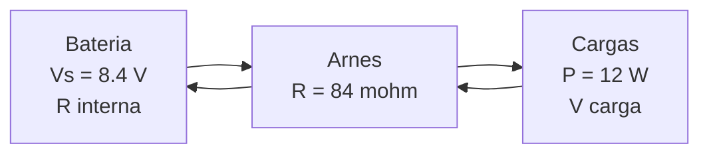

# B90-C07 — Integración eléctrica de buses

<!-- nav:top -->
[🏠 Programa](../../../../README.md) · [📚 Bloque B90](../../../tronco-comun/B90-integracion-ensayos-y-calificacion-espacial.md) · [← Anterior: B90-C06 — Integración mecánica de subsistemas](../B90-C06-integracion-mecanica-de-subsistemas/CLASE.md) · [Siguiente: B90-C08 — Procedimientos de prueba funcional →](../B90-C08-procedimientos-de-prueba-funcional/CLASE.md)
<!-- /nav -->

## 1. Ubicación, nivel y alcance

Clase 7 del bloque B90. Nivel N3. Integrar eléctricamente es conectar fuente, arnés y cargas y comprobar que cada carga recibe la tensión que necesita, que el arnés no desperdicia potencia y que el **arranque** no produce picos de corriente dañinos. Aquí calculas la caída de tensión en un arnés de cobre con cargas de potencia constante, la pérdida y el pico de corriente al conectar un capacitor. Todos los datos son **sintéticos**: un bus de batería de 8,4 V.

## 2. Por qué esta clase existe

Una carga de potencia constante pide más corriente cuando baja la tensión, de modo que un arnés largo o delgado puede hundir el bus justo cuando más se necesita. Y al conectar una carga con capacitor, la corriente inicial puede ser decenas de amperios. La decisión central: **¿el bus entrega a cada carga su tensión mínima y qué hay que limitar al arrancar?**

## 3. Lo que podrás hacer al terminar

1. Calcular la resistencia de un conductor de cobre a partir de su sección.
2. Resolver la tensión en la carga con una carga de potencia constante.
3. Calcular la pérdida `I²R` y la eficiencia del arnés.
4. Calcular el pico y la constante de tiempo de un arranque con capacitor.
5. Evaluar un limitador de corriente en el arranque.
6. Separar lo consultado (principios de integración) de lo sintético y de lo no consultado (resistividad).

La evidencia es la **hoja de integración de un bus de potencia** del ejercicio 12 (sección 20).

## 4. Con qué llegas y cómo comprobarlo

1. ¿Qué dice la ley de Ohm?
2. ¿Cuál es la fórmula de la resistencia de un conductor?
3. ¿Qué es una carga de potencia constante?
4. ¿Cuál es la corriente de carga de un capacitor a través de una resistencia?
5. ¿Qué es una comprobación independiente?

<details>
<summary>Ver respuestas</summary>

1. `V = I R`. 2. `R = ρ L/A`. 3. Una carga que consume `P` fija: `I = P/V`. 4. `i(t) = (V/R) e^{−t/RC}`. 5. Calcular lo mismo por otro método y comparar.
</details>

Con cuatro o cinco aciertos, sigue; si no, repasa los prerrequisitos.

## 5. Un caso de contexto y casos de referencia

Una batería de 8,4 V con 50 mΩ de resistencia interna alimenta, por 1,0 m de arnés de cobre AWG24 (0,5 m de ida y 0,5 m de retorno), cuatro cargas: 1,0 W (OBC), 6,0 W (comunicaciones al transmitir), 2,0 W (ADCS) y 3,0 W (carga útil), **12,0 W**. La tensión en la carga es **8,204 V**, la caída 196 mV y la pérdida 0,286 W. Al conectar un capacitor de 470 µF el pico directo es **62,7 A**; con un limitador de 2 Ω, **3,94 A**. Todo es **sintético**.

## 6. Vocabulario

**Bus de potencia:** red que distribuye la energía. **Arnés:** conjunto de cables y conectores. **Carga de potencia constante:** carga cuya corriente sube cuando baja la tensión. **Caída de tensión:** `I R` a lo largo del arnés. **Corriente de arranque (*inrush*):** pico al cargar un capacitor de entrada. **Limitador:** resistencia o circuito que reduce ese pico. **Presupuesto de potencia:** suma de las potencias de las cargas con márgenes.

## 7. Modelo mental: fuente, resistencia y carga



*Descripción textual:* la batería entrega corriente por el arnés a las cargas y esta vuelve por el retorno; la tensión en la carga es la de la batería menos la caída en las resistencias.

Analogía: una manguera larga y delgada: cuanto más caudal se pide, menos presión llega al final. Límite: aquí el «caudal» sube cuando baja la presión, porque la carga exige potencia constante.

## 8. La explicación, paso a paso

### 8.1 Qué dicen las fuentes

El *Systems Engineering Handbook* de NASA (F3) incluye en la integración la gestión de interfaces eléctricas y de datos, las comprobaciones funcionales antes de verificar y el registro de anomalías. La *CubeSat Design Specification* (F8) exige, entre otros, tres inhibidores independientes para evitar transmisión de RF y liberación de desplegables, y un pasador de remoción antes del vuelo (*remove before flight*) que corta toda la energía de la nave. La resistividad del cobre (1,72 × 10⁻⁸ Ω·m a 20 °C) y los diámetros de calibre son valores de uso general que no se consultaron en una fuente concreta.

### 8.2 El arnés

El conductor AWG24 de 0,511 mm tiene sección `0,2051 mm²` y `R/L = 83,87 mΩ/m`; con 1,0 m de recorrido, `R_arn = 83,9 mΩ` y con la resistencia interna, `R = 133,9 mΩ`.

### 8.3 Caída con carga de potencia constante

La carga cumple `V_c = V_s − (P/V_c) R`, es decir `V_c² − V_s V_c + P R = 0`, con raíz `V_c = [V_s + √(V_s² − 4 P R)]/2`. Con `P = 12 W`: `V_c = 8,2042 V`, `I = 1,4627 A`, caída `195,8 mV` y pérdida `I²R = 0,2864 W` (2,4 % de la potencia). Una iteración de punto fijo converge al mismo valor (diferencia `0`). Margen sobre una tensión mínima sintética de 6,0 V: 2,204 V.

| Longitud (m) | Caída (mV) |
|---|---|
| 0,5 | 133,5 |
| 1,0 | 195,8 |
| 2,0 | 323,5 |
| 4,0 | 592,5 |

### 8.4 Arranque con capacitor

Al conectar un capacitor descargado de 470 µF, `i(0) = V/R = 8,4/0,1339 = 62,7 A` y `τ = R C = 62,9 µs`; la energía almacenada es `½ C V² = 16,58 mJ`. Con un limitador de 2,0 Ω el pico baja a `8,4/2,1339 = 3,94 A` pero `τ` sube a 1 003 µs. Una integración explícita con paso de 10 ns da `62,75 A` de pico y `8,3434 V` tras `5 τ`, igual a `V(1 − e^{−5}) = 8,3434 V`.

## 9. Magnitudes, símbolos y unidades

| Símbolo | Qué es | Unidad | Valor / nota |
|---|---|---|---|
| `V_s` | tensión de la batería | V | 8,4 |
| `R` | resistencia total | mΩ | 133,9 |
| `P` | potencia total | W | 12,0 |
| `V_c`, `I` | tensión y corriente en la carga | V, A | 8,2042; 1,4627 |
| `C` | capacitor de entrada | µF | 470 (sintético) |
| `I_pico` | pico de arranque | A | 62,7 |
| `τ` | constante de tiempo | µs | 62,9 |

## 10. Convenciones y referencias

Unidades SI. Resistencia a 20 °C, sin efecto de temperatura ni de inductancia del cable. Las cargas son de potencia constante y estacionarias; la batería se modela con tensión fija y resistencia interna constante. Sistema de referencia: no aplica. Tolerancias: punto fijo frente a cuadrática `< 10⁻⁹`; Euler frente a `V/R` `< 10⁻³`. La batería, las cargas, el capacitor y los límites son **sintéticos**.

## 11. De dónde sale lo que afirmamos

| ID | Fuente | Localizador | Respalda | Estado |
|---|---|---|---|---|
| F3 | NASA, Systems Engineering Handbook, 5.2 Product Integration — https://www.nasa.gov/reference/5-2-product-integration/ (consultada 2026-11-10) | sección 5.2 | propósito de la integración, entradas, actividades, secuencia ascendente, dominios de interfaz y errores frecuentes | Consultada |
| F8 | Cal Poly CubeSat Program, CubeSat Design Specification Rev. 14.1 (febrero de 2022) — PDF https://static1.squarespace.com/static/5418c831e4b0fa4ecac1bacd/t/62193b7fc9e72e0053f00910/1645820809779/CDS+REV14_1+2022-02-09.pdf (consultada 2026-11-10 con PyMuPDF) | secciones 2.2, 2.3, 2.4 y 3 (3.1–3.5) | ensayos típicos (vibración aleatoria, bakeout termovacío, choque, inspección visual), calificación, protovuelo y aceptación, tres inhibidores independientes, rieles y centro de gravedad (tabla 2) | Consultada |
| — | Texto de las normas ECSS (verificación, ensayos, EMC, limpieza, carga de nave) | — | — | No consultada |
| — | Resistividad del cobre, calibre AWG24, ley de Ohm y carga de un capacitor | — | las verifica el laboratorio con una iteración y una integración independientes | No consultada en una fuente concreta |

Límites: ninguna fuente consultada da valores de arnés ni de potencia; el bus es didáctico.

## 12. Cómo ver el bus

| Magnitud | Valor |
|---|---|
| `V_c` | 8,2042 V |
| caída | 195,8 mV |
| pérdida | 0,2864 W |
| `I_pico` directo / con limitador | 62,7 / 3,94 A |

Descripción larga: la caída crece casi linealmente con la longitud (de 134 a 593 mV de 0,5 a 4 m) y el pico de arranque cae 16 veces con un limitador de 2 Ω, a cambio de un arranque 16 veces más lento.

## 13. Ejemplo trabajado: tensión en la carga

**Paso 1 · Ecuación.** `V_c² − 8,4 V_c + 12 × 0,1339 = 0`, es decir `V_c² − 8,4 V_c + 1,607 = 0`.

**Paso 2 · Raíz.** `V_c = [8,4 + √(70,56 − 6,427)]/2 = [8,4 + 8,008]/2 = 8,204 V`.

**Paso 3 · Corriente y pérdida.** `I = 12/8,204 = 1,4627 A`; `I²R = 0,286 W`.

**Paso 4 · Comprobación.** La iteración `V ← V_s − (P/V) R` converge al mismo valor.

## 14. Distintas formas de describir la integración eléctrica

**Por presupuesto:** suma de potencias con margen. **Por tensión:** caídas y mínimos en cada carga. **Por transitorio:** arranque y cortocircuito. Las tres vistas son necesarias; esta clase calcula las dos últimas para un caso.

## 15. Práctica guiada

**Ejercicio 1 · con los pasos indicados.** Calcula la resistencia de 2,0 m de cobre AWG24 con `R/L = 83,87 mΩ/m`. *Pasos:* producto.

<details><summary>Solución comentada</summary>

`83,87 × 2,0 = 167,7 mΩ`.
</details>

**Ejercicio 2 · con una pista.** Calcula la corriente de una carga de 6 W a 8,2 V. *Pista:* `P/V`.

<details><summary>Solución comentada</summary>

`6/8,2 = 0,732 A`.
</details>

**Ejercicio 3 · casi autónomo.** Calcula la pérdida `I²R` con 1,46 A y 0,134 Ω.

<details><summary>Solución comentada</summary>

`1,46² × 0,134 = 0,286 W`.
</details>

## 16. Práctica autónoma, transferencia e integrador

**Ejercicio 4 · autónomo.** Calcula `τ` con `R = 0,1339 Ω` y `C = 470 µF`.

<details><summary>Solución comentada</summary>

`0,1339 × 470×10⁻⁶ = 62,9 µs`.
</details>

**Ejercicio 5 · autónomo.** Calcula la energía almacenada por 470 µF a 8,4 V.

<details><summary>Solución comentada</summary>

`½ × 470×10⁻⁶ × 70,56 = 16,58 mJ`.
</details>

**Ejercicio 6 · autónomo.** Calcula el pico con un limitador de 1 Ω.

<details><summary>Solución comentada</summary>

`8,4/(0,1339 + 1) = 7,41 A`.
</details>

**Ejercicio 7 · autónomo.** ¿Cuánto vale la eficiencia del conjunto fuente + arnés (`V_c/V_s`)?

<details><summary>Solución comentada</summary>

`8,2042/8,4 = 97,67 %`.
</details>

**Ejercicio 8 · autónomo.** ¿Por qué la caída con 4 m no es exactamente 8 veces la de 0,5 m?

<details><summary>Solución comentada</summary>

Porque la resistencia interna de 50 mΩ no cambia y porque, al bajar la tensión, la carga de potencia constante pide más corriente (ecuación cuadrática).
</details>

**Ejercicio 9 · transferencia.** **Transferencia.** Un colega afirma que su bus tiene «97,7 % de eficiencia». ¿Es válido?

<details><summary>Solución comentada</summary>

No: es el resultado de datos sintéticos; la eficiencia de su bus depende de su arnés, sus conectores y su batería reales.
</details>

**Ejercicio 10 · transferencia.** **Transferencia.** ¿Qué riesgo introduce un limitador de arranque de 2 Ω si queda en el circuito durante la operación?

<details><summary>Solución comentada</summary>

Disiparía `I²R` con 1,46 A: 4,3 W, mucho más que el arnés; por eso se pone en derivación después del arranque.
</details>

**Ejercicio 11 · transferencia.** **Transferencia.** ¿Por qué se verifican pasos de potencia antes de conectar la carga útil?

<details><summary>Solución comentada</summary>

Porque la integración ascendente comprueba cada nivel antes de unirlo al superior (F3): un error de polaridad o una tensión fuera de rango destruiría una carga costosa.
</details>

**Ejercicio 12 · integrador.** **Integrador.** Elabora tu *hoja de integración de un bus de potencia*: arnés, presupuesto, tensión en cada carga, pérdida, pico de arranque, limitador y lista de qué es consultado, no consultado y sintético.

<details><summary>Solución comentada</summary>

Secciones 8.2–8.4 y la salida del laboratorio.
</details>

## 17. Laboratorio: arnés y arranque

El script [bus_potencia.py](bus_potencia.py) calcula la resistencia del arnés, resuelve la tensión con carga de potencia constante por fórmula cerrada y por iteración, tabula la caída y simula el arranque con un limitador; **comprueba** que ambas soluciones coinciden y que el pico y la carga del capacitor concuerdan con la solución analítica. Usa la biblioteca común [b90_comun.py](../b90_comun.py).

**Datos:** batería, arnés, cargas y capacitor **sintéticos**; resistividad no consultada. **Predice antes de ejecutar:** ¿cuál es el pico de arranque sin limitador? (`V/R ≈ 62,7 A`.) Ejecución del 2026-11-10 (Python 3.12.9, numpy 2.4.4):

```text
Python 3.12.9 | numpy 2.4.4
Datos SINTETICOS: bateria 8.4 V, arnes de cobre AWG24 de 0.5 m (ida) + 0.5 m (retorno), 4 cargas
Seccion = 0.2051 mm2 ; R por metro = 83.87 mohm/m ; R arnes = 83.9 mohm ; R total = 133.9 mohm
Potencia total = 12.0 W ; V en la carga = 8.2042 V ; I = 1.4627 A ; caida = 195.8 mV ; perdida I2R = 0.2864 W
Iteracion de punto fijo: V = 8.204195661 V (diferencia con la cuadratica = 0.00e+00 V)
Tension minima de operacion = 6.0 V -> CUMPLE ; margen = 2.204 V
Eficiencia del arnes = 97.67 %
Longitud de arnes [m] -> caida [mV] a P total
   0.5 ->   133.5
   1.0 ->   195.8
   2.0 ->   323.5
   4.0 ->   592.5
Arranque directo: I pico = 62.7 A ; tau = 62.9 us
Con limitador de 2.0 ohm: I pico = 3.94 A ; tau = 1002.9 us
Energia almacenada = 16.58 mJ
Euler: I pico = 62.75 A ; V del capacitor tras 5 tau = 8.3434 V
Pruebas superadas.
```

```bash
python programa/clases/B90/B90-C07-integracion-electrica-de-buses/bus_potencia.py
```

**Límites:** cargas estacionarias; sin inductancia ni efecto de temperatura; batería ideal con resistencia fija; un solo capacitor.

## 18. Errores frecuentes y cómo corregirlos

**Olvidar el retorno.** La resistencia incluye ida y vuelta (8.2)

**Tratar la carga como resistencia fija.** Resuelve la cuadrática (8.3)

**Ignorar el arranque.** Calcula el pico y limita (8.4)

## 19. Cómo sabrás que vas bien

Tras la sección 8: ¿qué pasa con el pico de arranque si se añade 2 Ω en serie? Si dudas, repasa el ejercicio 6. Tras el laboratorio: ¿qué comprueba la iteración de punto fijo? (ver sección 17).

## 20. Qué entregas y cómo se evalúa

El producto es tu **hoja de integración de un bus de potencia** (ejercicio 12).

| Criterio | Inicial | En desarrollo | Logrado | Destacado |
|---|---|---|---|---|
| Conceptos | Los confunde | Parciales | Explica el método y su dominio | Explica los límites y las alternativas |
| Cálculo | Sin unidades | Con errores | Resultados con unidades y comprobados | Resuelve casos nuevos |
| Numérico | Sin comprobar | Un caso | Verifica con una comprobación independiente en varios casos | Interpreta las diferencias y los fallos |
| Fuentes | Sin fuente | Sin fecha | Fuentes con fecha y estado | Declara lo sintético y lo no consultado |
| Límites | No los nombra | Uno | Tres | Discute qué falta del modelo |

**Condiciones críticas (no se compensan con promedio):** rotular los datos como sintéticos; verificar cada resultado con una comprobación independiente; citar solo lo consultado.

## 21. Ética, seguridad y límites

Clase educativa: el bus, los cables y las cargas son de ejemplo y no sustituyen el análisis eléctrico del proyecto ni sus protecciones. Con baterías reales se aplican procedimientos de seguridad del proveedor y del lanzador; esta clase no los reemplaza. Accesibilidad: tablas equivalentes a las gráficas, fórmulas en texto, ejercicios sin conexión.

## 22. Para cerrar y seguir

Con 12 W, la carga recibe 8,204 V y el arnés pierde 0,286 W; el arranque directo pide 62,7 A y un limitador de 2 Ω lo lleva a 3,94 A. Queda una pregunta: ¿cómo se comprueba que todo funciona y con qué criterio se decide que pasa?

**Glosario español–inglés.** arnés · *harness*; caída de tensión · *voltage drop*; carga de potencia constante · *constant power load*; corriente de arranque · *inrush current*; presupuesto de potencia · *power budget*; limitador · *limiter*.

**Continuidad.** [B90-C08](../B90-C08-procedimientos-de-prueba-funcional/CLASE.md) trata los procedimientos de prueba funcional.

**Referencias:** ver sección 11.

<!-- nav:bottom -->
---

[← Anterior: B90-C06 — Integración mecánica de subsistemas](../B90-C06-integracion-mecanica-de-subsistemas/CLASE.md) · [📚 Bloque B90](../../../tronco-comun/B90-integracion-ensayos-y-calificacion-espacial.md) · [Siguiente: B90-C08 — Procedimientos de prueba funcional →](../B90-C08-procedimientos-de-prueba-funcional/CLASE.md)
<!-- /nav -->
