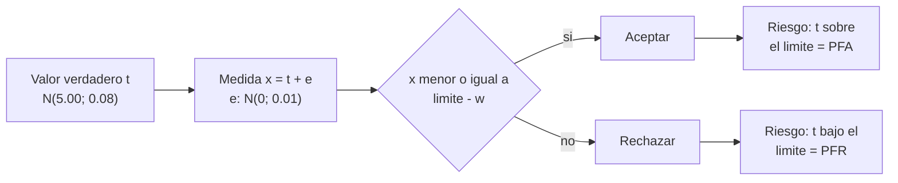

# B90-C08 — Procedimientos de prueba funcional

<!-- nav:top -->
[🏠 Programa](../../../../README.md) · [📚 Bloque B90](../../../tronco-comun/B90-integracion-ensayos-y-calificacion-espacial.md) · [← Anterior: B90-C07 — Integración eléctrica de buses](../B90-C07-integracion-electrica-de-buses/CLASE.md) · [Siguiente: B90-C09 — Ensayos de vibración →](../../../tronco-comun/B90-integracion-ensayos-y-calificacion-espacial.md#b90-c09)
<!-- /nav -->

## 1. Ubicación, nivel y alcance

Clase 8 del bloque B90. Nivel N3. Una **prueba funcional** comprueba que la unidad hace lo que debe: enciende, mide, responde y se comunica. Su **procedimiento** es un guion con pasos, valores esperados, tolerancias y una **regla de decisión**: qué hacer cuando la medida cae cerca del límite y el instrumento tiene incertidumbre. Aquí estimas, con datos **sintéticos**, las probabilidades de aceptar una unidad mala (falsa aceptación) o rechazar una buena (falso rechazo) según la banda de guarda.

## 2. Por qué esta clase existe

Toda medida tiene incertidumbre. Si se acepta con el límite exacto, algunas unidades malas pasan; si se endurece el criterio, algunas buenas se rechazan y cuesta tiempo. La decisión central: **¿qué banda de guarda se adopta y con qué riesgo?**

## 3. Lo que podrás hacer al terminar

1. Escribir un procedimiento con pasos, valor esperado, tolerancia y criterio de decisión.
2. Distinguir tolerancia de especificación e incertidumbre de medida.
3. Calcular las probabilidades de falsa aceptación (PFA) y falso rechazo (PFR) para una banda de guarda.
4. Comprobar el cálculo con Monte Carlo y con cuadratura numérica.
5. Clasificar cada paso como pasa, indeterminado o falla.
6. Separar lo consultado (qué exige el informe de una prueba) de lo sintético y de lo no consultado.

La evidencia es el **procedimiento funcional con regla de decisión** del ejercicio 12 (sección 20).

## 4. Con qué llegas y cómo comprobarlo

1. ¿Qué es la incertidumbre expandida de una medida (`k = 2`)?
2. ¿Qué es una distribución normal?
3. ¿Qué es una probabilidad condicional?
4. ¿Qué es un Monte Carlo y por qué se fija la semilla?
5. ¿Qué es una comprobación independiente?

<details>
<summary>Ver respuestas</summary>

1. Dos veces la incertidumbre estándar: cubre ≈ 95 % de los valores. 2. La campana con media `μ` y desviación `σ`. 3. La probabilidad de un suceso dado otro. 4. Un cálculo con muestras aleatorias; la semilla hace repetible el resultado. 5. Calcular lo mismo por otro método y comparar.
</details>

Con cuatro o cinco aciertos, sigue; si no, repasa los prerrequisitos.

## 5. Un caso de contexto y casos de referencia

Un regulador de 5 V tiene límite superior de especificación de 5,25 V. La producción se distribuye `N(5,00; 0,08) V` y el instrumento tiene incertidumbre expandida de 0,02 V (`σ_m = 0,01 V`). El **0,089 %** de las unidades está realmente fuera de especificación. Sin banda de guarda se acepta el **0,012 %** de unidades malas y se rechaza el **0,019 %** de buenas; con guarda `U` la falsa aceptación baja a **0,0003 %** y el falso rechazo sube a **0,128 %**. Todo es **sintético**.

## 6. Vocabulario

**Procedimiento de prueba:** guion aprobado de pasos y criterios. **Tolerancia:** variación admisible del valor. **Incertidumbre de medida:** dispersión asociada a la medida. **Banda de guarda `w`:** margen que se resta al límite para aceptar. **Falsa aceptación (PFA):** aceptar una unidad realmente fuera de especificación. **Falso rechazo (PFR):** rechazar una unidad conforme. **Resultado indeterminado:** medida dentro de la banda de incertidumbre del límite.

## 7. Modelo mental: la medida es una nube alrededor del valor verdadero



*Descripción textual:* el valor verdadero de cada unidad es desconocido; la medida le suma un error; la regla acepta si la medida está por debajo del límite menos la banda `w`; el riesgo de aceptar una unidad mala y el de rechazar una buena dependen de `w`.

Analogía: una balanza con error pesa un paquete cerca del límite de peso: si se acepta con el límite justo, a veces pasa uno excedido; si se resta un margen, a veces se devuelve uno bueno. Límite: la analogía supone que se conoce la distribución de la producción, algo que en pruebas de pocas unidades no ocurre.

## 8. La explicación, paso a paso

### 8.1 Qué dicen las fuentes

El *Systems Engineering Handbook* de NASA (F2) dice que la verificación por prueba usa el producto para obtener datos detallados bajo condiciones controladas, que una discrepancia detiene la verificación y genera un informe y que solo se completa con evidencia documentada de cumplimiento. *CubeSat 101* (F7) pide, en los informes, procedimientos tal como se ejecutaron con todos los pasos con marca de tiempo, y que el integrador apruebe el procedimiento antes de la prueba. Los criterios estadísticos de decisión de esta clase (banda de guarda, PFA, PFR) no se consultaron en una norma; son relaciones estándar que se verifican en el laboratorio.

### 8.2 La regla con banda de guarda

Se acepta si `x ≤ U_L − w`. Con `w = 0` hay riesgo simétrico alrededor del límite; con `w = U` se desplaza la frontera de aceptación hacia dentro.

### 8.3 Probabilidades

`PFA = P(aceptado y t > U_L)` y `PFR = P(rechazado y t ≤ U_L)`. Se calculan integrando sobre `t`: `∫ f(t) Φ((U_L − w − t)/σ_m) 1{t > U_L} dt` para la PFA, y con el complemento para la PFR.

| `w` (V) | Regla | PFA (%) MC | PFR (%) MC | PFA ; PFR (%) cuadratura |
|---|---|---|---|---|
| 0,00 | sin guarda | 0,0120 | 0,0191 | 0,0120 ; 0,0196 |
| 0,02 | guarda U | 0,0003 | 0,1281 | 0,0003 ; 0,1281 |
| 0,04 | guarda 2U | 0,0000 | 0,3673 | 0,0000 ; 0,3708 |

Monte Carlo (4 × 10⁶ unidades, semilla 90) y cuadratura coinciden dentro de 4 errores estándar.

### 8.4 Un procedimiento con resultado de tres estados

Cuatro pasos de ejemplo con incertidumbre del 2 % del valor esperado:

| Paso | Magnitud | Esperado | Tol. | Medido | `Δ/tol` | Decisión |
|---|---|---|---|---|---|---|
| 1 | Tensión del riel de 5 V | 5,00 | 0,25 | 5,07 | 0,28 | Pasa |
| 2 | Corriente en reposo (mA) | 85,0 | 15,0 | 92,4 | 0,49 | Pasa |
| 3 | Respuesta al eco (ms) | 120,0 | 30,0 | 151,0 | 1,03 | Indeterminado |
| 4 | Tensión de la batería (V) | 8,20 | 0,40 | 8,31 | 0,28 | Pasa |

El paso 3 excede la tolerancia por 1 ms, pero la incertidumbre (2,4 ms) impide decidir: se repite con mejor medición o se abre una discrepancia (F2).

## 9. Magnitudes, símbolos y unidades

| Símbolo | Qué es | Unidad | Valor / nota |
|---|---|---|---|
| `U_L` | límite superior de especificación | V | 5,25 |
| `t`, `x` | valor verdadero y medida | V | — |
| `σ_m`, `U` | incertidumbre estándar y expandida | V | 0,01 y 0,02 |
| `w` | banda de guarda | V | 0, 0,02, 0,04 |
| PFA, PFR | probabilidades de decisión errónea | % | tabla 8.3 |

## 10. Convenciones y referencias

Unidades V, mA, ms. La producción y el error de medida son normales e independientes, con parámetros **sintéticos**; la incertidumbre se toma conocida y constante. Sistema de referencia: no aplica. Tolerancia: Monte Carlo frente a cuadratura dentro de 4 errores estándar. La semilla es 90 y N = 4 × 10⁶.

## 11. De dónde sale lo que afirmamos

| ID | Fuente | Localizador | Respalda | Estado |
|---|---|---|---|---|
| F2 | NASA, Systems Engineering Handbook, 5.3 Product Verification — https://www.nasa.gov/reference/5-3-product-verification/ (consultada 2026-11-10) | sección 5.3 | métodos de verificación (análisis, demostración, inspección, prueba); verificación frente a validación; definiciones de calificación, aceptación y pruebas de extremo a extremo; manejo de discrepancias | Consultada |
| F7 | NASA CubeSat Launch Initiative, CubeSat 101: Basic Concepts and Processes for First-Time CubeSat Developers (octubre de 2017) — PDF https://www.nasa.gov/wp-content/uploads/2017/03/nasa_csli_cubesat_101_508.pdf (consultada 2026-11-10 con PyMuPDF) | capítulo 6, secciones 6.9.2 y 6.9.3 y prueba DITL | el ICD fija niveles y duraciones de vibración y bakeout; contenido mínimo de los informes; no modificar el hardware tras el ensayo; el ciclado termovacío no se exige habitualmente | Consultada |
| — | Texto de las normas ECSS (verificación, ensayos, EMC, limpieza, carga de nave) | — | — | No consultada |
| — | Banda de guarda, PFA, PFR y su cálculo con una distribución normal | — | las verifica el laboratorio con Monte Carlo y cuadratura | No consultada en una fuente concreta |

Límites: ninguna fuente consultada define una regla de decisión; los porcentajes son de datos sintéticos.

## 12. Cómo ver el riesgo

| Magnitud | Valor |
|---|---|
| Fuera de especificación (verdadero) | 0,0891 % |
| PFA sin guarda | 0,0120 % |
| PFA con guarda U | 0,0003 % |
| PFR con guarda U | 0,1281 % |

Descripción larga: al subir la banda de guarda la falsa aceptación se acerca a cero y el falso rechazo crece de 0,019 % a 0,37 %.

## 13. Ejemplo trabajado: qué guarda adoptar

**Paso 1 · Frontera.** Con `w = U = 0,02 V`, se acepta si `x ≤ 5,23 V`.

**Paso 2 · Riesgos.** PFA `= 0,0003 %`, PFR `= 0,128 %`.

**Paso 3 · Costo.** De cada 1 000 unidades buenas, 1,3 se rechazarían por error (revisión adicional).

**Paso 4 · Decisión.** Si aceptar una unidad mala es grave, se adopta `w = U`; si no, `w = 0`. La decisión se documenta en el procedimiento.

## 14. Distintas formas de describir la decisión

**Por probabilidad:** PFA y PFR (esta clase). **Por región:** zonas de aceptación, indeterminación y rechazo. **Por costo:** costo esperado del error. Las tres comparten la misma estructura de riesgos.

## 15. Práctica guiada

**Ejercicio 1 · con los pasos indicados.** Calcula `σ_m` de una medida con `U = 0,04 V` y `k = 2`. *Pasos:* dividir.

<details><summary>Solución comentada</summary>

`σ_m = 0,04/2 = 0,02 V`.
</details>

**Ejercicio 2 · con una pista.** Calcula el límite de aceptación con `U_L = 5,25 V` y `w = 0,02 V`. *Pista:* resta.

<details><summary>Solución comentada</summary>

`5,25 − 0,02 = 5,23 V`.
</details>

**Ejercicio 3 · casi autónomo.** Clasifica una medida de corriente en reposo de 99 mA (esperado 85, tolerancia 15, `U = 1,7`).

<details><summary>Solución comentada</summary>

`|Δ| = 14`; `tol − U = 13,3`; como `14 > 13,3` y `14 ≤ 16,7`: **indeterminado**.
</details>

## 16. Práctica autónoma, transferencia e integrador

**Ejercicio 4 · autónomo.** ¿Qué fracción de la producción está fuera de especificación? (tabla de la normal: `z = 0,25/0,08 = 3,125`.)

<details><summary>Solución comentada</summary>

`1 − Φ(3,125) ≈ 0,0009 = 0,089 %`.
</details>

**Ejercicio 5 · autónomo.** ¿Por qué la PFA es menor que la fracción fuera de especificación?

<details><summary>Solución comentada</summary>

Porque la mayoría de las unidades fuera de especificación se miden por encima del límite y se rechazan; solo pasan las que el error de medida baja bajo el límite.
</details>

**Ejercicio 6 · autónomo.** Si `U` se duplica a 0,04 V sin cambiar `w = 0`, ¿qué ocurre con la PFA?

<details><summary>Solución comentada</summary>

Aumenta: más ruido hace que más unidades malas se midan por debajo del límite.
</details>

**Ejercicio 7 · autónomo.** ¿Cuántas unidades buenas de 100 000 se rechazan con `w = 2U`?

<details><summary>Solución comentada</summary>

`0,3673 % × 100 000 ≈ 367` unidades.
</details>

**Ejercicio 8 · autónomo.** Escribe tres campos mínimos de un paso de procedimiento.

<details><summary>Solución comentada</summary>

Por ejemplo: acción, valor esperado con tolerancia, instrumento con su incertidumbre, resultado medido y marca de tiempo (F7).
</details>

**Ejercicio 9 · transferencia.** **Transferencia.** Un colega usa la PFA de la tabla para su producto. ¿Es válido?

<details><summary>Solución comentada</summary>

No: depende de la distribución de su producción y de su incertidumbre; los valores son de ejemplo.
</details>

**Ejercicio 10 · transferencia.** **Transferencia.** ¿Qué hacer con un resultado indeterminado en una prueba de una sola unidad de vuelo?

<details><summary>Solución comentada</summary>

Repetir con una medida de menor incertidumbre, o tratarlo como discrepancia y analizar si es el producto o el procedimiento (F2).
</details>

**Ejercicio 11 · transferencia.** **Transferencia.** ¿Por qué el procedimiento debe aprobarse antes de ejecutarse?

<details><summary>Solución comentada</summary>

Porque si se cambia durante la prueba, no se sabe qué se verificó; el integrador lo exige (F7).
</details>

**Ejercicio 12 · integrador.** **Integrador.** Elabora tu *procedimiento funcional con regla de decisión*: pasos, esperados, tolerancias, incertidumbres, banda de guarda, PFA y PFR estimadas y lista de qué es consultado, no consultado y sintético.

<details><summary>Solución comentada</summary>

Secciones 8.2–8.4 y la salida del laboratorio.
</details>

## 17. Laboratorio: banda de guarda y riesgo

El script [regla_de_decision.py](regla_de_decision.py) simula 4 × 10⁶ unidades, calcula PFA y PFR para tres bandas por Monte Carlo y por cuadratura y clasifica cuatro pasos de ejemplo; **comprueba** que ambos métodos coinciden dentro de 4 errores estándar y que la guarda reduce la PFA y aumenta la PFR. Usa la biblioteca común [b90_comun.py](../b90_comun.py).

**Datos:** producción, incertidumbre, límites y medidas **sintéticos**; sin constantes con fuente. **Predice antes de ejecutar:** ¿qué banda reduce más la falsa aceptación? (La de `2U`.) Ejecución del 2026-11-10 (Python 3.12.9, numpy 2.4.4):

```text
Python 3.12.9 | numpy 2.4.4
Datos SINTETICOS: regulador de 5 V, limite 5.25 V, produccion N(5.00; 0.08) V, medida con U = 0.02 V (k = 2)
Fraccion fuera de especificacion (verdadera) = 0.0891 %
w [V]   regla         PFA [%]    PFR [%]   (Monte Carlo ; cuadratura)
 0.00  sin guarda     0.0120    0.0191   (0.0120 ; 0.0196)
 0.02  guarda U       0.0003    0.1281   (0.0003 ; 0.1281)
 0.04  guarda 2U      0.0000    0.3673   (0.0000 ; 0.3708)
paso  magnitud                               esperado  tol    medido  |dif|/tol  decision (guarda U = 2 % del valor esperado)
  1   Tension del riel de 5 V                   5.00  0.25     5.07      0.28   PASA
  2   Corriente en reposo [mA]                 85.00 15.00    92.40      0.49   PASA
  3   Respuesta al telecomando de eco [ms]    120.00 30.00   151.00      1.03   INDETERMINADO
  4   Tension de la bateria [V]                 8.20  0.40     8.31      0.28   PASA
Pruebas superadas.
```

```bash
python programa/clases/B90/B90-C08-procedimientos-de-prueba-funcional/regla_de_decision.py
```

**Límites:** distribuciones normales independientes; incertidumbre conocida; un solo límite; sin correlación entre pasos.

## 18. Errores frecuentes y cómo corregirlos

**Aceptar con el límite exacto sin mirar la incertidumbre.** Calcula PFA y PFR (8.3)

**Tratar «indeterminado» como «pasa».** Decide con mejor medida o abre una discrepancia (8.4)

**Presentar los porcentajes como los de un producto real.** Revisa la sección 10

## 19. Cómo sabrás que vas bien

Tras la sección 8: ¿qué pasa con la PFR cuando aumentas la banda? Si dudas, repasa el ejercicio 7. Tras el laboratorio: ¿qué contrasta la cuadratura? (ver sección 17).

## 20. Qué entregas y cómo se evalúa

El producto es tu **procedimiento funcional con regla de decisión** (ejercicio 12).

| Criterio | Inicial | En desarrollo | Logrado | Destacado |
|---|---|---|---|---|
| Conceptos | Los confunde | Parciales | Explica el método y su dominio | Explica los límites y las alternativas |
| Cálculo | Sin unidades | Con errores | Resultados con unidades y comprobados | Resuelve casos nuevos |
| Numérico | Sin comprobar | Un caso | Verifica con una comprobación independiente en varios casos | Interpreta las diferencias y los fallos |
| Fuentes | Sin fuente | Sin fecha | Fuentes con fecha y estado | Declara lo sintético y lo no consultado |
| Límites | No los nombra | Uno | Tres | Discute qué falta del modelo |

**Condiciones críticas (no se compensan con promedio):** rotular los datos como sintéticos; verificar cada resultado con una comprobación independiente; citar solo lo consultado.

## 21. Ética, seguridad y límites

Clase educativa: los datos, las distribuciones y las bandas son de ejemplo y no sustituyen el procedimiento aprobado de un proyecto ni su política de decisión. Accesibilidad: tablas equivalentes a las gráficas, fórmulas en texto, ejercicios sin conexión.

## 22. Para cerrar y seguir

Una banda de guarda igual a la incertidumbre reduce la falsa aceptación de 0,012 % a 0,0003 % a cambio de rechazar 0,128 % de unidades buenas. Queda una pregunta: ¿qué ensayos someten a la nave a los ambientes del lanzamiento?

**Glosario español–inglés.** prueba funcional · *functional test*; banda de guarda · *guard band*; falsa aceptación · *false accept*; falso rechazo · *false reject*; incertidumbre expandida · *expanded uncertainty*; procedimiento · *procedure*.

**Continuidad.** [B90-C09](../B90-C09-ensayos-de-vibracion/CLASE.md) trata los ensayos de vibración.

**Referencias:** ver sección 11.

<!-- nav:bottom -->
---

[← Anterior: B90-C07 — Integración eléctrica de buses](../B90-C07-integracion-electrica-de-buses/CLASE.md) · [📚 Bloque B90](../../../tronco-comun/B90-integracion-ensayos-y-calificacion-espacial.md) · [Siguiente: B90-C09 — Ensayos de vibración →](../../../tronco-comun/B90-integracion-ensayos-y-calificacion-espacial.md#b90-c09)
<!-- /nav -->
