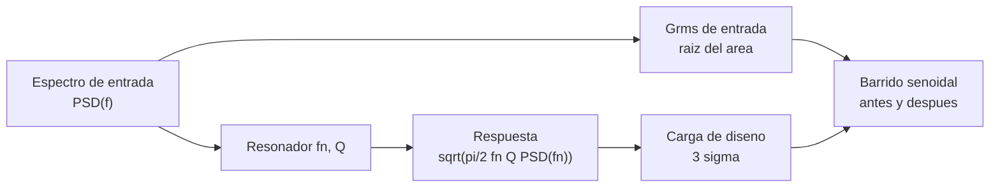

# B90-C09 — Ensayos de vibración

<!-- nav:top -->
[🏠 Programa](../../../../README.md) · [📚 Bloque B90](../../../tronco-comun/B90-integracion-ensayos-y-calificacion-espacial.md) · [← Anterior: B90-C08 — Procedimientos de prueba funcional](../B90-C08-procedimientos-de-prueba-funcional/CLASE.md) · [Siguiente: B90-C10 — Ensayos de choque →](../B90-C10-ensayos-de-choque/CLASE.md)
<!-- /nav -->

## 1. Ubicación, nivel y alcance

Clase 9 del bloque B90. Nivel N3. Durante el lanzamiento la nave vibra en un amplio rango de frecuencias; el **ensayo de vibración aleatoria** reproduce ese ambiente sobre una mesa vibradora con un **espectro de densidad de potencia** (PSD). Aquí calculas la aceleración eficaz (Grms) de un espectro por tramos, la respuesta de un resonador con la ecuación de Miles y la comprueba contra una integral numérica. Todos los niveles son **sintéticos**: no son los de una norma ni los de un lanzador.

## 2. Por qué esta clase existe

Un espectro se especifica con una curva; lo que importa al hardware es cuánto se amplifica en sus resonancias. La decisión central: **¿qué nivel y duración de ensayo hay que aplicar y qué carga ve un equipo con una resonancia dada?**

## 3. Lo que podrás hacer al terminar

1. Calcular el área (g²) y el Grms de un espectro lineal por tramos en escala log-log.
2. Verificar el área con una integral numérica.
3. Aplicar la ecuación de Miles a una resonancia de frecuencia `fn` y factor de calidad `Q`.
4. Contrastar Miles con la integral de la transmisibilidad de un oscilador.
5. Evaluar un criterio de verificación (desplazamiento de la resonancia antes y después).
6. Separar lo consultado (qué dice el alcance de NASA-STD-7001C y lo que piden CubeSat 101 y la CDS) de lo sintético.

La evidencia es la **ficha de un espectro de vibración y su respuesta** del ejercicio 12 (sección 20).

## 4. Con qué llegas y cómo comprobarlo

1. ¿Qué es una densidad espectral de potencia y en qué unidades se da una de aceleración?
2. ¿Qué es el valor eficaz (rms) de una señal?
3. ¿Qué es un oscilador de un grado de libertad y qué es su factor de calidad `Q`?
4. ¿Qué es una escala log-log?
5. ¿Qué es una comprobación independiente?

<details>
<summary>Ver respuestas</summary>

1. Potencia por unidad de frecuencia; para aceleración, g²/Hz. 2. La raíz del promedio del cuadrado; el área bajo la PSD es su cuadrado. 3. Un sistema masa-resorte-amortiguador; `Q = 1/(2ζ)` es la amplificación en resonancia. 4. Una escala donde ambas variables van en logaritmo; un tramo recto es una ley de potencias. 5. Calcular lo mismo por otro método y comparar.
</details>

Con cuatro o cinco aciertos, sigue; si no, repasa los prerrequisitos.

## 5. Un caso de contexto y casos de referencia

Un espectro de ejemplo sube de 0,010 a 0,040 g²/Hz entre 20 y 80 Hz, se mantiene en 0,040 hasta 500 Hz y baja a 0,010 a 2 000 Hz: **Grms = 6,784 g** (área 46,026 g²), con pico de 3 sigma de 20,4 g. Un equipo con resonancia de 300 Hz y `Q = 10` responde con **13,73 g rms**, una amplificación de 2,02. Los niveles son **sintéticos**.

## 6. Vocabulario

**PSD:** densidad espectral de potencia, g²/Hz. **Grms:** aceleración eficaz, raíz del área. **Resonancia:** frecuencia a la que un equipo amplifica. **Factor `Q`:** amplificación en resonancia. **Transmisibilidad:** cociente respuesta/entrada en función de la frecuencia. **Ecuación de Miles:** aproximación de la respuesta rms para un oscilador de banda estrecha con PSD plana. **Barrido senoidal de verificación:** barrido de baja amplitud antes y después que detecta cambios de resonancia.

## 7. Modelo mental: la mesa excita, la resonancia amplifica



*Descripción textual:* el espectro de entrada da el Grms; un resonador amplifica la entrada alrededor de su frecuencia natural, y la ecuación de Miles da su respuesta rms; el pico de 3 sigma da una carga de diseño y los barridos antes y después verifican que no cambió la estructura.

Analogía: empujar a un niño en un columpio con empujones aleatorios: el columpio responde sobre todo a los empujones cerca de su ritmo natural. Límite: la analogía no refleja que la estructura tiene muchos modos, no uno solo.

## 8. La explicación, paso a paso

### 8.1 Qué dicen las fuentes

NASA-STD-7001C, *Payload Vibroacoustic Test Criteria* (F4), cubre los entornos y niveles de ensayo acústico y de vibración aleatoria de cargas útiles; excluye lanzadores y equipos de tierra; la página es lo único consultado. La *CubeSat Design Specification* (F8) pide vibración aleatoria a los niveles y duración del proveedor de lanzamiento y señala que GSFC-STD-7000A y SMC-S-016 solo orientan si el entorno es desconocido. *CubeSat 101* (F7) pide mostrar que el CubeSat fue ensayado a los niveles del ICD, que quedó intacto (inspección visual y barridos senoidales previos y posteriores) y que no se modifica el hardware después. GEVS (F1) cubre la verificación ambiental con niveles guía; su texto no se consultó.

### 8.2 Área y Grms de un espectro por tramos

En un tramo con `P(f) = P₁ (f/f₁)^m` y `m = ln(P₂/P₁)/ln(f₂/f₁)`: área `= P₁ f₁/(m+1) [(f₂/f₁)^{m+1} − 1]` (si `m = −1`, `P₁ f₁ ln(f₂/f₁)`). Para el espectro de ejemplo:

| Tramo (Hz) | Pendiente (dB/oct) | Área (g²) |
|---|---|---|
| 20–80 | +3,01 | 1,5000 |
| 80–500 | 0 | 16,8000 |
| 500–2 000 | −3,01 | 27,7259 |

Área total `= 46,0259 g²`; `Grms = √46,0259 = 6,784 g`. La integral numérica (trapecio, 4 001 puntos) da el mismo valor.

### 8.3 Respuesta de un resonador: Miles

`G_resp = √(π/2 · fn · Q · PSD(fn))`. Con `fn = 300 Hz`, `Q = 10` y `PSD(300) = 0,040`: `√(1,5708 × 300 × 10 × 0,040) = 13,73 g`. La integral de `|T(f)|² PSD(f)`, con `T² = (1 + (2ζr)²)/((1 − r²)² + (2ζr)²)` y `r = f/fn`, da `13,722 g`: diferencia de 0,05 %. El pico de 3 sigma de la respuesta es 41,2 g.

| `Q` | Respuesta (g rms) |
|---|---|
| 5 | 9,71 |
| 10 | 13,73 |
| 20 | 19,42 |
| 50 | 30,70 |

La respuesta crece con `√Q`.

### 8.4 Verificación con barridos

Un barrido senoidal de baja amplitud antes y después del ensayo mide la frecuencia de resonancia: 300 Hz antes y 291 Hz después son un desplazamiento de −3,0 %. Con un criterio de ejemplo de 5 % pasa; en un proyecto real el criterio lo da el plan de ensayo. Un cambio mayor sugiere un fallo estructural (un tornillo aflojado, una grieta) y se trata como anomalía (C17).

## 9. Magnitudes, símbolos y unidades

| Símbolo | Qué es | Unidad | Valor / nota |
|---|---|---|---|
| `f` | frecuencia | Hz | 20 a 2 000 |
| `PSD` | densidad espectral | g²/Hz | 0,010 a 0,040 |
| `Grms` | aceleración eficaz | g | 6,784 |
| `fn`, `Q` | resonancia y factor de calidad | Hz, — | 300; 10 |
| `G_resp` | respuesta rms (Miles) | g | 13,73 |
| `g` | aceleración de la gravedad | m/s² | 9,80665 |

## 10. Convenciones y referencias

Un solo eje, un solo resonador, ruido gaussiano estacionario. Unidades g²/Hz, g y Hz. Sistema de referencia: el eje de excitación de la mesa. Tolerancias: área exacta frente a trapecio `< 10⁻²` (la rejilla de 4 001 puntos); Miles frente a integral `< 3 %`. El espectro, la resonancia, `Q` y el criterio de 5 % son **sintéticos**; no son los de GEVS, NASA-STD-7001C ni los del proveedor de lanzamiento.

## 11. De dónde sale lo que afirmamos

| ID | Fuente | Localizador | Respalda | Estado |
|---|---|---|---|---|
| F4 | NASA, NASA-STD-7001 Version C, Payload Vibroacoustic Test Criteria — https://standards.nasa.gov/standard/nasa/nasa-std-7001 (consultada 2026-11-10) | página de la norma | título, versión C (cambio 0), fecha 14-07-2026 y alcance: entornos y niveles de ensayo acústico y de vibración aleatoria de cargas útiles; excluye lanzadores y equipo de tierra | Consultada (solo la página; no el texto de la norma) |
| F7 | NASA CubeSat Launch Initiative, CubeSat 101: Basic Concepts and Processes for First-Time CubeSat Developers (octubre de 2017) — PDF https://www.nasa.gov/wp-content/uploads/2017/03/nasa_csli_cubesat_101_508.pdf (consultada 2026-11-10 con PyMuPDF) | capítulo 6, secciones 6.9.2 y 6.9.3 y prueba DITL | el ICD fija niveles y duraciones de vibración y bakeout; contenido mínimo de los informes; no modificar el hardware tras el ensayo; el ciclado termovacío no se exige habitualmente | Consultada |
| F8 | Cal Poly CubeSat Program, CubeSat Design Specification Rev. 14.1 (febrero de 2022) — PDF https://static1.squarespace.com/static/5418c831e4b0fa4ecac1bacd/t/62193b7fc9e72e0053f00910/1645820809779/CDS+REV14_1+2022-02-09.pdf (consultada 2026-11-10 con PyMuPDF) | secciones 2.2, 2.3, 2.4 y 3 (3.1–3.5) | ensayos típicos (vibración aleatoria, bakeout termovacío, choque, inspección visual), calificación, protovuelo y aceptación, tres inhibidores independientes, rieles y centro de gravedad (tabla 2) | Consultada |
| F1 | NASA, GSFC-STD-7000 Version B, General Environmental Verification Standard (GEVS) — https://standards.nasa.gov/standard/gsfc/gsfc-std-7000 (consultada 2026-11-10) | solo la página de la norma | título, versión B (cambio 0), fecha 28-04-2021 y alcance: verificación ambiental de cargas útiles, subsistemas y componentes por prueba o análisis, con niveles guía | Consultada (solo la página; no el texto de la norma) |
| — | Texto de las normas ECSS (verificación, ensayos, EMC, limpieza, carga de nave) | — | — | No consultada |
| — | Ecuación de Miles, área de una PSD por tramos y transmisibilidad de un oscilador | — | las verifica el laboratorio con integración numérica | No consultada en una fuente concreta |

Límites: las páginas de F4 y F1 dan alcance, no niveles; los niveles de la clase no provienen de ellas.

## 12. Cómo ver el espectro

| Magnitud | Valor |
|---|---|
| `Grms` de entrada | 6,784 g |
| respuesta a 300 Hz, `Q = 10` | 13,73 g rms |
| pico 3σ de la respuesta | 41,2 g |
| diferencia Miles / integral | 0,05 % |

Descripción larga: la PSD tiene una meseta de 80 a 500 Hz que concentra el 36 % del área y un descenso a −3 dB/oct que aporta 60 % del área total, porque abarca dos octavas.

## 13. Ejemplo trabajado: de una PSD a una carga

**Paso 1 · Áreas.** 1,5 + 16,8 + 27,7259 = 46,0259 g².

**Paso 2 · Grms.** `√46,0259 = 6,784 g`.

**Paso 3 · Respuesta.** `√(π/2 × 300 × 10 × 0,040) = 13,73 g`.

**Paso 4 · Carga de diseño.** `3 × 13,73 = 41,2 g` (pico de 3 sigma).

**Paso 5 · Comprobación.** La integral de la transmisibilidad da 13,722 g.

## 14. Distintas formas de describir el ensayo

**Por espectro:** PSD, Grms y duración (esta clase). **Por pico:** carga cuasi-estática equivalente. **Por daño:** fatiga acumulada (C19). Un mismo ensayo se describe con las tres.

## 15. Práctica guiada

**Ejercicio 1 · con los pasos indicados.** Calcula el área de una meseta de 0,04 g²/Hz entre 80 y 500 Hz. *Pasos:* ancho, producto.

<details><summary>Solución comentada</summary>

`0,04 × 420 = 16,8 g²`.
</details>

**Ejercicio 2 · con una pista.** Calcula el Grms de un espectro plano de 0,02 g²/Hz de 20 a 2 000 Hz. *Pista:* `√(PSD × ancho)`.

<details><summary>Solución comentada</summary>

`√(0,02 × 1 980) = √39,6 = 6,29 g`.
</details>

**Ejercicio 3 · casi autónomo.** Calcula la respuesta de Miles con `fn = 200 Hz`, `Q = 10` y `PSD = 0,04`.

<details><summary>Solución comentada</summary>

`√(1,5708 × 200 × 10 × 0,04) = √125,7 = 11,2 g`.
</details>

## 16. Práctica autónoma, transferencia e integrador

**Ejercicio 4 · autónomo.** ¿Cómo cambia la respuesta si `Q` se duplica?

<details><summary>Solución comentada</summary>

Se multiplica por `√2 = 1,41` (de 13,73 a 19,42 g).
</details>

**Ejercicio 5 · autónomo.** ¿Cuántos dB corresponden a un tramo que sube de 0,010 a 0,040 g²/Hz?

<details><summary>Solución comentada</summary>

`10 log₁₀(4) = 6,02 dB`; en dos octavas (20→80 Hz) son 3,01 dB/oct.
</details>

**Ejercicio 6 · autónomo.** Calcula el pico de 3 sigma de una respuesta de 10 g rms.

<details><summary>Solución comentada</summary>

`30 g`.
</details>

**Ejercicio 7 · autónomo.** Si el espectro sube todo 3 dB, ¿cuánto cambia el Grms?

<details><summary>Solución comentada</summary>

La PSD se duplica (3,01 dB); el Grms sube `√2`: de 6,784 a 9,59 g.
</details>

**Ejercicio 8 · autónomo.** Una resonancia pasa de 300 a 270 Hz tras el ensayo. ¿Pasa el criterio de 5 %?

<details><summary>Solución comentada</summary>

Desplazamiento `−10 %`: **no pasa**; se abre una anomalía (C17).
</details>

**Ejercicio 9 · transferencia.** **Transferencia.** Un colega usa este espectro para calificar su equipo. ¿Es válido?

<details><summary>Solución comentada</summary>

No: es sintético; el espectro de calificación lo fija el proveedor de lanzamiento o el plan de ensayo (F8, F7).
</details>

**Ejercicio 10 · transferencia.** **Transferencia.** ¿Por qué Miles puede subestimar la respuesta de un equipo con resonancia a 60 Hz?

<details><summary>Solución comentada</summary>

Porque la PSD no es plana alrededor de 60 Hz (está subiendo a +3 dB/oct) y la aproximación supone una PSD constante en el ancho de banda de la resonancia.
</details>

**Ejercicio 11 · transferencia.** **Transferencia.** ¿Por qué no se desmonta el CubeSat después del ensayo?

<details><summary>Solución comentada</summary>

Porque cualquier cambio invalida el ensayo y exige repetirlo (F7, F8).
</details>

**Ejercicio 12 · integrador.** **Integrador.** Elabora tu *ficha de un espectro de vibración y su respuesta*: tabla de tramos, Grms, respuesta de un resonador con Miles y con la integral, carga de 3 sigma, criterio de barrido y lista de qué es consultado, no consultado y sintético.

<details><summary>Solución comentada</summary>

Secciones 8.2–8.4 y la salida del laboratorio.
</details>

## 17. Laboratorio: Grms y respuesta de un resonador

El script [vibracion_aleatoria.py](vibracion_aleatoria.py) calcula el área exacta de un espectro por tramos, la verifica con una integral numérica, calcula la respuesta de Miles y la contrasta con la integral de la transmisibilidad; **comprueba** el área (`< 1 %`), Miles (`< 3 %`) y el criterio de barrido. Usa la biblioteca común [b90_comun.py](../b90_comun.py).

**Datos:** espectro, resonancia, `Q` y criterio **sintéticos**; `g = 9,80665 m/s²`. **Predice antes de ejecutar:** ¿cuánto vale el Grms de entrada? (≈ 6,8 g.) Ejecución del 2026-11-10 (Python 3.12.9, numpy 2.4.4):

```text
Python 3.12.9 | numpy 2.4.4
Datos SINTETICOS: espectro de 20 a 2000 Hz y un resonador de 300 Hz con Q = 10
Tramo     20-    80 Hz: pendiente = 3.01 dB/oct ; area = 1.5000 g2
Tramo     80-   500 Hz: pendiente = 0.00 dB/oct ; area = 16.8000 g2
Tramo    500-  2000 Hz: pendiente = -3.01 dB/oct ; area = 27.7259 g2
Area total = 46.0259 g2 ; Grms = 6.784 g ; pico 3-sigma = 20.35 g
Integral numerica (trapecio en 4001 puntos) = 46.0259 g2 ; diferencia = 0.000 %
Respuesta del resonador: Miles = 13.729 g ; integral de |T|^2 PSD = 13.722 g ; diferencia = 0.05 %
Amplificacion de la respuesta = 2.02 ; pico 3-sigma de la respuesta = 41.2 g
Q -> respuesta Grms (Miles) [g]
    5 -> 9.71
   10 -> 13.73
   20 -> 19.42
   50 -> 30.70
Barrido de verificacion: f_pre = 300.0 Hz ; f_post = 291.0 Hz ; desplazamiento = -3.0 % (criterio de ejemplo 5.0 %) -> PASA
Pruebas superadas.
```

```bash
python programa/clases/B90/B90-C09-ensayos-de-vibracion/vibracion_aleatoria.py
```

**Límites:** un eje, un resonador, ruido gaussiano estacionario, sin acoplamiento con la mesa ni muestreo temporal real, sin fatiga.

## 18. Errores frecuentes y cómo corregirlos

**Confundir PSD con Grms.** El Grms es la raíz del área bajo la PSD (8.2)

**Usar Miles con una PSD que cambia mucho en la resonancia.** Integra la transmisibilidad (8.3)

**Presentar un espectro de ejemplo como el de un lanzador.** Revisa la sección 10

## 19. Cómo sabrás que vas bien

Tras la sección 8: ¿qué pasa con la respuesta si `Q` se cuadruplica? Si dudas, repasa el ejercicio 4. Tras el laboratorio: ¿qué compara la integral de la transmisibilidad? (ver sección 17).

## 20. Qué entregas y cómo se evalúa

El producto es tu **ficha de un espectro de vibración y su respuesta** (ejercicio 12).

| Criterio | Inicial | En desarrollo | Logrado | Destacado |
|---|---|---|---|---|
| Conceptos | Los confunde | Parciales | Explica el método y su dominio | Explica los límites y las alternativas |
| Cálculo | Sin unidades | Con errores | Resultados con unidades y comprobados | Resuelve casos nuevos |
| Numérico | Sin comprobar | Un caso | Verifica con una comprobación independiente en varios casos | Interpreta las diferencias y los fallos |
| Fuentes | Sin fuente | Sin fecha | Fuentes con fecha y estado | Declara lo sintético y lo no consultado |
| Límites | No los nombra | Uno | Tres | Discute qué falta del modelo |

**Condiciones críticas (no se compensan con promedio):** rotular los datos como sintéticos; verificar cada resultado con una comprobación independiente; citar solo lo consultado.

## 21. Ética, seguridad y límites

Clase educativa: los niveles son de ejemplo y no sustituyen el plan de ensayo ni los niveles del proveedor de lanzamiento; los ensayos reales usan equipos calificados y personal formado. Accesibilidad: tablas equivalentes a las gráficas, fórmulas en texto, ejercicios sin conexión.

## 22. Para cerrar y seguir

El espectro de ejemplo da 6,78 g rms y un resonador de 300 Hz con `Q = 10` responde con 13,73 g rms; los barridos antes y después detectan un cambio de 3,0 %. Queda una pregunta: ¿qué pasa cuando la excitación no es continua sino un golpe breve?

**Glosario español–inglés.** vibración aleatoria · *random vibration*; densidad espectral de potencia · *power spectral density (PSD)*; aceleración eficaz · *Grms*; factor de calidad · *quality factor (Q)*; barrido senoidal · *sine sweep*; resonancia · *resonance*.

**Continuidad.** [B90-C10](../B90-C10-ensayos-de-choque/CLASE.md) trata el ensayo de choque.

**Referencias:** ver sección 11.

<!-- nav:bottom -->
---

[← Anterior: B90-C08 — Procedimientos de prueba funcional](../B90-C08-procedimientos-de-prueba-funcional/CLASE.md) · [📚 Bloque B90](../../../tronco-comun/B90-integracion-ensayos-y-calificacion-espacial.md) · [Siguiente: B90-C10 — Ensayos de choque →](../B90-C10-ensayos-de-choque/CLASE.md)
<!-- /nav -->
