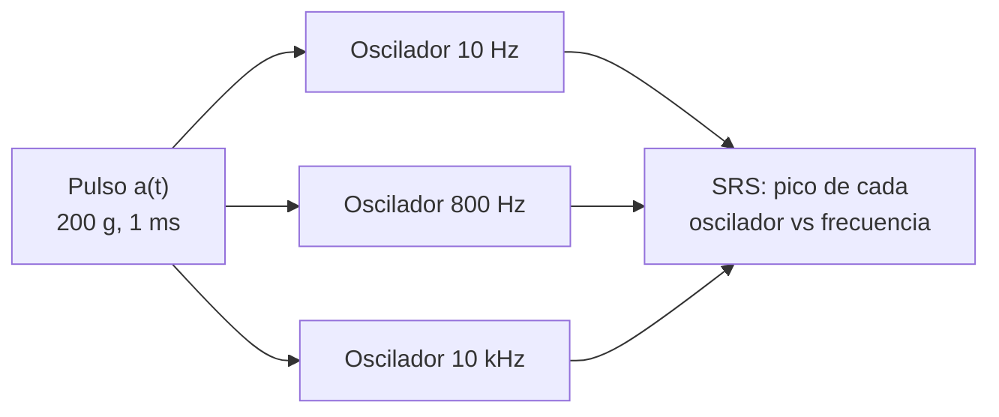

# B90-C10 — Ensayos de choque

<!-- nav:top -->
[🏠 Programa](../../../../README.md) · [📚 Bloque B90](../../../tronco-comun/B90-integracion-ensayos-y-calificacion-espacial.md) · [← Anterior: B90-C09 — Ensayos de vibración](../B90-C09-ensayos-de-vibracion/CLASE.md) · [Siguiente: B90-C11 — Ensayos térmicos →](../B90-C11-ensayos-termicos/CLASE.md)
<!-- /nav -->

## 1. Ubicación, nivel y alcance

Clase 10 del bloque B90. Nivel N3. Un **choque** es una excitación breve e intensa: el disparo de una separación pirotécnica, la liberación de una abrazadera, el impacto de una traba. Su efecto sobre un equipo no se describe con la forma del pulso sino con el **espectro de respuesta al choque** (SRS): el pico de respuesta de osciladores de distintas frecuencias sometidos al mismo pulso. Aquí calculas el SRS de un pulso semisenoidal sintético de 200 g y 1 ms y lo verificas con dos límites teóricos. Todos los niveles son **sintéticos**.

## 2. Por qué esta clase existe

Dos pulsos con distinta forma pueden dañar lo mismo si sus SRS coinciden, y un pulso con gran aceleración pico puede ser inofensivo para un equipo de baja frecuencia. La decisión central: **¿qué frecuencias de mi equipo están amenazadas por este choque y con qué nivel?**

## 3. Lo que podrás hacer al terminar

1. Definir el SRS de aceleración absoluta de un oscilador de un grado de libertad.
2. Calcularlo integrando la ecuación del oscilador con RK4.
3. Calcular el cambio de velocidad de un pulso semisenoidal.
4. Verificar el SRS a baja frecuencia con la respuesta analítica a un impulso.
5. Verificar el SRS a alta frecuencia con la amplitud del pulso.
6. Separar lo consultado (que CubeSat 101 y la CDS tratan el choque como ensayo a veces no exigido) de lo sintético.

La evidencia es el **espectro de choque de un pulso** del ejercicio 12 (sección 20).

## 4. Con qué llegas y cómo comprobarlo

1. ¿Qué es la ecuación de un oscilador forzado por su base?
2. ¿Qué es la aceleración absoluta frente a la relativa?
3. ¿Qué es un impulso?
4. ¿Qué es RK4?
5. ¿Qué es una comprobación independiente?

<details>
<summary>Ver respuestas</summary>

1. `z'' + 2ζω z' + ω² z = −a(t)`, con `z` desplazamiento relativo a la base. 2. La absoluta es la de la masa respecto de un sistema inercial: `2ζω z' + ω² z`. 3. Una fuerza muy breve: cambia la velocidad en `ΔV` sin mover mucho. 4. Un método de integración numérica de cuarto orden. 5. Calcular lo mismo por otro método y comparar.
</details>

Con cuatro o cinco aciertos, sigue; si no, repasa los prerrequisitos.

## 5. Un caso de contexto y casos de referencia

Un pulso semisenoidal `a(t) = A sen(πt/T)` con `A = 200 g` y `T = 1 ms` cambia la velocidad en `ΔV = 2AT/π = 1,2486 m/s`. Con osciladores de `Q = 10`, el SRS pasa de **7,45 g** a 10 Hz a un máximo de **330,2 g** (1,65 `A`) a 800 Hz y vuelve a **202,2 g** (1,01 `A`) a 10 kHz. Todo es **sintético**.

## 6. Vocabulario

**Choque:** excitación transitoria breve. **SRS:** espectro de respuesta al choque, pico del oscilador según su frecuencia. **Pulso semisenoidal:** medio ciclo de seno de amplitud `A` y duración `T`. **Cambio de velocidad `ΔV`:** integral de la aceleración. **Q:** factor de calidad del oscilador de análisis. **Amplificación máxima:** SRS máximo dividido por `A`.

## 7. Modelo mental: muchos osciladores prueban el mismo golpe



*Descripción textual:* el mismo pulso excita osciladores de frecuencias distintas; el pico de respuesta de cada uno, en función de su frecuencia, forma el SRS.

Analogía: golpear una mesa con una fila de diapasones: cada uno suena con una intensidad distinta según su afinación. Límite: la analogía no dice que dos golpes de forma distinta pueden producir la misma respuesta.

## 8. La explicación, paso a paso

### 8.1 Qué dicen las fuentes

La *CubeSat Design Specification* (F8) dice que el ensayo de choque se hace como lo defina el proveedor de lanzamiento y que normalmente no se exige a los CubeSats. *CubeSat 101* (F7) dice que los ensayos dinámicos son de choque y vibración, que la vibración se exige en todos los lanzamientos y que el proveedor no siempre pide choque. NASA-STD-7003 (choque pirotécnico) no se pudo consultar (la página devolvió 403) y GEVS (F1) solo se consultó en su página.

### 8.2 El oscilador y su pico

Con `z'' + 2ζω z' + ω² z = −a(t)`, `ζ = 1/(2Q) = 0,05` y aceleración absoluta `a_abs = 2ζω z' + ω² z`, el SRS de frecuencia `fn = ω/2π` es `máx |a_abs|`. Cada punto se calcula con RK4 y un paso `min(1/(200 fn), T/400)`.

### 8.3 Dos comprobaciones teóricas

**Baja frecuencia.** Si `T ≪ 1/fn`, el pulso es casi un impulso de cambio de velocidad `ΔV` y la respuesta absoluta pico es la del impulso amortiguado. A 10 Hz: SRS `= 7,45 g`; respuesta analítica del impulso `= 7,45 g` (diferencia 0,01 %); el SRS queda 6,9 % por debajo de la cota sin amortiguamiento `ω ΔV = 8,00 g`.
**Alta frecuencia.** Si `1/fn ≪ T`, el oscilador sigue al pulso y su respuesta tiende a `A`: a 10 kHz el SRS es `202,24 g = 1,011 A`.

### 8.4 El espectro completo

| `fn` (Hz) | SRS (g) | SRS/`A` | `ω ΔV` (g) |
|---|---|---|---|
| 10 | 7,45 | 0,037 | 8,00 |
| 100 | 73,81 | 0,369 | 80,00 |
| 400 | 255,83 | 1,279 | 320,00 |
| 800 | 330,20 | 1,651 | 640,00 |
| 1 000 | 324,76 | 1,624 | 800,00 |
| 2 000 | 242,47 | 1,212 | 1 600,00 |
| 10 000 | 202,24 | 1,011 | 8 000,00 |

El SRS crece en proporción a `fn` a baja frecuencia (pendiente +6 dB/oct), alcanza un máximo cerca de `0,8/T` y converge a `A` a alta frecuencia. Con `Q` = 5, 10 y 20, el SRS a 1 000 Hz es 307,3, 324,8 y 335,0 g.

## 9. Magnitudes, símbolos y unidades

| Símbolo | Qué es | Unidad | Valor / nota |
|---|---|---|---|
| `A`, `T` | amplitud y duración del pulso | g, ms | 200; 1 |
| `ΔV` | cambio de velocidad | m/s | 1,2486 |
| `Q`, `ζ` | calidad y amortiguamiento | —, — | 10; 0,05 |
| `fn` | frecuencia del oscilador | Hz | 10 a 10 000 |
| SRS | pico de aceleración absoluta | g | tabla 8.4 |

## 10. Convenciones y referencias

Aceleración absoluta, pico máximo (positivo o negativo) sobre el tiempo calculado. `g = 9,80665 m/s²`. Sistema de referencia: la base de un oscilador de un grado de libertad. Tolerancias: baja frecuencia frente al impulso analítico `< 2 %`; alta frecuencia dentro de `[A, 1,2 A]`; máximo `≤ 2 A`. El pulso y `Q` son **sintéticos**; ningún valor representa un dispositivo pirotécnico real.

## 11. De dónde sale lo que afirmamos

| ID | Fuente | Localizador | Respalda | Estado |
|---|---|---|---|---|
| F8 | Cal Poly CubeSat Program, CubeSat Design Specification Rev. 14.1 (febrero de 2022) — PDF https://static1.squarespace.com/static/5418c831e4b0fa4ecac1bacd/t/62193b7fc9e72e0053f00910/1645820809779/CDS+REV14_1+2022-02-09.pdf (consultada 2026-11-10 con PyMuPDF) | secciones 2.2, 2.3, 2.4 y 3 (3.1–3.5) | ensayos típicos (vibración aleatoria, bakeout termovacío, choque, inspección visual), calificación, protovuelo y aceptación, tres inhibidores independientes, rieles y centro de gravedad (tabla 2) | Consultada |
| F7 | NASA CubeSat Launch Initiative, CubeSat 101: Basic Concepts and Processes for First-Time CubeSat Developers (octubre de 2017) — PDF https://www.nasa.gov/wp-content/uploads/2017/03/nasa_csli_cubesat_101_508.pdf (consultada 2026-11-10 con PyMuPDF) | capítulo 6, secciones 6.9.2 y 6.9.3 y prueba DITL | el ICD fija niveles y duraciones de vibración y bakeout; contenido mínimo de los informes; no modificar el hardware tras el ensayo; el ciclado termovacío no se exige habitualmente | Consultada |
| F1 | NASA, GSFC-STD-7000 Version B, General Environmental Verification Standard (GEVS) — https://standards.nasa.gov/standard/gsfc/gsfc-std-7000 (consultada 2026-11-10) | solo la página de la norma | título, versión B (cambio 0), fecha 28-04-2021 y alcance: verificación ambiental de cargas útiles, subsistemas y componentes por prueba o análisis, con niveles guía | Consultada (solo la página; no el texto de la norma) |
| — | MIL-STD-461, MIL-STD-1540 y MIL-STD-810 | — | — | No consultada |
| — | NASA-STD-7003 (choque pirotécnico) | https://standards.nasa.gov/standard/nasa/nasa-std-7003 | — | No consultada (la página devolvió 403 el 2026-11-10) |
| — | Definición del SRS, respuesta de un oscilador a un impulso y comportamiento límite | — | las verifica el laboratorio con la respuesta analítica del impulso y con la amplitud del pulso | No consultada en una fuente concreta |

Límites: ninguna fuente consultada da niveles de choque; el pulso es didáctico.

## 12. Cómo ver el SRS

| Magnitud | Valor |
|---|---|
| `ΔV` | 1,2486 m/s |
| SRS máximo | 330,2 g a 800 Hz |
| SRS a 10 Hz | 7,45 g |
| SRS a 10 kHz | 202,2 g |

Descripción larga: el SRS sube con pendiente de 6 dB por octava hasta cerca de 800 Hz, llega a 1,65 veces la amplitud del pulso y baja hacia 1 `A`.

## 13. Ejemplo trabajado: cuánto amenaza el pulso a un equipo de 100 Hz

**Paso 1 · Frecuencia.** `fn = 100 Hz`, `ζ = 0,05`.

**Paso 2 · Cota de baja frecuencia.** `ω ΔV/g = 628,3 × 1,2486/9,80665 = 80,0 g`.

**Paso 3 · SRS calculado.** `73,81 g` (RK4), 7,7 % menor por el amortiguamiento y por el ancho del pulso.

**Paso 4 · Interpretación.** El equipo ve 74 g aunque el pulso tenga 200 g de pico: el SRS, no el pico, es la medida de amenaza.

## 14. Distintas formas de describir el choque

**Por el pulso:** forma, amplitud y duración. **Por el SRS:** pico de respuesta por frecuencia (esta clase). **Por la velocidad:** `ΔV`. En frecuencias bajas manda `ΔV`; en altas, `A`.

## 15. Práctica guiada

**Ejercicio 1 · con los pasos indicados.** Calcula `ΔV` de un pulso de 100 g y 2 ms. *Pasos:* `2 A T/π`, con `A` en m/s².

<details><summary>Solución comentada</summary>

`2 × 980,665 × 0,002/π = 1,249 m/s`.
</details>

**Ejercicio 2 · con una pista.** Calcula `ω ΔV/g` a 50 Hz con `ΔV = 1,2486 m/s`. *Pista:* `ω = 2π f`.

<details><summary>Solución comentada</summary>

`314,16 × 1,2486/9,80665 = 40,0 g` (el SRS calculado es 37,17 g).
</details>

**Ejercicio 3 · casi autónomo.** ¿Qué amplificación máxima (SRS/`A`) tiene el pulso de ejemplo?

<details><summary>Solución comentada</summary>

`330,2/200 = 1,65`.
</details>

## 16. Práctica autónoma, transferencia e integrador

**Ejercicio 4 · autónomo.** ¿Qué valor tiene el SRS a 10 kHz respecto de `A`?

<details><summary>Solución comentada</summary>

`202,24/200 = 1,011`: el oscilador de alta frecuencia sigue al pulso.
</details>

**Ejercicio 5 · autónomo.** ¿Por qué el SRS crece 6 dB por octava a baja frecuencia?

<details><summary>Solución comentada</summary>

Porque `SRS ≈ ω ΔV` es proporcional a la frecuencia; duplicar `fn` duplica el SRS (+6 dB).
</details>

**Ejercicio 6 · autónomo.** ¿Qué pasa con el SRS a 1 000 Hz si `Q` pasa de 10 a 20?

<details><summary>Solución comentada</summary>

Sube de 324,76 a 334,98 g (3 %): el pulso es tan breve que el amortiguamiento afecta poco.
</details>

**Ejercicio 7 · autónomo.** Si el pulso fuera de 2 ms, ¿hacia qué frecuencia se mueve el máximo?

<details><summary>Solución comentada</summary>

Hacia la mitad (≈ 400 Hz): el máximo está cerca de `0,8/T`.
</details>

**Ejercicio 8 · autónomo.** Calcula `ω ΔV/g` a 1 000 Hz y compáralo con el SRS de 324,76 g.

<details><summary>Solución comentada</summary>

`800 g` frente a 324,8 g: la asíntota de baja frecuencia no vale cuando `fn T` es del orden de 1.
</details>

**Ejercicio 9 · transferencia.** **Transferencia.** Un colega afirma que su equipo «resiste 200 g de choque». ¿Qué falta?

<details><summary>Solución comentada</summary>

El SRS del choque real y las frecuencias de su equipo: 200 g de pico no dicen la amenaza.
</details>

**Ejercicio 10 · transferencia.** **Transferencia.** ¿Por qué un CubeSat puede quedar exento del ensayo de choque?

<details><summary>Solución comentada</summary>

Porque el proveedor de lanzamiento define si lo exige y suele no hacerlo (F8, 3.3; F7); la decisión la da el ICD.
</details>

**Ejercicio 11 · transferencia.** **Transferencia.** ¿Qué limita usar el SRS de un solo grado de libertad para un equipo real?

<details><summary>Solución comentada</summary>

Un equipo real tiene muchos modos y amortiguamientos distintos; el SRS es una medida estándar de severidad, no una predicción de la respuesta de un punto concreto.
</details>

**Ejercicio 12 · integrador.** **Integrador.** Elabora tu *espectro de choque de un pulso*: pulso, `ΔV`, tabla SRS, comprobaciones de baja y alta frecuencia y lista de qué es consultado, no consultado y sintético.

<details><summary>Solución comentada</summary>

Secciones 8.2–8.4 y la salida del laboratorio.
</details>

## 17. Laboratorio: SRS de un pulso semisenoidal

El script [espectro_de_choque.py](espectro_de_choque.py) integra con RK4 el oscilador a 11 frecuencias, tabula el SRS y lo contrasta con la respuesta analítica a un impulso a 10 Hz y con la amplitud del pulso a 10 kHz. **Comprueba** ambos límites y que el máximo no supera 2 `A`. Usa la biblioteca común [b90_comun.py](../b90_comun.py).

**Datos:** pulso y `Q` **sintéticos**; `g = 9,80665 m/s²`. **Predice antes de ejecutar:** ¿hacia qué valor tiende el SRS a muy alta frecuencia? (A `A`.) Ejecución del 2026-11-10 (Python 3.12.9, numpy 2.4.4):

```text
Python 3.12.9 | numpy 2.4.4
Datos SINTETICOS: semisenoidal de 200 g y 1 ms; resonador de Q = 10
Cambio de velocidad del pulso DV = 2 A T / pi = 1.2486 m/s
fn [Hz]   SRS [g]   SRS/A   w DV [g] (asintota baja)
     10      7.45   0.037       8.00
     20     14.90   0.074      16.00
     50     37.17   0.186      40.00
    100     73.81   0.369      80.00
    200    143.52   0.718     160.00
    400    255.83   1.279     320.00
    800    330.20   1.651     640.00
   1000    324.76   1.624     800.00
   2000    242.47   1.212    1600.00
   5000    208.60   1.043    4000.00
  10000    202.24   1.011    8000.00
Baja frecuencia (10 Hz): SRS = 7.45 g ; w DV (sin amortiguamiento) = 8.00 g ; impulso analitico amortiguado = 7.45 g
  diferencia SRS frente al impulso analitico = 0.01 % ; frente a w DV = 6.87 %
Alta frecuencia (10 kHz): SRS = 202.24 g = 1.011 A
Maximo del SRS = 330.20 g en 800 Hz (1.651 A)
SRS en 1000 Hz para otro Q
  Q =  5: 307.33 g
  Q = 10: 324.76 g
  Q = 20: 334.98 g
Pruebas superadas.
```

```bash
python programa/clases/B90/B90-C10-ensayos-de-choque/espectro_de_choque.py
```

**Límites:** un solo oscilador, pulso ideal, sin aceleración inicial del oscilador, sin pirotecnia real; tarda unos segundos por la integración en Python.

## 18. Errores frecuentes y cómo corregirlos

**Confundir la aceleración pico con la amenaza.** Calcula el SRS (8.4)

**Usar la cota `ωΔV` a alta frecuencia.** Solo vale si `fn T ≪ 1` (8.3)

**Presentar el pulso de ejemplo como un choque real.** Revisa la sección 10

## 19. Cómo sabrás que vas bien

Tras la sección 8: ¿hacia qué valor tiende el SRS de un pulso a alta frecuencia? Si dudas, repasa el ejercicio 4. Tras el laboratorio: ¿qué verifica la respuesta del impulso a 10 Hz? (ver sección 17).

## 20. Qué entregas y cómo se evalúa

El producto es tu **espectro de choque de un pulso** (ejercicio 12).

| Criterio | Inicial | En desarrollo | Logrado | Destacado |
|---|---|---|---|---|
| Conceptos | Los confunde | Parciales | Explica el método y su dominio | Explica los límites y las alternativas |
| Cálculo | Sin unidades | Con errores | Resultados con unidades y comprobados | Resuelve casos nuevos |
| Numérico | Sin comprobar | Un caso | Verifica con una comprobación independiente en varios casos | Interpreta las diferencias y los fallos |
| Fuentes | Sin fuente | Sin fecha | Fuentes con fecha y estado | Declara lo sintético y lo no consultado |
| Límites | No los nombra | Uno | Tres | Discute qué falta del modelo |

**Condiciones críticas (no se compensan con promedio):** rotular los datos como sintéticos; verificar cada resultado con una comprobación independiente; citar solo lo consultado.

## 21. Ética, seguridad y límites

Clase educativa: el pulso es de ejemplo y no representa un dispositivo real; los ensayos de choque reales los hacen laboratorios con procedimientos de seguridad. Accesibilidad: tablas equivalentes a las gráficas, fórmulas en texto, ejercicios sin conexión.

## 22. Para cerrar y seguir

El pulso de 200 g y 1 ms tiene `ΔV = 1,2486 m/s` y un SRS que sube hasta 330 g a 800 Hz y baja a 202 g a 10 kHz; su amenaza depende de la frecuencia del equipo. Queda una pregunta: ¿cómo se comprueba la nave frente a los cambios de temperatura?

**Glosario español–inglés.** choque · *shock*; espectro de respuesta al choque · *shock response spectrum (SRS)*; pulso semisenoidal · *half-sine pulse*; cambio de velocidad · *velocity change*; oscilador · *oscillator*; amplificación · *amplification*.

**Continuidad.** [B90-C11](../B90-C11-ensayos-termicos/CLASE.md) trata los ensayos térmicos.

**Referencias:** ver sección 11.

<!-- nav:bottom -->
---

[← Anterior: B90-C09 — Ensayos de vibración](../B90-C09-ensayos-de-vibracion/CLASE.md) · [📚 Bloque B90](../../../tronco-comun/B90-integracion-ensayos-y-calificacion-espacial.md) · [Siguiente: B90-C11 — Ensayos térmicos →](../B90-C11-ensayos-termicos/CLASE.md)
<!-- /nav -->
