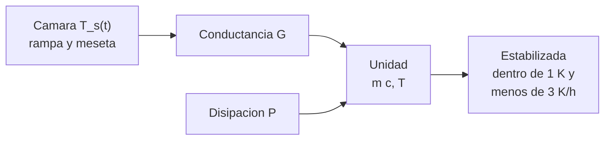

# B90-C11 — Ensayos térmicos

<!-- nav:top -->
[🏠 Programa](../../../../README.md) · [📚 Bloque B90](../../../tronco-comun/B90-integracion-ensayos-y-calificacion-espacial.md) · [← Anterior: B90-C10 — Ensayos de choque](../B90-C10-ensayos-de-choque/CLASE.md) · [Siguiente: B90-C12 — Vacío térmico y ciclos →](../B90-C12-vacio-termico-y-ciclos/CLASE.md)
<!-- /nav -->

## 1. Ubicación, nivel y alcance

Clase 11 del bloque B90. Nivel N3. Un **ensayo térmico** lleva la unidad a temperaturas extremas para demostrar que funciona y resiste. Lo difícil no es llegar a la temperatura de la cámara sino **cuándo la unidad la alcanza**: su inercia térmica la hace seguir a la cámara con retraso. Aquí modelas un nodo concentrado, calculas la constante de tiempo, el retraso en una rampa y el tiempo de estabilización, y comparas la solución exacta con RK4. Todos los datos son **sintéticos**.

## 2. Por qué esta clase existe

Una prueba funcional hecha antes de que la unidad se estabilice no demuestra nada sobre la temperatura extrema; una espera excesiva consume cámara y calendario. La decisión central: **¿cuánto debe esperar el ensayo para que la temperatura de la unidad sea la de la prueba?**

## 3. Lo que podrás hacer al terminar

1. Plantear la ecuación de un nodo térmico concentrado y calcular su constante de tiempo.
2. Resolver la respuesta a una rampa y a una meseta.
3. Calcular el retraso en una rampa y el desfase al final.
4. Calcular el tiempo de estabilización con un criterio de ejemplo.
5. Verificar con RK4 la solución exacta.
6. Separar lo consultado (que el ciclado térmico es un ensayo aparte) de lo sintético.

La evidencia es el **perfil térmico con tiempos de estabilización** del ejercicio 12 (sección 20).

## 4. Con qué llegas y cómo comprobarlo

1. ¿Qué es la capacidad térmica `m c`?
2. ¿Qué es una conductancia térmica `G` en W/K?
3. ¿Qué es una constante de tiempo `τ`?
4. ¿Qué es una rampa de temperatura?
5. ¿Qué es una comprobación independiente?

<details>
<summary>Ver respuestas</summary>

1. La energía para subir 1 K la temperatura: `m c` en J/K. 2. Potencia por kelvin de diferencia: `G = Q/ΔT`. 3. El tiempo en que se recorre el 63 % de un cambio; aquí `m c/G`. 4. Un cambio lineal de la temperatura en el tiempo. 5. Calcular lo mismo por otro método y comparar.
</details>

Con cuatro o cinco aciertos, sigue; si no, repasa los prerrequisitos.

## 5. Un caso de contexto y casos de referencia

Una unidad de 2,0 kg (`c = 900 J/(kg·K)`) en una cámara con conductancia 2,0 W/K y 5 W de disipación interna tiene `τ = 900 s = 15 min` y un offset de régimen de 2,5 K. La cámara sube de 20 a 65 °C a 1 K/min (45 min). Al terminar la rampa la unidad va **14,25 K por debajo** de la meseta y necesita **44,2 min** más para estabilizarse. Todo es **sintético**: la unidad, la cámara y el criterio de estabilización no son los de una norma.

## 6. Vocabulario

**Nodo concentrado:** modelo de una sola temperatura. **Constante de tiempo `τ`:** `m c/G`. **Rampa:** variación lineal de la temperatura de la cámara. **Meseta (*dwell*):** tiempo a temperatura constante. **Estabilización:** estado donde la unidad ya no cambia apreciablemente. **Margen de ensayo:** diferencia entre la temperatura de ensayo y la prevista en órbita. **Balance térmico:** ensayo para correlacionar el modelo térmico.

## 7. Modelo mental: una bañera que se llena por una llave



*Descripción textual:* la cámara sigue una rampa y una meseta; el calor llega a la unidad por la conductancia `G` y se suma la disipación `P`; la unidad se considera estabilizada cuando está dentro de 1 K de su valor de régimen y su deriva es menor de 3 K/h (criterio de ejemplo).

Analogía: llenar una bañera grande con un grifo delgado: el nivel sigue al del grifo con un retraso fijo. Límite: la analogía supone un único nivel, y la unidad real tiene varios nodos con distintas inercias.

## 8. La explicación, paso a paso

### 8.1 Qué dicen las fuentes

*CubeSat 101* (F7) separa el *bakeout* termovacío (casi siempre exigido) del **ciclado** termovacío (no exigido habitualmente), y pide informes con registros de temperatura con marca de tiempo y fotos de la ubicación de los termopares. La *CubeSat Design Specification* (F8) deja a cargo del proveedor de lanzamiento la especificación del ensayo. GEVS (F1) cubre la verificación ambiental con niveles guía; ECSS-Q-ST-70-04C *Thermal testing for the evaluation of space materials, processes, mechanical parts and assemblies* (15-11-2008) existe (F9). Los criterios de estabilización y los márgenes de esta clase son de ejemplo.

### 8.2 El nodo concentrado

`m c dT/dt = G (T_s − T) + P`, con `τ = m c/G = 2 × 900/2 = 900 s`. Con la cámara constante, `T → T_s + P/G`.

### 8.3 Rampa y meseta

Con una rampa `T_s = T₀ + r t`, la solución (partiendo del régimen en `T₀`) es `T = T₀ + P/G + r (t − τ) + r τ e^{−t/τ}`. Pasado un tiempo, la unidad sigue a la cámara con un retraso `r τ = 15 K`. Al final de la rampa (45 min), `T = 53,247 °C` mientras la cámara está en 65 °C; en la meseta, `T → 67,5 °C` (65 + 2,5 K).

| `t` (min) | `T_s` (°C) | `T` exacta (°C) | RK4 (°C) |
|---|---|---|---|
| 30,0 | 50,0 | 39,530 | 39,530 |
| 45,0 | 65,0 | 53,247 | 53,247 |
| 75,0 | 65,0 | 65,571 | 65,571 |
| 105,0 | 65,0 | 67,239 | 67,239 |

### 8.4 Estabilización y margen

El criterio de ejemplo (dentro de 1 K de 67,5 °C y deriva menor de 3 K/h) se alcanza a los `2 650 s = 44,2 min` de terminada la rampa, y coincide con el cálculo analítico `τ ln(|ΔT₀|/(3/3600 · τ)) = 2 650 s`. El tiempo total hasta la prueba funcional es `45 + 44,2 = 89,2 min`. Si la temperatura máxima prevista es 55 °C y el margen de ejemplo es 10 K, la temperatura de ensayo es 65 °C (el margen real lo da el plan).

## 9. Magnitudes, símbolos y unidades

| Símbolo | Qué es | Unidad | Valor / nota |
|---|---|---|---|
| `m`, `c` | masa y calor específico | kg, J/(kg·K) | 2,0; 900 |
| `G` | conductancia térmica | W/K | 2,0 |
| `P` | disipación interna | W | 5 |
| `τ` | constante de tiempo | s | 900 |
| `r` | velocidad de la rampa | K/min | 1 |
| `T_s`, `T` | temperatura de cámara y de unidad | °C | 20 a 65 |

## 10. Convenciones y referencias

Unidades SI con temperaturas en °C (las diferencias en K). Modelo lineal de un nodo, conducción dominante, sin radiación no lineal ni gradientes internos. Sistema de referencia: no aplica. Tolerancias: RK4 (paso 1 s) frente a solución exacta `< 10⁻³ K`; tiempo numérico frente al analítico `< 2 s`. La unidad, la cámara y el criterio (1 K y 3 K/h) son **sintéticos**.

## 11. De dónde sale lo que afirmamos

| ID | Fuente | Localizador | Respalda | Estado |
|---|---|---|---|---|
| F7 | NASA CubeSat Launch Initiative, CubeSat 101: Basic Concepts and Processes for First-Time CubeSat Developers (octubre de 2017) — PDF https://www.nasa.gov/wp-content/uploads/2017/03/nasa_csli_cubesat_101_508.pdf (consultada 2026-11-10 con PyMuPDF) | capítulo 6, secciones 6.9.2 y 6.9.3 y prueba DITL | el ICD fija niveles y duraciones de vibración y bakeout; contenido mínimo de los informes; no modificar el hardware tras el ensayo; el ciclado termovacío no se exige habitualmente | Consultada |
| F8 | Cal Poly CubeSat Program, CubeSat Design Specification Rev. 14.1 (febrero de 2022) — PDF https://static1.squarespace.com/static/5418c831e4b0fa4ecac1bacd/t/62193b7fc9e72e0053f00910/1645820809779/CDS+REV14_1+2022-02-09.pdf (consultada 2026-11-10 con PyMuPDF) | secciones 2.2, 2.3, 2.4 y 3 (3.1–3.5) | ensayos típicos (vibración aleatoria, bakeout termovacío, choque, inspección visual), calificación, protovuelo y aceptación, tres inhibidores independientes, rieles y centro de gravedad (tabla 2) | Consultada |
| F1 | NASA, GSFC-STD-7000 Version B, General Environmental Verification Standard (GEVS) — https://standards.nasa.gov/standard/gsfc/gsfc-std-7000 (consultada 2026-11-10) | solo la página de la norma | título, versión B (cambio 0), fecha 28-04-2021 y alcance: verificación ambiental de cargas útiles, subsistemas y componentes por prueba o análisis, con niveles guía | Consultada (solo la página; no el texto de la norma) |
| F9 | ECSS, listado de normas activas — https://ecss.nl/standards/active-standards/ (consultada 2026-11-10) | solo títulos y fechas | existencia, código y fecha de ECSS-E-ST-10-02C Rev.1, ECSS-E-ST-10-03C Rev.1, ECSS-E-ST-20-07C Rev.2, ECSS-Q-ST-70-01C Rev.1, ECSS-E-ST-20-06C Rev.1, ECSS-Q-ST-70-55C y ECSS-U-ST-20C | Consultada (solo títulos y fechas; el texto de las normas no se consultó) |
| — | Ecuación de un nodo concentrado y su solución exacta | — | las verifica el laboratorio con RK4 | No consultada en una fuente concreta |

Límites: ninguna fuente consultada da velocidades de rampa, márgenes ni criterios de estabilización.

## 12. Cómo ver el perfil

| Magnitud | Valor |
|---|---|
| `τ` | 900 s |
| retraso en rampa | 15 K |
| desfase al final de la rampa | 14,25 K |
| estabilización | 44,2 min |

Descripción larga: la temperatura de la unidad sube con pendiente de 1 K/min pero 15 K atrasada, y tras el fin de la rampa se aproxima exponencialmente a 67,5 °C.

## 13. Ejemplo trabajado: cuándo hacer la prueba funcional

**Paso 1 · Constante de tiempo.** `τ = m c/G = 1 800/2 = 900 s`.

**Paso 2 · Desfase.** Al fin de la rampa `ΔT₀ = T − (T_s + P/G) = 53,247 − 67,5 = −14,25 K`.

**Paso 3 · Tiempo.** `t = τ ln(14,25/(3/3600 × 900)) = 900 ln(19) = 2 650 s`.

**Paso 4 · Decisión.** La prueba funcional empieza `45 + 44,2 = 89,2 min` después de arrancar la rampa.

## 14. Distintas formas de describir el ensayo térmico

**Por la cámara:** rampas, mesetas y número de ciclos. **Por la unidad:** retraso, `τ` y estabilización (esta clase). **Por el modelo:** correlación del balance térmico. Las tres vistas se relacionan en el plan de ensayo.

## 15. Práctica guiada

**Ejercicio 1 · con los pasos indicados.** Calcula `τ` de una unidad de 1,5 kg con `c = 900` y `G = 1,0 W/K`. *Pasos:* `m c`, cociente.

<details><summary>Solución comentada</summary>

`1,5 × 900/1,0 = 1 350 s = 22,5 min`.
</details>

**Ejercicio 2 · con una pista.** Calcula el retraso en una rampa de 2 K/min con `τ = 900 s`. *Pista:* `r τ`.

<details><summary>Solución comentada</summary>

`(2/60) × 900 = 30 K`.
</details>

**Ejercicio 3 · casi autónomo.** Calcula el offset de régimen de 8 W con `G = 2 W/K`.

<details><summary>Solución comentada</summary>

`8/2 = 4 K`.
</details>

## 16. Práctica autónoma, transferencia e integrador

**Ejercicio 4 · autónomo.** ¿Cuánto vale la temperatura de régimen de la unidad en la meseta de 65 °C con 5 W?

<details><summary>Solución comentada</summary>

`65 + 2,5 = 67,5 °C`.
</details>

**Ejercicio 5 · autónomo.** Si `G` se duplica, ¿cómo cambia `τ` y el tiempo de estabilización?

<details><summary>Solución comentada</summary>

`τ` se divide por 2 (450 s); el tiempo de estabilización baja de forma proporcional (≈ 22 min).
</details>

**Ejercicio 6 · autónomo.** ¿Qué velocidad de rampa permite que el retraso sea de 5 K con `τ = 900 s`?

<details><summary>Solución comentada</summary>

`r = 5/900 = 0,00556 K/s = 0,33 K/min`.
</details>

**Ejercicio 7 · autónomo.** ¿Cuántas constantes de tiempo hacen falta para pasar de 14,25 K de desfase a 1 K?

<details><summary>Solución comentada</summary>

`ln(14,25) = 2,66 τ` (≈ 40 min; la deriva de 3 K/h pide 44 min).
</details>

**Ejercicio 8 · autónomo.** ¿Cuánto dura una rampa de −40 a +60 °C a 3 K/min?

<details><summary>Solución comentada</summary>

`100/3 = 33,3 min`.
</details>

**Ejercicio 9 · transferencia.** **Transferencia.** Un colega usa 44 min de estabilización para su equipo. ¿Es válido?

<details><summary>Solución comentada</summary>

No: depende de su masa, conductancia y criterio; los datos son sintéticos.
</details>

**Ejercicio 10 · transferencia.** **Transferencia.** ¿Qué cambia si la unidad tiene dos nodos con inercias distintas?

<details><summary>Solución comentada</summary>

Hay dos constantes de tiempo; la estabilización la manda la más lenta y la unidad tiene gradientes internos.
</details>

**Ejercicio 11 · transferencia.** **Transferencia.** ¿Por qué se instalan termopares y se documentan sus posiciones?

<details><summary>Solución comentada</summary>

Porque el informe debe mostrar que el hardware llegó a la temperatura pedida; la ubicación define qué temperatura se midió (F7).
</details>

**Ejercicio 12 · integrador.** **Integrador.** Elabora tu *perfil térmico con tiempos de estabilización*: `τ`, rampa, retraso, tiempo de estabilización, comprobación RK4 y lista de qué es consultado, no consultado y sintético.

<details><summary>Solución comentada</summary>

Secciones 8.2–8.4 y la salida del laboratorio.
</details>

## 17. Laboratorio: rampa, meseta y estabilización

El script [estabilizacion_termica.py](estabilizacion_termica.py) resuelve el nodo con la fórmula exacta y con RK4, calcula el desfase al final de la rampa y el tiempo de estabilización y lo compara con el cálculo analítico; **comprueba** RK4 (`< 10⁻³ K`) y el tiempo (`< 2 s`). Usa la biblioteca común [b90_comun.py](../b90_comun.py).

**Datos:** unidad, cámara, rampa y criterio **sintéticos**; sin constantes con fuente. **Predice antes de ejecutar:** ¿cuánto se retrasa la unidad en régimen de rampa? (`r τ = 15 K`.) Ejecución del 2026-11-10 (Python 3.12.9, numpy 2.4.4):

```text
Python 3.12.9 | numpy 2.4.4
Datos SINTETICOS: unidad de 2.0 kg (c = 900 J/kg/K), G = 2.0 W/K, disipacion 5 W, rampa de 1 K/min de 20 C a 65 C
tau = m c / G = 900 s = 15.0 min ; tiempo de rampa = 45 min ; offset de regimen P/G = 2.50 K
t =   30.0 min: T_s =  50.0 C ; T exacta =  39.530 C ; RK4 =  39.530 C ; |dif| = 7.8e-14 K
t =   45.0 min: T_s =  65.0 C ; T exacta =  53.247 C ; RK4 =  53.247 C ; |dif| = 5.0e-14 K
t =   75.0 min: T_s =  65.0 C ; T exacta =  65.571 C ; RK4 =  65.571 C ; |dif| = 9.9e-14 K
t =  105.0 min: T_s =  65.0 C ; T exacta =  67.239 C ; RK4 =  67.239 C ; |dif| = 5.7e-14 K
Retraso en regimen de rampa = r tau = 15.0 K ; la unidad queda 15.0 K por debajo de la camara al final de la rampa (aprox.)
Tiempo de estabilizacion tras la rampa = 2650 s = 44.2 min (criterio de ejemplo: dentro de 1 K y menos de 3 K/h)
Desfase al fin de la rampa = -14.25 K ; tiempo para |dT/dt| < 3 K/h (analitico) = 2650 s
Margen de ensayo: T_max predicha 55 C + margen de ejemplo 10 K -> 65 C (igual a T_hot)
Tiempo total para llegar a T_hot y estabilizar = 89.2 min
Pruebas superadas.
```

```bash
python programa/clases/B90/B90-C11-ensayos-termicos/estabilizacion_termica.py
```

**Límites:** un nodo, conducción lineal, sin radiación ni gradientes, sin vacío (ver C12) y con parámetros constantes.

## 18. Errores frecuentes y cómo corregirlos

**Medir la temperatura de la cámara en vez de la de la unidad.** Usa termopares en la unidad (8.1)

**Hacer la prueba funcional al terminar la rampa.** Espera la estabilización (8.4)

**Presentar el criterio de ejemplo como el de una norma.** Revisa la sección 10

## 19. Cómo sabrás que vas bien

Tras la sección 8: ¿qué retraso hay en régimen de rampa? Si dudas, repasa el ejercicio 2. Tras el laboratorio: ¿qué compara RK4? (ver sección 17).

## 20. Qué entregas y cómo se evalúa

El producto es tu **perfil térmico con tiempos de estabilización** (ejercicio 12).

| Criterio | Inicial | En desarrollo | Logrado | Destacado |
|---|---|---|---|---|
| Conceptos | Los confunde | Parciales | Explica el método y su dominio | Explica los límites y las alternativas |
| Cálculo | Sin unidades | Con errores | Resultados con unidades y comprobados | Resuelve casos nuevos |
| Numérico | Sin comprobar | Un caso | Verifica con una comprobación independiente en varios casos | Interpreta las diferencias y los fallos |
| Fuentes | Sin fuente | Sin fecha | Fuentes con fecha y estado | Declara lo sintético y lo no consultado |
| Límites | No los nombra | Uno | Tres | Discute qué falta del modelo |

**Condiciones críticas (no se compensan con promedio):** rotular los datos como sintéticos; verificar cada resultado con una comprobación independiente; citar solo lo consultado.

## 21. Ética, seguridad y límites

Clase educativa: la unidad y la cámara son de ejemplo y no sustituyen el plan de ensayo térmico de un proyecto; las cámaras reales exigen procedimientos de seguridad. Accesibilidad: tablas equivalentes a las gráficas, fórmulas en texto, ejercicios sin conexión.

## 22. Para cerrar y seguir

Con `τ = 15 min` y una rampa de 1 K/min la unidad va 15 K atrasada y tarda 44 min más en estabilizarse tras 45 min de rampa. Queda una pregunta: ¿qué cambia al hacer lo mismo en vacío y repetir el ciclo cientos de veces?

**Glosario español–inglés.** ensayo térmico · *thermal test*; constante de tiempo · *time constant*; rampa · *ramp*; meseta · *dwell*; estabilización · *stabilization*; balance térmico · *thermal balance*.

**Continuidad.** [B90-C12](../B90-C12-vacio-termico-y-ciclos/CLASE.md) trata el vacío térmico y los ciclos.

**Referencias:** ver sección 11.

<!-- nav:bottom -->
---

[← Anterior: B90-C10 — Ensayos de choque](../B90-C10-ensayos-de-choque/CLASE.md) · [📚 Bloque B90](../../../tronco-comun/B90-integracion-ensayos-y-calificacion-espacial.md) · [Siguiente: B90-C12 — Vacío térmico y ciclos →](../B90-C12-vacio-termico-y-ciclos/CLASE.md)
<!-- /nav -->
