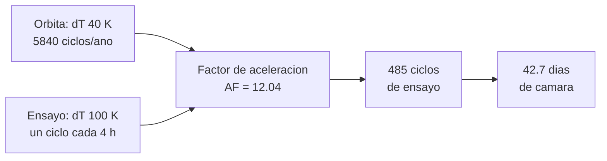

# B90-C12 — Vacío térmico y ciclos

<!-- nav:top -->
[🏠 Programa](../../../../README.md) · [📚 Bloque B90](../../../tronco-comun/B90-integracion-ensayos-y-calificacion-espacial.md) · [← Anterior: B90-C11 — Ensayos térmicos](../B90-C11-ensayos-termicos/CLASE.md) · [Siguiente: B90-C13 — Compatibilidad electromagnética EMC →](../B90-C13-compatibilidad-electromagnetica-emc/CLASE.md)
<!-- /nav -->

## 1. Ubicación, nivel y alcance

Clase 12 del bloque B90. Nivel N3. El **ensayo de vacío térmico** (TVAC) expone la unidad a vacío y a temperaturas extremas; el **ciclado** repite esos extremos para destapar fallas de fatiga en soldaduras y uniones. Aquí calculas el tiempo de evacuación de una cámara en dos etapas y la **equivalencia de ciclos** entre la órbita y el ensayo con un factor de aceleración de tipo Coffin–Manson. Todos los datos son **sintéticos**; los coeficientes del factor de aceleración son valores de la literatura **no consultados**.

## 2. Por qué esta clase existe

Una nave en órbita baja sufre unos 16 ciclos térmicos por día; no se pueden repetir 5 840 ciclos en tierra. La decisión central: **¿cuántos ciclos de ensayo con mayor amplitud representan un año de órbita y cuánto tarda la campaña?**

## 3. Lo que podrás hacer al terminar

1. Calcular el tiempo de evacuación de una cámara con dos etapas y la presión límite por gas liberado.
2. Verificar la evacuación con RK4.
3. Calcular un factor de aceleración de ciclado térmico.
4. Convertir ciclos de órbita en ciclos de ensayo y en días de cámara.
5. Recuperar el exponente de fatiga con una regresión log-log.
6. Separar lo consultado (bakeout exigido, ciclado no exigido) de lo no consultado (coeficientes) y de lo sintético.

La evidencia es el **plan de ciclos con su equivalencia de vida** del ejercicio 12 (sección 20).

## 4. Con qué llegas y cómo comprobarlo

1. ¿Qué es el caudal de bombeo `S` y qué es una presión límite?
2. ¿Qué es la fatiga por ciclado térmico?
3. ¿Qué es una regresión log-log?
4. ¿Qué es un factor de aceleración?
5. ¿Qué es una comprobación independiente?

<details>
<summary>Ver respuestas</summary>

1. `S` es el volumen por segundo que extrae la bomba; la presión límite es `Q_gas/S`. 2. Daño por deformación repetida debida a la diferencia de dilatación de materiales. 3. Un ajuste lineal de `ln N` frente a `ln ΔT`; la pendiente es el exponente. 4. El cociente entre vida en servicio y vida en ensayo. 5. Calcular lo mismo por otro método y comparar.
</details>

Con cuatro o cinco aciertos, sigue; si no, repasa los prerrequisitos.

## 5. Un caso de contexto y casos de referencia

Una cámara de 2 m³ pasa de 10⁵ a 10 Pa en 368 s con una bomba de desbaste de 0,05 m³/s y de 10 a 10⁻³ Pa en 37,7 s con una de alto vacío de 0,5 m³/s (presión límite 2 × 10⁻⁴ Pa): **6,8 min** en total. Para un año de órbita (**5 840 ciclos** de −10 a +30 °C), el factor de aceleración de un ciclado de −40 a +60 °C es **12,04**, es decir **485 ciclos** de ensayo, **42,7 días** de cámara. Todo es **sintético**.

## 6. Vocabulario

**Vacío térmico (TVAC):** ensayo de temperatura en vacío. **Bakeout:** calentamiento en vacío para expulsar volátiles. **Ciclado:** repetición de ciclos entre dos temperaturas. **Presión límite:** `Q_gas/S`. **Factor de aceleración (AF):** ciclos de servicio por ciclo de ensayo. **Coffin–Manson:** relación de ley de potencias entre amplitud térmica y vida. **Meseta:** tiempo a temperatura extrema.

## 7. Modelo mental: más amplitud, menos ciclos



*Descripción textual:* la órbita aporta amplitud y número de ciclos de servicio; el ensayo, su amplitud, frecuencia y temperatura máxima; el factor de aceleración reduce los ciclos a 485, que ocupan 42,7 días de cámara.

Analogía: doblar un alambre mucho unas pocas veces o poco muchas veces lo rompe igual. Límite: la equivalencia vale solo si el mecanismo de falla es el mismo en ambos casos.

## 8. La explicación, paso a paso

### 8.1 Qué dicen las fuentes

*CubeSat 101* (F7) dice que el *bakeout* termovacío es requerido en casi todas las misiones para que los materiales expulsen contaminantes, y que el ciclado termovacío no se exige habitualmente pero ayuda a detectar fallas como soldaduras rotas; pide registros con marca de tiempo de temperatura y vacío y fotos de la ubicación de los termopares. La CDS (F8) deja al proveedor la especificación de ambos. El coeficiente 1,9, el exponente 1/3 y el 1 414 K del factor de aceleración son valores de la literatura que **no se consultaron**.

### 8.2 Evacuación

`V dP/dt = −S (P − P_f)` con `P_f = Q_gas/S`, y `t = (V/S) ln[(P₀ − P_f)/(P − P_f)]`. Con `Q_gas = 10⁻⁴ Pa·m³/s` y `S₂ = 0,5 m³/s`: `P_f = 2 × 10⁻⁴ Pa`. Etapa 1 (1 × 10⁵ → 10 Pa, `S₁ = 0,05`): `t₁ = 40 ln(10⁴) = 368 s`. Etapa 2 (10 → 10⁻³ Pa): `t₂ = 4 ln[(10 − 2×10⁻⁴)/(10⁻³ − 2×10⁻⁴)] = 37,7 s`. RK4 da 37,74 s (diferencia 0,006 s). El modelo supone caudales constantes y gas liberado constante, lo que subestima el tiempo real.

### 8.3 Factor de aceleración

`AF = (ΔT_ens/ΔT_op)^n (f_op/f_ens)^{1/3} exp[1414 (1/T_max,op − 1/T_max,ens)]`, con `n = 1,9`. Con `ΔT_ens = 100 K`, `ΔT_op = 40 K`, `T_max` = 333,15 y 303,15 K, y frecuencias 1 ciclo/4 h y 16 ciclos/día: `AF = 5,70 × 1,39 × 1,52 = 12,04`. Con las mismas condiciones el factor es 1.

| `ΔT_ens` (K) | AF | Ciclos para 1 año |
|---|---|---|
| 60 | 2,56 | 2 285 |
| 80 | 6,01 | 972 |
| 100 | 12,04 | 485 |
| 120 | 21,64 | 270 |

### 8.4 Duración y recuperación del exponente

Un ciclo de −40 a +60 °C con rampa de 3 K/min y mesetas de 30 min dura `2 × 33,3 + 60 = 127 min`; 485 ciclos son **42,7 días**. Una regresión log-log sobre 100 datos de vida sintéticos (`N = C ΔT^{−1,9}` con ruido lognormal de 0,15, semilla 90) recupera la pendiente `−1,914`, cerca de `−1,9`.

## 9. Magnitudes, símbolos y unidades

| Símbolo | Qué es | Unidad | Valor / nota |
|---|---|---|---|
| `V`, `S` | volumen y velocidad de bombeo | m³, m³/s | 2; 0,05 y 0,5 |
| `Q_gas`, `P_f` | gas liberado y presión límite | Pa·m³/s, Pa | 10⁻⁴; 2 × 10⁻⁴ |
| `ΔT`, `T_max` | amplitud y máxima del ciclo | K | ver 8.3 |
| `f` | frecuencia de ciclado | ciclos/h | 0,667 y 0,25 |
| AF | factor de aceleración | — | 12,04 |
| `N` | ciclos | — | 5 840; 485 |

## 10. Convenciones y referencias

Unidades SI y K. Un solo mecanismo de falla (fatiga de unión), sin dependencia del vacío en el AF. Sistema de referencia: no aplica. Tolerancias: RK4 frente a fórmula `< 0,05 s`; exponente ajustado `< 0,05`. La cámara, las bombas, los ciclos y los datos de vida son **sintéticos**; el AF usa coeficientes no consultados.

## 11. De dónde sale lo que afirmamos

| ID | Fuente | Localizador | Respalda | Estado |
|---|---|---|---|---|
| F7 | NASA CubeSat Launch Initiative, CubeSat 101: Basic Concepts and Processes for First-Time CubeSat Developers (octubre de 2017) — PDF https://www.nasa.gov/wp-content/uploads/2017/03/nasa_csli_cubesat_101_508.pdf (consultada 2026-11-10 con PyMuPDF) | capítulo 6, secciones 6.9.2 y 6.9.3 y prueba DITL | el ICD fija niveles y duraciones de vibración y bakeout; contenido mínimo de los informes; no modificar el hardware tras el ensayo; el ciclado termovacío no se exige habitualmente | Consultada |
| F8 | Cal Poly CubeSat Program, CubeSat Design Specification Rev. 14.1 (febrero de 2022) — PDF https://static1.squarespace.com/static/5418c831e4b0fa4ecac1bacd/t/62193b7fc9e72e0053f00910/1645820809779/CDS+REV14_1+2022-02-09.pdf (consultada 2026-11-10 con PyMuPDF) | secciones 2.2, 2.3, 2.4 y 3 (3.1–3.5) | ensayos típicos (vibración aleatoria, bakeout termovacío, choque, inspección visual), calificación, protovuelo y aceptación, tres inhibidores independientes, rieles y centro de gravedad (tabla 2) | Consultada |
| F9 | ECSS, listado de normas activas — https://ecss.nl/standards/active-standards/ (consultada 2026-11-10) | solo títulos y fechas | existencia, código y fecha de ECSS-E-ST-10-02C Rev.1, ECSS-E-ST-10-03C Rev.1, ECSS-E-ST-20-07C Rev.2, ECSS-Q-ST-70-01C Rev.1, ECSS-E-ST-20-06C Rev.1, ECSS-Q-ST-70-55C y ECSS-U-ST-20C | Consultada (solo títulos y fechas; el texto de las normas no se consultó) |
| — | Factor de aceleración tipo Norris–Landzberg (1,9; 1/3; 1 414 K) | — | usado solo como ejemplo | No consultada |
| — | Tiempo de evacuación exponencial y regresión log-log | — | las verifica el laboratorio con RK4 y un ajuste | No consultada en una fuente concreta |

Límites: ninguna fuente consultada da niveles, números de ciclos ni coeficientes de fatiga.

## 12. Cómo ver el plan

| Magnitud | Valor |
|---|---|
| evacuación total | 6,8 min |
| AF | 12,04 |
| ciclos de ensayo | 485 |
| días de cámara | 42,7 |

Descripción larga: cuanto mayor la amplitud del ensayo, menos ciclos hacen falta, pero un ciclo más amplio puede activar mecanismos que no existen en órbita.

## 13. Ejemplo trabajado: ciclos de ensayo para un año

**Paso 1 · Ciclos de servicio.** `16 × 365 = 5 840`.

**Paso 2 · AF.** `(100/40)^1,9 = 5,70`; `(16/24 ÷ 0,25)^{1/3} = 1,39`; `exp[1414(1/303,15 − 1/333,15)] = 1,52`; `AF = 12,04`.

**Paso 3 · Ciclos.** `5 840/12,04 = 485`.

**Paso 4 · Tiempo.** `485 × 127 min = 42,7 días`.

## 14. Distintas formas de describir el ensayo

**Por vacío:** presión y tiempo. **Por temperatura:** extremos, rampas y mesetas. **Por vida:** AF y ciclos equivalentes. Esta clase une las tres.

## 15. Práctica guiada

**Ejercicio 1 · con los pasos indicados.** Calcula `t = (V/S) ln(P₀/P)` con `V = 1 m³`, `S = 0,1 m³/s`, de 10⁵ a 10 Pa. *Pasos:* `V/S`, logaritmo.

<details><summary>Solución comentada</summary>

`10 × ln(10⁴) = 92 s`.
</details>

**Ejercicio 2 · con una pista.** Calcula `P_f` con `Q = 2×10⁻⁴ Pa·m³/s` y `S = 0,5`. *Pista:* `Q/S`.

<details><summary>Solución comentada</summary>

`4 × 10⁻⁴ Pa`.
</details>

**Ejercicio 3 · casi autónomo.** Calcula `(120/40)^1,9`.

<details><summary>Solución comentada</summary>

`3^1,9 = 8,06`.
</details>

## 16. Práctica autónoma, transferencia e integrador

**Ejercicio 4 · autónomo.** Calcula la duración de un ciclo con ΔT = 80 K, 3 K/min y 30 min de meseta.

<details><summary>Solución comentada</summary>

`2 × 26,7 + 60 = 113 min`.
</details>

**Ejercicio 5 · autónomo.** ¿Cuántos días son 972 ciclos de 113 min?

<details><summary>Solución comentada</summary>

`972 × 113/1 440 = 76 días`.
</details>

**Ejercicio 6 · autónomo.** ¿Por qué no se puede evacuar por debajo de `P_f`?

<details><summary>Solución comentada</summary>

Porque el gas liberado iguala al extraído: a `P_f` el balance `S P = Q_gas` es estable.
</details>

**Ejercicio 7 · autónomo.** Si el factor de acoplamiento de frecuencias fuera 1, ¿cuánto vale AF con la misma ΔT y T_max?

<details><summary>Solución comentada</summary>

`5,70 × 1,52 = 8,66`.
</details>

**Ejercicio 8 · autónomo.** ¿Qué pendiente tiene `ln N` frente a `ln ΔT` si `n = 1,9`?

<details><summary>Solución comentada</summary>

`−1,9`; la regresión dio `−1,914`.
</details>

**Ejercicio 9 · transferencia.** **Transferencia.** Un colega propone 485 ciclos para su CubeSat. ¿Es válido?

<details><summary>Solución comentada</summary>

No: los coeficientes no se consultaron y los datos son sintéticos; el ciclado ni siquiera se exige habitualmente (F7).
</details>

**Ejercicio 10 · transferencia.** **Transferencia.** ¿Qué pasa si un ensayo de ΔT mayor activa otro mecanismo de falla?

<details><summary>Solución comentada</summary>

La equivalencia deja de valer: el ensayo puede dañar por un mecanismo inexistente en órbita o no ver el real.
</details>

**Ejercicio 11 · transferencia.** **Transferencia.** ¿Por qué se registra el vacío y no solo la temperatura?

<details><summary>Solución comentada</summary>

Porque el informe debe demostrar ambos niveles con marca de tiempo (F7) y porque el bakeout depende de la presión.
</details>

**Ejercicio 12 · integrador.** **Integrador.** Elabora tu *plan de ciclos con su equivalencia de vida*: tiempos de evacuación, AF, ciclos, días, regresión y lista de qué es consultado, no consultado y sintético.

<details><summary>Solución comentada</summary>

Secciones 8.2–8.4 y la salida del laboratorio.
</details>

## 17. Laboratorio: evacuación y ciclos equivalentes

El script [vacio_y_ciclos.py](vacio_y_ciclos.py) calcula la evacuación en dos etapas y su RK4, el AF, los ciclos y los días y la regresión del exponente; **comprueba** RK4 (`< 0,05 s`), AF = 1 en condiciones iguales y el exponente (`< 0,05`). Usa la biblioteca común [b90_comun.py](../b90_comun.py).

**Datos:** cámara, ciclos y datos de vida **sintéticos**; coeficientes del AF no consultados. **Predice antes de ejecutar:** ¿cuántos ciclos de ensayo equivalen a un año? (≈ 485.) Ejecución del 2026-11-10 (Python 3.12.9, numpy 2.4.4):

```text
Python 3.12.9 | numpy 2.4.4
Datos SINTETICOS: camara de 2 m3, dos bombas; ciclos de -40 a +60 C frente a orbita de -10 a +30 C
Presion limite con S2 = 0.5 m3/s: P_f = 2.0e-04 Pa
Desbaste 1e5 -> 10 Pa: t1 = 368 s ; alto vacio 10 -> 1e-3 Pa: t2 = 37.7 s ; total = 6.8 min
RK4 de la etapa 2: t2 = 37.74 s ; formula = 37.73 s ; diferencia = 0.006 s
AF (ensayo frente a orbita) = 12.04 ; con solo dT: 5.70
Ciclos de orbita en 1 ano = 5840 ; ciclos de ensayo equivalentes = 485
Duracion de un ciclo = 127 min ; 485 ciclos = 42.7 dias
Regresion log-log de vida frente a dT (100 datos sinteticos): pendiente = -1.914 (verdadera -1.9) ; C = 1.065e+07
dT del ensayo [K] (minimo fijo de -40 C) -> AF -> ciclos equivalentes de un ano en orbita
    60 ->   2.56 ->    2285
    80 ->   6.01 ->     972
   100 ->  12.04 ->     485
   120 ->  21.64 ->     270
Pruebas superadas.
```

```bash
python programa/clases/B90/B90-C12-vacio-termico-y-ciclos/vacio_y_ciclos.py
```

**Límites:** caudales constantes, un mecanismo de falla, sin dependencia del vacío ni de la humedad en el AF.

## 18. Errores frecuentes y cómo corregirlos

**Creer que la equivalencia es universal.** Depende del mecanismo (8.3)

**Ignorar el gas liberado.** Fija la presión límite (8.2)

**Presentar los ciclos de ejemplo como un requisito.** Revisa la sección 10

## 19. Cómo sabrás que vas bien

Tras la sección 8: ¿qué pasa con los ciclos si la amplitud sube de 80 a 120 K? Si dudas, repasa la tabla 8.3. Tras el laboratorio: ¿qué comprueba la regresión? (ver sección 17).

## 20. Qué entregas y cómo se evalúa

El producto es tu **plan de ciclos con su equivalencia de vida** (ejercicio 12).

| Criterio | Inicial | En desarrollo | Logrado | Destacado |
|---|---|---|---|---|
| Conceptos | Los confunde | Parciales | Explica el método y su dominio | Explica los límites y las alternativas |
| Cálculo | Sin unidades | Con errores | Resultados con unidades y comprobados | Resuelve casos nuevos |
| Numérico | Sin comprobar | Un caso | Verifica con una comprobación independiente en varios casos | Interpreta las diferencias y los fallos |
| Fuentes | Sin fuente | Sin fecha | Fuentes con fecha y estado | Declara lo sintético y lo no consultado |
| Límites | No los nombra | Uno | Tres | Discute qué falta del modelo |

**Condiciones críticas (no se compensan con promedio):** rotular los datos como sintéticos; verificar cada resultado con una comprobación independiente; citar solo lo consultado.

## 21. Ética, seguridad y límites

Clase educativa: la cámara y los coeficientes son de ejemplo y no sustituyen el plan de ensayo; las cámaras de vacío exigen procedimientos de seguridad. Accesibilidad: tablas equivalentes a las gráficas, fórmulas en texto, ejercicios sin conexión.

## 22. Para cerrar y seguir

La cámara se evacúa en 6,8 min y un año de órbita equivale, con los coeficientes de ejemplo, a 485 ciclos de −40 a +60 °C, 42,7 días de cámara. Queda una pregunta: ¿cómo se comprueba que la nave no interfiere consigo misma electromagnéticamente?

**Glosario español–inglés.** vacío térmico · *thermal vacuum (TVAC)*; ciclado térmico · *thermal cycling*; presión límite · *ultimate pressure*; factor de aceleración · *acceleration factor*; meseta · *dwell*; fatiga · *fatigue*.

**Continuidad.** [B90-C13](../B90-C13-compatibilidad-electromagnetica-emc/CLASE.md) trata la compatibilidad electromagnética.

**Referencias:** ver sección 11.

<!-- nav:bottom -->
---

[← Anterior: B90-C11 — Ensayos térmicos](../B90-C11-ensayos-termicos/CLASE.md) · [📚 Bloque B90](../../../tronco-comun/B90-integracion-ensayos-y-calificacion-espacial.md) · [Siguiente: B90-C13 — Compatibilidad electromagnética EMC →](../B90-C13-compatibilidad-electromagnetica-emc/CLASE.md)
<!-- /nav -->
