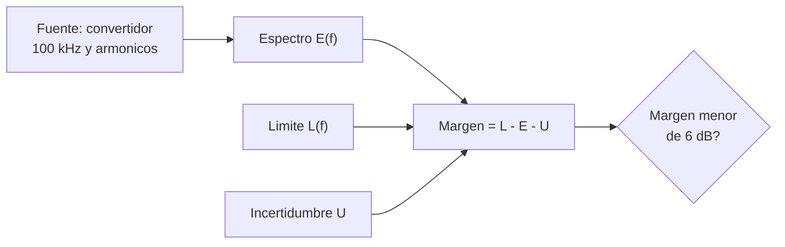

# B90-C13 — Compatibilidad electromagnética EMC

<!-- nav:top -->
[🏠 Programa](../../../../README.md) · [📚 Bloque B90](../../../tronco-comun/B90-integracion-ensayos-y-calificacion-espacial.md) · [← Anterior: B90-C12 — Vacío térmico y ciclos](../B90-C12-vacio-termico-y-ciclos/CLASE.md) · [Siguiente: B90-C14 — Interferencias electromagnéticas EMI →](../B90-C14-interferencias-electromagneticas-emi/CLASE.md)
<!-- /nav -->

## 1. Ubicación, nivel y alcance

Clase 13 del bloque B90. Nivel N3. La **compatibilidad electromagnética** (EMC) exige que un equipo no emita perturbaciones por encima de un límite y que tolere las del entorno. Aquí trabajas el lado de las **emisiones conducidas**: comparas un espectro con un límite en dBµV, calculas el **margen** con la incertidumbre de medida y sumas fuentes en dB. Todos los datos y el límite son **sintéticos**; ninguna norma EMC se consultó en su texto.

## 2. Por qué esta clase existe

Un convertidor de potencia emite armónicos que viajan por el arnés y pueden perturbar a otro equipo. El margen de 2 dB que pasa hoy puede ser negativo mañana si cambia la incertidumbre. La decisión central: **¿qué margen real queda frente al límite y cómo se suman las fuentes?**

## 3. Lo que podrás hacer al terminar

1. Convertir entre dBµV, V y dBm en 50 Ω.
2. Calcular el margen `L − E − U` y hallar el peor armónico.
3. Sumar fuentes en dB de forma incoherente y coherente.
4. Verificar la suma incoherente con Monte Carlo de fases.
5. Evaluar el efecto de la incertidumbre de medida en el margen.
6. Separar lo consultado (existencia de ECSS-E-ST-20-07C) de lo no consultado y de lo sintético.

La evidencia es la **tabla de márgenes de emisión** del ejercicio 12 (sección 20).

## 4. Con qué llegas y cómo comprobarlo

1. ¿Qué es un decibelio?
2. ¿Qué es un armónico?
3. ¿Qué relación hay entre potencia, tensión y resistencia?
4. ¿Qué es una suma incoherente?
5. ¿Qué es una comprobación independiente?

<details>
<summary>Ver respuestas</summary>

1. `10 log₁₀` de un cociente de potencias (`20 log₁₀` de tensiones). 2. Una componente a un múltiplo entero de la frecuencia fundamental. 3. `P = V²/R`. 4. Suma de potencias de señales con fases no relacionadas. 5. Calcular lo mismo por otro método y comparar.
</details>

Con cuatro o cinco aciertos, sigue; si no, repasa los prerrequisitos.

## 5. Un caso de contexto y casos de referencia

Un convertidor conmutado a 100 kHz emite armónicos que caen 20 dB/década desde 80 dBµV, más una espuria de +9 dB a 400 kHz. Con un límite de ejemplo de 94 dBµV hasta 100 kHz y descenso de 20 dB/década, y una incertidumbre de 3 dB, el margen es **11 dB** en casi todos los armónicos y solo **2,0 dB** a 400 kHz. Todo es **sintético**.

## 6. Vocabulario

**EMC:** capacidad de un equipo de funcionar en su entorno sin perturbarlo ni ser perturbado. **Emisión conducida:** perturbación que viaja por los cables. **dBµV:** nivel de tensión referido a 1 µV. **Límite:** nivel máximo admitido a cada frecuencia. **Margen:** `L − E − U`. **Incertidumbre `U`:** dispersión de la medida. **Suma incoherente:** suma de potencias.

## 7. Modelo mental: un espectro bajo una línea



*Descripción textual:* el espectro de emisión se compara con el límite en cada frecuencia, restando la incertidumbre de medida; un margen pequeño (aquí menos de 6 dB, criterio de ejemplo) obliga a revisar el diseño.

Analogía: una carretera con límite de velocidad y un radar con error: conviene ir por debajo del límite menos el error. Límite: la analogía supone un solo valor, y aquí el límite cambia con la frecuencia.

## 8. La explicación, paso a paso

### 8.1 Qué se sabe de las normas

El listado de ECSS (F9) confirma que existe ECSS-E-ST-20-07C Rev.2 *Electromagnetic compatibility* (3-01-2022) y ECSS-E-ST-20-06C Rev.1 *Spacecraft charging*; no se consultó su contenido. Tampoco MIL-STD-461 (fuera de alcance). El *Systems Engineering Handbook* (F3) incluye la compatibilidad entre sistema y entorno entre los asuntos de interfaz. El límite, los niveles y los 6 dB de la clase son de ejemplo.

### 8.2 Unidades

`V = 1 µV × 10^{dBµV/20}` y `P = V²/R`; en 50 Ω, `dBm = dBµV − 107`. Verificación: 94 dBµV = 50,12 mV = 50 238 nW = −12,990 dBm (fórmula −13,000: la diferencia de 0,01 dB es el redondeo de 107).

### 8.3 Margen

| `f` (kHz) | `E` (dBµV) | `L` (dBµV) | Margen (dB) |
|---|---|---|---|
| 100 | 80,00 | 94,00 | 11,00 |
| 200 | 73,98 | 87,98 | 11,00 |
| 400 | 76,96 | 81,96 | 2,00 |
| 1 000 | 60,00 | 74,00 | 11,00 |

El peor margen es **2,00 dB a 400 kHz** (la espuria). Con `U = 0, 3, 6 dB` el peor margen es 5,00, 2,00 y −1,00 dB: con `U = 6 dB` el equipo excedería el límite.

### 8.4 Suma de fuentes

Dos fuentes de 70 dBµV: incoherentes suman `+3,01 dB` (73,010 dBµV); coherentes y en fase, `+6,02 dB` (76,021). Con fases aleatorias (Monte Carlo, 10⁶ muestras), la potencia media es 2,0001 veces la de una fuente (incoherente: 2) y el máximo 2,0000 (coherente: 4 en potencia, 2 en tensión). El peor caso es la suma coherente, que añade 3 dB al margen requerido.

## 9. Magnitudes, símbolos y unidades

| Símbolo | Qué es | Unidad | Valor / nota |
|---|---|---|---|
| `E`, `L` | emisión y límite | dBµV | tabla 8.3 |
| `U` | incertidumbre de medida | dB | 3 (sintética) |
| margen | `L − E − U` | dB | 2,00 (peor) |
| `R` | impedancia de referencia | Ω | 50 |
| `P` | potencia | dBm, nW | −12,99 a 94 dBµV |

## 10. Convenciones y referencias

Emisiones conducidas por una línea de alimentación en una impedancia de 50 Ω; detector y ancho de banda no modelados. Sistema de referencia: no aplica. Tolerancias: conversión dBm `< 0,02 dB`; sumas `< 10⁻³ dB`; Monte Carlo `< 0,01`. Espectro, límite, espuria, incertidumbre y el criterio de 6 dB son **sintéticos**.

## 11. De dónde sale lo que afirmamos

| ID | Fuente | Localizador | Respalda | Estado |
|---|---|---|---|---|
| F9 | ECSS, listado de normas activas — https://ecss.nl/standards/active-standards/ (consultada 2026-11-10) | solo títulos y fechas | existencia, código y fecha de ECSS-E-ST-10-02C Rev.1, ECSS-E-ST-10-03C Rev.1, ECSS-E-ST-20-07C Rev.2, ECSS-Q-ST-70-01C Rev.1, ECSS-E-ST-20-06C Rev.1, ECSS-Q-ST-70-55C y ECSS-U-ST-20C | Consultada (solo títulos y fechas; el texto de las normas no se consultó) |
| F3 | NASA, Systems Engineering Handbook, 5.2 Product Integration — https://www.nasa.gov/reference/5-2-product-integration/ (consultada 2026-11-10) | sección 5.2 | propósito de la integración, entradas, actividades, secuencia ascendente, dominios de interfaz y errores frecuentes | Consultada |
| — | MIL-STD-461, MIL-STD-1540 y MIL-STD-810 | — | — | No consultada |
| — | Aritmética de decibelios, `P = V²/R` y suma de potencias | — | las verifica el laboratorio con cálculo directo y Monte Carlo | No consultada en una fuente concreta |

Límites: ninguna fuente consultada da límites de emisión; el límite de ejemplo es didáctico.

## 12. Cómo ver los márgenes

| Magnitud | Valor |
|---|---|
| peor margen | 2,00 dB a 400 kHz |
| margen con `U = 6 dB` | −1,00 dB |
| suma incoherente | +3,01 dB |
| suma coherente | +6,02 dB |

Descripción larga: el espectro cae 20 dB/década igual que el límite, por eso el margen es constante (11 dB) salvo en la espuria.

## 13. Ejemplo trabajado: el margen a 400 kHz

**Paso 1 · Emisión.** `80 − 20 log₁₀(4) + 9 = 76,96 dBµV`.

**Paso 2 · Límite.** `94 − 20 log₁₀(4) = 81,96 dBµV`.

**Paso 3 · Margen.** `81,96 − 76,96 − 3 = 2,00 dB`.

**Paso 4 · Decisión.** Menor de 6 dB: se revisa el filtro; se corrige la resonancia que produce la espuria.

## 14. Distintas formas de describir la EMC

**Por espectro:** emisión y límite por frecuencia (esta clase). **Por acoplamiento:** conducido, radiado, capacitivo, inductivo. **Por víctima:** qué equipo se perturba (C14). Las tres se cruzan en el plan de EMC.

## 15. Práctica guiada

**Ejercicio 1 · con los pasos indicados.** Convierte 60 dBµV a mV. *Pasos:* `10^{60/20}` µV.

<details><summary>Solución comentada</summary>

`10³ µV = 1 mV`.
</details>

**Ejercicio 2 · con una pista.** Convierte 80 dBµV a dBm en 50 Ω. *Pista:* resta 107.

<details><summary>Solución comentada</summary>

`−27 dBm`.
</details>

**Ejercicio 3 · casi autónomo.** Calcula el margen con `L = 80`, `E = 72` y `U = 3`.

<details><summary>Solución comentada</summary>

`5 dB`.
</details>

## 16. Práctica autónoma, transferencia e integrador

**Ejercicio 4 · autónomo.** ¿Cuánto suman dos fuentes incoherentes de 70 y 64 dBµV?

<details><summary>Solución comentada</summary>

Tensiones `3 162 + 1 585 µV`; potencia `10 000 000 + 2 512 000` → `√(1,0×10⁷+2,51×10⁶)` = 3 537 µV = 70,97 dBµV.
</details>

**Ejercicio 5 · autónomo.** ¿Cuánto vale la suma coherente de dos fuentes de 70 dBµV?

<details><summary>Solución comentada</summary>

`76,02 dBµV`.
</details>

**Ejercicio 6 · autónomo.** El límite desciende 20 dB/década: ¿cuánto vale a 1 MHz si es 94 dBµV a 100 kHz?

<details><summary>Solución comentada</summary>

`94 − 20 = 74 dBµV`.
</details>

**Ejercicio 7 · autónomo.** Si `U = 6 dB`, ¿cuántos dB hay que bajar la espuria?

<details><summary>Solución comentada</summary>

Margen `−1`; para llegar a 6 dB hay que bajar 7 dB.
</details>

**Ejercicio 8 · autónomo.** Convierte 1 mV a dBµV.

<details><summary>Solución comentada</summary>

`60 dBµV`.
</details>

**Ejercicio 9 · transferencia.** **Transferencia.** Un colega usa el límite de la clase para su equipo. ¿Es válido?

<details><summary>Solución comentada</summary>

No: el límite es sintético; el vigente sale de los requisitos de EMC del proyecto.
</details>

**Ejercicio 10 · transferencia.** **Transferencia.** ¿Por qué la incertidumbre se resta del margen y no se suma?

<details><summary>Solución comentada</summary>

Porque el valor medido puede estar subestimado en `U`: el valor verdadero podría ser `E + U`.
</details>

**Ejercicio 11 · transferencia.** **Transferencia.** ¿Qué diferencia hay entre emisión conducida y radiada?

<details><summary>Solución comentada</summary>

La conducida viaja por cables y se mide en una red de línea; la radiada se propaga por el aire y se mide con antenas. Esta clase solo calcula la primera.
</details>

**Ejercicio 12 · integrador.** **Integrador.** Elabora tu *tabla de márgenes de emisión*: espectro, límite, incertidumbre, margen, peor armónico, suma de fuentes y lista de qué es consultado, no consultado y sintético.

<details><summary>Solución comentada</summary>

Secciones 8.2–8.4 y la salida del laboratorio.
</details>

## 17. Laboratorio: márgenes de emisión

El script [margenes_emc.py](margenes_emc.py) calcula emisión, límite y margen de diez armónicos, convierte a dBm, suma fuentes y simula fases; **comprueba** que ningún armónico excede, que el peor está en 400 kHz, las conversiones y las sumas (+3,01 y +6,02 dB). Usa la biblioteca común [b90_comun.py](../b90_comun.py).

**Datos:** espectro, límite e incertidumbre **sintéticos**; sin constantes con fuente. **Predice antes de ejecutar:** ¿en qué frecuencia está el peor margen? (400 kHz.) Ejecución del 2026-11-10 (Python 3.12.9, numpy 2.4.4):

```text
Python 3.12.9 | numpy 2.4.4
Datos SINTETICOS: armonicos de 100 kHz, limite de ejemplo, U = 3 dB
f [kHz]   E [dBuV]   L [dBuV]   margen = L - E - U [dB]
    100      80.00      94.00      11.00  
    200      73.98      87.98      11.00  
    300      70.46      84.46      11.00  
    400      76.96      81.96       2.00  (margen < 6 dB)
    500      66.02      80.02      11.00  
    600      64.44      78.44      11.00  
    700      63.10      77.10      11.00  
    800      61.94      75.94      11.00  
    900      60.92      74.92      11.00  
   1000      60.00      74.00      11.00  
Margen peor = 2.00 dB en 400 kHz
 60.0 dBuV =    1.0000 mV =    20.0000 nW = -46.990 dBm (formula -47.000)
 80.0 dBuV =   10.0000 mV =  2000.0000 nW = -26.990 dBm (formula -27.000)
 94.0 dBuV =   50.1187 mV = 50237.7286 nW = -12.990 dBm (formula -13.000)
Dos fuentes de 70 dBuV: suma incoherente = 73.010 dBuV (+3.01 dB) ; suma coherente = 76.021 dBuV (+6.02 dB)
Fases aleatorias (Monte Carlo): potencia media = 2.0001 (incoherente 2.0000) ; maximo = 2.0000 (coherente 2.0000)
Efecto de la incertidumbre: margen minimo con U = 0, 3, 6 dB
   U = 0.0 dB -> margen peor = 5.00 dB
   U = 3.0 dB -> margen peor = 2.00 dB
   U = 6.0 dB -> margen peor = -1.00 dB
Pruebas superadas.
```

```bash
python programa/clases/B90/B90-C13-compatibilidad-electromagnetica-emc/margenes_emc.py
```

**Límites:** solo emisiones conducidas; detector y ancho de banda no modelados; una línea; una incertidumbre constante.

## 18. Errores frecuentes y cómo corregirlos

**Sumar dB como números.** Suma tensiones o potencias (8.4)

**Ignorar la incertidumbre.** Réstala del margen (8.3)

**Presentar el límite de ejemplo como una norma.** Revisa la sección 10

## 19. Cómo sabrás que vas bien

Tras la sección 8: ¿cuánto suman dos fuentes iguales incoherentes? Si dudas, repasa el ejercicio 4. Tras el laboratorio: ¿qué compara el Monte Carlo de fases? (ver sección 17).

## 20. Qué entregas y cómo se evalúa

El producto es tu **tabla de márgenes de emisión** (ejercicio 12).

| Criterio | Inicial | En desarrollo | Logrado | Destacado |
|---|---|---|---|---|
| Conceptos | Los confunde | Parciales | Explica el método y su dominio | Explica los límites y las alternativas |
| Cálculo | Sin unidades | Con errores | Resultados con unidades y comprobados | Resuelve casos nuevos |
| Numérico | Sin comprobar | Un caso | Verifica con una comprobación independiente en varios casos | Interpreta las diferencias y los fallos |
| Fuentes | Sin fuente | Sin fecha | Fuentes con fecha y estado | Declara lo sintético y lo no consultado |
| Límites | No los nombra | Uno | Tres | Discute qué falta del modelo |

**Condiciones críticas (no se compensan con promedio):** rotular los datos como sintéticos; verificar cada resultado con una comprobación independiente; citar solo lo consultado.

## 21. Ética, seguridad y límites

Clase educativa: los límites y espectros son de ejemplo y no sustituyen el plan de EMC ni las mediciones en un laboratorio acreditado. Accesibilidad: tablas equivalentes a las gráficas, fórmulas en texto, ejercicios sin conexión.

## 22. Para cerrar y seguir

El espectro de ejemplo cumple con 2,0 dB de margen en su peor frecuencia (400 kHz) y dejaría de cumplir con una incertidumbre de 6 dB. Queda una pregunta: ¿qué le pasa a un receptor cuando la emisión de otro equipo cae dentro de su banda?

**Glosario español–inglés.** compatibilidad electromagnética · *electromagnetic compatibility (EMC)*; emisión conducida · *conducted emission*; margen · *margin*; incertidumbre · *uncertainty*; suma incoherente · *incoherent sum*; espuria · *spurious*.

**Continuidad.** [B90-C14](../B90-C14-interferencias-electromagneticas-emi/CLASE.md) trata las interferencias electromagnéticas.

**Referencias:** ver sección 11.

<!-- nav:bottom -->
---

[← Anterior: B90-C12 — Vacío térmico y ciclos](../B90-C12-vacio-termico-y-ciclos/CLASE.md) · [📚 Bloque B90](../../../tronco-comun/B90-integracion-ensayos-y-calificacion-espacial.md) · [Siguiente: B90-C14 — Interferencias electromagnéticas EMI →](../B90-C14-interferencias-electromagneticas-emi/CLASE.md)
<!-- /nav -->
