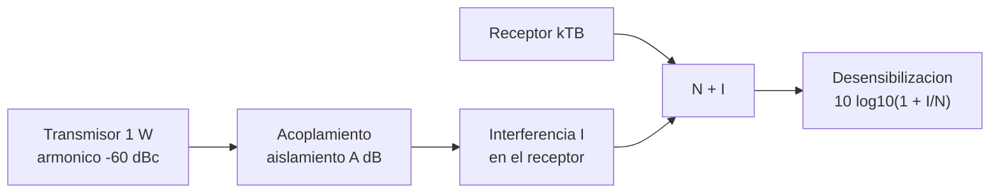

# B90-C14 — Interferencias electromagnéticas EMI

<!-- nav:top -->
[🏠 Programa](../../../../README.md) · [📚 Bloque B90](../../../tronco-comun/B90-integracion-ensayos-y-calificacion-espacial.md) · [← Anterior: B90-C13 — Compatibilidad electromagnética EMC](../B90-C13-compatibilidad-electromagnetica-emc/CLASE.md) · [Siguiente: B90-C15 — Pruebas de despliegue →](../B90-C15-pruebas-de-despliegue/CLASE.md)
<!-- /nav -->

## 1. Ubicación, nivel y alcance

Clase 14 del bloque B90. Nivel N3. Una **interferencia electromagnética** (EMI) ocurre cuando la energía de un equipo (la fuente) perturba a otro (la víctima). En una nave el caso típico es un transmisor cuyo armónico cae en la banda de un receptor a pocos centímetros. Aquí calculas el **piso de ruido térmico** `kTB`, la **desensibilización** de un receptor por interferencia y el **aislamiento** necesario entre transmisor y receptor. Todos los datos son **sintéticos**; la constante de Boltzmann es consultada.

## 2. Por qué esta clase existe

Un transmisor de 1 W deja un armónico de −30 dBm; el piso de ruido de un receptor estrecho está cerca de −132 dBm. La diferencia de más de 100 dB se pierde con facilidad en un chasis de 10 cm. La decisión central: **¿cuánto aislamiento exige este par fuente-víctima y qué margen consume la interferencia?**

## 3. Lo que podrás hacer al terminar

1. Calcular el piso de ruido `kTB` en W y en dBm.
2. Verificarlo con ruido gaussiano simulado.
3. Calcular la relación interferencia/ruido (I/N) y la desensibilización.
4. Calcular el aislamiento requerido para una I/N objetivo.
5. Calcular la atenuación de espacio libre a una distancia dada.
6. Separar lo consultado (constante `k`) de lo sintético y de lo no consultado.

La evidencia es el **análisis de desensibilización de un receptor** del ejercicio 12 (sección 20).

## 4. Con qué llegas y cómo comprobarlo

1. ¿Qué es el ruido térmico?
2. ¿Qué es un dBm?
3. ¿Qué es una temperatura de ruido de sistema?
4. ¿Qué es la atenuación de espacio libre?
5. ¿Qué es una comprobación independiente?

<details>
<summary>Ver respuestas</summary>

1. La potencia del movimiento térmico de los portadores, `k T B`. 2. Potencia en dB respecto de 1 mW. 3. La temperatura que, en un resistor ideal, daría el ruido total del receptor. 4. `20 log₁₀(4π d/λ)`. 5. Calcular lo mismo por otro método y comparar.
</details>

Con cuatro o cinco aciertos, sigue; si no, repasa los prerrequisitos.

## 5. Un caso de contexto y casos de referencia

Un receptor de 435 MHz con ancho de banda de 10 kHz y `T = 500 K` tiene `N = 6,90 × 10⁻¹⁷ W = −131,61 dBm`. Si un armónico del transmisor llega a −110 dBm, `I/N = 21,6 dB` y la sensibilidad se degrada **21,64 dB**: el margen de enlace de 6 dB de ejemplo pasa a **−15,64 dB**. Para mantener `I/N = −6 dB` hacen falta **107,6 dB** de aislamiento. Todo es **sintético** salvo `k`.

## 6. Vocabulario

**EMI:** interferencia electromagnética. **Fuente y víctima:** quien emite y quien sufre. **Piso de ruido:** `k T B`. **I/N:** relación interferencia a ruido. **Desensibilización:** pérdida de sensibilidad por interferencia. **Aislamiento:** atenuación entre fuente y víctima. **Armónico:** componente a múltiplo de la frecuencia del transmisor. **Supresión (dBc):** nivel relativo a la portadora.

## 7. Modelo mental: el ruido sube cuando se suma una interferencia



*Descripción textual:* el armónico del transmisor atraviesa el acoplamiento y llega al receptor como interferencia; se suma al ruido térmico y la sensibilidad se degrada en `10 log₁₀(1 + I/N)` dB.

Analogía: conversar en una sala con un aspirador: el ruido de fondo no cambia, pero el aspirador sube el umbral de lo que se entiende. Límite: la interferencia no es ruido blanco y puede afectar distinto según su forma.

## 8. La explicación, paso a paso

### 8.1 Qué dicen las fuentes

El NIST (F10) da `k = 1,380 649 × 10⁻²³ J/K`, exacta por definición (CODATA 2022). ECSS-E-ST-20-07C Rev.2 *Electromagnetic compatibility* existe (F9) y su texto no se consultó. El *Systems Engineering Handbook* (F3) incluye interferencias entre elementos entre los asuntos de la integración. La CDS (F8) exige inhibidores independientes para evitar transmisión no deseada, lo que reduce el riesgo de que el transmisor interfiera en una fase indebida.

### 8.2 Piso de ruido

`N = k T B = 1,380649×10⁻²³ × 500 × 10⁴ = 6,9032 × 10⁻¹⁷ W = −131,61 dBm`. A 290 K el piso es `−173,98 dBm/Hz`, es decir `−133,98 dBm` en 10 kHz. Un Monte Carlo con 4 × 10⁶ muestras gaussianas de varianza `N R` en 50 Ω da una potencia media de `6,9069 × 10⁻¹⁷ W` (0,053 % de diferencia).

### 8.3 Desensibilización

`I = −110 dBm`; `I/N = −110 − (−131,61) = 21,61 dB`; `Δ = 10 log₁₀(1 + I/N) = 21,64 dB`.

| I/N (dB) | Desensibilización (dB) |
|---|---|
| −20 | 0,04 |
| −10 | 0,41 |
| −6 | 0,97 |
| 0 | 3,01 |
| 10 | 10,41 |
| 20 | 20,04 |

Con `I/N = −6 dB` la degradación es de solo 1 dB; con `I/N = 0 dB`, 3 dB.

### 8.4 Aislamiento requerido

Un transmisor de +30 dBm con armónico a −60 dBc deja −30 dBm. Para `I/N = −6 dB`, `I ≤ N − 6 = −137,6 dBm`, así que hacen falta `−30 − (−137,6) = 107,6 dB`. La atenuación de espacio libre a 435 MHz (`λ = 0,689 m`) es 5,2 dB a 0,1 m, 14,8 dB a 0,3 m y 25,2 dB a 1 m; faltan 102,4, 92,8 y 82,4 dB de filtrado y blindaje. En campo cercano la fórmula no vale, pero muestra que la separación sola no basta.

## 9. Magnitudes, símbolos y unidades

| Símbolo | Qué es | Unidad | Valor / nota |
|---|---|---|---|
| `k` | constante de Boltzmann | J/K | 1,380649 × 10⁻²³ (exacta) |
| `T`, `B` | temperatura de ruido y ancho de banda | K, Hz | 500; 10⁴ |
| `N` | piso de ruido | dBm | −131,61 |
| `I` | interferencia | dBm | −110 (sintética) |
| `Δ` | desensibilización | dB | 21,64 |
| `λ` | longitud de onda | m | 0,689 |

## 10. Convenciones y referencias

Unidades SI y dB; potencia referida a la entrada del receptor; ruido blanco gaussiano; interferencia tratada como potencia adicional. Sistema de referencia: no aplica. Tolerancias: Monte Carlo frente a `kTB` `< 1 %`; piso `−174 dBm/Hz` a 0,02 dB. Temperatura de ruido, ancho de banda, interferencia, margen y supresión son **sintéticos**.

## 11. De dónde sale lo que afirmamos

| ID | Fuente | Localizador | Respalda | Estado |
|---|---|---|---|---|
| F10 | NIST, CODATA Value: Boltzmann constant — https://physics.nist.gov/cgi-bin/cuu/Value?k (consultada 2026-11-10) | página del valor | k = 1,380 649 × 10⁻²³ J/K, exacta por definición (CODATA 2022) | Consultada |
| F9 | ECSS, listado de normas activas — https://ecss.nl/standards/active-standards/ (consultada 2026-11-10) | solo títulos y fechas | existencia, código y fecha de ECSS-E-ST-10-02C Rev.1, ECSS-E-ST-10-03C Rev.1, ECSS-E-ST-20-07C Rev.2, ECSS-Q-ST-70-01C Rev.1, ECSS-E-ST-20-06C Rev.1, ECSS-Q-ST-70-55C y ECSS-U-ST-20C | Consultada (solo títulos y fechas; el texto de las normas no se consultó) |
| F3 | NASA, Systems Engineering Handbook, 5.2 Product Integration — https://www.nasa.gov/reference/5-2-product-integration/ (consultada 2026-11-10) | sección 5.2 | propósito de la integración, entradas, actividades, secuencia ascendente, dominios de interfaz y errores frecuentes | Consultada |
| F8 | Cal Poly CubeSat Program, CubeSat Design Specification Rev. 14.1 (febrero de 2022) — PDF https://static1.squarespace.com/static/5418c831e4b0fa4ecac1bacd/t/62193b7fc9e72e0053f00910/1645820809779/CDS+REV14_1+2022-02-09.pdf (consultada 2026-11-10 con PyMuPDF) | secciones 2.2, 2.3, 2.4 y 3 (3.1–3.5) | ensayos típicos (vibración aleatoria, bakeout termovacío, choque, inspección visual), calificación, protovuelo y aceptación, tres inhibidores independientes, rieles y centro de gravedad (tabla 2) | Consultada |
| — | `N = kTB`, desensibilización `10 log(1 + I/N)` y atenuación de espacio libre | — | las verifica el laboratorio con Monte Carlo y cálculo directo | No consultada en una fuente concreta |

Límites: ninguna fuente consultada da límites de susceptibilidad ni aislamientos.

## 12. Cómo ver el efecto

| Magnitud | Valor |
|---|---|
| `N` | −131,61 dBm |
| I/N | 21,61 dB |
| desensibilización | 21,64 dB |
| aislamiento requerido | 107,6 dB |

Descripción larga: la desensibilización es casi igual a I/N cuando I ≫ N y tiende a 0 cuando I ≪ N.

## 13. Ejemplo trabajado: el margen con el armónico

**Paso 1 · Ruido.** `N = −131,61 dBm`.

**Paso 2 · I/N.** `−110 − (−131,61) = 21,61 dB`.

**Paso 3 · Desensibilización.** `10 log₁₀(1 + 145,2) = 21,64 dB`.

**Paso 4 · Margen.** `6 − 21,64 = −15,64 dB`: el enlace falla; se necesitan 107,6 dB de aislamiento para llevar I/N a −6 dB.

## 14. Distintas formas de describir la EMI

**Por potencia:** I y N en dBm (esta clase). **Por tiempo:** interferencia continua o pulsada. **Por frecuencia:** en banda o fuera de banda. Las tres cambian cómo se mide el efecto.

## 15. Práctica guiada

**Ejercicio 1 · con los pasos indicados.** Calcula `N` con `T = 290 K` y `B = 1 kHz`. *Pasos:* producto, a dBm.

<details><summary>Solución comentada</summary>

`4,0 × 10⁻¹⁸ W = −143,98 dBm`.
</details>

**Ejercicio 2 · con una pista.** Calcula la desensibilización con `I/N = 10 dB`. *Pista:* `10 log(1 + 10)`.

<details><summary>Solución comentada</summary>

`10,41 dB`.
</details>

**Ejercicio 3 · casi autónomo.** ¿Qué aislamiento se requiere si el armónico es −50 dBm y `N = −131,6 dBm`, con `I/N = −6 dB`?

<details><summary>Solución comentada</summary>

`−50 − (−137,6) = 87,6 dB`.
</details>

## 16. Práctica autónoma, transferencia e integrador

**Ejercicio 4 · autónomo.** ¿Cómo cambia `N` si `B` se reduce a 1 kHz?

<details><summary>Solución comentada</summary>

Baja 10 dB: −141,61 dBm.
</details>

**Ejercicio 5 · autónomo.** Calcula `FSPL` a 2 m y 435 MHz.

<details><summary>Solución comentada</summary>

`20 log₁₀(4π × 2/0,689) = 31,2 dB`.
</details>

**Ejercicio 6 · autónomo.** ¿Qué `I/N` corresponde a 3 dB de desensibilización?

<details><summary>Solución comentada</summary>

0 dB (`1 + 1 = 2`).
</details>

**Ejercicio 7 · autónomo.** Si el armónico se suprime 20 dB más, ¿cuánto cambia la desensibilización de 21,64 dB?

<details><summary>Solución comentada</summary>

`I/N = 1,61 dB` → `Δ = 10 log(1 + 1,45) = 3,89 dB`.
</details>

**Ejercicio 8 · autónomo.** ¿Por qué `k` se puede tomar sin incertidumbre?

<details><summary>Solución comentada</summary>

Porque desde la redefinición del SI su valor es exacto por definición (F10).
</details>

**Ejercicio 9 · transferencia.** **Transferencia.** Un colega usa −110 dBm como interferencia de su equipo. ¿Es válido?

<details><summary>Solución comentada</summary>

No: es un valor sintético; el real se mide en su integración.
</details>

**Ejercicio 10 · transferencia.** **Transferencia.** ¿Qué medidas reducen la EMI sin cambiar la distancia?

<details><summary>Solución comentada</summary>

Filtros en el transmisor, blindaje, separación en frecuencia y gestión del tiempo (inhibir el transmisor mientras el receptor trabaja).
</details>

**Ejercicio 11 · transferencia.** **Transferencia.** ¿Por qué la prueba de EMI se hace con el sistema integrado?

<details><summary>Solución comentada</summary>

Porque el acoplamiento depende de la geometría y el arnés reales; no se ve en pruebas aisladas.
</details>

**Ejercicio 12 · integrador.** **Integrador.** Elabora tu *análisis de desensibilización de un receptor*: `N`, `I/N`, desensibilización, margen, aislamiento y lista de qué es consultado, no consultado y sintético.

<details><summary>Solución comentada</summary>

Secciones 8.2–8.4 y la salida del laboratorio.
</details>

## 17. Laboratorio: ruido, interferencia y aislamiento

El script [desensibilizacion.py](desensibilizacion.py) calcula `kTB`, lo verifica con ruido gaussiano, calcula la desensibilización y el aislamiento requerido y la atenuación de espacio libre; **comprueba** el piso `−174 dBm/Hz`, el Monte Carlo (`< 1 %`) y los valores de desensibilización. Usa la biblioteca común [b90_comun.py](../b90_comun.py).

**Datos:** `k` del NIST (consultado el 2026-11-10); temperatura, banda, interferencia y potencias **sintéticas**. **Predice antes de ejecutar:** ¿cuánto vale `N` en dBm? (≈ −131,6.) Ejecución del 2026-11-10 (Python 3.12.9, numpy 2.4.4):

```text
Python 3.12.9 | numpy 2.4.4
Datos SINTETICOS: receptor de 435 MHz, B = 10 kHz, T_sis = 500 K, transmisor de 1 W en el mismo satelite
k = 1.380649e-23 J/K ; N = k T B = 6.9032e-17 W = -131.61 dBm
Piso de ruido -174 dBm/Hz a 290 K = -173.98 dBm/Hz ; N a 290 K y 10 kHz = -133.98 dBm
Monte Carlo (4e6 muestras): potencia media = 6.9069e-17 W ; diferencia con kTB = 0.053 %
Interferencia en la entrada = -110.0 dBm ; I/N = 21.61 dB
Desensibilizacion = 10 log10(1 + I/N) = 21.64 dB
Margen de enlace de ejemplo = 6.0 dB -> con interferencia = -15.64 dB (FALLA)
I/N [dB] -> desensibilizacion [dB]
    -20 ->   0.04
    -10 ->   0.41
     -6 ->   0.97
      0 ->   3.01
     10 ->  10.41
     20 ->  20.04
Armonico del transmisor = -30 dBm ; aislamiento requerido para I/N = -6 dB: 107.6 dB
   FSPL a 0.1 m =    5.2 dB (lambda = 0.689 m) -> faltan  102.4 dB de filtrado/blindaje
   FSPL a 0.3 m =   14.8 dB (lambda = 0.689 m) -> faltan   92.8 dB de filtrado/blindaje
   FSPL a 1.0 m =   25.2 dB (lambda = 0.689 m) -> faltan   82.4 dB de filtrado/blindaje
Pruebas superadas.
```

```bash
python programa/clases/B90/B90-C14-interferencias-electromagneticas-emi/desensibilizacion.py
```

**Límites:** ruido blanco, interferencia como potencia, sin campo cercano ni forma de modulación.

## 18. Errores frecuentes y cómo corregirlos

**Olvidar el ancho de banda.** `N` depende de `B` (8.2)

**Sumar I y N en dB.** Suma en potencia (8.3)

**Usar la atenuación de espacio libre en campo cercano.** Es solo una referencia (8.4)

## 19. Cómo sabrás que vas bien

Tras la sección 8: ¿qué desensibilización da `I/N = 0 dB`? Si dudas, repasa el ejercicio 6. Tras el laboratorio: ¿qué verifica el Monte Carlo? (ver sección 17).

## 20. Qué entregas y cómo se evalúa

El producto es tu **análisis de desensibilización de un receptor** (ejercicio 12).

| Criterio | Inicial | En desarrollo | Logrado | Destacado |
|---|---|---|---|---|
| Conceptos | Los confunde | Parciales | Explica el método y su dominio | Explica los límites y las alternativas |
| Cálculo | Sin unidades | Con errores | Resultados con unidades y comprobados | Resuelve casos nuevos |
| Numérico | Sin comprobar | Un caso | Verifica con una comprobación independiente en varios casos | Interpreta las diferencias y los fallos |
| Fuentes | Sin fuente | Sin fecha | Fuentes con fecha y estado | Declara lo sintético y lo no consultado |
| Límites | No los nombra | Uno | Tres | Discute qué falta del modelo |

**Condiciones críticas (no se compensan con promedio):** rotular los datos como sintéticos; verificar cada resultado con una comprobación independiente; citar solo lo consultado.

## 21. Ética, seguridad y límites

Clase educativa: los niveles son de ejemplo y no sustituyen el plan de EMC; transmitir en radio exige respetar la normativa de espectro del país. Accesibilidad: tablas equivalentes a las gráficas, fórmulas en texto, ejercicios sin conexión.

## 22. Para cerrar y seguir

Con `N = −131,6 dBm`, un armónico de −110 dBm desensibiliza el receptor 21,6 dB y hacen falta 107,6 dB de aislamiento para dejarlo en −6 dB de I/N. Queda una pregunta: ¿cómo se prueba que lo que debe desplegarse se despliega?

**Glosario español–inglés.** interferencia electromagnética · *electromagnetic interference (EMI)*; piso de ruido · *noise floor*; desensibilización · *desensitization*; aislamiento · *isolation*; armónico · *harmonic*; víctima · *victim*.

**Continuidad.** [B90-C15](../B90-C15-pruebas-de-despliegue/CLASE.md) trata las pruebas de despliegue.

**Referencias:** ver sección 11.

<!-- nav:bottom -->
---

[← Anterior: B90-C13 — Compatibilidad electromagnética EMC](../B90-C13-compatibilidad-electromagnetica-emc/CLASE.md) · [📚 Bloque B90](../../../tronco-comun/B90-integracion-ensayos-y-calificacion-espacial.md) · [Siguiente: B90-C15 — Pruebas de despliegue →](../B90-C15-pruebas-de-despliegue/CLASE.md)
<!-- /nav -->
