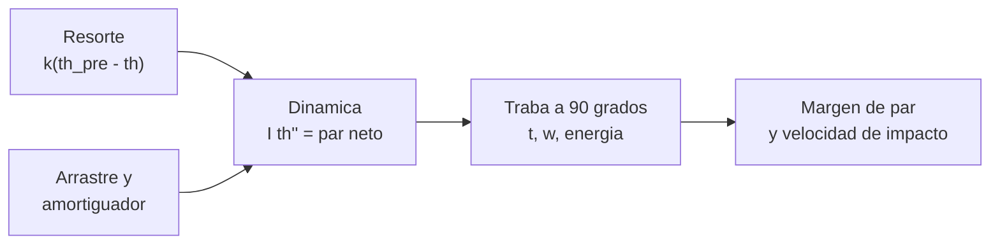

# B90-C15 — Pruebas de despliegue

<!-- nav:top -->
[🏠 Programa](../../../../README.md) · [📚 Bloque B90](../../../tronco-comun/B90-integracion-ensayos-y-calificacion-espacial.md) · [← Anterior: B90-C14 — Interferencias electromagnéticas EMI](../B90-C14-interferencias-electromagneticas-emi/CLASE.md) · [Siguiente: B90-C16 — Pruebas de extremo a extremo →](../B90-C16-pruebas-de-extremo-a-extremo/CLASE.md)
<!-- /nav -->

## 1. Ubicación, nivel y alcance

Clase 15 del bloque B90. Nivel N3. Antenas, paneles solares y mástiles viajan plegados y se **despliegan** en órbita; una falla de despliegue suele ser una falla de misión. La **prueba de despliegue** demuestra que el mecanismo despliega con **margen** suficiente y que la secuencia respeta los **inhibidores**. Aquí integras la dinámica de un panel articulado con resorte de torsión, calculas el margen de par y la velocidad de traba, y revisas la cronología y los inhibidores de un ejemplo. Todos los datos son **sintéticos**.

## 2. Por qué esta clase existe

Un mecanismo que despliega en el laboratorio con un margen justo puede quedarse a medio camino con lubricación degradada o arrastre de un arnés. La decisión central: **¿cuánto par sobra frente al arrastre y con qué velocidad llega a la traba?**

## 3. Lo que podrás hacer al terminar

1. Plantear y resolver la dinámica de un panel con resorte de torsión.
2. Calcular el margen de par frente al arrastre.
3. Calcular el tiempo de despliegue y la velocidad y energía en la traba.
4. Verificar la energía con la integral del par.
5. Revisar una cronología de separación, temporizador y despliegue.
6. Contar inhibidores independientes (el temporizador no cuenta) y separar lo consultado de lo sintético.

La evidencia es el **informe de una prueba de despliegue** del ejercicio 12 (sección 20).

## 4. Con qué llegas y cómo comprobarlo

1. ¿Qué es un resorte de torsión y cuál es su par?
2. ¿Qué es el momento de inercia?
3. ¿Qué es un margen de par?
4. ¿Qué es un inhibidor?
5. ¿Qué es una comprobación independiente?

<details>
<summary>Ver respuestas</summary>

1. Un resorte que ejerce un par `k (θ_pre − θ)`. 2. La resistencia a la aceleración angular, en kg·m². 3. El cociente entre el par disponible y el requerido. 4. Un dispositivo físico que impide una acción hasta que se cumple una condición. 5. Calcular lo mismo por otro método y comparar.
</details>

Con cuatro o cinco aciertos, sigue; si no, repasa los prerrequisitos.

## 5. Un caso de contexto y casos de referencia

Un panel con `I = 2,0 × 10⁻⁴ kg·m²` y un resorte de 0,020 N·m/rad precargado 126° entrega 43,98 mN·m al inicio y **12,57 mN·m en la traba**; con 3,0 mN·m de arrastre el **margen de par es 4,19**. Despliega en **0,1352 s** y llega a la traba a **19,34 rad/s** (37,4 mJ). En la cronología de ejemplo, el temporizador vence a 1 800 s, la antena se despliega a 1 805 s y la primera transmisión ocurre a 1 830 s. Todo es **sintético**.

## 6. Vocabulario

**Despliegue:** paso de la configuración plegada a la operativa. **Par de resorte:** `k (θ_pre − θ)`. **Arrastre:** par resistente (fricción, arnés). **Margen de par:** par mínimo disponible dividido por el arrastre. **Traba (*latch*):** tope que fija el panel desplegado. **Inhibidor independiente:** dispositivo físico entre una fuente de energía y un peligro. **Cronología:** secuencia de eventos con sus tiempos.

## 7. Modelo mental: el resorte empuja contra el arrastre hasta la traba



*Descripción textual:* el resorte entrega un par que decrece con el ángulo; el arrastre y el amortiguador lo reducen; la dinámica da el tiempo y la velocidad al llegar a 90°, donde la traba absorbe la energía.

Analogía: una puerta con resorte que se cierra sola: empuja con más fuerza al principio y menos al final; si el roce aumenta, puede quedar entornada. Límite: la analogía no refleja el impacto en la traba ni el efecto de la temperatura sobre el resorte.

## 8. La explicación, paso a paso

### 8.1 Qué dicen las fuentes

La *CubeSat Design Specification* (F8) exige al menos tres inhibidores independientes contra la liberación inadvertida de desplegables como antenas o paneles, aclara que un inhibidor es un dispositivo físico entre una fuente de energía y un peligro y que **un temporizador no es un inhibidor independiente**; también aclara que algunos proveedores consideran que actuar los mecanismos de despliegue es un cambio de configuración que invalida las vibraciones previas. *CubeSat 101* (F7) describe la prueba de «día en la vida» (DITL): retirar el pasador de remoción con los interruptores de separación oprimidos, soltarlos para simular la eyección y medir cuánto tarda en transmitir o desplegar, con informe de procedimiento con marcas de tiempo; si no se quiere liberar el despliegue basta demostrar que no ocurre antes del mínimo del ICD. El *Systems Engineering Handbook* (F2) define las pruebas de extremo a extremo y manda tratar las discrepancias. El criterio de margen ≥ 2 es de ejemplo.

### 8.2 La dinámica

`I θ'' = k (θ_pre − θ) − τ_arr − c θ'`, de `θ = 0` a `θ = π/2`, con `k = 0,020 N·m/rad`, `θ_pre = 126° = 2,199 rad`, `τ_arr = 3,0 mN·m` y `c = 10⁻⁴ N·m·s/rad`. El par del resorte es `43,98 mN·m` en 0° y `12,57 mN·m` en 90°. **Margen de par** `= 12,57/3,0 = 4,19` (el mínimo ocurre en la traba).

### 8.3 Tiempo, velocidad y energía

Con RK4 (paso 10 µs) y la traba por interpolación lineal: con arrastre y amortiguador, `t = 0,1352 s`, `ω = 19,344 rad/s` y `E = ½ I ω² = 37,418 mJ`. Sin pérdidas, `t = 0,1281 s` y `E = 44,413 mJ`, igual a `∫τ dθ = k (θ_pre θ_f − θ_f²/2) = 44,413 mJ` con diferencia relativa `2,7 × 10⁻⁹`.

| Arrastre (mN·m) | Margen | `t` (s) | `ω` en la traba (rad/s) |
|---|---|---|---|
| 3,00 | 4,19 | 0,1352 | 19,344 |
| 6,00 | 2,09 | 0,1416 | 18,116 |
| 9,50 | 1,32 | 0,1504 | 16,572 |
| 12,60 | 1,00 | 0,1597 | 15,076 |
| 15,00 | 0,84 | 0,1684 | 13,810 |

Incluso con margen 0,84 el panel llega, porque el par es mayor al principio; pero el margen se define en el punto más desfavorable y falla el criterio de ejemplo (≥ 2).

### 8.4 Cronología e inhibidores

Eventos de ejemplo: separación y arranque del temporizador (0 s); vence a 1 800 s; antena desplegada 1 805 s; primera transmisión 1 830 s (≥ 1 800 s, cumple el mínimo de ejemplo). Con deriva de ±0,5 % el temporizador vence entre 1 791 y 1 809 s. Inhibidores: interruptor de separación y pasador de remoción son independientes; el temporizador no: **2 de 3** y el requisito de tres **no se cumple**; hay que añadir un tercero.

## 9. Magnitudes, símbolos y unidades

| Símbolo | Qué es | Unidad | Valor / nota |
|---|---|---|---|
| `I` | inercia del panel | kg·m² | 2,0 × 10⁻⁴ |
| `k`, `θ_pre` | resorte de torsión y precarga | N·m/rad, ° | 0,020; 126 |
| `τ_arr`, `c` | arrastre y amortiguamiento | N·m, N·m·s/rad | 0,003; 10⁻⁴ |
| `t`, `ω` | tiempo y velocidad en la traba | s, rad/s | 0,1352; 19,344 |
| `E` | energía en la traba | mJ | 37,418 |
| margen | par disponible/arrastre | — | 4,19 |

## 10. Convenciones y referencias

Rotación de un panel rígido en un eje fijo, sin gravedad (ensayo con descarga de peso) y sin efectos térmicos. Unidades SI. Sistema de referencia: ángulo `θ` medido desde la posición plegada. Tolerancias: energía numérica frente a analítica `< 10⁻⁶`. Inercia, resorte, arrastre, amortiguador y tiempos de la cronología son **sintéticos**.

## 11. De dónde sale lo que afirmamos

| ID | Fuente | Localizador | Respalda | Estado |
|---|---|---|---|---|
| F8 | Cal Poly CubeSat Program, CubeSat Design Specification Rev. 14.1 (febrero de 2022) — PDF https://static1.squarespace.com/static/5418c831e4b0fa4ecac1bacd/t/62193b7fc9e72e0053f00910/1645820809779/CDS+REV14_1+2022-02-09.pdf (consultada 2026-11-10 con PyMuPDF) | secciones 2.2, 2.3, 2.4 y 3 (3.1–3.5) | ensayos típicos (vibración aleatoria, bakeout termovacío, choque, inspección visual), calificación, protovuelo y aceptación, tres inhibidores independientes, rieles y centro de gravedad (tabla 2) | Consultada |
| F7 | NASA CubeSat Launch Initiative, CubeSat 101: Basic Concepts and Processes for First-Time CubeSat Developers (octubre de 2017) — PDF https://www.nasa.gov/wp-content/uploads/2017/03/nasa_csli_cubesat_101_508.pdf (consultada 2026-11-10 con PyMuPDF) | capítulo 6, secciones 6.9.2 y 6.9.3 y prueba DITL | el ICD fija niveles y duraciones de vibración y bakeout; contenido mínimo de los informes; no modificar el hardware tras el ensayo; el ciclado termovacío no se exige habitualmente | Consultada |
| F2 | NASA, Systems Engineering Handbook, 5.3 Product Verification — https://www.nasa.gov/reference/5-3-product-verification/ (consultada 2026-11-10) | sección 5.3 | métodos de verificación (análisis, demostración, inspección, prueba); verificación frente a validación; definiciones de calificación, aceptación y pruebas de extremo a extremo; manejo de discrepancias | Consultada |
| — | Texto de las normas ECSS (verificación, ensayos, EMC, limpieza, carga de nave) | — | — | No consultada |
| — | Dinámica de un resorte de torsión con arrastre | — | la verifica el laboratorio con la integral del par | No consultada en una fuente concreta |
| — | Criterios de margen de par para mecanismos | — | usado solo como criterio de ejemplo (≥ 2) | No consultada |

Límites: ninguna fuente consultada da márgenes de par ni tiempos de despliegue.

## 12. Cómo ver el despliegue

| Magnitud | Valor |
|---|---|
| margen de par | 4,19 |
| tiempo de despliegue | 0,1352 s |
| energía en la traba | 37,418 mJ |
| inhibidores independientes | 2 de 3 |

Descripción larga: el ángulo crece con aceleración decreciente y el panel llega a 90° en 0,135 s; el margen empeora con el arrastre y el tiempo aumenta.

## 13. Ejemplo trabajado: ¿cumple el margen?

**Paso 1 · Par en la traba.** `0,020 × (2,199 − 1,571) = 12,57 mN·m`.

**Paso 2 · Margen.** `12,57/3,0 = 4,19`.

**Paso 3 · Criterio.** `4,19 ≥ 2,0` (ejemplo): cumple.

**Paso 4 · Energía.** `½ × 2×10⁻⁴ × 19,344² = 37,4 mJ`: la traba debe absorberla.

## 14. Distintas formas de describir el despliegue

**Por la dinámica:** ángulo, velocidad y tiempo. **Por la secuencia:** inhibidores, temporizadores y órdenes. **Por el informe:** procedimiento con marcas de tiempo y fotos (F7). Una prueba completa demuestra las tres.

## 15. Práctica guiada

**Ejercicio 1 · con los pasos indicados.** Calcula el par de un resorte de 0,02 N·m/rad con `θ_pre − θ = 1 rad`. *Pasos:* producto.

<details><summary>Solución comentada</summary>

`0,02 N·m = 20 mN·m`.
</details>

**Ejercicio 2 · con una pista.** Calcula el margen con 12,57 mN·m y 6 mN·m de arrastre. *Pista:* cociente.

<details><summary>Solución comentada</summary>

`2,09`.
</details>

**Ejercicio 3 · casi autónomo.** Calcula `½ I ω²` con `I = 2×10⁻⁴` y `ω = 15 rad/s`.

<details><summary>Solución comentada</summary>

`0,5 × 2×10⁻⁴ × 225 = 0,0225 J = 22,5 mJ`.
</details>

## 16. Práctica autónoma, transferencia e integrador

**Ejercicio 4 · autónomo.** ¿Con qué arrastre el margen es 1?

<details><summary>Solución comentada</summary>

Con 12,57 mN·m (el par en la traba).
</details>

**Ejercicio 5 · autónomo.** Calcula el trabajo del resorte de 0 a 90°: `k (θ_pre θ_f − θ_f²/2)`.

<details><summary>Solución comentada</summary>

`0,02 × (2,199 × 1,571 − 1,234) = 0,02 × 2,221 = 44,4 mJ`.
</details>

**Ejercicio 6 · autónomo.** ¿Cuánto se retrasa el vencimiento con deriva de +0,5 % en 1 800 s?

<details><summary>Solución comentada</summary>

9 s (1 809 s).
</details>

**Ejercicio 7 · autónomo.** ¿Cuántos inhibidores independientes faltan en el ejemplo?

<details><summary>Solución comentada</summary>

Uno: hay 2 y se exigen 3.
</details>

**Ejercicio 8 · autónomo.** ¿Por qué el margen se evalúa en la traba?

<details><summary>Solución comentada</summary>

Porque el par del resorte decrece con el ángulo: ahí es mínimo.
</details>

**Ejercicio 9 · transferencia.** **Transferencia.** Un colega usa estos números para su panel. ¿Es válido?

<details><summary>Solución comentada</summary>

No: son sintéticos; inercia, resorte y arrastre de su panel son otros.
</details>

**Ejercicio 10 · transferencia.** **Transferencia.** ¿Por qué un ensayo de despliegue antes de la vibración puede invalidar la vibración?

<details><summary>Solución comentada</summary>

Porque actuar los mecanismos cambia la configuración y algunos proveedores exigen repetir la vibración (F8).
</details>

**Ejercicio 11 · transferencia.** **Transferencia.** ¿Qué efecto tiene el frío sobre el margen?

<details><summary>Solución comentada</summary>

Suele aumentar la fricción y el arrastre; por eso se verifica el margen a temperatura mínima.
</details>

**Ejercicio 12 · integrador.** **Integrador.** Elabora tu *informe de una prueba de despliegue*: margen, tiempo, energía, comprobación con la integral del par, cronología, inhibidores y lista de qué es consultado, no consultado y sintético.

<details><summary>Solución comentada</summary>

Secciones 8.2–8.4 y la salida del laboratorio.
</details>

## 17. Laboratorio: panel articulado y cronología

El script [despliegue_panel.py](despliegue_panel.py) integra la dinámica con RK4, calcula margen, tiempo, velocidad y energía, barre el arrastre y revisa cronología e inhibidores; **comprueba** la energía contra la integral del par (`< 10⁻⁶`), el margen y el conteo de inhibidores. Usa la biblioteca común [b90_comun.py](../b90_comun.py).

**Datos:** panel, resorte, arrastre y cronología **sintéticos**; la regla del temporizador viene de F8 (consultada 2026-11-10). **Predice antes de ejecutar:** ¿cuántos inhibidores independientes cuenta el ejemplo? (2.) Ejecución del 2026-11-10 (Python 3.12.9, numpy 2.4.4):

```text
Python 3.12.9 | numpy 2.4.4
Datos SINTETICOS: panel de I = 2.0e-4 kg m2, resorte k = 0.020 N m/rad con precarga angular de 126 grados
Par del resorte: inicial = 43.98 mN m ; en la traba = 12.57 mN m ; arrastre = 3.00 mN m
Margen de par (minimo, en la traba) = 4.19 (criterio de ejemplo >= 2.0) -> CUMPLE
Con arrastre y amortiguador: t_despliegue = 0.1352 s ; w_traba = 19.344 rad/s ; energia en la traba = 37.418 mJ
Caso sin perdidas: t = 0.1281 s ; energia numerica = 44.413220 mJ ; analitica = 44.413220 mJ ; dif = 2.7e-09
Arrastre [mN m] -> margen -> t_despliegue [s] -> w en la traba [rad/s]
     3.00 ->  4.19 -> 0.1352 -> 19.344
     6.00 ->  2.09 -> 0.1416 -> 18.116
     9.50 ->  1.32 -> 0.1504 -> 16.572
    12.60 ->  1.00 -> 0.1597 -> 15.076
    15.00 ->  0.84 -> 0.1684 -> 13.810
Cronologia de ejemplo (s desde la separacion):
   t =     0.0 s  Separacion detectada (interruptores liberados)
   t =     0.0 s  Arranque del temporizador de 1800 s
   t =  1800.0 s  Temporizador vence: habilita despliegue de antena
   t =  1805.0 s  Antena desplegada
   t =  1830.0 s  Primera transmision
Inhibidores independientes = 2 de 3 (el temporizador no cuenta); requisito: al menos 3 -> NO CUMPLE
Deriva del temporizador -0.5 % -> vence en 1791.0 s
Deriva del temporizador +0.0 % -> vence en 1800.0 s
Deriva del temporizador +0.5 % -> vence en 1809.0 s
Pruebas superadas.
```

```bash
python programa/clases/B90/B90-C15-pruebas-de-despliegue/despliegue_panel.py
```

**Límites:** un eje, sin gravedad ni temperatura, traba ideal, arrastre constante.

## 18. Errores frecuentes y cómo corregirlos

**Evaluar el margen al inicio.** Es mínimo en la traba (8.2)

**Contar el temporizador como inhibidor.** No lo es (8.4)

**Desplegar sin documentar la secuencia.** Registra marcas de tiempo (8.1)

## 19. Cómo sabrás que vas bien

Tras la sección 8: ¿dónde es mínimo el par del resorte? Si dudas, repasa el ejercicio 8. Tras el laboratorio: ¿qué verifica la integral del par? (ver sección 17).

## 20. Qué entregas y cómo se evalúa

El producto es tu **informe de una prueba de despliegue** (ejercicio 12).

| Criterio | Inicial | En desarrollo | Logrado | Destacado |
|---|---|---|---|---|
| Conceptos | Los confunde | Parciales | Explica el método y su dominio | Explica los límites y las alternativas |
| Cálculo | Sin unidades | Con errores | Resultados con unidades y comprobados | Resuelve casos nuevos |
| Numérico | Sin comprobar | Un caso | Verifica con una comprobación independiente en varios casos | Interpreta las diferencias y los fallos |
| Fuentes | Sin fuente | Sin fecha | Fuentes con fecha y estado | Declara lo sintético y lo no consultado |
| Límites | No los nombra | Uno | Tres | Discute qué falta del modelo |

**Condiciones críticas (no se compensan con promedio):** rotular los datos como sintéticos; verificar cada resultado con una comprobación independiente; citar solo lo consultado.

## 21. Ética, seguridad y límites

Clase educativa: panel, resorte y cronología son de ejemplo y no sustituyen el análisis de mecanismos ni el procedimiento aprobado; un resorte cargado almacena energía y su manipulación exige procedimientos de seguridad. Accesibilidad: tablas equivalentes a las gráficas, fórmulas en texto, ejercicios sin conexión.

## 22. Para cerrar y seguir

El panel despliega en 0,135 s con margen de par 4,19 y 37 mJ en la traba, pero el ejemplo cuenta solo 2 inhibidores independientes de los 3 exigidos. Queda una pregunta: ¿cómo se prueba la cadena completa, del telecomando a la telemetría?

**Glosario español–inglés.** despliegue · *deployment*; resorte de torsión · *torsion spring*; margen de par · *torque margin*; traba · *latch*; inhibidor · *inhibit*; pasador de remoción · *remove-before-flight pin*.

**Continuidad.** [B90-C16](../B90-C16-pruebas-de-extremo-a-extremo/CLASE.md) trata las pruebas de extremo a extremo.

**Referencias:** ver sección 11.

<!-- nav:bottom -->
---

[← Anterior: B90-C14 — Interferencias electromagnéticas EMI](../B90-C14-interferencias-electromagneticas-emi/CLASE.md) · [📚 Bloque B90](../../../tronco-comun/B90-integracion-ensayos-y-calificacion-espacial.md) · [Siguiente: B90-C16 — Pruebas de extremo a extremo →](../B90-C16-pruebas-de-extremo-a-extremo/CLASE.md)
<!-- /nav -->
