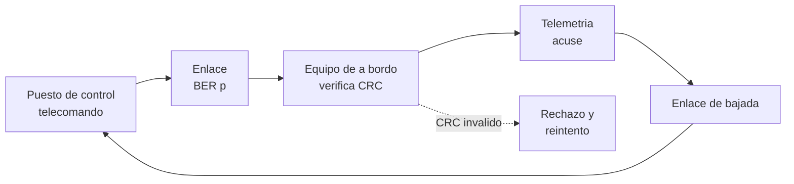

# B90-C16 — Pruebas de extremo a extremo

<!-- nav:top -->
[🏠 Programa](../../../../README.md) · [📚 Bloque B90](../../../tronco-comun/B90-integracion-ensayos-y-calificacion-espacial.md) · [← Anterior: B90-C15 — Pruebas de despliegue](../B90-C15-pruebas-de-despliegue/CLASE.md) · [Siguiente: B90-C17 — Gestión de anomalías de prueba →](../../../tronco-comun/B90-integracion-ensayos-y-calificacion-espacial.md#b90-c17)
<!-- /nav -->

## 1. Ubicación, nivel y alcance

Clase 16 del bloque B90. Nivel N3. Una **prueba de extremo a extremo** (E2E) recorre una cadena operativa completa: un telecomando sale del puesto de control, atraviesa el enlace y el equipo de a bordo y vuelve como telemetría. Aquí modelas la cadena con tramas protegidas por un **CRC-16**, un canal con errores de bits y un presupuesto de latencia, y comparas la tasa de error de trama teórica con una simulación. Todos los datos son **sintéticos**.

## 2. Por qué esta clase existe

Cada subsistema puede pasar sus pruebas y la cadena fallar: un formato de trama distinto, un retraso mayor que el tiempo de espera, un error de bit no detectado. La decisión central: **¿qué errores detecta la cadena, con qué frecuencia reintenta y cuánto tarda cada acuse?**

## 3. Lo que podrás hacer al terminar

1. Definir una prueba de extremo a extremo y su diferencia con una prueba por subsistema.
2. Calcular un CRC-16/CCITT y verificar con su valor de comprobación.
3. Medir la detección de errores de uno y dos bits y de ráfagas.
4. Calcular la tasa de error de trama (FER) y comprobarla con Monte Carlo.
5. Calcular el número medio de reintentos y la latencia de un telecomando.
6. Separar lo consultado (definición de E2E) de lo sintético y de lo no consultado.

La evidencia es el **informe de una prueba de extremo a extremo** del ejercicio 12 (sección 20).

## 4. Con qué llegas y cómo comprobarlo

1. ¿Qué es una trama y qué es un CRC?
2. ¿Qué es la tasa de error de bit (BER)?
3. ¿Qué es una distribución binomial?
4. ¿Qué es la latencia?
5. ¿Qué es una comprobación independiente?

<details>
<summary>Ver respuestas</summary>

1. Una unidad de datos con cabecera y verificación; el CRC es un código de detección de errores. 2. La fracción de bits recibidos con error. 3. El número de éxitos en `n` intentos independientes. 4. El tiempo entre el envío y la recepción. 5. Calcular lo mismo por otro método y comparar.
</details>

Con cuatro o cinco aciertos, sigue; si no, repasa los prerrequisitos.

## 5. Un caso de contexto y casos de referencia

Una trama de 130 bytes (1 040 bits: 128 de datos y 2 de CRC) a 9 600 bit/s dura **0,108 s**. Con `BER = 10⁻⁴`, la FER es **0,0988** y cada trama se reintenta en promedio **1,11** veces; con `BER = 10⁻³`, FER **0,647** y 2,83 envíos. El CRC detecta todos los errores de 1 bit, de 2 bits y las ráfagas de hasta 16 bits probadas. La latencia de un telecomando con acuse es **0,2467 s**. Todo es **sintético**.

## 6. Vocabulario

**Prueba de extremo a extremo:** prueba de un hilo operativo completo entre elementos e interfaces externas. **CRC:** código de redundancia cíclica. **BER:** tasa de error de bit. **FER:** tasa de error de trama, `1 − (1 − p)^n`. **Ráfaga:** error en bits consecutivos. **ARQ:** retransmisión automática. **Presupuesto de latencia:** suma de retardos de la cadena.

## 7. Modelo mental: un hilo de punta a punta



*Descripción textual:* el telecomando sale del puesto de control, cruza el enlace con errores, llega al equipo de a bordo que verifica el CRC; si es válido responde con telemetría y acuse; si no, lo rechaza y se reintenta.

Analogía: una carta certificada con acuse de recibo: la prueba no es que salió, sino que llegó el acuse. Límite: en la cadena real hay varios saltos y cada uno tiene su propia tasa de error.

## 8. La explicación, paso a paso

### 8.1 Qué dice la fuente

El *Systems Engineering Handbook* (F2) define la prueba de extremo a extremo como la prueba de hilos operativos completos entre elementos del sistema e interfaces externas, y la validación frente a la verificación; también define la discrepancia y manda detener la verificación y emitir un informe. *CubeSat 101* (F7) describe una prueba de día en la vida con procedimiento y tiempos. CCSDS publica protocolos de datos espaciales, pero sus recomendaciones **no se consultaron**; el CRC-16/CCITT-FALSE (polinomio 0x1021, valor inicial 0xFFFF) y su valor de comprobación 0x29B1 son datos de uso general no consultados en una fuente concreta.

### 8.2 El CRC

El laboratorio calcula `CRC("123456789") = 0x29B1`, igual al valor de comprobación. Una trama válida cumple `CRC(datos + CRC) = 0`. Resultados medidos: 1 040 de 1 040 errores de 1 bit detectados; 20 000 de 20 000 errores dobles al azar; 20 000 de 20 000 ráfagas de hasta 16 bits. Con palabras de 4 bytes al azar, 38 de 2 × 10⁶ tienen CRC válido (1,90 × 10⁻⁵) frente a `2⁻¹⁶ = 1,53 × 10⁻⁵`: el CRC deja pasar una fracción cercana a `2⁻¹⁶` de los errores arbitrarios.

### 8.3 FER y reintentos

`FER = 1 − (1 − p)^n` con `n = 1 040`:

| BER | FER teórica | FER simulada | Envíos medios `1/(1 − FER)` |
|---|---|---|---|
| 10⁻⁶ | 0,00104 | 0,00102 | 1,001 |
| 10⁻⁵ | 0,01035 | 0,01090 | 1,010 |
| 10⁻⁴ | 0,09878 | 0,09806 | 1,110 |
| 10⁻³ | 0,64673 | 0,64632 | 2,831 |

La simulación (200 000 tramas por fila) coincide con la teoría dentro de 4 errores estándar.

### 8.4 Latencia

A 9 600 bit/s: serialización `1 040/9 600 = 0,1083 s`; propagación a 1 500 km `0,0050 s` por sentido; proceso a bordo (ejemplo) `0,020 s`; telemetría de respuesta `0,1083 s`. Total ida y vuelta: `0,1083 + 0,005 + 0,020 + 0,1083 + 0,005 = 0,2467 s`. El tiempo de espera del acuse debe ser mayor y debe considerar los reintentos.

## 9. Magnitudes, símbolos y unidades

| Símbolo | Qué es | Unidad | Valor / nota |
|---|---|---|---|
| `n` | bits de la trama | bits | 1 040 |
| `p` | BER | — | 10⁻⁶ a 10⁻³ |
| FER | tasa de error de trama | — | tabla 8.3 |
| CRC | código de verificación | 16 bits | 0x29B1 (prueba) |
| `R` | velocidad de enlace | bit/s | 9 600 |
| latencia | ida y vuelta | s | 0,2467 |

## 10. Convenciones y referencias

Errores independientes entre bits (canal binario simétrico); un solo salto de enlace; trama de longitud fija. Unidades bits, s. Sistema de referencia: no aplica. Tolerancias: FER simulada frente a teórica `< 4` errores estándar. La trama, el enlace, los retardos y los BER son **sintéticos**.

## 11. De dónde sale lo que afirmamos

| ID | Fuente | Localizador | Respalda | Estado |
|---|---|---|---|---|
| F2 | NASA, Systems Engineering Handbook, 5.3 Product Verification — https://www.nasa.gov/reference/5-3-product-verification/ (consultada 2026-11-10) | sección 5.3 | métodos de verificación (análisis, demostración, inspección, prueba); verificación frente a validación; definiciones de calificación, aceptación y pruebas de extremo a extremo; manejo de discrepancias | Consultada |
| F7 | NASA CubeSat Launch Initiative, CubeSat 101: Basic Concepts and Processes for First-Time CubeSat Developers (octubre de 2017) — PDF https://www.nasa.gov/wp-content/uploads/2017/03/nasa_csli_cubesat_101_508.pdf (consultada 2026-11-10 con PyMuPDF) | capítulo 6, secciones 6.9.2 y 6.9.3 y prueba DITL | el ICD fija niveles y duraciones de vibración y bakeout; contenido mínimo de los informes; no modificar el hardware tras el ensayo; el ciclado termovacío no se exige habitualmente | Consultada |
| F8 | Cal Poly CubeSat Program, CubeSat Design Specification Rev. 14.1 (febrero de 2022) — PDF https://static1.squarespace.com/static/5418c831e4b0fa4ecac1bacd/t/62193b7fc9e72e0053f00910/1645820809779/CDS+REV14_1+2022-02-09.pdf (consultada 2026-11-10 con PyMuPDF) | secciones 2.2, 2.3, 2.4 y 3 (3.1–3.5) | ensayos típicos (vibración aleatoria, bakeout termovacío, choque, inspección visual), calificación, protovuelo y aceptación, tres inhibidores independientes, rieles y centro de gravedad (tabla 2) | Consultada |
| — | Texto de las normas ECSS (verificación, ensayos, EMC, limpieza, carga de nave) | — | — | No consultada |
| — | CCSDS (recomendaciones de enlace y de datos) | https://ccsds.org/publications/ | — | No consultada |
| — | CRC-16/CCITT-FALSE, valor 0x29B1 y `FER = 1 − (1 − p)^n` | — | los verifica el laboratorio | No consultada en una fuente concreta |

Límites: ninguna fuente consultada da formatos de trama ni tasas de error; la cadena es didáctica.

## 12. Cómo ver la cadena

| Magnitud | Valor |
|---|---|
| tiempo de trama | 0,1083 s |
| FER a 10⁻⁴ | 0,0988 |
| detección de errores de 1 y 2 bits | 100 % en las pruebas |
| latencia con acuse | 0,2467 s |

Descripción larga: la FER crece casi linealmente con `p` mientras `n p ≪ 1` y tiende a 1 cuando `n p` es grande; la latencia está dominada por la serialización.

## 13. Ejemplo trabajado: FER y reintentos con BER de 10⁻⁴

**Paso 1 · Bits.** `n = 130 × 8 = 1 040`.

**Paso 2 · FER.** `1 − (1 − 10⁻⁴)^1040 = 1 − e^{−0,104} = 0,0988`.

**Paso 3 · Reintentos.** `1/(1 − 0,0988) = 1,110` envíos medios.

**Paso 4 · Simulación.** 0,09806 con 200 000 tramas: coincide.

## 14. Distintas formas de describir la prueba E2E

**Por hilo:** un telecomando de ida y vuelta (esta clase). **Por capa:** enlace, trama, aplicación. **Por escenario:** operación nominal, degradada y de falla. Se cubren con casos distintos.

## 15. Práctica guiada

**Ejercicio 1 · con los pasos indicados.** Calcula el tiempo de una trama de 520 bits a 9 600 bit/s. *Pasos:* cociente.

<details><summary>Solución comentada</summary>

`520/9 600 = 0,0542 s`.
</details>

**Ejercicio 2 · con una pista.** Calcula la FER con `p = 10⁻⁵` y `n = 1 040`. *Pista:* `1 − e^{−np}`.

<details><summary>Solución comentada</summary>

`1 − e^{−0,0104} = 0,01035`.
</details>

**Ejercicio 3 · casi autónomo.** ¿Cuántos envíos medios hacen falta con FER = 0,5?

<details><summary>Solución comentada</summary>

`1/(1 − 0,5) = 2`.
</details>

## 16. Práctica autónoma, transferencia e integrador

**Ejercicio 4 · autónomo.** ¿Cuál es la probabilidad de que un error arbitrario pase el CRC-16?

<details><summary>Solución comentada</summary>

Alrededor de `2⁻¹⁶ = 1,5 × 10⁻⁵`.
</details>

**Ejercicio 5 · autónomo.** Calcula la propagación a 36 000 km en un sentido.

<details><summary>Solución comentada</summary>

`3,6×10⁷/299 792 458 = 0,120 s`.
</details>

**Ejercicio 6 · autónomo.** ¿Qué pasa con la latencia si la velocidad sube a 19 200 bit/s?

<details><summary>Solución comentada</summary>

Cada serialización baja a 0,0542 s: total `0,0542 × 2 + 0,010 + 0,020 = 0,1384 s`.
</details>

**Ejercicio 7 · autónomo.** ¿Por qué la FER a 10⁻³ no es 1,04?

<details><summary>Solución comentada</summary>

Porque es una probabilidad: `1 − (1 − p)^n` nunca supera 1; `np = 1,04` no es la probabilidad sino el número medio de errores por trama.
</details>

**Ejercicio 8 · autónomo.** Si el tiempo de espera es de 0,25 s, ¿alcanza con un reintento?

<details><summary>Solución comentada</summary>

La latencia de un intento es 0,2467 s: apenas; con reintento se supera; el tiempo de espera debe considerar el peor caso.
</details>

**Ejercicio 9 · transferencia.** **Transferencia.** Un colega afirma que su enlace tiene BER de 10⁻⁴ porque la clase lo usa. ¿Es válido?

<details><summary>Solución comentada</summary>

No: el BER de ejemplo es sintético; el real se mide en la prueba.
</details>

**Ejercicio 10 · transferencia.** **Transferencia.** ¿Qué errores no detecta una prueba por subsistema y sí una E2E?

<details><summary>Solución comentada</summary>

Desacuerdos de formato, tiempos de espera y tamaños entre elementos, errores de integración (F2).
</details>

**Ejercicio 11 · transferencia.** **Transferencia.** ¿Qué hacer si la prueba E2E muestra una discrepancia?

<details><summary>Solución comentada</summary>

Detener, emitir un informe, decidir si el fallo es del producto o del procedimiento y cerrar el informe con evidencia (F2; C17).
</details>

**Ejercicio 12 · integrador.** **Integrador.** Elabora tu *informe de una prueba de extremo a extremo*: cadena, CRC, FER teórica y simulada, reintentos, latencia y lista de qué es consultado, no consultado y sintético.

<details><summary>Solución comentada</summary>

Secciones 8.2–8.4 y la salida del laboratorio.
</details>

## 17. Laboratorio: CRC, canal y latencia

El script [cadena_e2e.py](cadena_e2e.py) calcula un CRC con tabla, prueba la detección de errores, simula el canal y compara la FER, y calcula la latencia; **comprueba** el valor 0x29B1, la detección de errores de 1 y 2 bits y ráfagas, la FER (4 errores estándar) y el rango de la latencia. Usa la biblioteca común [b90_comun.py](../b90_comun.py).

**Datos:** trama, enlace, BER y retardos **sintéticos**. **Predice antes de ejecutar:** ¿cuál es la FER con `BER = 10⁻⁴`? (≈ 0,10.) Ejecución del 2026-11-10 (Python 3.12.9, numpy 2.4.4):

```text
Python 3.12.9 | numpy 2.4.4
Datos SINTETICOS: trama de 1024 bits de datos + CRC de 16 bits; enlace de 9600 bit/s
CRC-16/CCITT-FALSE de '123456789' = 0x29B1 (valor de verificacion habitual: 0x29B1)
Trama = 130 bytes = 1040 bits ; CRC de los datos = 0xA0A7 ; CRC de la trama completa = 0x0000 (0 si es valida)
Errores de 1 bit: detectados 1040 de 1040
Errores de 2 bits (20 000 al azar): detectados 20000
Rafagas de hasta 16 bits (20 000 al azar): detectadas 20000
Palabras al azar de 4 bytes con CRC valido: 38 de 2000000 = 1.90e-05 (teoria 2^-16 = 1.53e-05)
BER p -> FER teorico -> FER Monte Carlo (200 000 tramas) -> reintentos medios 1/(1-FER)
    1e-06 -> 0.00104 -> 0.00102 -> 1.001
    1e-05 -> 0.01035 -> 0.01090 -> 1.010
    1e-04 -> 0.09878 -> 0.09806 -> 1.110
    1e-03 -> 0.64673 -> 0.64632 -> 2.831
Presupuesto de latencia de un telecomando con acuse [s]:
   serializacion de la trama                    0.1083
   propagacion (1500 km, un sentido)            0.0050
   proceso en a bordo (ejemplo)                 0.0200
   respuesta de telemetria (serializacion)      0.1083
   total (ida y vuelta, con propagacion de regreso) = 0.2467 s
Pruebas superadas.
```

```bash
python programa/clases/B90/B90-C16-pruebas-de-extremo-a-extremo/cadena_e2e.py
```

**Límites:** canal binario simétrico sin memoria, un salto, sin cifrado ni protocolo real; tarda unos segundos por las simulaciones.

## 18. Errores frecuentes y cómo corregirlos

**Probar solo subsistemas.** Añade un hilo completo (8.1)

**Confundir `n p` con una probabilidad.** Usa `1 − (1 − p)^n` (8.3)

**Presentar los parámetros de ejemplo como los de un enlace real.** Revisa la sección 10

## 19. Cómo sabrás que vas bien

Tras la sección 8: ¿qué FER da `BER = 10⁻⁵`? Si dudas, repasa el ejercicio 2. Tras el laboratorio: ¿qué errores detecta siempre el CRC en las pruebas? (ver sección 17).

## 20. Qué entregas y cómo se evalúa

El producto es tu **informe de una prueba de extremo a extremo** (ejercicio 12).

| Criterio | Inicial | En desarrollo | Logrado | Destacado |
|---|---|---|---|---|
| Conceptos | Los confunde | Parciales | Explica el método y su dominio | Explica los límites y las alternativas |
| Cálculo | Sin unidades | Con errores | Resultados con unidades y comprobados | Resuelve casos nuevos |
| Numérico | Sin comprobar | Un caso | Verifica con una comprobación independiente en varios casos | Interpreta las diferencias y los fallos |
| Fuentes | Sin fuente | Sin fecha | Fuentes con fecha y estado | Declara lo sintético y lo no consultado |
| Límites | No los nombra | Uno | Tres | Discute qué falta del modelo |

**Condiciones críticas (no se compensan con promedio):** rotular los datos como sintéticos; verificar cada resultado con una comprobación independiente; citar solo lo consultado.

## 21. Ética, seguridad y límites

Clase educativa: el enlace y la trama son de ejemplo y no sustituyen la validación con el estándar de enlace de la misión; la protección criptográfica es tema de otro bloque. Accesibilidad: tablas equivalentes a las gráficas, fórmulas en texto, ejercicios sin conexión.

## 22. Para cerrar y seguir

Con BER de 10⁻⁴ una trama de 1 040 bits falla el 9,9 % de las veces y cada telecomando tarda 0,247 s con acuse; el CRC detectó todos los errores simples probados. Queda una pregunta: ¿qué se hace cuando una prueba falla?

**Glosario español–inglés.** prueba de extremo a extremo · *end-to-end test*; código de redundancia cíclica · *cyclic redundancy check (CRC)*; tasa de error de bit · *bit error rate (BER)*; tasa de error de trama · *frame error rate (FER)*; ráfaga · *burst*; acuse · *acknowledgement*.

**Continuidad.** [B90-C17](../B90-C17-gestion-de-anomalias-de-prueba/CLASE.md) trata la gestión de anomalías de prueba.

**Referencias:** ver sección 11.

<!-- nav:bottom -->
---

[← Anterior: B90-C15 — Pruebas de despliegue](../B90-C15-pruebas-de-despliegue/CLASE.md) · [📚 Bloque B90](../../../tronco-comun/B90-integracion-ensayos-y-calificacion-espacial.md) · [Siguiente: B90-C17 — Gestión de anomalías de prueba →](../../../tronco-comun/B90-integracion-ensayos-y-calificacion-espacial.md#b90-c17)
<!-- /nav -->
