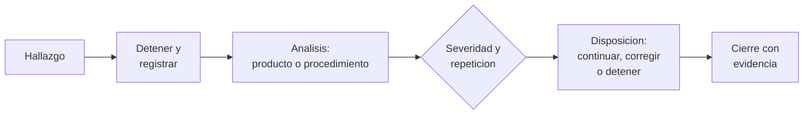

# B90-C17 — Gestión de anomalías de prueba

<!-- nav:top -->
[🏠 Programa](../../../../README.md) · [📚 Bloque B90](../../../tronco-comun/B90-integracion-ensayos-y-calificacion-espacial.md) · [← Anterior: B90-C16 — Pruebas de extremo a extremo](../B90-C16-pruebas-de-extremo-a-extremo/CLASE.md) · [Siguiente: B90-C18 — Trazabilidad de evidencias →](../B90-C18-trazabilidad-de-evidencias/CLASE.md)
<!-- /nav -->

## 1. Ubicación, nivel y alcance

Clase 17 del bloque B90. Nivel N3. Una **anomalía de prueba** es cualquier resultado que difiere de lo esperado. Su gestión decide si la prueba continúa, si se corrige el producto o el procedimiento, y qué se puede afirmar sobre la confiabilidad con pocos datos. Aquí registras 12 anomalías sintéticas, aplicas una regla de disposición por severidad y repetición, haces un Pareto y calculas una **cota superior de confianza de la tasa de fallas** con la distribución de Poisson. Todos los datos son **sintéticos**.

## 2. Por qué esta clase existe

Una falla única en 500 horas de ensayo no demuestra que el equipo sea confiable: solo acota la tasa de fallas. Y una anomalía mal registrada se pierde. La decisión central: **¿se detiene la prueba, se corrige y se repite, o se registra y se continúa?, y ¿qué se puede decir de la confiabilidad con lo observado?**

## 3. Lo que podrás hacer al terminar

1. Describir el ciclo de una discrepancia: detener, registrar, analizar, disponer y cerrar.
2. Aplicar una regla de disposición por severidad y repetición.
3. Construir un Pareto de anomalías por ensayo.
4. Calcular la cota superior de Poisson de la tasa de fallas con una confianza dada.
5. Comprobar la cota con una forma cerrada y con la cobertura por Monte Carlo.
6. Separar lo consultado (manejo de discrepancias) de lo sintético.

La evidencia es el **informe de no conformidad con su disposición** del ejercicio 12 (sección 20).

## 4. Con qué llegas y cómo comprobarlo

1. ¿Qué es una distribución de Poisson?
2. ¿Qué es un nivel de confianza?
3. ¿Qué es una causa raíz?
4. ¿Qué es un Pareto?
5. ¿Qué es una comprobación independiente?

<details>
<summary>Ver respuestas</summary>

1. La de los conteos de sucesos independientes a tasa constante. 2. La probabilidad de que el método de acotación cubra el valor verdadero. 3. La causa básica que, si se corrige, evita la repetición. 4. Un ordenamiento por frecuencia de las categorías de problemas. 5. Calcular lo mismo por otro método y comparar.
</details>

Con cuatro o cinco aciertos, sigue; si no, repasa los prerrequisitos.

## 5. Un caso de contexto y casos de referencia

Un registro de ejemplo tiene 12 anomalías: 3 de severidad S1, 4 de S2 y 5 de S3; **4** son funcionales y 2 de cada uno de los demás ensayos. Con **1 falla en 500 h**, la tasa superior al 90 % de confianza es **7,78 × 10⁻³ /h**, o un tiempo medio entre fallas de al menos **128,5 h**. Todo es **sintético**.

## 6. Vocabulario

**Anomalía/discrepancia:** variación frente a lo esperado. **No conformidad:** producto que no cumple su requisito. **Disposición:** decisión sobre qué hacer. **Severidad:** gravedad del efecto (S1 la mayor). **Causa raíz:** origen de la falla. **Cota superior de confianza:** valor que, con probabilidad `CL`, no es inferior a la tasa verdadera. **MTBF:** tiempo medio entre fallas.

## 7. Modelo mental: del hallazgo al cierre



*Descripción textual:* un hallazgo detiene la actividad y se registra; el análisis decide si el defecto es del producto o del procedimiento; la regla de severidad y repetición propone una disposición y el cierre exige evidencia.

Analogía: el parte de averías de un taller: no basta con arreglar el auto; hay que anotar qué falló, cuántas veces y por qué. Límite: un registro no sustituye el análisis de causa raíz.

## 8. La explicación, paso a paso

### 8.1 Qué dice la fuente

El *Systems Engineering Handbook* (F2) dice que cuando se observa una discrepancia se detienen las actividades de verificación y se genera un informe; los analistas determinan si el producto no es conforme o si el problema está en el procedimiento o en cómo se condujo la prueba; las discrepancias y no conformidades se registran y algunas requieren aprobación de una junta de revisión de materiales o de control de configuración; la resolución puede ser rediseño, reverificación, corrección de procedimiento o equipo, o una renuncia; y la verificación se completa solo con evidencia documentada y todos los informes cerrados. La CDS (F8) añade que si se modifica el CubeSat tras un ensayo se requieren ensayos adicionales. La regla de disposición y la estadística de esta clase son de ejemplo.

### 8.2 Regla de disposición de ejemplo

S1: detener, abrir no conformidad y revisar con un comité. S2: analizar la causa raíz antes de continuar (primera vez) o detener y corregir (repetida). S3: registrar y continuar, y analizar la causa si ocurre tres o más veces. Con el registro de ejemplo, A03, A07 y A08 detienen la campaña; A06 y A11 (funcionales recurrentes) exigen causa raíz.

### 8.3 Pareto

Por ensayo: funcional 4; vibración, termovacío, EMC y despliegue 2 cada uno. Por severidad: S1 3, S2 4, S3 5. El ensayo funcional concentra el 33 % de las anomalías, que son de baja severidad pero repetidas: una causa común es probable.

### 8.4 Cota de Poisson

Con `r` fallas en `T` horas y confianza `CL`, `μ_U` cumple `P(X ≤ r | μ_U) = 1 − CL` y `λ_U = μ_U/T`.

| `r` | `μ_U` (CL = 90 %) |
|---|---|
| 0 | 2,3026 |
| 1 | 3,8897 |
| 2 | 5,3223 |
| 3 | 6,6808 |
| 4 | 7,9936 |
| 5 | 9,2747 |

Para `r = 0`, `μ_U = −ln(1 − CL) = 2,3026` (forma cerrada comprobada con tolerancia `10⁻⁹`). Con `r = 1` y `T = 500 h`: `λ_U = 3,8897/500 = 7,78 × 10⁻³ /h`. La cobertura por Monte Carlo (2 × 10⁵ campañas con tasa verdadera 0,012 /h) es **0,9384**, mayor que el 0,90 nominal: la cota de Poisson es conservadora.

## 9. Magnitudes, símbolos y unidades

| Símbolo | Qué es | Unidad | Valor / nota |
|---|---|---|---|
| `r` | fallas observadas | — | 0 a 5 |
| `T` | tiempo de ensayo | h | 500 |
| `CL` | nivel de confianza | — | 0,90 |
| `μ_U` | cota superior del conteo esperado | — | tabla 8.4 |
| `λ_U` | cota superior de la tasa | 1/h | 7,78 × 10⁻³ |

## 10. Convenciones y referencias

Tasa constante de fallas, sucesos independientes, un solo modo de falla. Unidades h y 1/h. Sistema de referencia: no aplica. Tolerancias: forma cerrada `10⁻⁹`; cobertura `≥ CL − 0,01`. El registro, la regla de disposición y las horas son **sintéticos**.

## 11. De dónde sale lo que afirmamos

| ID | Fuente | Localizador | Respalda | Estado |
|---|---|---|---|---|
| F2 | NASA, Systems Engineering Handbook, 5.3 Product Verification — https://www.nasa.gov/reference/5-3-product-verification/ (consultada 2026-11-10) | sección 5.3 | métodos de verificación (análisis, demostración, inspección, prueba); verificación frente a validación; definiciones de calificación, aceptación y pruebas de extremo a extremo; manejo de discrepancias | Consultada |
| F8 | Cal Poly CubeSat Program, CubeSat Design Specification Rev. 14.1 (febrero de 2022) — PDF https://static1.squarespace.com/static/5418c831e4b0fa4ecac1bacd/t/62193b7fc9e72e0053f00910/1645820809779/CDS+REV14_1+2022-02-09.pdf (consultada 2026-11-10 con PyMuPDF) | secciones 2.2, 2.3, 2.4 y 3 (3.1–3.5) | ensayos típicos (vibración aleatoria, bakeout termovacío, choque, inspección visual), calificación, protovuelo y aceptación, tres inhibidores independientes, rieles y centro de gravedad (tabla 2) | Consultada |
| — | Texto de las normas ECSS (verificación, ensayos, EMC, limpieza, carga de nave) | — | — | No consultada |
| — | Cota superior de Poisson y su cobertura | — | las verifica el laboratorio con forma cerrada y Monte Carlo | No consultada en una fuente concreta |

Límites: F2 no da reglas numéricas de severidad ni umbrales; la regla de la clase es de ejemplo.

## 12. Cómo ver el registro

| Magnitud | Valor |
|---|---|
| anomalías | 12 |
| S1 / S2 / S3 | 3 / 4 / 5 |
| `λ_U` con 1 falla en 500 h | 7,78 × 10⁻³ /h |
| MTBF inferior | 128,5 h |

Descripción larga: la tasa superior baja al aumentar `T` y sube con `r`; con cero fallas la cota es `2,30/T`.

## 13. Ejemplo trabajado: ¿qué dice una falla en 500 h?

**Paso 1 · Datos.** `r = 1`, `T = 500 h`, `CL = 0,90`.

**Paso 2 · Conteo.** `μ_U = 3,8897`.

**Paso 3 · Tasa.** `λ_U = 7,78 × 10⁻³ /h`; MTBF inferior `= 128,5 h`.

**Paso 4 · Lectura.** Con el 90 % de confianza, la tasa real no supera 7,8 × 10⁻³ /h; no se puede afirmar que sea menor.

## 14. Distintas formas de describir una anomalía

**Por registro:** identificador, ensayo, severidad, repetición. **Por causa:** diseño, fabricación, procedimiento, equipo de prueba. **Por efecto:** funcional, estructural, térmico. Un buen informe cruza las tres.

## 15. Práctica guiada

**Ejercicio 1 · con los pasos indicados.** Calcula `μ_U` para `r = 0` y `CL = 0,95`. *Pasos:* `−ln(1 − CL)`.

<details><summary>Solución comentada</summary>

`−ln(0,05) = 2,996`.
</details>

**Ejercicio 2 · con una pista.** Calcula `λ_U` con `μ_U = 2,3026` y `T = 200 h`. *Pista:* cociente.

<details><summary>Solución comentada</summary>

`1,15 × 10⁻² /h`.
</details>

**Ejercicio 3 · casi autónomo.** ¿Qué disposición da la regla a una anomalía S2 repetida?

<details><summary>Solución comentada</summary>

Detener y corregir.
</details>

## 16. Práctica autónoma, transferencia e integrador

**Ejercicio 4 · autónomo.** ¿Cuántas anomalías son S1?

<details><summary>Solución comentada</summary>

Tres (A03, A07, A08).
</details>

**Ejercicio 5 · autónomo.** ¿Qué porcentaje de anomalías son funcionales?

<details><summary>Solución comentada</summary>

`4/12 = 33,3 %`.
</details>

**Ejercicio 6 · autónomo.** ¿Por qué la cota con `r = 0` no es cero?

<details><summary>Solución comentada</summary>

Porque cero fallas observadas en un tiempo finito son compatibles con una tasa pequeña pero no nula.
</details>

**Ejercicio 7 · autónomo.** ¿Cuántas horas sin fallas hacen falta para `λ_U = 10⁻³ /h` con 90 % de confianza?

<details><summary>Solución comentada</summary>

`T = 2,3026/10⁻³ = 2 303 h`.
</details>

**Ejercicio 8 · autónomo.** ¿Cuánto vale el MTBF inferior si `λ_U = 1,15 × 10⁻² /h`?

<details><summary>Solución comentada</summary>

`87 h`.
</details>

**Ejercicio 9 · transferencia.** **Transferencia.** Un colega dice «solo hubo una falla, es confiable». ¿Qué responder?

<details><summary>Solución comentada</summary>

Una falla en 500 h solo permite afirmar con 90 % que la tasa no supera 7,8 × 10⁻³ /h.
</details>

**Ejercicio 10 · transferencia.** **Transferencia.** ¿Qué hacer si el análisis indica que el fallo fue del procedimiento?

<details><summary>Solución comentada</summary>

Corregir el procedimiento, repetir la prueba y cerrar el informe con evidencia; el producto no se declara no conforme (F2).
</details>

**Ejercicio 11 · transferencia.** **Transferencia.** ¿Por qué no se borra una anomalía cerrada?

<details><summary>Solución comentada</summary>

Porque el historial es evidencia de la verificación y alimenta el Pareto y las lecciones aprendidas (C18).
</details>

**Ejercicio 12 · integrador.** **Integrador.** Elabora tu *informe de no conformidad con su disposición*: registro, regla de disposición, Pareto, cota de tasa de fallas y lista de qué es consultado, no consultado y sintético.

<details><summary>Solución comentada</summary>

Secciones 8.2–8.4 y la salida del laboratorio.
</details>

## 17. Laboratorio: registro, Pareto y cota de Poisson

El script [anomalias.py](anomalias.py) calcula la cota de Poisson por bisección, la compara con la forma cerrada, mide su cobertura por Monte Carlo y procesa un registro de 12 anomalías con una regla de disposición y un Pareto. **Comprueba** la forma cerrada, la cobertura y el Pareto. Usa la biblioteca común [b90_comun.py](../b90_comun.py).

**Datos:** registro, regla y horas **sintéticos**. **Predice antes de ejecutar:** ¿qué ensayo concentra más anomalías? (El funcional.) Ejecución del 2026-11-10 (Python 3.12.9, numpy 2.4.4):

```text
Python 3.12.9 | numpy 2.4.4
Datos SINTETICOS: 12 anomalias de una campana de ensayos de una unidad de ejemplo
r   mu_U (x T) con CL = 90 %
 0     2.3026
 1     3.8897
 2     5.3223
 3     6.6808
 4     7.9936
 5     9.2747
Con 1 falla en 500 h: tasa superior = 7.7794e-03 /h ; MTBF inferior = 128.5 h
Cobertura por Monte Carlo (200000 campanas, tasa verdadera 0.012/h): 0.9384 (debe ser >= 0.9)
id   ensayo       sev rep  disposicion
A01  Vibracion    S2  1   analizar causa raiz antes de continuar
A02  Funcional    S3  1   registrar y continuar
A03  Termovacio   S1  1   detener, abrir no conformidad y revisar con el comite
A04  Funcional    S3  2   registrar y continuar
A05  EMC          S2  1   analizar causa raiz antes de continuar
A06  Funcional    S3  3   analizar causa raiz (recurrente)
A07  Vibracion    S1  1   detener, abrir no conformidad y revisar con el comite
A08  Despliegue   S1  1   detener, abrir no conformidad y revisar con el comite
A09  Termovacio   S3  1   registrar y continuar
A10  EMC          S2  2   detener y corregir
A11  Funcional    S3  4   analizar causa raiz (recurrente)
A12  Despliegue   S2  1   analizar causa raiz antes de continuar
Pareto por ensayo: Funcional 4, Vibracion 2, Termovacio 2, EMC 2, Despliegue 2
Por severidad: S1 3, S2 4, S3 5
Pruebas superadas.
```

```bash
python programa/clases/B90/B90-C17-gestion-de-anomalias-de-prueba/anomalias.py
```

**Límites:** tasa constante, un solo modo de falla, sin pesos por severidad ni causas.

## 18. Errores frecuentes y cómo corregirlos

**Continuar tras un S1 sin análisis.** Aplica la regla (8.2)

**Afirmar confiabilidad con pocos datos.** Usa la cota (8.4)

**Presentar la regla de ejemplo como un procedimiento.** Revisa la sección 10

## 19. Cómo sabrás que vas bien

Tras la sección 8: ¿qué cota se obtiene con cero fallas? Si dudas, repasa el ejercicio 1. Tras el laboratorio: ¿qué mide la cobertura? (ver sección 17).

## 20. Qué entregas y cómo se evalúa

El producto es tu **informe de no conformidad con su disposición** (ejercicio 12).

| Criterio | Inicial | En desarrollo | Logrado | Destacado |
|---|---|---|---|---|
| Conceptos | Los confunde | Parciales | Explica el método y su dominio | Explica los límites y las alternativas |
| Cálculo | Sin unidades | Con errores | Resultados con unidades y comprobados | Resuelve casos nuevos |
| Numérico | Sin comprobar | Un caso | Verifica con una comprobación independiente en varios casos | Interpreta las diferencias y los fallos |
| Fuentes | Sin fuente | Sin fecha | Fuentes con fecha y estado | Declara lo sintético y lo no consultado |
| Límites | No los nombra | Uno | Tres | Discute qué falta del modelo |

**Condiciones críticas (no se compensan con promedio):** rotular los datos como sintéticos; verificar cada resultado con una comprobación independiente; citar solo lo consultado.

## 21. Ética, seguridad y límites

Clase educativa: el registro y la regla son de ejemplo; las no conformidades reales las gestiona el proceso aprobado del proyecto y nunca se ocultan ni se reescriben. Accesibilidad: tablas equivalentes a las gráficas, fórmulas en texto, ejercicios sin conexión.

## 22. Para cerrar y seguir

El registro de ejemplo detiene la campaña por tres anomalías S1 y revela una causa común en las pruebas funcionales; una falla en 500 h solo acota la tasa por debajo de 7,8 × 10⁻³ /h. Queda una pregunta: ¿cómo se guarda la evidencia para que nadie pueda alterarla sin que se note?

**Glosario español–inglés.** anomalía · *anomaly*; no conformidad · *nonconformance*; disposición · *disposition*; causa raíz · *root cause*; cota de confianza · *confidence bound*; renuncia · *waiver*.

**Continuidad.** [B90-C18](../B90-C18-trazabilidad-de-evidencias/CLASE.md) trata la trazabilidad de evidencias.

**Referencias:** ver sección 11.

<!-- nav:bottom -->
---

[← Anterior: B90-C16 — Pruebas de extremo a extremo](../B90-C16-pruebas-de-extremo-a-extremo/CLASE.md) · [📚 Bloque B90](../../../tronco-comun/B90-integracion-ensayos-y-calificacion-espacial.md) · [Siguiente: B90-C18 — Trazabilidad de evidencias →](../B90-C18-trazabilidad-de-evidencias/CLASE.md)
<!-- /nav -->
