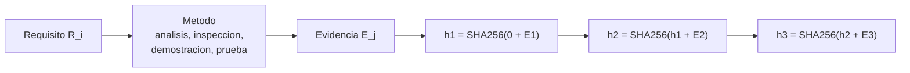

# B90-C18 — Trazabilidad de evidencias

<!-- nav:top -->
[🏠 Programa](../../../../README.md) · [📚 Bloque B90](../../../tronco-comun/B90-integracion-ensayos-y-calificacion-espacial.md) · [← Anterior: B90-C17 — Gestión de anomalías de prueba](../B90-C17-gestion-de-anomalias-de-prueba/CLASE.md) · [Siguiente: B90-C19 — Aceptación de unidades de vuelo →](../B90-C19-aceptacion-de-unidades-de-vuelo/CLASE.md)
<!-- /nav -->

## 1. Ubicación, nivel y alcance

Clase 18 del bloque B90. Nivel N3. La **trazabilidad** conecta cada requisito con el método que lo verifica y con la evidencia que lo demuestra; la **integridad** asegura que esa evidencia no cambió. Aquí construyes una **matriz requisito–verificación**, calculas su cobertura, detectas requisitos sin verificar y evidencias huérfanas, y proteges una secuencia de registros con una **cadena de resúmenes SHA-256**. Todos los datos son **sintéticos**.

## 2. Por qué esta clase existe

Una campaña de ensayos produce informes, fotos y registros; si no se sabe qué requisito respalda cada uno o si un informe fue editado después, la verificación no vale como evidencia. La decisión central: **¿qué requisitos faltan por verificar y cómo se demuestra que la evidencia no fue alterada?**

## 3. Lo que podrás hacer al terminar

1. Construir una matriz de verificación con método (análisis, inspección, demostración, prueba), evidencia y estado.
2. Calcular la cobertura y listar requisitos abiertos o sin verificar.
3. Detectar evidencias sin requisito.
4. Encadenar registros con SHA-256.
5. Detectar la alteración de un registro y ubicar el punto de ruptura.
6. Separar lo consultado (métodos de verificación) de lo sintético.

La evidencia es la **matriz de trazabilidad con integridad comprobable** del ejercicio 12 (sección 20).

## 4. Con qué llegas y cómo comprobarlo

1. ¿Qué es un requisito verificable?
2. ¿Qué es una función resumen (hash)?
3. ¿Qué es una colisión?
4. ¿Qué es una configuración *as-built*?
5. ¿Qué es una comprobación independiente?

<details>
<summary>Ver respuestas</summary>

1. Una condición que se puede comprobar por un método definido. 2. Una función que convierte datos en una huella de longitud fija. 3. Dos entradas distintas con la misma huella; es prácticamente imposible en SHA-256. 4. La descripción del producto tal como se construyó. 5. Calcular lo mismo por otro método y comparar.
</details>

Con cuatro o cinco aciertos, sigue; si no, repasa los prerrequisitos.

## 5. Un caso de contexto y casos de referencia

Una unidad de ejemplo tiene 8 requisitos: **6 están cerrados** (75 %), R4 (termovacío) tiene su prueba abierta y R7 (tres inhibidores independientes) no tiene ninguna verificación. Hay una evidencia sin requisito (E8). Siete registros se encadenan con SHA-256 (256 bits); editar el registro E3 cambia **5 de 7** resúmenes, desde la posición 3. Todo es **sintético**.

## 6. Vocabulario

**Trazabilidad:** vínculo documentado entre requisito, verificación y evidencia. **Matriz de verificación:** tabla de requisitos con su método y estado. **Cobertura:** requisitos cerrados/total. **Evidencia huérfana:** registro sin requisito. **SHA-256:** función resumen de 256 bits. **Cadena de resúmenes:** cada registro incorpora el resumen del anterior. **Configuración *as-built*:** configuración real del producto.

## 7. Modelo mental: cada eslabón sella al anterior



*Descripción textual:* cada requisito se verifica con un método que produce evidencia; los registros de evidencia se encadenan, de modo que el resumen de cada uno depende del anterior y editar uno invalida todos los siguientes.

Analogía: una cuenta de cuaderno con sellos en cada hoja: no se puede cambiar una hoja intermedia sin romper los sellos de las siguientes. Límite: la cadena detecta cambios, pero no prueba que el contenido original fuera correcto.

## 8. La explicación, paso a paso

### 8.1 Qué dice la fuente

El *Systems Engineering Handbook* (F2) describe cuatro métodos de verificación: **análisis** (modelado matemático), **demostración** (mostrar que se logra un requisito sin recolectar datos detallados), **inspección** (examen visual de características físicas y documentos) y **prueba** (datos detallados en condiciones controladas), y señala que la verificación termina con evidencia documentada de cumplimiento o renuncia aprobada y con todos los informes de discrepancia cerrados. *CubeSat 101* (F7) pide informes con procedimientos tal como se ejecutaron, fotos y gráficas. SHA-256 pertenece a FIPS 180-4, que **no se consultó**; el laboratorio usa `hashlib` de la biblioteca estándar.

### 8.2 La matriz

| Req. | Método | Evidencia | Estado |
|---|---|---|---|
| R1 masa | inspección | E1 | cerrada |
| R2 CG | análisis | E2 | cerrada |
| R3 vibración | prueba | E3 | cerrada |
| R4 termovacío | prueba | E4 | abierta |
| R5 EMC | prueba | E5 | cerrada |
| R6 despliegue | demostración | E6 | cerrada |
| R7 inhibidores | — | — | sin verificación |
| R8 E2E | prueba | E7 | cerrada |

Cobertura cerrada `= 6/8 = 75 %`. Las evidencias huérfanas son las que no aparecen en la matriz (aquí, E8 declarada para la comprobación).

### 8.3 La cadena

`h_i = SHA256(h_{i−1} ‖ JSON(registro_i))` con `h₀ = 0⁶⁴`. Los primeros ocho caracteres hexadecimales de los siete resúmenes son `d79310f8 043c43ac f109e47f a0b60ad9 fe2013f5 82f6f99d a8e965bb`. Una segunda implementación independiente de la cadena da los mismos valores.

### 8.4 Detección de alteración

Si se edita el contenido de E3, los resúmenes de las posiciones 1 y 2 no cambian y los de las posiciones 3 a 7 sí (5 de 7): la ruptura queda localizada en E3. El resumen tiene 256 bits.

## 9. Magnitudes, símbolos y unidades

| Símbolo | Qué es | Unidad | Valor / nota |
|---|---|---|---|
| `R_i` | requisito | — | 8 |
| cobertura | cerrados/total | % | 75,0 |
| `h_i` | resumen del registro `i` | hex | 64 caracteres |
| posición de ruptura | primer resumen distinto | — | 3 |

## 10. Convenciones y referencias

Un requisito está cerrado si tiene al menos una verificación cerrada. Serialización JSON con claves ordenadas. Sistema de referencia: no aplica. Tolerancias: igualdad exacta de resúmenes entre implementaciones. Requisitos, evidencias y fechas son **sintéticos**.

## 11. De dónde sale lo que afirmamos

| ID | Fuente | Localizador | Respalda | Estado |
|---|---|---|---|---|
| F2 | NASA, Systems Engineering Handbook, 5.3 Product Verification — https://www.nasa.gov/reference/5-3-product-verification/ (consultada 2026-11-10) | sección 5.3 | métodos de verificación (análisis, demostración, inspección, prueba); verificación frente a validación; definiciones de calificación, aceptación y pruebas de extremo a extremo; manejo de discrepancias | Consultada |
| F7 | NASA CubeSat Launch Initiative, CubeSat 101: Basic Concepts and Processes for First-Time CubeSat Developers (octubre de 2017) — PDF https://www.nasa.gov/wp-content/uploads/2017/03/nasa_csli_cubesat_101_508.pdf (consultada 2026-11-10 con PyMuPDF) | capítulo 6, secciones 6.9.2 y 6.9.3 y prueba DITL | el ICD fija niveles y duraciones de vibración y bakeout; contenido mínimo de los informes; no modificar el hardware tras el ensayo; el ciclado termovacío no se exige habitualmente | Consultada |
| F8 | Cal Poly CubeSat Program, CubeSat Design Specification Rev. 14.1 (febrero de 2022) — PDF https://static1.squarespace.com/static/5418c831e4b0fa4ecac1bacd/t/62193b7fc9e72e0053f00910/1645820809779/CDS+REV14_1+2022-02-09.pdf (consultada 2026-11-10 con PyMuPDF) | secciones 2.2, 2.3, 2.4 y 3 (3.1–3.5) | ensayos típicos (vibración aleatoria, bakeout termovacío, choque, inspección visual), calificación, protovuelo y aceptación, tres inhibidores independientes, rieles y centro de gravedad (tabla 2) | Consultada |
| — | SHA-256 (FIPS 180-4) | — | — | No consultada |
| — | Cadena de resúmenes y cálculo de cobertura | — | las verifica el laboratorio con dos implementaciones | No consultada en una fuente concreta |

Límites: ninguna fuente consultada trata cadenas de resúmenes; son una técnica de ejemplo.

## 12. Cómo ver la trazabilidad

| Magnitud | Valor |
|---|---|
| cobertura | 75 % |
| requisitos sin verificación | R7 |
| requisitos abiertos | R4 |
| resúmenes distintos tras editar E3 | 5 de 7 |

Descripción larga: la matriz tiene una fila vacía y una abierta; la cadena de resúmenes se rompe desde el registro editado hasta el final.

## 13. Ejemplo trabajado: qué falta para cerrar

**Paso 1 · Cuenta.** Cerrados: R1, R2, R3, R5, R6, R8 = 6.

**Paso 2 · Faltantes.** R4 (cerrar la prueba) y R7 (definir y ejecutar una verificación).

**Paso 3 · Integridad.** Los 7 resúmenes coinciden en las dos implementaciones.

**Paso 4 · Decisión.** No se declara la verificación completa hasta cerrar R4 y R7 (F2).

## 14. Distintas formas de describir la trazabilidad

**Por requisito:** qué demuestra cada uno. **Por evidencia:** qué respalda cada registro. **Por tiempo:** cuándo se produjo y por quién. La cadena de resúmenes añade la vista de integridad.

## 15. Práctica guiada

**Ejercicio 1 · con los pasos indicados.** Calcula la cobertura si se cierra R4. *Pasos:* contar, dividir.

<details><summary>Solución comentada</summary>

`7/8 = 87,5 %`.
</details>

**Ejercicio 2 · con una pista.** ¿Qué método verifica «masa menor de 4 kg»? *Pista:* examen físico.

<details><summary>Solución comentada</summary>

Inspección (pesaje) o prueba; en el ejemplo, inspección.
</details>

**Ejercicio 3 · casi autónomo.** ¿Cuántos caracteres hexadecimales tiene un SHA-256?

<details><summary>Solución comentada</summary>

64 (256 bits / 4).
</details>

## 16. Práctica autónoma, transferencia e integrador

**Ejercicio 4 · autónomo.** Si se edita E5, ¿cuántos resúmenes cambian?

<details><summary>Solución comentada</summary>

Los de las posiciones 5, 6 y 7: 3 de 7.
</details>

**Ejercicio 5 · autónomo.** ¿Por qué se encadena con el resumen anterior y no solo se resume cada registro?

<details><summary>Solución comentada</summary>

Porque con resúmenes independientes se podría reemplazar un registro y su resumen sin que nada lo delate; el encadenamiento ata el orden y el contenido.
</details>

**Ejercicio 6 · autónomo.** ¿Qué método usarías para «tres inhibidores independientes»?

<details><summary>Solución comentada</summary>

Inspección del diseño y demostración o prueba de funcionamiento; en R7 hay que definirlo (F8 exige tres).
</details>

**Ejercicio 7 · autónomo.** ¿Qué es una evidencia huérfana y por qué importa?

<details><summary>Solución comentada</summary>

Un registro sin requisito: no demuestra nada y puede ocultar un requisito sin trazar.
</details>

**Ejercicio 8 · autónomo.** ¿Qué prueba que una cadena válida no garantiza?

<details><summary>Solución comentada</summary>

Que el contenido original fuera correcto: solo que no cambió.
</details>

**Ejercicio 9 · transferencia.** **Transferencia.** Un colega dice que su matriz está «completa» con 100 % de requisitos con evidencia. ¿Qué verificar?

<details><summary>Solución comentada</summary>

Que la evidencia esté cerrada (no solo exista), que no haya discrepancias abiertas y que cada evidencia apunte al requisito correcto.
</details>

**Ejercicio 10 · transferencia.** **Transferencia.** ¿Qué ocurre con la trazabilidad si se cambia la configuración después de un ensayo?

<details><summary>Solución comentada</summary>

La evidencia deja de aplicar a la configuración actual; hay que repetir el ensayo o justificar (F8; F7).
</details>

**Ejercicio 11 · transferencia.** **Transferencia.** ¿Basta una cadena de resúmenes como firma?

<details><summary>Solución comentada</summary>

No: no identifica al autor ni impide recalcular toda la cadena; se complementa con firmas y control de acceso.
</details>

**Ejercicio 12 · integrador.** **Integrador.** Elabora tu *matriz de trazabilidad con integridad comprobable*: requisitos, métodos, evidencias, cobertura, huérfanas, cadena de resúmenes y lista de qué es consultado, no consultado y sintético.

<details><summary>Solución comentada</summary>

Secciones 8.2–8.4 y la salida del laboratorio.
</details>

## 17. Laboratorio: matriz y cadena de resúmenes

El script [trazabilidad.py](trazabilidad.py) calcula la cobertura, lista requisitos sin verificar y evidencias huérfanas, encadena siete registros con SHA-256 con dos implementaciones y detecta una edición; **comprueba** que 6 de 8 están cerrados, que las dos cadenas coinciden y que la ruptura empieza en E3. Usa la biblioteca común [b90_comun.py](../b90_comun.py).

**Datos:** requisitos, evidencias y fechas **sintéticos**. **Predice antes de ejecutar:** ¿cuántos resúmenes cambian al editar E3? (5 de 7.) Ejecución del 2026-11-10 (Python 3.12.9, numpy 2.4.4):

```text
Python 3.12.9 | numpy 2.4.4
Datos SINTETICOS: 8 requisitos y 7 registros de evidencia de una unidad de ejemplo
req  metodo        evidencia  estado
R1   inspeccion    E1         cerrada
R2   analisis      E2         cerrada
R3   prueba        E3         cerrada
R4   prueba        E4         abierta
R5   prueba        E5         cerrada
R6   demostracion  E6         cerrada
R7   -             -          SIN VERIFICACION
R8   prueba        E7         cerrada
Cobertura cerrada = 6 de 8 = 75.0 % ; sin verificacion: ['R7'] ; abiertas: ['R4']
Evidencias sin requisito (huerfanas): ['E8']
Cadena de resumenes (8 primeros hex): d79310f8 043c43ac f109e47f a0b60ad9 fe2013f5 82f6f99d a8e965bb
Tras editar el registro E3 la cadena cambia desde la posicion 3: 5 de 7 resumenes distintos
Longitud del resumen = 256 bits
Pruebas superadas.
```

```bash
python programa/clases/B90/B90-C18-trazabilidad-de-evidencias/trazabilidad.py
```

**Límites:** sin firmas, sin sellado de tiempo externo, sin control de acceso; la cadena puede recalcularse por completo.

## 18. Errores frecuentes y cómo corregirlos

**Confundir evidencia existente con evidencia cerrada.** Revisa el estado (8.2)

**Resumir cada registro por separado.** Encadénalos (8.3)

**Presentar la matriz de ejemplo como real.** Revisa la sección 10

## 19. Cómo sabrás que vas bien

Tras la sección 8: ¿qué cobertura queda si se cierra R4? Si dudas, repasa el ejercicio 1. Tras el laboratorio: ¿qué detecta la cadena? (ver sección 17).

## 20. Qué entregas y cómo se evalúa

El producto es tu **matriz de trazabilidad con integridad comprobable** (ejercicio 12).

| Criterio | Inicial | En desarrollo | Logrado | Destacado |
|---|---|---|---|---|
| Conceptos | Los confunde | Parciales | Explica el método y su dominio | Explica los límites y las alternativas |
| Cálculo | Sin unidades | Con errores | Resultados con unidades y comprobados | Resuelve casos nuevos |
| Numérico | Sin comprobar | Un caso | Verifica con una comprobación independiente en varios casos | Interpreta las diferencias y los fallos |
| Fuentes | Sin fuente | Sin fecha | Fuentes con fecha y estado | Declara lo sintético y lo no consultado |
| Límites | No los nombra | Uno | Tres | Discute qué falta del modelo |

**Condiciones críticas (no se compensan con promedio):** rotular los datos como sintéticos; verificar cada resultado con una comprobación independiente; citar solo lo consultado.

## 21. Ética, seguridad y límites

Clase educativa: la matriz y los registros son de ejemplo; la evidencia real no se altera ni se reescribe y su custodia sigue el proceso aprobado del proyecto. Accesibilidad: tablas equivalentes a las gráficas, fórmulas en texto, ejercicios sin conexión.

## 22. Para cerrar y seguir

La matriz de ejemplo cierra 6 de 8 requisitos (75 %), deja R4 abierto y R7 sin verificar, y la cadena de resúmenes localiza una edición en E3. Queda una pregunta: ¿cuándo se acepta una unidad de vuelo con esta evidencia?

**Glosario español–inglés.** trazabilidad · *traceability*; matriz de verificación · *verification matrix*; evidencia · *evidence*; resumen · *hash*; cobertura · *coverage*; as-built · *as-built*.

**Continuidad.** [B90-C19](../B90-C19-aceptacion-de-unidades-de-vuelo/CLASE.md) trata la aceptación de unidades de vuelo.

**Referencias:** ver sección 11.

<!-- nav:bottom -->
---

[← Anterior: B90-C17 — Gestión de anomalías de prueba](../B90-C17-gestion-de-anomalias-de-prueba/CLASE.md) · [📚 Bloque B90](../../../tronco-comun/B90-integracion-ensayos-y-calificacion-espacial.md) · [Siguiente: B90-C19 — Aceptación de unidades de vuelo →](../B90-C19-aceptacion-de-unidades-de-vuelo/CLASE.md)
<!-- /nav -->
