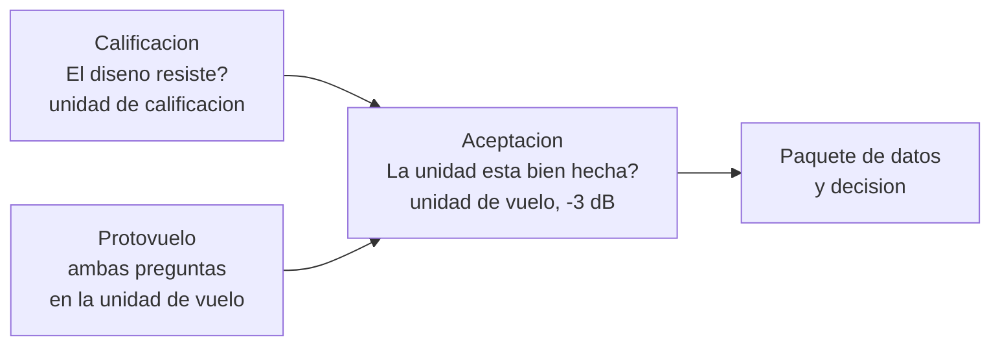

# B90-C19 — Aceptación de unidades de vuelo

<!-- nav:top -->
[🏠 Programa](../../../../README.md) · [📚 Bloque B90](../../../tronco-comun/B90-integracion-ensayos-y-calificacion-espacial.md) · [← Anterior: B90-C18 — Trazabilidad de evidencias](../B90-C18-trazabilidad-de-evidencias/CLASE.md) · [Siguiente: B90-C20 — Campaña conceptual de calificación de CubeSat →](../B90-C20-campana-conceptual-de-calificacion-de-cubesat/CLASE.md)
<!-- /nav -->

## 1. Ubicación, nivel y alcance

Clase 19 del bloque B90. Nivel N3. La **aceptación** es el conjunto de ensayos y revisiones que demuestra que **cada unidad fabricada** cumple su diseño ya calificado. A diferencia de la calificación, no busca márgenes extremos sino detectar defectos de mano de obra sin consumir la vida de la unidad. Aquí comparas los niveles de calificación y de aceptación, calculas el **daño acumulado** de cada uno y revisas un **paquete de datos** de aceptación. Todos los datos son **sintéticos**, incluida la diferencia de 3 dB entre niveles.

## 2. Por qué esta clase existe

Un ensayo de aceptación demasiado severo gasta vida útil; uno demasiado suave deja pasar defectos. La decisión central: **¿qué nivel y duración demuestran la mano de obra sin dañar la unidad, y con qué evidencia se acepta?**

## 3. Lo que podrás hacer al terminar

1. Distinguir calificación, protovuelo y aceptación.
2. Calcular el Grms de un espectro de aceptación desplazado en dB.
3. Calcular el daño relativo con un modelo de Miner–Basquin de ejemplo.
4. Comparar el daño de calificación y de aceptación.
5. Evaluar un paquete de datos de aceptación y decidir.
6. Separar lo consultado (definiciones de la CDS y del SE Handbook) de lo sintético.

La evidencia es la **decisión de aceptación de una unidad** del ejercicio 12 (sección 20).

## 4. Con qué llegas y cómo comprobarlo

1. ¿Qué es la calificación?
2. ¿Qué es el Grms de una PSD?
3. ¿Qué es la regla de Miner?
4. ¿Qué es un decibelio?
5. ¿Qué es una comprobación independiente?

<details>
<summary>Ver respuestas</summary>

1. La demostración de que el diseño cumple en ambientes extremos. 2. La raíz del área bajo la PSD. 3. El daño acumulado es la suma de las fracciones de vida consumidas. 4. `10 log₁₀` de un cociente de potencias. 5. Calcular lo mismo por otro método y comparar.
</details>

Con cuatro o cinco aciertos, sigue; si no, repasa los prerrequisitos.

## 5. Un caso de contexto y casos de referencia

Con el espectro de la clase C09 (Grms de calificación **6,784 g**), un espectro de aceptación 3 dB menor en PSD tiene **4,803 g** (cociente 0,7079). Con exponente de daño `b = 6`, la calificación de 120 s consume el **3,33 %** de una vida de referencia sintética y la aceptación de 60 s a −3 dB, el **0,210 %**. El paquete de aceptación de ejemplo tiene **5 de 7** elementos completos: **no se acepta todavía**. Todo es **sintético**.

## 6. Vocabulario

**Calificación:** demostración del diseño en niveles extremos con una unidad. **Protovuelo:** calificación aplicada a la unidad de vuelo. **Aceptación:** prueba de cada unidad con niveles menores. **Mano de obra (*workmanship*):** calidad de fabricación. **Daño acumulado:** suma de fracciones de vida consumidas. **Paquete de datos:** conjunto de evidencias de aceptación. **Certificación:** presentación de la evidencia a una autoridad.

## 7. Modelo mental: tres ensayos, tres preguntas



*Descripción textual:* la calificación responde si el diseño resiste, con una unidad de calificación; la aceptación responde si cada unidad de vuelo está bien hecha, con niveles menores; el protovuelo combina ambas en la unidad de vuelo; todos terminan en un paquete de datos y una decisión.

Analogía: el examen de diseño de un puente (calificación) frente a la inspección de cada tramo antes de abrirlo (aceptación). Límite: en un CubeSat el protovuelo une los dos ensayos en una sola unidad y no hay unidad de calificación aparte.

## 8. La explicación, paso a paso

### 8.1 Qué dicen las fuentes

El *Systems Engineering Handbook* (F2) define **calificación** como asegurar que el diseño de la unidad de vuelo cumple los requisitos de desempeño en los ambientes esperados, con un subconjunto de la verificación en los extremos; **aceptación** como probar cada unidad fabricada con un conjunto menor de criterios para confirmar que la mano de obra corresponde al diseño verificado; y **certificación** como proporcionar la evidencia a una autoridad que aprueba el diseño. La CDS (F8) dice que la calificación se hace con una unidad idéntica a la de vuelo a niveles que fija el proveedor de lanzamiento y que luego la unidad de vuelo se ensaya a niveles de aceptación; que el protovuelo se hace sobre la unidad de vuelo a niveles de protovuelo y que esta no debe desarmarse ni modificarse sin el proceso de renuncia; y que tras la integración en el dispensador puede haber pruebas de aceptación. GEVS (F1) da niveles guía; no se consultó su texto. La diferencia de 3 dB es de ejemplo.

### 8.2 Niveles

Con el espectro de C09 (20–2 000 Hz, área 46,026 g²): calificación `Grms = 6,784 g`; aceptación `−3 dB` (factor 0,5012 en PSD) `Grms = 4,803 g`; cociente `0,7079 = 10^{−3/20}`. La integral numérica del espectro (46,0259 g²) coincide con el área exacta.

### 8.3 Daño acumulado

Con `D = (G/G_ref)^b t/t_ref`, `b = 6`, `t_ref = 3 600 s` y referencia en el nivel de calificación:

| Ensayo | Nivel | Tiempo | Daño |
|---|---|---|---|
| Calificación | 0 dB | 120 s | 3,33 % |
| Aceptación | −3 dB | 60 s | 0,210 % |

Cada decibelio de reducción baja el daño por segundo a 0,5012 (−1 dB), 0,1259 (−3 dB) y 0,0158 (−6 dB): la aceptación a −3 dB consume 12,6 % del daño por segundo de la calificación.

### 8.4 Paquete de datos y decisión

Elementos del ejemplo: informe de vibración de aceptación (completo), registro de termovacío (completo), prueba funcional posensayo (completa), lista de anomalías cerradas (**falta**), registro de configuración *as-built* (completo), certificados de calibración (completos) y firma del comité (**falta**). Con 2 de 7 faltantes: **no aceptar todavía**. Aceptar exige también que todos los informes de discrepancia estén cerrados (F2).

## 9. Magnitudes, símbolos y unidades

| Símbolo | Qué es | Unidad | Valor / nota |
|---|---|---|---|
| `G_q`, `G_a` | Grms de calificación y aceptación | g | 6,784; 4,803 |
| `b` | exponente de daño | — | 6 (sintético) |
| `t_q`, `t_a` | tiempos de ensayo | s | 120; 60 |
| `D` | daño relativo | % | 3,33; 0,210 |
| `t_ref` | vida de referencia | s | 3 600 |

## 10. Convenciones y referencias

Un solo eje, PSD por tramos como en C09; el daño varía como `G^b` (Basquin) y se suma en el tiempo (Miner). Sistema de referencia: no aplica. Tolerancias: razón de Grms `10⁻¹²`; área numérica frente a exacta `< 1 %`. Espectro, diferencia de 3 dB, `b`, tiempos, vida de referencia y paquete son **sintéticos**.

## 11. De dónde sale lo que afirmamos

| ID | Fuente | Localizador | Respalda | Estado |
|---|---|---|---|---|
| F2 | NASA, Systems Engineering Handbook, 5.3 Product Verification — https://www.nasa.gov/reference/5-3-product-verification/ (consultada 2026-11-10) | sección 5.3 | métodos de verificación (análisis, demostración, inspección, prueba); verificación frente a validación; definiciones de calificación, aceptación y pruebas de extremo a extremo; manejo de discrepancias | Consultada |
| F8 | Cal Poly CubeSat Program, CubeSat Design Specification Rev. 14.1 (febrero de 2022) — PDF https://static1.squarespace.com/static/5418c831e4b0fa4ecac1bacd/t/62193b7fc9e72e0053f00910/1645820809779/CDS+REV14_1+2022-02-09.pdf (consultada 2026-11-10 con PyMuPDF) | secciones 2.2, 2.3, 2.4 y 3 (3.1–3.5) | ensayos típicos (vibración aleatoria, bakeout termovacío, choque, inspección visual), calificación, protovuelo y aceptación, tres inhibidores independientes, rieles y centro de gravedad (tabla 2) | Consultada |
| F1 | NASA, GSFC-STD-7000 Version B, General Environmental Verification Standard (GEVS) — https://standards.nasa.gov/standard/gsfc/gsfc-std-7000 (consultada 2026-11-10) | solo la página de la norma | título, versión B (cambio 0), fecha 28-04-2021 y alcance: verificación ambiental de cargas útiles, subsistemas y componentes por prueba o análisis, con niveles guía | Consultada (solo la página; no el texto de la norma) |
| — | Texto de las normas ECSS (verificación, ensayos, EMC, limpieza, carga de nave) | — | — | No consultada |
| — | Daño de Miner–Basquin para vibración aleatoria | — | usado como modelo de ejemplo; se verifica la aritmética | No consultada en una fuente concreta |

Límites: ninguna fuente consultada da niveles, diferencias en dB ni exponentes de daño.

## 12. Cómo ver la decisión

| Magnitud | Valor |
|---|---|
| Grms calificación / aceptación | 6,784 / 4,803 g |
| daño calificación / aceptación | 3,33 % / 0,210 % |
| paquete | 5 de 7 completos |
| decisión | no aceptar todavía |

Descripción larga: el daño por segundo cae rápido con el nivel porque depende de la sexta potencia del Grms.

## 13. Ejemplo trabajado: el daño de la aceptación

**Paso 1 · Cociente.** `G_a/G_q = 10^{−3/20} = 0,7079`.

**Paso 2 · Potencia.** `0,7079⁶ = 0,1259`.

**Paso 3 · Tiempo.** `0,1259 × 60/3 600 = 0,210 %`.

**Paso 4 · Decisión.** El daño es pequeño, pero el paquete está incompleto: no se acepta.

## 14. Distintas formas de describir la aceptación

**Por nivel:** dB bajo la calificación. **Por daño:** fracción de vida consumida. **Por documentación:** paquete completo y firmado. Las tres deben cumplirse.

## 15. Práctica guiada

**Ejercicio 1 · con los pasos indicados.** Calcula el Grms con PSD −6 dB (factor 0,2512). *Pasos:* raíz del factor.

<details><summary>Solución comentada</summary>

`6,784 × √0,2512 = 3,40 g`.
</details>

**Ejercicio 2 · con una pista.** Calcula `10^{−3/20}`. *Pista:* `10^{−0,15}`.

<details><summary>Solución comentada</summary>

`0,7079`.
</details>

**Ejercicio 3 · casi autónomo.** Calcula el daño por segundo a −6 dB con `b = 6`.

<details><summary>Solución comentada</summary>

`10^{−6×6/20} = 10^{−1,8} = 0,0158`.
</details>

## 16. Práctica autónoma, transferencia e integrador

**Ejercicio 4 · autónomo.** ¿Cuántas veces menor es el daño por segundo a −3 dB que a 0 dB?

<details><summary>Solución comentada</summary>

`1/0,1259 = 7,9` veces.
</details>

**Ejercicio 5 · autónomo.** Si la aceptación dura 120 s a −3 dB, ¿cuánto daño produce?

<details><summary>Solución comentada</summary>

`0,1259 × 120/3 600 = 0,42 %`.
</details>

**Ejercicio 6 · autónomo.** ¿Qué ensayo requiere unidad aparte, calificación o protovuelo?

<details><summary>Solución comentada</summary>

La calificación usa una unidad de calificación idéntica a la de vuelo; el protovuelo usa la de vuelo (F8).
</details>

**Ejercicio 7 · autónomo.** ¿Por qué no se desarma la unidad de vuelo tras el protovuelo?

<details><summary>Solución comentada</summary>

Porque cambiaría la configuración ensayada; se exige el proceso de renuncia (F8).
</details>

**Ejercicio 8 · autónomo.** Con 4 de 7 elementos completos, ¿se acepta?

<details><summary>Solución comentada</summary>

No: la aceptación exige el paquete completo y los informes cerrados.
</details>

**Ejercicio 9 · transferencia.** **Transferencia.** Un colega adopta −3 dB como regla. ¿Es válido?

<details><summary>Solución comentada</summary>

No: es un valor de ejemplo; los niveles los fija el proveedor de lanzamiento o el plan de ensayo.
</details>

**Ejercicio 10 · transferencia.** **Transferencia.** ¿Qué pasa si el modelo de daño tiene `b = 4`?

<details><summary>Solución comentada</summary>

El daño por segundo a −3 dB sería `10^{−0,6} = 0,251`: la aceptación consumiría más vida; `b` depende del material.
</details>

**Ejercicio 11 · transferencia.** **Transferencia.** ¿Qué diferencia hay entre aceptar y certificar?

<details><summary>Solución comentada</summary>

Aceptar es de cada unidad; certificar presenta la evidencia del diseño a una autoridad (F2).
</details>

**Ejercicio 12 · integrador.** **Integrador.** Elabora tu *decisión de aceptación de una unidad*: niveles, daño, paquete de datos con estado, decisión y lista de qué es consultado, no consultado y sintético.

<details><summary>Solución comentada</summary>

Secciones 8.2–8.4 y la salida del laboratorio.
</details>

## 17. Laboratorio: niveles, daño y paquete

El script [aceptacion.py](aceptacion.py) calcula Grms de calificación y aceptación, el daño de Miner–Basquin y revisa el paquete de datos; **comprueba** la escala de Grms, el área numérica, el daño y los faltantes. Usa la biblioteca común [b90_comun.py](../b90_comun.py).

**Datos:** espectro, dB, exponente, tiempos y paquete **sintéticos**. **Predice antes de ejecutar:** ¿qué fracción del daño por segundo consume la aceptación? (≈ 12,6 %.) Ejecución del 2026-11-10 (Python 3.12.9, numpy 2.4.4):

```text
Python 3.12.9 | numpy 2.4.4
Datos SINTETICOS: espectro de calificacion de 20-2000 Hz; unidad de vuelo
Calificacion: Grms = 6.784 g ; aceptacion (-3 dB): Grms = 4.803 g ; cociente = 0.7079 (10^(-3/20) = 0.7079)
Area numerica = 46.0259 ; area exacta = 46.0259
Danio relativo (exponente b = 6): calificacion 120 s = 3.33 % ; aceptacion 60 s a -3 dB = 0.210 % de la vida de referencia
Descuento por nivel: -dB -> cociente de danio por segundo
   0 -> 1.0000
   1 -> 0.5012
   3 -> 0.1259
   6 -> 0.0158
Paquete de datos de aceptacion:
   [x] Informe de vibracion de aceptacion
   [x] Registro de termovacio
   [x] Prueba funcional posensayo
   [ ] Lista de anomalias cerradas
   [x] Registro de configuracion (as-built)
   [x] Certificados de calibracion
   [ ] Firma del comite
Faltan 2 de 7 elementos -> decision: NO ACEPTAR todavia
Pruebas superadas.
```

```bash
python programa/clases/B90/B90-C19-aceptacion-de-unidades-de-vuelo/aceptacion.py
```

**Límites:** un eje, un modo de daño, sin dispersión del material, sin otros ensayos.

## 18. Errores frecuentes y cómo corregirlos

**Aceptar con niveles de calificación.** Consume vida (8.3)

**Aceptar sin el paquete completo.** Revisa la lista (8.4)

**Presentar el −3 dB como una norma.** Revisa la sección 10

## 19. Cómo sabrás que vas bien

Tras la sección 8: ¿qué cociente de Grms da −3 dB? Si dudas, repasa el ejercicio 2. Tras el laboratorio: ¿qué verifica el área numérica? (ver sección 17).

## 20. Qué entregas y cómo se evalúa

El producto es tu **decisión de aceptación de una unidad** (ejercicio 12).

| Criterio | Inicial | En desarrollo | Logrado | Destacado |
|---|---|---|---|---|
| Conceptos | Los confunde | Parciales | Explica el método y su dominio | Explica los límites y las alternativas |
| Cálculo | Sin unidades | Con errores | Resultados con unidades y comprobados | Resuelve casos nuevos |
| Numérico | Sin comprobar | Un caso | Verifica con una comprobación independiente en varios casos | Interpreta las diferencias y los fallos |
| Fuentes | Sin fuente | Sin fecha | Fuentes con fecha y estado | Declara lo sintético y lo no consultado |
| Límites | No los nombra | Uno | Tres | Discute qué falta del modelo |

**Condiciones críticas (no se compensan con promedio):** rotular los datos como sintéticos; verificar cada resultado con una comprobación independiente; citar solo lo consultado.

## 21. Ética, seguridad y límites

Clase educativa: niveles y criterios son de ejemplo; la aceptación real corresponde a las personas y procesos autorizados del proyecto y no se simplifica. Accesibilidad: tablas equivalentes a las gráficas, fórmulas en texto, ejercicios sin conexión.

## 22. Para cerrar y seguir

La aceptación a −3 dB consume 0,21 % de una vida de referencia frente a 3,33 % de la calificación, pero el paquete de ejemplo tiene 2 de 7 elementos pendientes y no se acepta. Queda una pregunta: ¿cómo se ordena todo en una campaña completa para un CubeSat?

**Glosario español–inglés.** aceptación · *acceptance*; calificación · *qualification*; protovuelo · *protoflight*; mano de obra · *workmanship*; daño acumulado · *cumulative damage*; certificación · *certification*.

**Continuidad.** [B90-C20](../B90-C20-campana-conceptual-de-calificacion-de-cubesat/CLASE.md) compone una campaña conceptual de calificación de un CubeSat.

**Referencias:** ver sección 11.

<!-- nav:bottom -->
---

[← Anterior: B90-C18 — Trazabilidad de evidencias](../B90-C18-trazabilidad-de-evidencias/CLASE.md) · [📚 Bloque B90](../../../tronco-comun/B90-integracion-ensayos-y-calificacion-espacial.md) · [Siguiente: B90-C20 — Campaña conceptual de calificación de CubeSat →](../B90-C20-campana-conceptual-de-calificacion-de-cubesat/CLASE.md)
<!-- /nav -->
