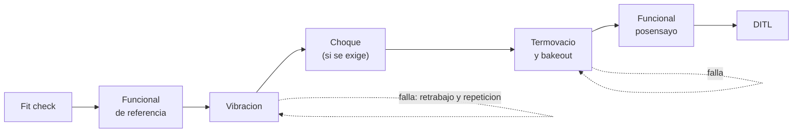

# B90-C20 — Campaña conceptual de calificación de CubeSat

<!-- nav:top -->
[🏠 Programa](../../../../README.md) · [📚 Bloque B90](../../../tronco-comun/B90-integracion-ensayos-y-calificacion-espacial.md) · [← Anterior: B90-C19 — Aceptación de unidades de vuelo](../B90-C19-aceptacion-de-unidades-de-vuelo/CLASE.md) · [Siguiente: B90-C21 — Biocarga de naves espaciales: verificación y requisitos normativos →](../../../tronco-comun/B90-integracion-ensayos-y-calificacion-espacial.md#b90-c21)
<!-- /nav -->

## 1. Ubicación, nivel y alcance

Clase 20 del bloque B90. Nivel N3. Esta clase **integra** lo anterior en un plan conceptual: qué ensayos componen la campaña de un CubeSat 3U, en qué orden, cuánto dura y con qué probabilidad termina en un plazo, considerando fallas y reintentos. Usas el flujo de ensayos de la *CubeSat Design Specification* como esqueleto y datos **sintéticos** para duraciones, probabilidades de falla y retrabajo. No es el plan de ningún proyecto.

## 2. Por qué esta clase existe

Un calendario de ensayos sin contingencia casi nunca se cumple: cada falla suma retrabajo y repetición. La decisión central: **¿cuánto tiempo reservar para terminar con una confianza dada?**

## 3. Lo que podrás hacer al terminar

1. Armar el flujo de ensayos de un CubeSat (fit check, funcional, vibración, choque opcional, termovacío con bakeout, funcional posensayo, DITL).
2. Calcular la duración esperada de cada ensayo con reintentos.
3. Calcular la duración esperada de la campaña y comprobarla con Monte Carlo.
4. Obtener percentiles y la probabilidad de terminar en un plazo.
5. Calcular la contingencia para una confianza dada.
6. Separar lo consultado (flujo de la CDS y CubeSat 101) de lo sintético.

La evidencia es el **plan conceptual de calificación de un CubeSat** del ejercicio 12 (sección 20).

## 4. Con qué llegas y cómo comprobarlo

1. ¿Qué diferencia hay entre calificación, protovuelo y aceptación?
2. ¿Qué es una distribución geométrica?
3. ¿Qué es un percentil?
4. ¿Qué es la ruta crítica?
5. ¿Qué es una comprobación independiente?

<details>
<summary>Ver respuestas</summary>

1. Ver C19. 2. El número de intentos hasta el primer éxito. 3. El valor bajo el cual cae un porcentaje de los casos. 4. La cadena de tareas que fija la duración (C01). 5. Calcular lo mismo por otro método y comparar.
</details>

Con cuatro o cinco aciertos, sigue; si no, repasa los prerrequisitos.

## 5. Un caso de contexto y casos de referencia

La campaña de ejemplo exige seis ensayos (el choque es opcional según el proveedor): duran **15 d sin fallas**; con las probabilidades de falla de ejemplo la duración esperada es **18,04 d** (Monte Carlo: 18,045 d). Hay **77,3 %** de probabilidad de terminar en 20 d, **93,3 %** en 25 d y **96,9 %** en 30 d; el percentil 90 es 25 d, es decir **10 d de contingencia**. Todo es **sintético**.

## 6. Vocabulario

**Campaña de calificación:** secuencia de ensayos que demuestra la unidad. **Flujo de ensayos:** orden de los ensayos. **Fit check:** ajuste con el dispensador. **DITL:** prueba de «día en la vida». **Contingencia:** tiempo reservado para fallas. **Percentil:** valor de la duración con cierta probabilidad de no ser superado. **Reintento:** repetir un ensayo tras retrabajo.

## 7. Modelo mental: una cadena con reintentos



*Descripción textual:* los ensayos se encadenan de la inspección al DITL; cada uno puede fallar y entonces se hace retrabajo y se repite el mismo ensayo antes de pasar al siguiente.

Analogía: una carrera de relevos donde cada corredor puede tropezar y repetir su tramo: el tiempo total es la suma de los tramos más las repeticiones. Límite: aquí las fallas son independientes; en la realidad una falla puede dejar secuelas en los ensayos siguientes.

## 8. La explicación, paso a paso

### 8.1 Qué dicen las fuentes

La CDS (F8) indica que los CubeSats se someten típicamente a vibración aleatoria, *bakeout* termovacío, choque (normalmente no exigido) e inspección visual; que se aplica calificación o protovuelo según el flujo de la figura 6; que los niveles y duraciones los da el proveedor; que el flujo varía de una misión a otra; y que tras el ensayo la unidad de vuelo no se desmonta ni modifica. *CubeSat 101* (F7) añade la prueba DITL, el mínimo contenido de los informes (procedimientos con marcas de tiempo, fotos, gráficas, prueba de que la unidad sobrevivió) y que el integrador debe aprobar el procedimiento antes de la prueba. El *Systems Engineering Handbook* (F2) define calificación, aceptación y prueba de extremo a extremo. Los tiempos y las probabilidades de la clase son de ejemplo.

### 8.2 Duración esperada de un ensayo

Si un ensayo dura `d`, falla con probabilidad `p` y cada falla exige retrabajo `r` y repetir el ensayo, el número de fallas antes del éxito es geométrico con media `p/(1 − p)` y `E[T] = d + p/(1 − p) (r + d)`.

| Ensayo | `d` (d) | `p` | `r` (d) | `E[T]` (d) |
|---|---|---|---|---|
| Inspección y ajuste | 1 | 0,02 | 1 | 1,041 |
| Funcional de referencia | 2 | 0,05 | 2 | 2,211 |
| Vibración aleatoria | 3 | 0,10 | 4 | 3,778 |
| Choque (opcional) | 2 | 0,05 | 3 | 2,263 |
| Termovacío y bakeout | 5 | 0,12 | 5 | 6,364 |
| Funcional posensayo | 2 | 0,05 | 2 | 2,211 |
| DITL | 2 | 0,08 | 3 | 2,435 |

### 8.3 La campaña

Sin el choque: duración sin fallas `15 d`; esperada `18,038 d`. El Monte Carlo (4 × 10⁵ campañas, semilla 90) da `18,045 d` con error estándar `0,008 d` y desviación estándar `5,08 d`: coincide con la fórmula.

### 8.4 Plazos y contingencia

| Percentil | Duración (d) |
|---|---|
| 50 | 15,0 |
| 80 | 22,0 |
| 90 | 25,0 |
| 95 | 29,0 |

La probabilidad de terminar en 20, 25, 30 y 35 d es 77,3; 93,3; 96,9 y 99,1 %. Para una confianza de 90 % hay que reservar `25 − 15 = 10 d` de contingencia sobre los 15 d sin fallas. La mediana es 15 d porque más de la mitad de las campañas no tiene fallas; la media es mayor porque la cola es larga.

## 9. Magnitudes, símbolos y unidades

| Símbolo | Qué es | Unidad | Valor / nota |
|---|---|---|---|
| `d`, `r` | duración y retrabajo de un ensayo | d | tabla 8.2 |
| `p` | probabilidad de falla por intento | — | 0,02 a 0,12 |
| `E[T]` | duración esperada | d | 18,04 |
| `P(T ≤ t)` | probabilidad de terminar | % | 77,3 a 99,1 |
| contingencia | percentil 90 menos duración base | d | 10 |

## 10. Convenciones y referencias

Los ensayos son secuenciales, cada falla es independiente y se resuelve con retrabajo y repetición; no hay recursos limitados ni feriados. Unidades: días. Sistema de referencia: no aplica. Tolerancias: media simulada frente a analítica `< 4` errores estándar. Todas las duraciones, probabilidades y retrabajos son **sintéticos**.

## 11. De dónde sale lo que afirmamos

| ID | Fuente | Localizador | Respalda | Estado |
|---|---|---|---|---|
| F8 | Cal Poly CubeSat Program, CubeSat Design Specification Rev. 14.1 (febrero de 2022) — PDF https://static1.squarespace.com/static/5418c831e4b0fa4ecac1bacd/t/62193b7fc9e72e0053f00910/1645820809779/CDS+REV14_1+2022-02-09.pdf (consultada 2026-11-10 con PyMuPDF) | secciones 2.2, 2.3, 2.4 y 3 (3.1–3.5) | ensayos típicos (vibración aleatoria, bakeout termovacío, choque, inspección visual), calificación, protovuelo y aceptación, tres inhibidores independientes, rieles y centro de gravedad (tabla 2) | Consultada |
| F7 | NASA CubeSat Launch Initiative, CubeSat 101: Basic Concepts and Processes for First-Time CubeSat Developers (octubre de 2017) — PDF https://www.nasa.gov/wp-content/uploads/2017/03/nasa_csli_cubesat_101_508.pdf (consultada 2026-11-10 con PyMuPDF) | capítulo 6, secciones 6.9.2 y 6.9.3 y prueba DITL | el ICD fija niveles y duraciones de vibración y bakeout; contenido mínimo de los informes; no modificar el hardware tras el ensayo; el ciclado termovacío no se exige habitualmente | Consultada |
| F2 | NASA, Systems Engineering Handbook, 5.3 Product Verification — https://www.nasa.gov/reference/5-3-product-verification/ (consultada 2026-11-10) | sección 5.3 | métodos de verificación (análisis, demostración, inspección, prueba); verificación frente a validación; definiciones de calificación, aceptación y pruebas de extremo a extremo; manejo de discrepancias | Consultada |
| — | Texto de las normas ECSS (verificación, ensayos, EMC, limpieza, carga de nave) | — | — | No consultada |
| — | Media de la distribución geométrica y percentiles por Monte Carlo | — | las verifica el laboratorio | No consultada en una fuente concreta |

Límites: ninguna fuente consultada da duraciones ni probabilidades de falla; el flujo es esquemático y el real lo fija el proveedor de lanzamiento.

## 12. Cómo ver el calendario

| Magnitud | Valor |
|---|---|
| duración sin fallas | 15 d |
| duración esperada | 18,04 d |
| P(≤ 25 d) | 93,3 % |
| contingencia 90 % | 10 d |

Descripción larga: la distribución de la duración es discreta y asimétrica: un pico en 15 d y una cola hacia 30 d o más.

## 13. Ejemplo trabajado: el termovacío

**Paso 1 · Datos.** `d = 5`, `p = 0,12`, `r = 5`.

**Paso 2 · Fallas esperadas.** `p/(1 − p) = 0,12/0,88 = 0,1364`.

**Paso 3 · Tiempo.** `5 + 0,1364 × (5 + 5) = 6,364 d`.

**Paso 4 · Lectura.** El termovacío añade 1,36 d esperados al calendario; es el ensayo con más incertidumbre.

## 14. Distintas formas de describir la campaña

**Por flujo:** orden de ensayos y modelos (C19). **Por calendario:** duración y contingencia (esta clase). **Por evidencia:** informes y matriz (C18). Un plan completo las une.

## 15. Práctica guiada

**Ejercicio 1 · con los pasos indicados.** Calcula `E[T]` para `d = 3`, `p = 0,1`, `r = 4`. *Pasos:* `p/(1 − p)`, producto, suma.

<details><summary>Solución comentada</summary>

`0,1111 × 7 + 3 = 3,778 d`.
</details>

**Ejercicio 2 · con una pista.** Suma las duraciones sin fallas de los seis ensayos exigidos. *Pista:* 1+2+3+5+2+2.

<details><summary>Solución comentada</summary>

`15 d`.
</details>

**Ejercicio 3 · casi autónomo.** ¿Cuánto añade el choque opcional a la duración esperada?

<details><summary>Solución comentada</summary>

2,263 d.
</details>

## 16. Práctica autónoma, transferencia e integrador

**Ejercicio 4 · autónomo.** Calcula la duración esperada con el choque incluido.

<details><summary>Solución comentada</summary>

`18,038 + 2,263 = 20,30 d`.
</details>

**Ejercicio 5 · autónomo.** ¿Por qué la mediana (15 d) es menor que la media (18 d)?

<details><summary>Solución comentada</summary>

Porque la distribución tiene cola larga a la derecha: pocas campañas con muchas fallas elevan el promedio.
</details>

**Ejercicio 6 · autónomo.** ¿Qué plazo da 90 % de confianza?

<details><summary>Solución comentada</summary>

25 d.
</details>

**Ejercicio 7 · autónomo.** Si `p` del termovacío baja a 0,05, ¿cuánto vale su `E[T]`?

<details><summary>Solución comentada</summary>

`5 + 0,0526 × 10 = 5,53 d`.
</details>

**Ejercicio 8 · autónomo.** ¿Qué ensayo no se repite tras un protovuelo sin modificar la unidad?

<details><summary>Solución comentada</summary>

Ninguno: si se modifica la unidad, los ensayos hechos pueden invalidarse (F8, F7); si no, no se repiten.
</details>

**Ejercicio 9 · transferencia.** **Transferencia.** Un colega usa 25 d como plazo de su proyecto. ¿Es válido?

<details><summary>Solución comentada</summary>

No: es un resultado de datos sintéticos; su campaña tiene otros ensayos, probabilidades e instalaciones.
</details>

**Ejercicio 10 · transferencia.** **Transferencia.** ¿Qué supuesto del modelo es más débil en la práctica?

<details><summary>Solución comentada</summary>

La independencia entre fallas y la ausencia de restricciones de instalaciones: una falla puede obligar a repetir ensayos anteriores y las cámaras no siempre están libres.
</details>

**Ejercicio 11 · transferencia.** **Transferencia.** ¿Por qué el integrador debe aprobar el procedimiento antes del ensayo?

<details><summary>Solución comentada</summary>

Para asegurar que el ensayo verificará los requisitos del ICD; un cambio posterior no queda cubierto (F7).
</details>

**Ejercicio 12 · integrador.** **Integrador.** Elabora tu *plan conceptual de calificación de un CubeSat*: flujo, duraciones, probabilidades, duración esperada, percentiles, contingencia y lista de qué es consultado, no consultado y sintético.

<details><summary>Solución comentada</summary>

Secciones 8.2–8.4 y la salida del laboratorio.
</details>

## 17. Laboratorio: calendario con fallas y reintentos

El script [campana_cubesat.py](campana_cubesat.py) calcula la duración esperada de cada ensayo y de la campaña y la simula con Monte Carlo; **comprueba** que la media simulada coincide con la analítica y que casi todas las campañas terminan en 40 d. Usa la biblioteca común [b90_comun.py](../b90_comun.py).

**Datos:** duraciones, probabilidades y retrabajos **sintéticos**; flujo según F8. **Predice antes de ejecutar:** ¿cuánto vale la duración esperada? (≈ 18 d.) Ejecución del 2026-11-10 (Python 3.12.9, numpy 2.4.4):

```text
Python 3.12.9 | numpy 2.4.4
Datos SINTETICOS: campana de protovuelo de un CubeSat 3U
ensayo                              d    p     r   E[T] (d)
Inspeccion y ajuste (fit check)     1  0.02   1   1.041
Funcional de referencia             2  0.05   2   2.211
Vibracion aleatoria                 3  0.10   4   3.778
Choque                              2  0.05   3   2.263  (no exigido: depende del proveedor de lanzamiento)
Termovacio y bakeout                5  0.12   5   6.364
Funcional posensayo                 2  0.05   2   2.211
Prueba de dia en la vida (DITL)     2  0.08   3   2.435
Flujo exigido: 6 ensayos ; duracion sin fallas = 15.0 d ; esperada con fallas = 18.038 d
Monte Carlo (400000 campanas): media = 18.045 d (error estandar 0.008) ; desviacion = 5.080 d
   percentil 50: 15.0 d
   percentil 80: 22.0 d
   percentil 90: 25.0 d
   percentil 95: 29.0 d
P(terminar en 20 d) = 77.3 %
P(terminar en 25 d) = 93.3 %
P(terminar en 30 d) = 96.9 %
P(terminar en 35 d) = 99.1 %
Contingencia para 90 % de confianza = 10.0 d sobre la duracion sin fallas
Pruebas superadas.
```

```bash
python programa/clases/B90/B90-C20-campana-conceptual-de-calificacion-de-cubesat/campana_cubesat.py
```

**Límites:** fallas independientes, sin recursos limitados, sin repetición de ensayos anteriores, un solo flujo.

## 18. Errores frecuentes y cómo corregirlos

**Planificar con la duración sin fallas.** Reserva contingencia (8.4)

**Usar la media como plazo.** Usa percentiles (8.4)

**Presentar el flujo de ejemplo como el de un lanzador.** Revisa la sección 10

## 19. Cómo sabrás que vas bien

Tras la sección 8: ¿qué plazo da 90 % de confianza? Si dudas, repasa el ejercicio 6. Tras el laboratorio: ¿qué comprueba el Monte Carlo? (ver sección 17).

## 20. Qué entregas y cómo se evalúa

El producto es tu **plan conceptual de calificación de un CubeSat** (ejercicio 12).

| Criterio | Inicial | En desarrollo | Logrado | Destacado |
|---|---|---|---|---|
| Conceptos | Los confunde | Parciales | Explica el método y su dominio | Explica los límites y las alternativas |
| Cálculo | Sin unidades | Con errores | Resultados con unidades y comprobados | Resuelve casos nuevos |
| Numérico | Sin comprobar | Un caso | Verifica con una comprobación independiente en varios casos | Interpreta las diferencias y los fallos |
| Fuentes | Sin fuente | Sin fecha | Fuentes con fecha y estado | Declara lo sintético y lo no consultado |
| Límites | No los nombra | Uno | Tres | Discute qué falta del modelo |

**Condiciones críticas (no se compensan con promedio):** rotular los datos como sintéticos; verificar cada resultado con una comprobación independiente; citar solo lo consultado.

## 21. Ética, seguridad y límites

Clase educativa: el plan es conceptual y no sustituye el plan de calificación aprobado por el proyecto y el proveedor de lanzamiento. Accesibilidad: tablas equivalentes a las gráficas, fórmulas en texto, ejercicios sin conexión.

## 22. Para cerrar y seguir

La campaña de ejemplo dura 15 d sin fallas, 18 d en promedio y 25 d con 90 % de confianza. Cierra aquí el recorrido de la línea base del bloque; las cuatro clases siguientes tratan biocarga, instrumentación y prototipos. Queda una pregunta: ¿cómo se verifica la carga biológica de una nave?

**Glosario español–inglés.** campaña de calificación · *qualification campaign*; flujo de ensayos · *test flow*; contingencia · *contingency*; percentil · *percentile*; reintento · *retest*; día en la vida · *day in the life (DITL)*.

**Continuidad.** [B90-C21](../B90-C21-biocarga-de-naves-espaciales-verificacion-y-requisitos-normativos/CLASE.md) trata la verificación de biocarga.

**Referencias:** ver sección 11.

<!-- nav:bottom -->
---

[← Anterior: B90-C19 — Aceptación de unidades de vuelo](../B90-C19-aceptacion-de-unidades-de-vuelo/CLASE.md) · [📚 Bloque B90](../../../tronco-comun/B90-integracion-ensayos-y-calificacion-espacial.md) · [Siguiente: B90-C21 — Biocarga de naves espaciales: verificación y requisitos normativos →](../../../tronco-comun/B90-integracion-ensayos-y-calificacion-espacial.md#b90-c21)
<!-- /nav -->
