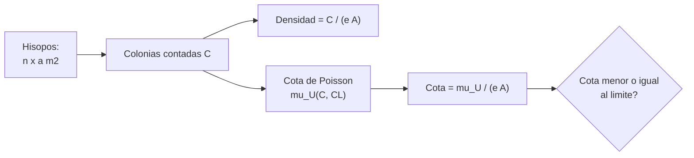

# B90-C21 — Biocarga de naves espaciales: verificación y requisitos normativos

<!-- nav:top -->
[🏠 Programa](../../../../README.md) · [📚 Bloque B90](../../../tronco-comun/B90-integracion-ensayos-y-calificacion-espacial.md) · [← Anterior: B90-C20 — Campaña conceptual de calificación de CubeSat](../B90-C20-campana-conceptual-de-calificacion-de-cubesat/CLASE.md) · [Siguiente: B90-C22 — Validación de procesos de reducción de biocarga →](../B90-C22-validacion-de-procesos-de-reduccion-de-biocarga/CLASE.md)
<!-- /nav -->

## 1. Ubicación, nivel y alcance

Clase 21 del bloque B90 (clase de la ampliación). Nivel N3. La **biocarga** es el número de microorganismos viables sobre una nave; la **protección planetaria** limita la contaminación de otros cuerpos con vida terrestre. B90-C04 trata la contaminación en la integración; aquí tratas la **verificación de la biocarga por muestreo de superficies**: qué dicen las fuentes, cómo se estima la densidad de esporas y cómo se acota con una cota de Poisson. Todos los datos son **sintéticos**; el límite de 300 esporas/m² es solo un **ejemplo** tomado de lo que cita una página de NASA para un rover de Marte.

## 2. Por qué esta clase existe

Un hisopo recoge solo una fracción de las esporas de una superficie y se cuentan pocas colonias; el resultado es una estimación con incertidumbre. La decisión central: **¿la biocarga cumple el límite con la confianza exigida o hace falta muestrear más o reducir?**

## 3. Lo que podrás hacer al terminar

1. Describir las categorías de protección planetaria y qué verificación exigen según una fuente.
2. Estimar la densidad de esporas con eficiencia de recuperación.
3. Calcular una cota superior de Poisson con distintos niveles de confianza.
4. Calcular cuántos hisopos hacen falta para que la cota cumpla.
5. Comprobar la cobertura de la cota por Monte Carlo.
6. Separar lo consultado (página de NASA y títulos de normas) de lo no consultado y de lo sintético.

La evidencia es la **verificación de biocarga frente a un límite de ejemplo** del ejercicio 12 (sección 20).

## 4. Con qué llegas y cómo comprobarlo

1. ¿Qué es una espora y por qué resiste el vacío?
2. ¿Qué es una unidad formadora de colonias (UFC)?
3. ¿Qué es una distribución de Poisson?
4. ¿Qué es una eficiencia de recuperación?
5. ¿Qué es una comprobación independiente?

<details>
<summary>Ver respuestas</summary>

1. Una forma latente de un microorganismo, muy resistente. 2. Una célula o grupo que genera una colonia visible al cultivar. 3. La de los conteos de sucesos independientes a tasa constante. 4. La fracción de las esporas presentes que el método de muestreo recupera. 5. Calcular lo mismo por otro método y comparar.
</details>

Con cuatro o cinco aciertos, sigue; si no, repasa los prerrequisitos.

## 5. Un caso de contexto y casos de referencia

Se toman 20 hisopos de 0,01 m² (0,20 m²) sobre una unidad de ejemplo; se cuentan **8 colonias** y la eficiencia de recuperación es **0,15**. La densidad observada es 40 /m² y la corregida **266,7 esporas/m²**, bajo el límite de ejemplo de 300; pero la cota superior al 95 % es **481,2 /m²**: **no cumple** con esa confianza. Haría falta muestrear **33 hisopos** (0,33 m²) con la misma cuenta para que la cota cumpla. Todo es **sintético**.

## 6. Vocabulario

**Biocarga:** número de microorganismos viables sobre un objeto. **Protección planetaria:** control de la contaminación hacia adelante (de la Tierra a otro cuerpo) y hacia atrás. **Espora:** forma latente resistente. **UFC:** unidad formadora de colonias. **Eficiencia de recuperación:** fracción recuperada por el hisopo. **Cota superior:** valor que, con confianza `CL`, no es menor que la densidad verdadera. **Categoría:** nivel de requisitos de la misión (I a V).

## 7. Modelo mental: de colonias a una cota de densidad



*Descripción textual:* los hisopos recogen colonias; la densidad estimada es `C/(eA)` y la cota superior usa el límite de Poisson de `C`; se compara la cota con el límite.

Analogía: contar peces en un lago con una red que atrapa una fracción: la estimación de la población depende de cuánta fracción atrapa y de cuántos peces se vieron. Límite: los microbios no se distribuyen al azar uniforme: se agrupan en rincones y juntas.

## 8. La explicación, paso a paso

### 8.1 Qué dicen las fuentes

La página de protección planetaria de NASA (F5) explica que se protege a otros cuerpos del sistema solar de la contaminación con vida terrestre y a la Tierra de lo que pueda volver; que las naves se construyen en salas limpias ISO y se mantienen protegidas de la recontaminación; que la **biocarga** es el número de microbios en una superficie, que se mide frotando o hisopando un área (normalmente cerca de 1 m²), cultivando y contando colonias, y que si excede el límite la nave se limpia y prueba de nuevo; que las **esporas** son lo más importante por sobrevivir al vacío; que el límite del rover de Marte es **300 esporas/m²**; y que las categorías son I (sin requisitos), II (documentación), III (más documentación, sala de clase 100 000 o mejor, posible reducción) y IV (landers y rovers: bioensayos, análisis de probabilidad de contaminación, inventario orgánico, reducción de biocarga), con subdivisiones IVa, IVb y IVc para Marte, y V (retorno a la Tierra). Cita NPR 8715.24 (que sustituyó a NPR 8020.12D, según la página), NASA-STD-8719.27 y el *NASA Planetary Protection Handbook*. NASA-STD-8719.27 (F6), línea base del 30-08-2022, trata contaminación hacia adelante y hacia atrás; solo se leyó la página con título y alcance. ECSS-U-ST-20C (planetary protection, 1-08-2019) y ECSS-Q-ST-70-55C (examen microbiano) existen (F9); su texto no se consultó. Los requisitos numéricos por categoría y la técnica de ensayo no se consultaron.

### 8.2 Densidad corregida

`d = C/(e A) = 8/(0,15 × 0,20) = 266,7 esporas/m²`. La eficiencia es crucial: con `e` de 0,1, 0,3, 0,5 y 1,0 la misma cuenta da 400, 133,3, 80 y 40 esporas/m².

### 8.3 Cota superior de Poisson

La cota `μ_U(C, CL)` cumple `P(X ≤ C | μ_U) = 1 − CL`. Para `C = 8`: 11,380 (80 %), 12,995 (90 %) y 14,435 (95 %) colonias, o **379,3, 433,2 y 481,2 esporas/m²** al dividir por `eA = 0,03`. La estimación central cumple, pero las cotas no.

### 8.4 Cuántas muestras y cobertura

Con las mismas 8 colonias, el área necesaria para que `14,435/(e a k) ≤ 300` es `k = 33` hisopos (0,33 m²); en la práctica, con más hisopos la cuenta también cambia, así que es una guía. La cobertura de la cota de 95 % por Monte Carlo (10⁵ campañas) es **0,9889** con densidad verdadera de 150 /m² y **0,9786** con 300 /m²: ambas mayores que 0,95, porque la cota de Poisson es conservadora.

## 9. Magnitudes, símbolos y unidades

| Símbolo | Qué es | Unidad | Valor / nota |
|---|---|---|---|
| `a`, `n`, `A` | área por hisopo, número y total | m² | 0,01; 20; 0,20 |
| `C` | colonias contadas | UFC | 8 |
| `e` | eficiencia de recuperación | — | 0,15 (sintética) |
| `d` | densidad estimada | esporas/m² | 266,7 |
| `CL` | confianza | — | 0,80; 0,90; 0,95 |
| límite | límite de ejemplo | esporas/m² | 300 |

## 10. Convenciones y referencias

Los conteos por hisopo siguen una distribución de Poisson independiente; la eficiencia se toma conocida. Unidades UFC, m², esporas/m². Sistema de referencia: no aplica. Tolerancias: cobertura `≥ 0,95 − 0,005`. La unidad, los conteos, la eficiencia y el límite de 300 esporas/m² como límite de ejemplo son **sintéticos**; el valor de 300 se tomó de una cita de la página F5 para el rover de Marte y no se verificó en un documento normativo.

## 11. De dónde sale lo que afirmamos

| ID | Fuente | Localizador | Respalda | Estado |
|---|---|---|---|---|
| F5 | NASA, Planetary Protection (SMA) — https://sma.nasa.gov/sma-disciplines/planetary-protection (consultada 2026-11-10) | página (leída hasta el carácter 100 000 de 123 869) | categorías I–V, sala limpia ISO, métodos de reducción de biocarga, definición y medición de biocarga, límite de 300 esporas/m² para el rover de Marte según la página, y documentos asociados | Consultada (parcial) |
| F6 | NASA, NASA-STD-8719.27 Implementing Planetary Protection Requirements for Space Flight (baseline, 30-08-2022) — https://standards.nasa.gov/standard/nasa/nasa-std-871927 (consultada 2026-11-10) | página de la norma | título, fecha y alcance: contaminación hacia adelante y hacia atrás | Consultada (solo la página; no el texto de la norma) |
| F9 | ECSS, listado de normas activas — https://ecss.nl/standards/active-standards/ (consultada 2026-11-10) | solo títulos y fechas | existencia, código y fecha de ECSS-E-ST-10-02C Rev.1, ECSS-E-ST-10-03C Rev.1, ECSS-E-ST-20-07C Rev.2, ECSS-Q-ST-70-01C Rev.1, ECSS-E-ST-20-06C Rev.1, ECSS-Q-ST-70-55C y ECSS-U-ST-20C | Consultada (solo títulos y fechas; el texto de las normas no se consultó) |
| — | NPR 8715.24, *NASA Planetary Protection Handbook*, COSPAR Policy on Planetary Protection | — | — | No consultada |
| — | Cota superior de Poisson y su cobertura | — | las verifica el laboratorio con Monte Carlo | No consultada en una fuente concreta |

Límites: ninguna fuente consultada da el método de ensayo microbiano ni el plan de muestreo; el ejemplo es didáctico.

## 12. Cómo ver la verificación

| Magnitud | Valor |
|---|---|
| densidad corregida | 266,7 esporas/m² |
| cota 95 % | 481,2 esporas/m² |
| hisopos necesarios | 33 |
| cobertura de la cota | 0,979–0,989 |

Descripción larga: la cota baja al aumentar los conteos o la superficie muestreada y sube cuando la eficiencia de recuperación es baja.

## 13. Ejemplo trabajado: ¿cumple el límite?

**Paso 1 · Densidad.** `8/(0,15 × 0,20) = 266,7`.

**Paso 2 · Cota.** `μ_U(8; 0,95) = 14,435`; `14,435/0,03 = 481,2`.

**Paso 3 · Comparación.** `266,7 ≤ 300` pero `481,2 > 300`.

**Paso 4 · Decisión.** Con 95 % de confianza no se puede declarar el cumplimiento: se muestrea más o se reduce la biocarga (C22).

## 14. Distintas formas de describir la biocarga

**Por densidad:** esporas/m² (esta clase). **Por total:** esporas en toda la nave. **Por categoría:** requisitos de la misión (F5). Las tres se complementan.

## 15. Práctica guiada

**Ejercicio 1 · con los pasos indicados.** Calcula la densidad con 5 colonias, `e = 0,3` y 0,2 m². *Pasos:* `e A`, cociente.

<details><summary>Solución comentada</summary>

`5/(0,3 × 0,2) = 83,3 esporas/m²`.
</details>

**Ejercicio 2 · con una pista.** ¿Qué área total dan 20 hisopos de 0,01 m²? *Pista:* producto.

<details><summary>Solución comentada</summary>

`0,20 m²`.
</details>

**Ejercicio 3 · casi autónomo.** Calcula la cota en esporas/m² con `μ_U = 12,995` y `eA = 0,03`.

<details><summary>Solución comentada</summary>

`433,2 esporas/m²`.
</details>

## 16. Práctica autónoma, transferencia e integrador

**Ejercicio 4 · autónomo.** Si `e = 0,1`, ¿qué densidad corregida da la misma cuenta de 8 colonias?

<details><summary>Solución comentada</summary>

`8/(0,1 × 0,2) = 400 esporas/m²`: supera el límite de ejemplo.
</details>

**Ejercicio 5 · autónomo.** ¿Por qué una eficiencia baja es conservadora?

<details><summary>Solución comentada</summary>

Porque la corrección multiplica la cuenta: asumir que el hisopo recupera poco aumenta la densidad estimada.
</details>

**Ejercicio 6 · autónomo.** ¿Qué categoría tiene un aterrizador a Marte según F5?

<details><summary>Solución comentada</summary>

Categoría IV (IVa, IVb o IVc).
</details>

**Ejercicio 7 · autónomo.** ¿Cuántas colonias se esperan si la densidad verdadera es 300 con `eA = 0,03`?

<details><summary>Solución comentada</summary>

`μ = 9`.
</details>

**Ejercicio 8 · autónomo.** ¿Por qué se miden las esporas y no solo las bacterias vegetativas?

<details><summary>Solución comentada</summary>

Porque las esporas sobreviven al vacío y a la radiación, según F5.
</details>

**Ejercicio 9 · transferencia.** **Transferencia.** Un colega usa 300 esporas/m² como límite de su misión. ¿Es válido?

<details><summary>Solución comentada</summary>

No: es un límite de ejemplo; el de su misión sale de su categoría y de su plan de protección planetaria.
</details>

**Ejercicio 10 · transferencia.** **Transferencia.** ¿Qué diferencia hay entre contaminación hacia adelante y hacia atrás?

<details><summary>Solución comentada</summary>

La primera es llevar vida terrestre a otro cuerpo; la segunda, traer material extraterrestre a la Tierra (F6).
</details>

**Ejercicio 11 · transferencia.** **Transferencia.** ¿Qué supuesto del modelo es más débil?

<details><summary>Solución comentada</summary>

La distribución uniforme e independiente de los microbios: se agrupan y los hisopos se toman en puntos de mayor riesgo.
</details>

**Ejercicio 12 · integrador.** **Integrador.** Elabora tu *verificación de biocarga frente a un límite de ejemplo*: conteos, eficiencia, densidad, cotas, hisopos necesarios, cobertura y lista de qué es consultado, no consultado y sintético.

<details><summary>Solución comentada</summary>

Secciones 8.2–8.4 y la salida del laboratorio.
</details>

## 17. Laboratorio: densidad y cota de Poisson

El script [biocarga_muestreo.py](biocarga_muestreo.py) calcula la densidad, las cotas de 80, 90 y 95 %, el número de hisopos necesarios y la cobertura por Monte Carlo; **comprueba** que el ejemplo cumple en la estimación central pero no en la cota y que la cobertura supera 0,95. Usa la biblioteca común [b90_comun.py](../b90_comun.py).

**Datos:** unidad, hisopos, conteos, eficiencia y límite **sintéticos**. **Predice antes de ejecutar:** ¿cumple la cota de 95 %? (No.) Ejecución del 2026-11-10 (Python 3.12.9, numpy 2.4.4):

```text
Python 3.12.9 | numpy 2.4.4
Datos SINTETICOS: 20 hisopos de 0.01 m2 sobre superficies de una unidad de ejemplo
Hisopos = 20 ; area total = 0.20 m2 ; colonias = 8 ; eficiencia de recuperacion = 0.15
Densidad observada = 40.0 /m2 ; corregida por recuperacion = 266.7 esporas/m2
   cota superior 80 %: 11.380 colonias -> 379.3 esporas/m2
   cota superior 90 %: 12.995 colonias -> 433.2 esporas/m2
   cota superior 95 %: 14.435 colonias -> 481.2 esporas/m2
Limite de ejemplo = 300 esporas/m2 -> cota 95 % = 481.2 : NO CUMPLE ; estimacion central: CUMPLE
Hisopos necesarios para que la cota de 95 % cumpla con las mismas 8 colonias: 33 (area 0.33 m2)
Cobertura de la cota de 95 % con densidad verdadera 150 /m2: 0.9889
Cobertura de la cota de 95 % con densidad verdadera 300 /m2: 0.9786
Eficiencia de recuperacion -> densidad corregida [esporas/m2]
   0.1 ->   400.0
   0.3 ->   133.3
   0.5 ->    80.0
   1.0 ->    40.0
Pruebas superadas.
```

```bash
python programa/clases/B90/B90-C21-biocarga-de-naves-espaciales-verificacion-y-requisitos-normativos/biocarga_muestreo.py
```

**Límites:** Poisson uniforme, eficiencia conocida, sin agrupamiento ni muestreo dirigido, sin método de ensayo.

## 18. Errores frecuentes y cómo corregirlos

**Comparar la estimación central con el límite sin confianza.** Usa la cota (8.3)

**Olvidar la eficiencia de recuperación.** Corrige la cuenta (8.2)

**Presentar el límite de ejemplo como un requisito.** Revisa la sección 10

## 19. Cómo sabrás que vas bien

Tras la sección 8: ¿qué pasa con la densidad corregida si la eficiencia baja? Si dudas, repasa el ejercicio 4. Tras el laboratorio: ¿qué mide la cobertura? (ver sección 17).

## 20. Qué entregas y cómo se evalúa

El producto es tu **verificación de biocarga frente a un límite de ejemplo** (ejercicio 12).

| Criterio | Inicial | En desarrollo | Logrado | Destacado |
|---|---|---|---|---|
| Conceptos | Los confunde | Parciales | Explica el método y su dominio | Explica los límites y las alternativas |
| Cálculo | Sin unidades | Con errores | Resultados con unidades y comprobados | Resuelve casos nuevos |
| Numérico | Sin comprobar | Un caso | Verifica con una comprobación independiente en varios casos | Interpreta las diferencias y los fallos |
| Fuentes | Sin fuente | Sin fecha | Fuentes con fecha y estado | Declara lo sintético y lo no consultado |
| Límites | No los nombra | Uno | Tres | Discute qué falta del modelo |

**Condiciones críticas (no se compensan con promedio):** rotular los datos como sintéticos; verificar cada resultado con una comprobación independiente; citar solo lo consultado.

## 21. Ética, seguridad y límites

Clase educativa: los datos y el límite son de ejemplo; la protección planetaria real se rige por la política y los requisitos de la misión y los lleva personal especializado. La clase no trata el manejo de microorganismos ni da protocolos de laboratorio. Accesibilidad: tablas equivalentes a las gráficas, fórmulas en texto, ejercicios sin conexión.

## 22. Para cerrar y seguir

Con 8 colonias en 0,20 m² y recuperación de 0,15, la densidad de ejemplo es 267 esporas/m² pero la cota de 95 % es 481: no cumple el límite de ejemplo de 300 y se necesitarían más muestras o reducir. Queda una pregunta: ¿cómo se valida un proceso que reduce la biocarga?

**Glosario español–inglés.** biocarga · *bioburden*; protección planetaria · *planetary protection*; espora · *spore*; unidad formadora de colonias · *colony-forming unit (CFU)*; eficiencia de recuperación · *recovery efficiency*; cota superior · *upper bound*.

**Continuidad.** [B90-C22](../B90-C22-validacion-de-procesos-de-reduccion-de-biocarga/CLASE.md) trata la validación de los procesos de reducción.

**Referencias:** ver sección 11.

<!-- nav:bottom -->
---

[← Anterior: B90-C20 — Campaña conceptual de calificación de CubeSat](../B90-C20-campana-conceptual-de-calificacion-de-cubesat/CLASE.md) · [📚 Bloque B90](../../../tronco-comun/B90-integracion-ensayos-y-calificacion-espacial.md) · [Siguiente: B90-C22 — Validación de procesos de reducción de biocarga →](../B90-C22-validacion-de-procesos-de-reduccion-de-biocarga/CLASE.md)
<!-- /nav -->
