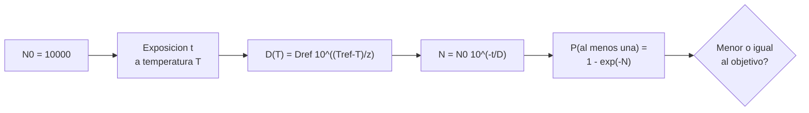

# B90-C22 — Validación de procesos de reducción de biocarga

<!-- nav:top -->
[🏠 Programa](../../../../README.md) · [📚 Bloque B90](../../../tronco-comun/B90-integracion-ensayos-y-calificacion-espacial.md) · [← Anterior: B90-C21 — Biocarga de naves espaciales: verificación y requisitos normativos](../B90-C21-biocarga-de-naves-espaciales-verificacion-y-requisitos-normativos/CLASE.md) · [Siguiente: B90-C23 — Instrumentación y adquisición de datos en ensayos →](../B90-C23-instrumentacion-y-adquisicion-de-datos-en-ensayos/CLASE.md)
<!-- /nav -->

## 1. Ubicación, nivel y alcance

Clase 22 del bloque B90 (clase de la ampliación `0.2.0`). Nivel N3. Un **proceso de reducción de biocarga** (por ejemplo, calor seco, peróxido de hidrógeno en vapor o radiación ultravioleta, según F5) mata una fracción de los microorganismos en cada unidad de tiempo; **validarlo** es demostrar con evidencia que alcanza la reducción exigida de forma repetible. Aquí modelas la cinética de primer orden con el **valor D** y el **valor z**, calculas la exposición necesaria y la probabilidad de que sobreviva alguna espora. Todos los parámetros son **sintéticos**: no son de ningún material, norma ni misión.

## 2. Por qué esta clase existe

Cada hora de calor consume vida del hardware; poca exposición deja sobrevivientes. La decisión central: **¿cuánta exposición garantiza la reducción pedida con una probabilidad de sobreviviente aceptable, y cómo cambia con la temperatura?**

## 3. Lo que podrás hacer al terminar

1. Describir la cinética de primer orden de la muerte microbiana y la reducción en logaritmos.
2. Calcular el valor D a otra temperatura con el valor z.
3. Calcular el tiempo para una reducción de `n` logaritmos.
4. Calcular la probabilidad de al menos un sobreviviente con Poisson y verificarla con Monte Carlo.
5. Calcular la exposición para una probabilidad objetivo y equivalentes a otras temperaturas.
6. Separar lo consultado (métodos de reducción citados por NASA) de lo sintético.

La evidencia es el **plan de validación de una reducción** del ejercicio 12 (sección 20).

## 4. Con qué llegas y cómo comprobarlo

1. ¿Qué es una reducción logarítmica?
2. ¿Qué es una cinética de primer orden?
3. ¿Qué es una distribución binomial o de Poisson de sobrevivientes?
4. ¿Qué es un logaritmo decimal?
5. ¿Qué es una comprobación independiente?

<details>
<summary>Ver respuestas</summary>

1. Una reducción de un factor 10 por logaritmo: 4 logaritmos son un factor 10⁴. 2. Una tasa de muerte proporcional a la población presente. 3. El número de sobrevivientes entre `N₀` con probabilidad pequeña de sobrevivir. 4. `log₁₀(x)`. 5. Calcular lo mismo por otro método y comparar.
</details>

Con cuatro o cinco aciertos, sigue; si no, repasa los prerrequisitos.

## 5. Un caso de contexto y casos de referencia

Con `N₀ = 10 000` esporas, `D = 60 min` a 125 °C y `z = 20 °C` (sintéticos), **4 logaritmos** de reducción llevan **240 min** y el promedio de sobrevivientes es 1 (probabilidad de al menos uno 0,632). Para que la probabilidad de al menos un sobreviviente sea ≤ 10⁻³ hacen falta **420 min** (7,00 D). A 135 °C bastan 133 min y a 115 °C hacen falta 1 328 min. Todo es **sintético**.

## 6. Vocabulario

**Reducción de biocarga:** disminución del número de microorganismos viables. **Valor D:** tiempo de exposición que reduce la población en un logaritmo (90 %). **Valor z:** aumento de temperatura que divide D por 10. **Reducción logarítmica:** `log₁₀(N₀/N)`. **Calor seco:** método térmico sin humedad. **Validación:** demostración documentada de que el proceso logra su objetivo. **Probabilidad de sobreviviente:** `1 − e^{−μ}`.

## 7. Modelo mental: cada D divide la población entre diez



*Descripción textual:* la temperatura fija el valor D; la exposición reduce la población en `t/D` logaritmos; el promedio de sobrevivientes da la probabilidad de que sobreviva al menos una y se compara con el objetivo.

Analogía: cada intervalo de D pasa una criba que deja pasar a uno de cada diez. Límite: en la realidad la curva puede tener un hombro o una cola; la cinética de primer orden es un modelo.

## 8. La explicación, paso a paso

### 8.1 Qué dicen las fuentes

La página de protección planetaria de NASA (F5) menciona que, según lo que el hardware tolere, se usan **reducción microbiana por calor seco, peróxido de hidrógeno en vapor y exposición a luz ultravioleta**, que las superficies expuestas se limpian con alcohol y que, si la biocarga excede el límite, se vuelve a limpiar y a medir. NASA-STD-8719.27 (F6) y ECSS-U-ST-20C, ECSS-Q-ST-70-55C (F9) existen y su texto no se consultó; los valores D y z de materiales y las condiciones de procesos validados **no se consultaron**. La cinética de primer orden es un modelo estándar que el laboratorio verifica.

### 8.2 El valor D y el valor z

`D(T) = D_ref 10^{(T_ref − T)/z}`:

| `T` (°C) | `D` (min) | Tiempo para 4 log (min) |
|---|---|---|
| 105 | 600,00 | 2 400,0 |
| 115 | 189,74 | 758,9 |
| 125 | 60,00 | 240,0 |
| 135 | 18,97 | 75,9 |
| 145 | 6,00 | 24,0 |

Subir `z = 20 °C` divide `D` por 10 (comprobado: `D(145) = 6,00`).

### 8.3 Sobrevivientes

Con `N(t) = N₀ 10^{−t/D}`, el número medio de sobrevivientes es `μ` y `P(≥1) = 1 − e^{−μ}`. A 125 °C:

| `t` (min) | `μ` | Reducción (log) | `P(≥1)` teórica | Monte Carlo |
|---|---|---|---|---|
| 120 | 100 | 2,0 | 1,00000 | 1,00000 |
| 240 | 1 | 4,0 | 0,63212 | 0,63291 |
| 360 | 0,01 | 6,0 | 0,00995 | 0,01015 |
| 480 | 10⁻⁴ | 8,0 | 0,00010 | 0,00010 |
| 600 | 10⁻⁶ | 10,0 | 0,00000 | 0,00000 |

El Monte Carlo (10⁶ réplicas por fila, binomial con `N₀ = 10⁴`, semilla 90) coincide con Poisson dentro de 4 errores estándar.

### 8.4 Exposición para un objetivo

Para `P(≥1) ≤ 10⁻³` se necesita `μ ≤ −ln(1 − 10⁻³) = 1,0005 × 10⁻³`, es decir `log₁₀(N₀/μ) = 7,00` logaritmos y `t = 7,00 × 60 = 420 min` a 125 °C. Con un margen de ejemplo de 2 veces (840 min) la probabilidad baja a `1,00 × 10⁻¹⁰`. A igual letalidad, 115 °C pide 1 328 min y 135 °C pide 133 min: la temperatura es la palanca más potente, pero limitada por lo que tolera el hardware.

## 9. Magnitudes, símbolos y unidades

| Símbolo | Qué es | Unidad | Valor / nota |
|---|---|---|---|
| `N₀` | población inicial | esporas | 10 000 |
| `D_ref`, `T_ref` | valor D y temperatura de referencia | min, °C | 60; 125 |
| `z` | variación de temperatura por factor 10 en D | °C | 20 |
| `t` | tiempo de exposición | min | 120 a 840 |
| `μ` | sobrevivientes medios | — | tabla 8.3 |
| `P(≥1)` | probabilidad de al menos un sobreviviente | — | tabla 8.3 |

## 10. Convenciones y referencias

Cinética de primer orden, temperatura constante durante la exposición, población homogénea, esporas independientes. Unidades min, °C. Sistema de referencia: no aplica. Tolerancias: `D(T_ref + z) = D_ref/10` a `10⁻¹²`; Monte Carlo frente a Poisson `< 4` errores estándar `+ 10⁻⁴`. `N₀`, `D`, `z` y el objetivo de 10⁻³ son **sintéticos**.

## 11. De dónde sale lo que afirmamos

| ID | Fuente | Localizador | Respalda | Estado |
|---|---|---|---|---|
| F5 | NASA, Planetary Protection (SMA) — https://sma.nasa.gov/sma-disciplines/planetary-protection (consultada 2026-11-10) | página (leída hasta el carácter 100 000 de 123 869) | categorías I–V, sala limpia ISO, métodos de reducción de biocarga, definición y medición de biocarga, límite de 300 esporas/m² para el rover de Marte según la página, y documentos asociados | Consultada (parcial) |
| F6 | NASA, NASA-STD-8719.27 Implementing Planetary Protection Requirements for Space Flight (baseline, 30-08-2022) — https://standards.nasa.gov/standard/nasa/nasa-std-871927 (consultada 2026-11-10) | página de la norma | título, fecha y alcance: contaminación hacia adelante y hacia atrás | Consultada (solo la página; no el texto de la norma) |
| F9 | ECSS, listado de normas activas — https://ecss.nl/standards/active-standards/ (consultada 2026-11-10) | solo títulos y fechas | existencia, código y fecha de ECSS-E-ST-10-02C Rev.1, ECSS-E-ST-10-03C Rev.1, ECSS-E-ST-20-07C Rev.2, ECSS-Q-ST-70-01C Rev.1, ECSS-E-ST-20-06C Rev.1, ECSS-Q-ST-70-55C y ECSS-U-ST-20C | Consultada (solo títulos y fechas; el texto de las normas no se consultó) |
| — | Valores D y z de materiales y procesos validados | — | — | No consultada |
| — | Cinética de primer orden, `P(≥1) = 1 − e^{−μ}` y su comprobación | — | las verifica el laboratorio con Monte Carlo | No consultada en una fuente concreta |

Límites: ninguna fuente consultada da parámetros cinéticos ni protocolos de validación.

## 12. Cómo ver el proceso

| Magnitud | Valor |
|---|---|
| `D` a 125 °C | 60 min |
| tiempo para 4 log | 240 min |
| tiempo para `P ≤ 10⁻³` | 420 min |
| equivalente a 135 °C | 133 min |

Descripción larga: `log₁₀ N` baja linealmente con el tiempo; la probabilidad de sobreviviente cae de 1 a casi 0 entre 4 y 8 logaritmos.

## 13. Ejemplo trabajado: el tiempo para el objetivo

**Paso 1 · Objetivo.** `P(≥1) ≤ 10⁻³` implica `μ ≤ 1,0005 × 10⁻³`.

**Paso 2 · Logaritmos.** `log₁₀(10⁴/1,0005×10⁻³) = 7,00`.

**Paso 3 · Tiempo.** `t = 7,00 × 60 = 420 min`.

**Paso 4 · Comprobación.** `P = 1 − exp(−10⁴ × 10^{−7}) = 1 − e^{−0,001} = 0,0009995`.

## 14. Distintas formas de describir la reducción

**Por cinética:** `D` y `z` (esta clase). **Por resultado:** biocarga final medida (C21). **Por proceso:** temperatura, humedad, tiempo y carga del horno. La validación necesita las tres.

## 15. Práctica guiada

**Ejercicio 1 · con los pasos indicados.** Calcula el tiempo para 3 logaritmos con `D = 60 min`. *Pasos:* `3 × D`.

<details><summary>Solución comentada</summary>

`180 min`.
</details>

**Ejercicio 2 · con una pista.** Calcula `D` a 135 °C con `D_ref = 60` a 125 °C y `z = 20`. *Pista:* `60 × 10^{−0,5}`.

<details><summary>Solución comentada</summary>

`18,97 min`.
</details>

**Ejercicio 3 · casi autónomo.** Calcula `μ` tras 300 min a 125 °C con `N₀ = 10⁴`.

<details><summary>Solución comentada</summary>

`10⁴ × 10^{−5} = 0,1`.
</details>

## 16. Práctica autónoma, transferencia e integrador

**Ejercicio 4 · autónomo.** ¿Cuál es `P(≥1)` con `μ = 0,1`?

<details><summary>Solución comentada</summary>

`1 − e^{−0,1} = 0,0952`.
</details>

**Ejercicio 5 · autónomo.** ¿Cuántos logaritmos de reducción dan `μ = 10⁻⁶` con `N₀ = 10⁴`?

<details><summary>Solución comentada</summary>

10 logaritmos.
</details>

**Ejercicio 6 · autónomo.** ¿Por qué 115 °C pide casi 10 veces más tiempo que 135 °C?

<details><summary>Solución comentada</summary>

Porque 20 °C de diferencia son un factor 10 en `D` (`z = 20`); 1 328/133 ≈ 10.
</details>

**Ejercicio 7 · autónomo.** Si `D` fuera 90 min, ¿cuánto dura la reducción de 4 logaritmos?

<details><summary>Solución comentada</summary>

`360 min`.
</details>

**Ejercicio 8 · autónomo.** ¿Cuánto vale `μ` si `N₀ = 10⁵` y se aplican 7 logaritmos?

<details><summary>Solución comentada</summary>

`10⁵ × 10^{−7} = 0,01`.
</details>

**Ejercicio 9 · transferencia.** **Transferencia.** Un colega usa `D = 60 min` para su proceso. ¿Es válido?

<details><summary>Solución comentada</summary>

No: `D` y `z` dependen del organismo, el material y las condiciones; los de la clase son sintéticos.
</details>

**Ejercicio 10 · transferencia.** **Transferencia.** ¿Qué limita subir la temperatura para acortar el tiempo?

<details><summary>Solución comentada</summary>

Lo que toleran los materiales y componentes del hardware (F5 lo condiciona a «lo que el hardware puede tolerar»).
</details>

**Ejercicio 11 · transferencia.** **Transferencia.** ¿Qué evidencia se necesita para validar un proceso real?

<details><summary>Solución comentada</summary>

Mediciones de reducción con indicadores biológicos, registros de temperatura y tiempo en todos los puntos de la carga y repetibilidad; los protocolos los fijan las normas y el plan del proyecto.
</details>

**Ejercicio 12 · integrador.** **Integrador.** Elabora tu *plan de validación de una reducción*: `D(T)`, tiempos, probabilidad de sobreviviente, objetivo, exposición requerida, equivalentes y lista de qué es consultado, no consultado y sintético.

<details><summary>Solución comentada</summary>

Secciones 8.2–8.4 y la salida del laboratorio.
</details>

## 17. Laboratorio: cinética de primer orden y sobrevivientes

El script [reduccion_biocarga.py](reduccion_biocarga.py) calcula `D(T)`, los tiempos para 4 logaritmos, la probabilidad de sobrevivientes por Poisson y por Monte Carlo y la exposición para un objetivo; **comprueba** `D(T_ref + z) = D_ref/10`, la coincidencia con Monte Carlo y que la exposición calculada cumple el objetivo. Usa la biblioteca común [b90_comun.py](../b90_comun.py).

**Datos:** `N₀`, `D`, `z` y objetivo **sintéticos**. **Predice antes de ejecutar:** ¿cuánto tiempo hace falta para `P ≤ 10⁻³`? (7 D = 420 min.) Ejecución del 2026-11-10 (Python 3.12.9, numpy 2.4.4):

```text
Python 3.12.9 | numpy 2.4.4
Datos SINTETICOS: N0 = 10000 esporas; D = 60 min a 125 C; z = 20 C
T [C]   D [min]   t para 4 logaritmos [min]
  105     600.00      2400.0
  115     189.74       758.9
  125      60.00       240.0
  135      18.97        75.9
  145       6.00        24.0
Exposicion a 125 C [min] -> esporas esperadas -> reduccion [log] -> P(al menos una sobreviviente)
   120          100     2.0    1.00000 (MC  1.00000)
   240            1     4.0    0.63212 (MC  0.63291)
   360         0.01     6.0    0.00995 (MC  0.01015)
   480       0.0001     8.0    0.00010 (MC  0.00010)
   600        1e-06    10.0    0.00000 (MC  0.00000)
Tiempo para que P(sobreviviente) <= 0.001: 420 min a 125 C = 7.00 D (7.00 log)
Con margen de 2 x el tiempo (practica de ejemplo): 840 min -> P = 1.00e-10
Tiempo equivalente a otra temperatura para igual letalidad (a 115 y 135 C) [min]
   115 C: 1328
   135 C: 133
Pruebas superadas.
```

```bash
python programa/clases/B90/B90-C22-validacion-de-procesos-de-reduccion-de-biocarga/reduccion_biocarga.py
```

**Límites:** primer orden sin hombro ni cola, temperatura uniforme, una población homogénea; no es un protocolo de laboratorio.

## 18. Errores frecuentes y cómo corregirlos

**Pensar que 4 logaritmos son «casi estéril».** Con `N₀ = 10⁴` quedan en promedio 1 espora (8.3)

**Ignorar la dependencia de D con la temperatura.** Usa `z` (8.2)

**Presentar los parámetros de ejemplo como los de un proceso.** Revisa la sección 10

## 19. Cómo sabrás que vas bien

Tras la sección 8: ¿cuántos logaritmos hacen falta para pasar de `10⁴` a `10⁻³` esporas? Si dudas, repasa el ejercicio 5. Tras el laboratorio: ¿qué compara el Monte Carlo? (ver sección 17).

## 20. Qué entregas y cómo se evalúa

El producto es tu **plan de validación de una reducción** (ejercicio 12).

| Criterio | Inicial | En desarrollo | Logrado | Destacado |
|---|---|---|---|---|
| Conceptos | Los confunde | Parciales | Explica el método y su dominio | Explica los límites y las alternativas |
| Cálculo | Sin unidades | Con errores | Resultados con unidades y comprobados | Resuelve casos nuevos |
| Numérico | Sin comprobar | Un caso | Verifica con una comprobación independiente en varios casos | Interpreta las diferencias y los fallos |
| Fuentes | Sin fuente | Sin fecha | Fuentes con fecha y estado | Declara lo sintético y lo no consultado |
| Límites | No los nombra | Uno | Tres | Discute qué falta del modelo |

**Condiciones críticas (no se compensan con promedio):** rotular los datos como sintéticos; verificar cada resultado con una comprobación independiente; citar solo lo consultado.

## 21. Ética, seguridad y límites

Clase educativa: los parámetros son de ejemplo y no sirven para validar un proceso real; no contiene protocolos de manipulación de microorganismos ni de esterilización. Los procesos reales los diseñan y validan especialistas bajo la política de protección planetaria. Accesibilidad: tablas equivalentes a las gráficas, fórmulas en texto, ejercicios sin conexión.

## 22. Para cerrar y seguir

Con los parámetros de ejemplo, 4 logaritmos requieren 240 min a 125 °C y una probabilidad de sobreviviente de 10⁻³ exige 420 min; a 135 °C bastan 133 min. Queda una pregunta: ¿cómo se mide todo esto en un ensayo?

**Glosario español–inglés.** reducción de biocarga · *bioburden reduction*; valor D · *D-value*; valor z · *z-value*; reducción logarítmica · *log reduction*; calor seco · *dry heat*; validación · *validation*.

**Continuidad.** [B90-C23](../B90-C23-instrumentacion-y-adquisicion-de-datos-en-ensayos/CLASE.md) trata la instrumentación y la adquisición de datos en ensayos.

**Referencias:** ver sección 11.

<!-- nav:bottom -->
---

[← Anterior: B90-C21 — Biocarga de naves espaciales: verificación y requisitos normativos](../B90-C21-biocarga-de-naves-espaciales-verificacion-y-requisitos-normativos/CLASE.md) · [📚 Bloque B90](../../../tronco-comun/B90-integracion-ensayos-y-calificacion-espacial.md) · [Siguiente: B90-C23 — Instrumentación y adquisición de datos en ensayos →](../B90-C23-instrumentacion-y-adquisicion-de-datos-en-ensayos/CLASE.md)
<!-- /nav -->
