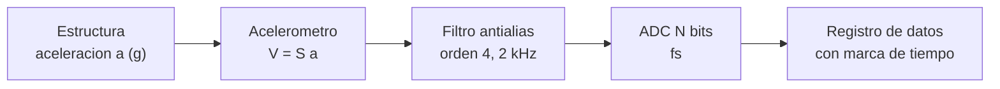

# B90-C23 — Instrumentación y adquisición de datos en ensayos

<!-- nav:top -->
[🏠 Programa](../../../../README.md) · [📚 Bloque B90](../../../tronco-comun/B90-integracion-ensayos-y-calificacion-espacial.md) · [← Anterior: B90-C22 — Validación de procesos de reducción de biocarga](../B90-C22-validacion-de-procesos-de-reduccion-de-biocarga/CLASE.md) · [Siguiente: B90-C24 — Prototipado y modelos de ingeniería de subconjuntos →](../B90-C24-prototipado-y-modelos-de-ingenieria-de-subconjuntos/CLASE.md)
<!-- /nav -->

## 1. Ubicación, nivel y alcance

Clase 23 del bloque B90 (clase de la ampliación `0.2.0`). Nivel N3. Un ensayo vale lo que valen sus datos: dónde están los **sensores**, con qué **sensibilidad**, cómo se **muestrean** y con cuántos **bits**. Aquí calculas el **aliasing** de una señal mal muestreada, el efecto de un filtro antialias, la **relación señal-ruido** de un cuantizador y la resolución de una cadena con acelerómetro. Todos los datos son **sintéticos**.

## 2. Por qué esta clase existe

Un ensayo de vibración que muestrea a 2 048 Hz un tono de 1 500 Hz lo registra como si fuera de 548 Hz y no se nota. La decisión central: **¿qué frecuencia de muestreo, qué filtro y cuántos bits aseguran que lo que se registra es lo que ocurrió?**

## 3. Lo que podrás hacer al terminar

1. Calcular la frecuencia aparente por aliasing.
2. Detectarla con una transformada de Fourier.
3. Calcular la atenuación de un filtro antialias de orden 4.
4. Calcular la relación señal-ruido de un cuantizador de `N` bits y comprobarla.
5. Convertir la sensibilidad del acelerómetro en tensión y la resolución en mg.
6. Separar lo consultado (qué exige CubeSat 101 en los informes de ensayo) de lo sintético.

La evidencia es la **especificación de una cadena de adquisición** del ejercicio 12 (sección 20).

## 4. Con qué llegas y cómo comprobarlo

1. ¿Qué es la frecuencia de Nyquist?
2. ¿Qué es una transformada de Fourier discreta?
3. ¿Qué es la cuantización?
4. ¿Qué es un acelerómetro piezoeléctrico y su sensibilidad en mV/g?
5. ¿Qué es una comprobación independiente?

<details>
<summary>Ver respuestas</summary>

1. La mitad de la frecuencia de muestreo: la máxima frecuencia representable. 2. El cálculo del contenido en frecuencia de una señal muestreada. 3. El redondeo del valor a uno de `2^N` niveles. 4. Un sensor que entrega una tensión proporcional a la aceleración; la sensibilidad es la tensión por g. 5. Calcular lo mismo por otro método y comparar.
</details>

Con cuatro o cinco aciertos, sigue; si no, repasa los prerrequisitos.

## 5. Un caso de contexto y casos de referencia

Un ensayo de vibración con banda de interés de 20 a 2 000 Hz muestrea un tono de 1 500 Hz: a **8 192 Hz** aparece en 1 500 Hz; a **2 048 Hz**, en **548 Hz** (alias); a **2 000 Hz**, en **500 Hz**. Con un acelerómetro de 10 mV/g, 5 g rms son 50 mV y una entrada de ±5 V equivale a 500 g. Un ADC de 16 bits tiene un escalón de 15,26 mg. Todo es **sintético**.

## 6. Vocabulario

**Frecuencia de muestreo `fs`:** muestras por segundo. **Nyquist:** `fs/2`. **Aliasing:** aparición de una frecuencia superior a Nyquist como una menor. **Filtro antialias:** filtro pasa-bajas antes del muestreo. **Cuantización:** discretización de la amplitud. **LSB:** escalón del cuantizador. **Sensibilidad:** tensión por unidad física (mV/g). **Resolución:** menor cambio distinguible.

## 7. Modelo mental: la cadena de medida



*Descripción textual:* la aceleración de la estructura se convierte en tensión con la sensibilidad del acelerómetro, se filtra para eliminar lo que está sobre Nyquist, se muestrea y cuantiza y se registra con marca de tiempo.

Analogía: filmar una rueda de carro con un cuadro por segundo: parece girar al revés. Límite: la analogía no incluye el ruido de cuantización.

## 8. La explicación, paso a paso

### 8.1 Qué dice la fuente

*CubeSat 101* (F7) pide que los informes de ensayo dinámico incluyan las gráficas de los datos con los niveles y duraciones, **fotos del montaje con la ubicación de los acelerómetros** y procedimientos con marcas de tiempo, y que se muestre que el CubeSat sobrevivió (inspección visual y barridos senoidales previos y posteriores); para el termovacío pide fotos con la ubicación de los termopares y registros de temperatura y vacío. NASA-STD-7001C (F4) trata los criterios de ensayo vibroacústico (solo se leyó la página). Las relaciones de muestreo y de cuantización de esta clase son estándar y las verifica el laboratorio; no se consultaron en una fuente concreta.

### 8.2 Aliasing

Un tono de `f₀` muestreado a `fs` aparece en `f_alias = |f₀ − round(f₀/fs) fs|`. Para `f₀ = 1 500 Hz`: a 8 192 Hz (Nyquist 4 096) aparece en 1 500; a 2 048 Hz (Nyquist 1 024), en `|1 500 − 2 048| = 548 Hz`; a 2 000 Hz, en 500 Hz. La FFT con ventana de Hann detecta los tres picos en las frecuencias previstas con un error menor de 1 bin (1 Hz).

### 8.3 Filtro antialias

Un filtro de Butterworth de orden 4 con corte en 2 000 Hz tiene `|H|² = 1/(1 + (f/2 000)⁸)`:

| `f` (Hz) | Atenuación (dB) |
|---|---|
| 2 000 | −3,0 |
| 3 000 | −14,3 |
| 4 000 | −24,1 |
| 6 144 | −39,0 |

Con `fs = 8 192 Hz` lo que está sobre Nyquist (4 096 Hz) llega atenuado al menos 24 dB; con un filtro de orden 4 y `fs` solo 2,5 veces la banda no habría margen suficiente.

### 8.4 Cuantización y sensibilidad

Un cuantizador de `N` bits con senoide casi a plena escala tiene `SNR ≈ 6,02 N + 1,76 dB`. Medido con una senoide cuantizada:

| `N` | Teórica (dB) | Medida (dB) |
|---|---|---|
| 8 | 49,92 | 49,93 |
| 12 | 74,00 | 74,01 |
| 16 | 98,08 | 98,04 |
| 24 | 146,24 | 146,25 |

Con `S = 10 mV/g`: 5 g rms = 50 mV; ±5 V equivalen a ±500 g. El LSB de un ADC de ±5 V es 2,4414 mV (244,14 mg) con 12 bits y 0,1526 mV (**15,26 mg**) con 16 bits; el ruido de cuantización de 16 bits es `LSB/√12 = 4,4 mg rms`, muy bajo frente a una señal mínima de 500 mg rms. La elección de la plena escala es un compromiso: ±500 g da poca resolución para una vibración de 5 g.

## 9. Magnitudes, símbolos y unidades

| Símbolo | Qué es | Unidad | Valor / nota |
|---|---|---|---|
| `fs` | frecuencia de muestreo | Hz | 8 192; 2 048; 2 000 |
| `f₀`, `f_alias` | tono y frecuencia aparente | Hz | 1 500; 1 500, 548, 500 |
| `N` | bits del ADC | bits | 8 a 24 |
| `S` | sensibilidad | mV/g | 10 |
| LSB | escalón | mV, mg | 0,1526 mV (16 bits) |
| SNR | relación señal-ruido | dB | `6,02 N + 1,76` |

## 10. Convenciones y referencias

Muestreo uniforme sin jitter; señal senoidal; filtro ideal Butterworth de orden 4; cuantizador de redondeo; sensibilidad lineal. Sistema de referencia: eje del acelerómetro. Tolerancias: frecuencia aparente a 1 bin (1 Hz); SNR a 0,5 dB. La banda, los tonos, la sensibilidad y la plena escala son **sintéticos**.

## 11. De dónde sale lo que afirmamos

| ID | Fuente | Localizador | Respalda | Estado |
|---|---|---|---|---|
| F7 | NASA CubeSat Launch Initiative, CubeSat 101: Basic Concepts and Processes for First-Time CubeSat Developers (octubre de 2017) — PDF https://www.nasa.gov/wp-content/uploads/2017/03/nasa_csli_cubesat_101_508.pdf (consultada 2026-11-10 con PyMuPDF) | capítulo 6, secciones 6.9.2 y 6.9.3 y prueba DITL | el ICD fija niveles y duraciones de vibración y bakeout; contenido mínimo de los informes; no modificar el hardware tras el ensayo; el ciclado termovacío no se exige habitualmente | Consultada |
| F4 | NASA, NASA-STD-7001 Version C, Payload Vibroacoustic Test Criteria — https://standards.nasa.gov/standard/nasa/nasa-std-7001 (consultada 2026-11-10) | página de la norma | título, versión C (cambio 0), fecha 14-07-2026 y alcance: entornos y niveles de ensayo acústico y de vibración aleatoria de cargas útiles; excluye lanzadores y equipo de tierra | Consultada (solo la página; no el texto de la norma) |
| F8 | Cal Poly CubeSat Program, CubeSat Design Specification Rev. 14.1 (febrero de 2022) — PDF https://static1.squarespace.com/static/5418c831e4b0fa4ecac1bacd/t/62193b7fc9e72e0053f00910/1645820809779/CDS+REV14_1+2022-02-09.pdf (consultada 2026-11-10 con PyMuPDF) | secciones 2.2, 2.3, 2.4 y 3 (3.1–3.5) | ensayos típicos (vibración aleatoria, bakeout termovacío, choque, inspección visual), calificación, protovuelo y aceptación, tres inhibidores independientes, rieles y centro de gravedad (tabla 2) | Consultada |
| — | Teorema de muestreo, aliasing, `SNR = 6,02 N + 1,76 dB` y respuesta de Butterworth | — | las verifica el laboratorio con FFT y una senoide cuantizada | No consultada en una fuente concreta |

Límites: ninguna fuente consultada da especificaciones de sensores ni de adquisición.

## 12. Cómo ver la cadena

| Magnitud | Valor |
|---|---|
| alias de 1 500 Hz a 2 048 Hz | 548 Hz |
| atenuación a 4 000 Hz | −24,1 dB |
| SNR de 16 bits | 98,08 dB |
| LSB de 16 bits en ±5 V | 15,26 mg |

Descripción larga: el alias refleja el tono sobre Nyquist hacia abajo; cada bit añade 6 dB de relación señal-ruido.

## 13. Ejemplo trabajado: ¿qué ve un ADC de 2 048 Hz?

**Paso 1 · Nyquist.** `2 048/2 = 1 024 Hz`.

**Paso 2 · Tono.** `1 500 > 1 024`: hay aliasing.

**Paso 3 · Alias.** `|1 500 − 1 × 2 048| = 548 Hz`.

**Paso 4 · Decisión.** Hay que subir `fs` (≥ 4 096 Hz, mejor 8 192) o filtrar antes.

## 14. Distintas formas de describir la adquisición

**Por sensor:** sensibilidad, rango, ubicación. **Por muestreo:** `fs`, filtro, resolución. **Por registro:** marcas de tiempo, calibración y formato. El informe del ensayo debe cubrir las tres (F7).

## 15. Práctica guiada

**Ejercicio 1 · con los pasos indicados.** Calcula la frecuencia aparente de 3 000 Hz muestreados a 4 000 Hz. *Pasos:* `|f₀ − round(f₀/fs) fs|`.

<details><summary>Solución comentada</summary>

`|3 000 − 1 × 4 000| = 1 000 Hz`.
</details>

**Ejercicio 2 · con una pista.** Calcula la tensión de un acelerómetro de 100 mV/g con 2 g. *Pista:* producto.

<details><summary>Solución comentada</summary>

`200 mV`.
</details>

**Ejercicio 3 · casi autónomo.** Calcula la SNR ideal de 14 bits.

<details><summary>Solución comentada</summary>

`6,02 × 14 + 1,76 = 86,04 dB`.
</details>

## 16. Práctica autónoma, transferencia e integrador

**Ejercicio 4 · autónomo.** ¿Cuál es el LSB de un ADC de ±10 V con 16 bits?

<details><summary>Solución comentada</summary>

`20/65 536 = 0,305 mV`.
</details>

**Ejercicio 5 · autónomo.** ¿Cuántos g equivale ese LSB con 10 mV/g?

<details><summary>Solución comentada</summary>

`0,305/10 = 0,0305 g = 30,5 mg`.
</details>

**Ejercicio 6 · autónomo.** ¿Qué `fs` mínima exige una banda de 2 000 Hz sin considerar el filtro?

<details><summary>Solución comentada</summary>

Más de 4 000 Hz (Nyquist); en la práctica 2,5 a 4 veces la banda.
</details>

**Ejercicio 7 · autónomo.** ¿Cuánto atenúa el filtro de la clase a 8 000 Hz?

<details><summary>Solución comentada</summary>

`−10 log(1 + 4⁸) = −10 log(65 537) = −48,2 dB`.
</details>

**Ejercicio 8 · autónomo.** ¿Por qué más bits no arreglan el aliasing?

<details><summary>Solución comentada</summary>

Porque el aliasing es un error de muestreo en frecuencia, no de resolución en amplitud.
</details>

**Ejercicio 9 · transferencia.** **Transferencia.** Un colega usa 10 mV/g para su acelerómetro. ¿Es válido?

<details><summary>Solución comentada</summary>

No: la sensibilidad la da la calibración de su sensor; la del ejemplo es sintética.
</details>

**Ejercicio 10 · transferencia.** **Transferencia.** ¿Por qué se documenta la ubicación de los acelerómetros?

<details><summary>Solución comentada</summary>

Porque la respuesta cambia de un punto a otro de la estructura y el informe debe permitir reproducir la medida (F7).
</details>

**Ejercicio 11 · transferencia.** **Transferencia.** ¿Qué riesgo hay en usar la plena escala de ±500 g para una prueba de 5 g rms?

<details><summary>Solución comentada</summary>

La señal usa el 1 % del rango: se pierde resolución; conviene un rango adaptado o amplificación.
</details>

**Ejercicio 12 · integrador.** **Integrador.** Elabora tu *especificación de una cadena de adquisición*: sensor, filtro, `fs`, bits, resolución en g, riesgo de aliasing y lista de qué es consultado, no consultado y sintético.

<details><summary>Solución comentada</summary>

Secciones 8.2–8.4 y la salida del laboratorio.
</details>

## 17. Laboratorio: aliasing, filtro y cuantización

El script [adquisicion.py](adquisicion.py) detecta con FFT los alias de un tono de 1 500 Hz, tabula la atenuación del filtro, mide la SNR de cuatro cuantizadores y calcula la resolución del acelerómetro; **comprueba** la frecuencia aparente (1 bin), la SNR (0,5 dB) y el ruido de cuantización. Usa la biblioteca común [b90_comun.py](../b90_comun.py).

**Datos:** banda, tonos, sensibilidad y plena escala **sintéticos**. **Predice antes de ejecutar:** ¿dónde aparece el tono a 2 048 Hz? (548 Hz.) Ejecución del 2026-11-10 (Python 3.12.9, numpy 2.4.4):

```text
Python 3.12.9 | numpy 2.4.4
Datos SINTETICOS: ensayo de vibracion con banda de interes de 20 a 2000 Hz
fs =    8192 Hz ; tono de 1500 Hz aparece en  1500.0 Hz (esperado  1500.0 Hz) ; Nyquist = 4096 Hz
fs =    2048 Hz ; tono de 1500 Hz aparece en   548.0 Hz (esperado   548.0 Hz) ; Nyquist = 1024 Hz
fs =    2000 Hz ; tono de 1500 Hz aparece en   500.0 Hz (esperado   500.0 Hz) ; Nyquist = 1000 Hz
Regla: fs >= 2 x banda; con filtro antialias de orden 4 y corte 2000 Hz, atenuacion en f:
   2000 Hz:   -3.0 dB
   3000 Hz:  -14.3 dB
   4000 Hz:  -24.1 dB
   6144 Hz:  -39.0 dB
Resolucion: N bits -> SNR ideal [dB] ; medida con senoide cuantizada
    8 ->  49.92 ;  49.93
   12 ->  74.00 ;  74.01
   16 ->  98.08 ;  98.04
   24 -> 146.24 ; 146.25
Acelerometro: S = 10.0 mV/g ; 5 g rms -> 50.0 mV ; plena escala del ADC 5.0 V corresponde a 500 g
   LSB con 12 bits en +-5.0 V = 2.4414 mV = 244.14 mg
   LSB con 16 bits en +-5.0 V = 0.1526 mV = 15.26 mg
Ruido de cuantizacion con 16 bits: 4.405 mg rms frente a 500 mg de la senal minima
Pruebas superadas.
```

```bash
python programa/clases/B90/B90-C23-instrumentacion-y-adquisicion-de-datos-en-ensayos/adquisicion.py
```

**Límites:** sin jitter, sin ruido del sensor ni del acondicionador, filtro ideal, un solo canal.

## 18. Errores frecuentes y cómo corregirlos

**Muestrear a justo el doble de la banda.** Deja margen y filtra (8.3)

**Creer que más bits corrigen el aliasing.** No lo hacen (8.4)

**Presentar la sensibilidad de ejemplo como real.** Revisa la sección 10

## 19. Cómo sabrás que vas bien

Tras la sección 8: ¿qué alias da 3 000 Hz muestreados a 4 000 Hz? Si dudas, repasa el ejercicio 1. Tras el laboratorio: ¿qué comprueba la SNR medida? (ver sección 17).

## 20. Qué entregas y cómo se evalúa

El producto es tu **especificación de una cadena de adquisición** (ejercicio 12).

| Criterio | Inicial | En desarrollo | Logrado | Destacado |
|---|---|---|---|---|
| Conceptos | Los confunde | Parciales | Explica el método y su dominio | Explica los límites y las alternativas |
| Cálculo | Sin unidades | Con errores | Resultados con unidades y comprobados | Resuelve casos nuevos |
| Numérico | Sin comprobar | Un caso | Verifica con una comprobación independiente en varios casos | Interpreta las diferencias y los fallos |
| Fuentes | Sin fuente | Sin fecha | Fuentes con fecha y estado | Declara lo sintético y lo no consultado |
| Límites | No los nombra | Uno | Tres | Discute qué falta del modelo |

**Condiciones críticas (no se compensan con promedio):** rotular los datos como sintéticos; verificar cada resultado con una comprobación independiente; citar solo lo consultado.

## 21. Ética, seguridad y límites

Clase educativa: la cadena es de ejemplo y no sustituye la calibración ni el plan de instrumentación del ensayo. Accesibilidad: tablas equivalentes a las gráficas, fórmulas en texto, ejercicios sin conexión.

## 22. Para cerrar y seguir

A 2 048 Hz un tono de 1 500 Hz se registra en 548 Hz; con 8 192 Hz y un filtro de orden 4 queda bien medido, y un ADC de 16 bits resuelve 15 mg. Queda una pregunta: ¿cómo se reduce el riesgo antes de construir el modelo de vuelo?

**Glosario español–inglés.** frecuencia de muestreo · *sampling rate*; aliasing · *aliasing*; filtro antialias · *anti-aliasing filter*; cuantización · *quantization*; sensibilidad · *sensitivity*; acelerómetro · *accelerometer*.

**Continuidad.** [B90-C24](../B90-C24-prototipado-y-modelos-de-ingenieria-de-subconjuntos/CLASE.md) trata el prototipado y los modelos de ingeniería.

**Referencias:** ver sección 11.

<!-- nav:bottom -->
---

[← Anterior: B90-C22 — Validación de procesos de reducción de biocarga](../B90-C22-validacion-de-procesos-de-reduccion-de-biocarga/CLASE.md) · [📚 Bloque B90](../../../tronco-comun/B90-integracion-ensayos-y-calificacion-espacial.md) · [Siguiente: B90-C24 — Prototipado y modelos de ingeniería de subconjuntos →](../B90-C24-prototipado-y-modelos-de-ingenieria-de-subconjuntos/CLASE.md)
<!-- /nav -->
