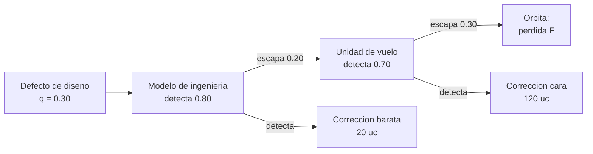

# B90-C24 — Prototipado y modelos de ingeniería de subconjuntos

<!-- nav:top -->
[🏠 Programa](../../../../README.md) · [📚 Bloque B90](../../../tronco-comun/B90-integracion-ensayos-y-calificacion-espacial.md) · [← Anterior: B90-C23 — Instrumentación y adquisición de datos en ensayos](../B90-C23-instrumentacion-y-adquisicion-de-datos-en-ensayos/CLASE.md) · [Siguiente: B91-C01 — Fundamentos de teoría de antenas →](../../B91/B91-C01-fundamentos-de-teoria-de-antenas/CLASE.md)
<!-- /nav -->

## 1. Ubicación, nivel y alcance

Clase 24 del bloque B90 (clase de la ampliación `0.2.0`). Nivel N3. Antes de construir la unidad de vuelo se pueden construir **prototipos** y **modelos de ingeniería** de subconjuntos para encontrar defectos de diseño cuando corregirlos es barato. B90 parte de unidades ya definidas; aquí comparas tres **filosofías de modelos** (solo vuelo, protovuelo, ingeniería más vuelo) con un modelo de **costo esperado y riesgo residual**. Todas las probabilidades y costos son **sintéticos**, en unidades de costo (uc).

## 2. Por qué esta clase existe

Un modelo de ingeniería cuesta dinero y calendario; un defecto que llega a órbita cuesta la misión. La decisión central: **¿vale la pena construir un modelo previo, o conviene el protovuelo o solo la unidad de vuelo, dado el valor de lo que se arriesga?**

## 3. Lo que podrás hacer al terminar

1. Distinguir prototipo, modelo de ingeniería, modelo de calificación, protovuelo y unidad de vuelo.
2. Plantear el costo esperado de una filosofía con detección por etapas.
3. Calcular la probabilidad de que un defecto escape a órbita.
4. Verificar el cálculo con Monte Carlo.
5. Analizar la sensibilidad a la pérdida de la misión.
6. Separar lo consultado (calificación, protovuelo, aceptación según CDS y SE Handbook) de lo sintético.

La evidencia es la **comparación de filosofías de modelos** del ejercicio 12 (sección 20).

## 4. Con qué llegas y cómo comprobarlo

1. ¿Qué es un valor esperado?
2. ¿Qué es una probabilidad condicional?
3. ¿Qué es un defecto de diseño?
4. ¿Qué es un riesgo residual?
5. ¿Qué es una comprobación independiente?

<details>
<summary>Ver respuestas</summary>

1. El promedio de los resultados ponderado por su probabilidad. 2. La probabilidad de un suceso dado otro. 3. Un error en el diseño que se presenta en todas las unidades. 4. El riesgo que queda tras las mitigaciones. 5. Calcular lo mismo por otro método y comparar.
</details>

Con cuatro o cinco aciertos, sigue; si no, repasa los prerrequisitos.

## 5. Un caso de contexto y casos de referencia

Un defecto de diseño existe con probabilidad 0,30. Tres filosofías de ejemplo: **A** solo vuelo (100 uc; detección 0,70 en vuelo), **B** protovuelo (130 uc; 0,85), **C** ingeniería más vuelo (160 uc; 0,80 en ingeniería y 0,70 en vuelo). Con una pérdida de misión de 1 000 uc, la probabilidad de que el defecto escape es **0,090**, **0,045** y **0,018**, y el costo esperado **215,2, 205,6 y 187,8 uc**: gana **C**. Con una pérdida de 200 o 500 uc, gana **A**. Todo es **sintético**.

## 6. Vocabulario

**Prototipo:** versión temprana para explorar el diseño. **Modelo de ingeniería (EM):** modelo funcionalmente representativo para probar el diseño. **Modelo de calificación (QM):** unidad idéntica a la de vuelo para calificar. **Protovuelo:** calificación aplicada a la unidad de vuelo. **Unidad de vuelo (FM):** la que vuela. **Filosofía de modelos:** conjunto de modelos que se construye y prueba. **Riesgo residual:** probabilidad de que un defecto llegue a órbita.

## 7. Modelo mental: cada etapa filtra una fracción de los defectos



*Descripción textual:* un defecto de diseño pasa por el modelo de ingeniería, que detecta la mayoría y lo corrige a bajo costo; los que escapan pasan a la unidad de vuelo, que detecta parte a mayor costo de corrección; los que escapan de ambas llegan a órbita y cuestan la pérdida.

Analogía: dos coladores en serie: el primero es barato y deja pasar poco, el segundo es caro; lo que pasa los dos cae en el plato final. Límite: aquí los coladores son independientes; en la realidad los mismos supuestos de diseño pueden hacer que ambas pruebas fallen en el mismo defecto.

## 8. La explicación, paso a paso

### 8.1 Qué dicen las fuentes

La CDS (F8) distingue calificación (con una unidad de ingeniería idéntica a la de vuelo y luego aceptación de la unidad de vuelo) y protovuelo (sobre la unidad de vuelo, que luego no se desmonta ni modifica), y señala que el flujo varía de una misión a otra. El *Systems Engineering Handbook* (F2) dice que el análisis se usa cuando no existe prototipo o producto construido, define calificación y aceptación, y recuerda que las discrepancias pueden resolverse por rediseño o reverificación; el apartado de integración (F3) recomienda que las pruebas de desarrollo cubran las interacciones entre subsistemas y los efectos ambientales. NASA State-of-the-Art of Small Spacecraft Technology 2026 (F13) se consultó solo en su página de edición. Los costos y las probabilidades de la clase son de ejemplo.

### 8.2 Costo esperado

Con `q` la probabilidad de defecto, etapas `i` con detección `d_i` y costo de corrección `k_i`, y `P_i` la probabilidad de que el defecto haya llegado sin detectar a la etapa `i`:
`E[C] = C_modelos + Σ q P_i d_i k_i + q P_final F`, con `P_final = Π (1 − d_i)`.

Para la filosofía A: `100 + 0,3 × 0,7 × 120 + 0,3 × 0,3 × 1 000 = 100 + 25,2 + 90 = 215,2 uc`.

### 8.3 Comparación

| Filosofía | Costo de modelos (uc) | `P(escapa)` | Costo esperado (uc) | Monte Carlo (uc) |
|---|---|---|---|---|
| A: solo vuelo | 100 | 0,0900 | 215,20 | 214,90 |
| B: protovuelo | 130 | 0,0450 | 205,60 | 205,40 |
| C: ingeniería + vuelo | 160 | 0,0180 | 187,84 | 187,87 |

El Monte Carlo (2 × 10⁶ réplicas, semilla 90) coincide con la fórmula dentro de 4 errores estándar. La mejor filosofía es C porque las correcciones tempranas son baratas y el riesgo residual es 5 veces menor que el de A.

### 8.4 Sensibilidad a la pérdida

| Pérdida `F` (uc) | Menor costo esperado |
|---|---|
| 200 | A: solo vuelo (143,2) |
| 500 | A: solo vuelo (170,2) |
| 1 000 | C: ingeniería + vuelo (187,8) |
| 5 000 | C: ingeniería + vuelo (259,8) |

Con una pérdida baja, el modelo previo no se paga; con una alta, sí. Las decisiones reales también ponderan calendario y aprendizaje, que el modelo no incluye.

## 9. Magnitudes, símbolos y unidades

| Símbolo | Qué es | Unidad | Valor / nota |
|---|---|---|---|
| `q` | probabilidad de defecto de diseño | — | 0,30 |
| `d_i` | probabilidad de detección en la etapa `i` | — | 0,70 a 0,85 |
| `k_i` | costo de corrección | uc | 20 (EM); 120 (FM) |
| `F` | pérdida de la misión | uc | 1 000 |
| `E[C]` | costo esperado | uc | tabla 8.3 |

## 10. Convenciones y referencias

Un defecto de diseño o ninguno; las etapas detectan de forma independiente; un defecto detectado se corrige por completo. Unidades de costo (uc). Sistema de referencia: no aplica. Tolerancias: Monte Carlo frente a analítico `< 4` errores estándar. Todos los costos y probabilidades son **sintéticos**.

## 11. De dónde sale lo que afirmamos

| ID | Fuente | Localizador | Respalda | Estado |
|---|---|---|---|---|
| F8 | Cal Poly CubeSat Program, CubeSat Design Specification Rev. 14.1 (febrero de 2022) — PDF https://static1.squarespace.com/static/5418c831e4b0fa4ecac1bacd/t/62193b7fc9e72e0053f00910/1645820809779/CDS+REV14_1+2022-02-09.pdf (consultada 2026-11-10 con PyMuPDF) | secciones 2.2, 2.3, 2.4 y 3 (3.1–3.5) | ensayos típicos (vibración aleatoria, bakeout termovacío, choque, inspección visual), calificación, protovuelo y aceptación, tres inhibidores independientes, rieles y centro de gravedad (tabla 2) | Consultada |
| F2 | NASA, Systems Engineering Handbook, 5.3 Product Verification — https://www.nasa.gov/reference/5-3-product-verification/ (consultada 2026-11-10) | sección 5.3 | métodos de verificación (análisis, demostración, inspección, prueba); verificación frente a validación; definiciones de calificación, aceptación y pruebas de extremo a extremo; manejo de discrepancias | Consultada |
| F3 | NASA, Systems Engineering Handbook, 5.2 Product Integration — https://www.nasa.gov/reference/5-2-product-integration/ (consultada 2026-11-10) | sección 5.2 | propósito de la integración, entradas, actividades, secuencia ascendente, dominios de interfaz y errores frecuentes | Consultada |
| F13 | NASA, State-of-the-Art of Small Spacecraft Technology, edición 2026 — https://www.nasa.gov/smallsat-institute/sst-soa/ (consultada 2026-11-10) | página de la edición | edición de mayo de 2026 y que su capítulo 10 trata integración, lanzamiento y despliegue; el contenido del capítulo no se consultó | Consultada (solo la página) |
| — | Costo esperado de una filosofía de modelos con detección por etapas | — | lo verifica el laboratorio con Monte Carlo | No consultada en una fuente concreta |

Límites: ninguna fuente consultada da costos ni probabilidades de detección; F13 solo aporta la edición de su página.

## 12. Cómo ver la decisión

| Magnitud | Valor |
|---|---|
| mejor filosofía con `F = 1 000` | C (187,8 uc) |
| riesgo residual C / A | 0,018 / 0,090 |
| mejor con `F = 200` | A (143,2 uc) |

Descripción larga: el costo esperado de A crece con la pérdida más rápido que el de C porque el riesgo residual de A es mayor.

## 13. Ejemplo trabajado: filosofía C

**Paso 1 · Ingeniería.** `0,3 × 0,8 × 20 = 4,8 uc` de corrección temprana.

**Paso 2 · Vuelo.** Escapa `0,2` de los defectos; `0,3 × 0,2 × 0,7 × 120 = 5,04 uc`.

**Paso 3 · Órbita.** Escapa `0,2 × 0,3 = 0,06` de los defectos: `0,3 × 0,06 × 1 000 = 18 uc`.

**Paso 4 · Total.** `160 + 4,8 + 5,04 + 18 = 187,84 uc`.

## 14. Distintas formas de describir los modelos

**Por propósito:** exploración (prototipo), diseño (EM), calificación (QM), vuelo (FM). **Por costo y riesgo:** esta clase. **Por documentación:** qué evidencia produce cada modelo (C18). Las tres decisiones se toman juntas.

## 15. Práctica guiada

**Ejercicio 1 · con los pasos indicados.** Calcula `P(escapa)` de la filosofía B. *Pasos:* `q (1 − d)`.

<details><summary>Solución comentada</summary>

`0,30 × 0,15 = 0,045`.
</details>

**Ejercicio 2 · con una pista.** Calcula el costo de pérdida esperado de A: `q P_final F`. *Pista:* `0,3 × 0,3 × 1 000`.

<details><summary>Solución comentada</summary>

`90 uc`.
</details>

**Ejercicio 3 · casi autónomo.** Calcula `E[C]` de B.

<details><summary>Solución comentada</summary>

`130 + 0,3 × 0,85 × 120 + 0,3 × 0,15 × 1 000 = 130 + 30,6 + 45 = 205,6 uc`.
</details>

## 16. Práctica autónoma, transferencia e integrador

**Ejercicio 4 · autónomo.** Calcula `E[C]` de A con `F = 200`.

<details><summary>Solución comentada</summary>

`100 + 25,2 + 0,09 × 200 = 143,2 uc`.
</details>

**Ejercicio 5 · autónomo.** ¿Por qué el costo de modelos de C es mayor que el de A?

<details><summary>Solución comentada</summary>

Porque incluye el modelo de ingeniería (60 uc más).
</details>

**Ejercicio 6 · autónomo.** Si el modelo de ingeniería detectara 0,5, ¿cuánto vale `P(escapa)` de C?

<details><summary>Solución comentada</summary>

`0,3 × 0,5 × 0,3 = 0,045`.
</details>

**Ejercicio 7 · autónomo.** ¿Cuántas veces menor es el riesgo residual de C que el de A?

<details><summary>Solución comentada</summary>

`0,090/0,018 = 5`.
</details>

**Ejercicio 8 · autónomo.** ¿Qué pérdida `F` iguala los costos esperados de A y de C?

<details><summary>Solución comentada</summary>

A: `125,2 + 0,09 F`; C: `169,84 + 0,018 F`; igualdad: `0,072 F = 44,64`, `F = 620 uc`.
</details>

**Ejercicio 9 · transferencia.** **Transferencia.** Un colega afirma que «el modelo de ingeniería siempre conviene». ¿Es válido?

<details><summary>Solución comentada</summary>

No: con `F` menor de unos 620 uc de ejemplo no conviene; depende del valor en riesgo.
</details>

**Ejercicio 10 · transferencia.** **Transferencia.** ¿Qué supuesto del modelo es más débil?

<details><summary>Solución comentada</summary>

La independencia entre etapas: un supuesto de diseño erróneo puede escapar a ambas pruebas.
</details>

**Ejercicio 11 · transferencia.** **Transferencia.** ¿Qué prefieren los CubeSat según la CDS, calificación o protovuelo?

<details><summary>Solución comentada</summary>

La CDS admite ambas; el protovuelo se hace sobre la unidad de vuelo y no se desmonta después (F8); la elección la da el proveedor y el costo.
</details>

**Ejercicio 12 · integrador.** **Integrador.** Elabora tu *comparación de filosofías de modelos*: etapas, detecciones, costos, riesgo residual, costo esperado, sensibilidad a `F` y lista de qué es consultado, no consultado y sintético.

<details><summary>Solución comentada</summary>

Secciones 8.2–8.4 y la salida del laboratorio.
</details>

## 17. Laboratorio: costo esperado de tres filosofías

El script [modelos_ingenieria.py](modelos_ingenieria.py) calcula el costo esperado y el riesgo residual de tres filosofías de modelos, los contrasta con Monte Carlo y barre la pérdida de misión; **comprueba** la coincidencia con Monte Carlo y que el modelo de ingeniería reduce el riesgo residual. Usa la biblioteca común [b90_comun.py](../b90_comun.py).

**Datos:** probabilidades y costos **sintéticos**. **Predice antes de ejecutar:** ¿qué filosofía gana con `F = 1 000`? (C.) Ejecución del 2026-11-10 (Python 3.12.9, numpy 2.4.4):

```text
Python 3.12.9 | numpy 2.4.4
Datos SINTETICOS: costos en unidades de costo (uc); q = 0.30 de defecto de diseno
filosofia               costo modelos  P(escapa)  costo esperado (uc)  MC (uc)
A: solo vuelo                   100     0.0900              215.20    214.90
B: protovuelo                   130     0.0450              205.60    205.40
C: ingenieria + vuelo           160     0.0180              187.84    187.87
Menor costo esperado: C: ingenieria + vuelo
Sensibilidad: F (uc) -> menor costo esperado
      200 -> A: solo vuelo (143.2)
      500 -> A: solo vuelo (170.2)
     1000 -> C: ingenieria + vuelo (187.8)
     5000 -> C: ingenieria + vuelo (259.8)
Pruebas superadas.
```

```bash
python programa/clases/B90/B90-C24-prototipado-y-modelos-de-ingenieria-de-subconjuntos/modelos_ingenieria.py
```

**Límites:** un solo defecto, etapas independientes, corrección perfecta, sin costo de calendario ni de aprendizaje.

## 18. Errores frecuentes y cómo corregirlos

**Comparar solo el costo de los modelos.** Suma riesgo y pérdida (8.2)

**Ignorar el valor en riesgo.** Barre `F` (8.4)

**Presentar las probabilidades de ejemplo como reales.** Revisa la sección 10

## 19. Cómo sabrás que vas bien

Tras la sección 8: ¿qué filosofía gana con una pérdida pequeña? Si dudas, repasa el ejercicio 4. Tras el laboratorio: ¿qué verifica Monte Carlo? (ver sección 17).

## 20. Qué entregas y cómo se evalúa

El producto es tu **comparación de filosofías de modelos** (ejercicio 12).

| Criterio | Inicial | En desarrollo | Logrado | Destacado |
|---|---|---|---|---|
| Conceptos | Los confunde | Parciales | Explica el método y su dominio | Explica los límites y las alternativas |
| Cálculo | Sin unidades | Con errores | Resultados con unidades y comprobados | Resuelve casos nuevos |
| Numérico | Sin comprobar | Un caso | Verifica con una comprobación independiente en varios casos | Interpreta las diferencias y los fallos |
| Fuentes | Sin fuente | Sin fecha | Fuentes con fecha y estado | Declara lo sintético y lo no consultado |
| Límites | No los nombra | Uno | Tres | Discute qué falta del modelo |

**Condiciones críticas (no se compensan con promedio):** rotular los datos como sintéticos; verificar cada resultado con una comprobación independiente; citar solo lo consultado.

## 21. Ética, seguridad y límites

Clase educativa: los costos y probabilidades son de ejemplo y no sustituyen el análisis de riesgos de un proyecto; la decisión de qué modelos construir la toma el equipo con sus datos y sus revisiones. Accesibilidad: tablas equivalentes a las gráficas, fórmulas en texto, ejercicios sin conexión.

## 22. Para cerrar y seguir

Con los datos de ejemplo, un modelo de ingeniería reduce el riesgo residual de 0,090 a 0,018 y el costo esperado de 215 a 188 uc si la pérdida es de 1 000 uc, pero no se paga si la pérdida es menor de unos 620 uc. Con esto se cierra el bloque: de planificar el ensamblaje a decidir qué modelos construir antes de volar.

**Glosario español–inglés.** prototipo · *prototype*; modelo de ingeniería · *engineering model (EM)*; modelo de calificación · *qualification model (QM)*; unidad de vuelo · *flight model (FM)*; riesgo residual · *residual risk*; costo esperado · *expected cost*.

**Continuidad.** Fin del bloque B90; el siguiente bloque continúa en [la guía del programa](../../../tronco-comun/B90-integracion-ensayos-y-calificacion-espacial.md).

**Referencias:** ver sección 11.

<!-- nav:bottom -->
---

[← Anterior: B90-C23 — Instrumentación y adquisición de datos en ensayos](../B90-C23-instrumentacion-y-adquisicion-de-datos-en-ensayos/CLASE.md) · [📚 Bloque B90](../../../tronco-comun/B90-integracion-ensayos-y-calificacion-espacial.md) · [Siguiente: B91-C01 — Fundamentos de teoría de antenas →](../../B91/B91-C01-fundamentos-de-teoria-de-antenas/CLASE.md)
<!-- /nav -->
